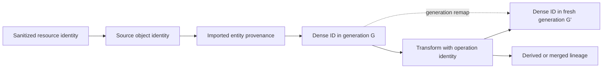

# ADR 0036: Source Identity, Provenance, and Metadata

## Context

Dense collection indices are efficient inside one scene, but they change after splitting, merging,
or rebuilding. Raw filenames and object names are not reliable persistent keys and may leak host
paths. A generic metadata map also cannot distinguish source identity, transformation lineage,
diagnostics, and descriptive source properties.

## Decision

Baozi separates four concepts:

- a dense ID addresses one entity in one validated scene generation and, for local IDs, one logical
  mesh owner
- `SourceIdentity` identifies a sanitized source resource plus a format-defined object locator
- `Provenance` records bounded source and derivation lineage
- metadata stores bounded descriptive values that do not control canonical behavior

### Source Identity

A resource identity is the import session's normalized logical identity, not an OS path or open-file
handle. For the primary asset it is the caller-provided logical name or a generated opaque report
identity. For dependencies it is the resolver's normalized identity relative to that primary asset.
Absolute host roots, credentials, query secrets, and backend implementation handles are excluded
from public output.

This public resource identity is distinct from ADR 0010's session-local physical dependency cache
key. The latter additionally includes an opaque authority-domain identity so equal logical names in
different scopes or resolver namespaces cannot share bytes or failures. That capability identity is
authorization machinery and is not serialized into Scene provenance; public resolver identity is
sanitized separately under this ADR.

A source object locator is format-defined, deterministic, and typed: for example a glTF document
index plus object kind, an OBJ statement/segment identity, or a PLY element row. Names may be
included for display but are never the sole identity when a stable source index exists. A content
digest can disambiguate changed resources; identity alone does not promise that two imports saw the
same bytes.

`SourceIdentity` persists across scene generations and is expected to be stable across repeated
imports while the resolver identity, format, and format object locator retain their meaning. Source
edits can move or replace an index-based locator, and byte equality is proven only by the separate
content digest. Source identity is not globally unique and never substitutes for a dense ID in
in-memory references.

The public shape is a typed resource identity plus a typed format/object locator, optional sanitized
display name, and optional content digest reference. It contains no host path or parser-backend
object. Unknown locator kinds require a registered bounded namespaced schema; an untyped free-form
string is evidence text, not identity. Equality excludes display text and keeps content digest
separate so identity continuity and byte equality remain different questions.

The locator's stable format owner uses the bounded `baozi-core::FormatId` value object. Core owns only
that lowercase ASCII/reverse-DNS value grammar so a validated Scene can retain provenance without
depending on import. ADR 0021 keeps sole authority over registry membership, descriptor and option
schemas, namespace claims, selection, and extension capability; constructing a syntactically valid
`FormatId` never registers or authorizes a format.

### Provenance

Imported entities record one or more source identities. Generated, split, merged, repaired, or
normalized entities record an operation identity, option digest, input provenance references, and
loss/diagnostic references. Lineage is deterministic and resource-bounded. Lossless structural
deduplication and interning are allowed, but the default policy preserves complete lineage or fails
before publication when the provenance budget is exhausted. Digest-plus-preview collapse is
`ImportLossKind::ProvenanceEvidenceLoss`: it requires that exact caller authority, emits a structured
provenance-loss record with a typed provenance or source-scope subject, and
`LossPolicy::preserve_or_fail()` rejects it. `SourceSemanticLoss` alone never authorizes evidence
collapse. A subject without one contiguous source range uses its stable document/provenance identity
and digest rather than a forged byte range. Generated entities do not receive forged source
identities.

Each Scene owns one immutable `ProvenanceArena` view over a persistent segmented DAG. A branch shares
its immutable ancestor segments and appends changes in a segment with a fresh process-unique nonce.
An ancestor attachment therefore remains valid in every descendant that retains that segment,
whereas an attachment created in one sibling branch is foreign to every other sibling. Segment
ordinal, segment nonce, local node address, and global topological index are validated together
before range access. A private `ProvenanceNodeId` is meaningful only inside that qualified address;
it is not a public source identity or an independently reusable cross-generation handle.
An identity-preserving fork remap retains a bounded source-segment snapshot and remains bound to one
target branch; the source arena or another sibling cannot substitute as its publication target.

The DAG is stored in deterministic topological order: every parent index is smaller than its child,
references are in range, duplicate parent edges are invalid, and structurally identical nodes may be
losslessly interned. Source leaves contain `SourceIdentity`; operation nodes contain operation kind,
option digest, ordered qualified parent attachments, and bounded durable evidence summaries. Those
summaries use typed codes/digests owned by the provenance node; they are never dangling IDs into an
import or postprocess report. A report may contain richer diagnostics while the scene remains
independently inspectable. Central validation walks the arena iteratively in `O(nodes + edges)` work
and rejects cycles, forward references, invalid owners, foreign segments, and excess lineage before
publication.

Provenance coverage is mandatory for all canonical identity or behavior owners:

| Owner class | Required provenance attachment |
| --- | --- |
| Scene, node, mesh instance, logical mesh, primitive | one or more provenance nodes, except a generated owner uses an operation node |
| Material, image, sampler, texture, texture binding | source or explicit default/generated operation provenance |
| Skin, animation clip/channel, camera, light | source or operation provenance |
| Attribute, morph definition, and per-primitive morph delta | source or operation provenance at the data's actual domain owner |

A synthetic root or default sampler therefore records a generated/default operation node rather than
inventing a source locator. A provenance attachment is never inferred from a name.

Provenance follows entity and attribute-domain remaps. A merge retains the union of source lineage;
a split retains the relevant parent lineage plus the split operation; newly interpolated vertices
record their parent element origins and coefficients when required by the operation contract.
For a multi-step edit, per-step lineage follows each local remap and the final lineage agrees with
ADR 0032's composed input-to-final relation. Deleted entities remain visible in remap/report evidence
without requiring an unreachable live entity in the output arena.

### Metadata

Metadata uses ADR 0023's validated namespaced keys and closed value types. It is suitable for
descriptive non-behavioral source facts such as author, source application tag, format version, or
an annotation label. Source unit declarations belong to `SceneSpace`; smoothing groups belong to
face-domain attributes. A raw lexeme for either may be retained only in provenance/source evidence,
not as a second behavioral metadata authority. Metadata is not used for:

- dense or persistent identity
- graph/material/skin/animation references
- validation proof or lifecycle stage
- operation diagnostics, losses, or resource statistics
- canonical behavior that already has a typed field

Generic metadata and extension values contain no dense scene or provenance-arena IDs. A typed
behavior descriptor that needs a dense reference is part of the canonical schema and must register
central validation and ADR 0032 remapping; encoding a numeric ID into a string/number is invalid.

Metadata, locator strings, provenance previews, and lineage arrays are all charged before allocation
and traversed by central validation.

## Considered Options

### Option A: Treat dense IDs as stable persistent keys

This is cheap but fails immediately when entities split, merge, reorder, or are removed. Rejected.

### Option B: Put paths, names, IDs, and lineage in metadata

This is flexible but leaks host details, creates collisions, and makes remapping and validation
unreliable. Rejected.

### Option C: Separate dense identity, source identity, provenance, and metadata

This makes each lifetime and trust boundary explicit while retaining source traceability. Chosen.

## Consequences

- Tools can correlate source objects across edits without treating scene indices as persistent.
- Report serialization must sanitize resource identities and bound lineage independently from scene
  metadata.
- Postprocess operations have a provenance cost and cannot simply invent or discard identity.
- A resolver that cannot provide a stable logical identity gets an opaque session identity rather
  than a misleading path-derived key.

## Risks and Mitigations

| Risk | Severity | Mitigation |
| --- | --- | --- |
| Source identity exposes sensitive paths or URIs | High | Sanitize at the import-session boundary and test drive/UNC/credential/query cases. |
| Provenance grows superlinearly through repeated merges | High | Use lossless deduplicated lineage nodes and checked limits; require explicit loss authority before digest/preview collapse. |
| Callers assume source identity implies equal content | Medium | Keep content digest separate and document resolver stability conditions. |
| Metadata duplicates typed behavior | Medium | Central validation rejects reserved/duplicate canonical keys and promotion tests remove duplicates. |

## Success Metrics

| Metric | Target | Measurement |
| --- | --- | --- |
| Lineage completeness | Every canonical owner has source or generated-operation provenance after import and edits | coverage walk and per-owner negative tests |
| Validation complexity | Provenance and source-reference validation is `O(nodes + edges + attachments)` with deterministic order | deep/wide/merge scale counters |
| Identity separation | Dense reorder, branch edit, and re-import independently exercise generation ID, source identity, digest, and provenance | identity/remap fixture matrix |

## Acceptance Criteria

- Reordering dense collections changes dense IDs/remaps but preserves source identity and provenance.
- Split, merge, generated, and deleted entity fixtures produce deterministic bounded lineage.
- Cyclic, forward, duplicate, foreign-generation, and out-of-range lineage/reference cases fail
  iteratively before publication.
- Exact provenance budget succeeds; excess fails without publication under
  `LossPolicy::preserve_or_fail()`; an explicitly authorized `ProvenanceEvidenceLoss` collapse emits
  structured loss evidence with a typed subject while retaining exact counts and digest.
- Public reports never expose absolute host paths, credentials, backend handles, or unsanitized URI
  components.
- Re-import fixtures distinguish stable identity from content digest changes.
- Metadata cannot forge references, stage/proof state, diagnostics, or canonical typed behavior.
- Per-step provenance and the composed input-to-final remap agree after multi-step edits.
