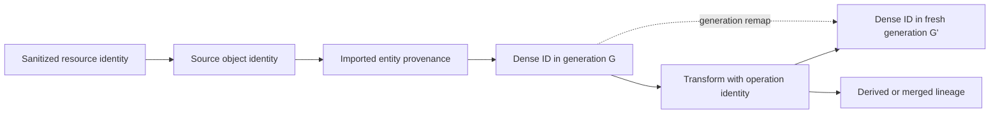

# ADR 0036: Source Identity, Provenance, and Metadata

## Context

Dense collection indices are efficient inside one scene, but they change after splitting, merging,
or rebuilding. Raw filenames and object names are not reliable persistent keys and may leak host
paths. A generic metadata map also cannot distinguish source identity, transformation lineage,
diagnostics, and descriptive source properties.

## Decision

Baozi separates four concepts:

- a dense ID addresses one entity in one validated scene generation and, for local IDs, one logical
  mesh owner
- `SourceIdentity` identifies a sanitized source resource plus a format-defined object locator
- `Provenance` records bounded source and derivation lineage
- metadata stores bounded descriptive values that do not control canonical behavior



### Source Identity

A resource identity is the import session's normalized logical identity, not an OS path or open-file
handle. For the primary asset it is the caller-provided logical name or a generated opaque report
identity. For a dependency it is the resolver's sanitized canonical namespace target after resolving
the hostile reference relative to the session-issued origin of the resource that declared it. The
primary is the origin only for references authored in the primary; an MTL-authored texture is based
on the MTL resource rather than the OBJ root. The private authority domain remains separate and never
enters this public identity.
Absolute host roots, credentials, query secrets, and backend implementation handles are excluded
from public output.

This public resource identity is distinct from the session-local authority domain used for
capability and cache isolation. For dependencies, ADR 0010 combines that opaque domain with logical
identity so equal names in different scopes or resolver namespaces cannot share bytes or failures.
For ADR 0029 direct bytes, each session receives a fresh domain even when callers reuse the same
public source label. The domain is authorization machinery: it is not derived from display text, is
not serialized into Scene provenance, and does not prove byte equality. Public resolver identity is
sanitized separately under this ADR, while byte equality requires content-digest evidence.

The canonical v1 `ResourceIdentity` value is the exact byte sequence of its already validated UTF-8
string. Resolver normalization, origin-relative resolution, and redaction happen before construction;
canonical encoding performs no additional Unicode normalization, case folding, percent decoding,
separator conversion, or display formatting. Invalid UTF-8 never becomes a `ResourceIdentity`, and
NFC and NFD spellings remain distinct unless the owning resolver has already produced one identical
sanitized canonical value for both.

`ResourceIdentity` text and replay stability are separate typed facts. Every manifest-facing identity
therefore carries one sealed `ResourceIdentityStability` value:

```text
Stable(owner, schema_id, schema_version)
SessionOpaque(reason)
```

`Stable` means the admitted owner guarantees that the exact validated UTF-8 value is derived by the
named, versioned identity schema and can be reproduced in a fresh session given the same logical
resource subject. It does not prove equal bytes or grant authority. A caller-provided primary name is
`Stable` only through an explicit admitted caller-identity schema; an ordinary display label is not
silently promoted. A generated report identity, a resolver without an admitted stable-identity
schema, or a fallback created from session state is `SessionOpaque`.

The stability value is Baozi-owned inert typed evidence. Its owner and schema IDs are bounded stable
registry values owned here; its reason is a closed typed variant. It contains no authority domain,
callback, path root, credential, or native handle. `ResourceIdentity` string equality remains byte
equality of the validated value. Stability is compared separately so two equal display identities
cannot accidentally share different replay claims. This ADR does not define manifest bytes or a
digest for that evidence.

ADR 0036 owns stability-schema registry membership and meaning. Each `Stable` entry names one exact
derivation from a logical subject to validated identity UTF-8 and includes independent fresh-session
semantic vectors. An unregistered owner/schema/version or a derivation/configuration change is
`SessionOpaque`; syntactically valid IDs cannot self-register. ADR 0041, as a downstream consumer,
admits only entries whose IDs fit its `canonical-id-v1` grammar and exclusively owns their manifest
encoding and digest vectors. Nothing in this ADR consumes that downstream adapter.

The initial registry admits `baozi.asset-io / same-authority-asset-path / 1`. Its logical subject is
the exact pair `(registered portable normalizer identity, hostile origin-relative reference)`, and
its output is the validated normalized `AssetPath` produced before backend IO. It carries no
authority-domain value: authority remains the private cache-isolation key. Fresh sessions must
produce `models/textures/albedo.png` from origin `models/scene.obj` and reference
`textures/albedo.png`, and must preserve the distinct NFC/NFD spellings fixed by ADR 0010. Only the
static same-authority resolver profile may issue this schema; custom resolvers remain
`SessionOpaque(UnregisteredResolverIdentity)`.

A source object locator is format-defined, deterministic, and typed: for example a glTF document
index plus object kind, an OBJ statement/segment identity, or a PLY element row. Names may be
included for display but are never the sole identity when a stable source index exists. A content
digest can disambiguate changed resources; identity alone does not promise that two imports saw the
same bytes.

`SourceIdentity` persists across scene generations and is expected to be stable across repeated
imports while the resolver identity, format, and format object locator retain their meaning. Source
edits can move or replace an index-based locator, and byte equality is proven only by the separate
content digest. Source identity is not globally unique and never substitutes for a dense ID in
in-memory references.

The public shape is a typed resource identity plus its sealed stability evidence, a typed format/
object locator, optional sanitized display name, and optional content digest reference. It contains
no host path or parser-backend object. Unknown locator kinds require a registered bounded namespaced
schema; an untyped free-form string is evidence text, not identity. Equality excludes display text
and keeps content digest and replay stability separate so identity continuity, byte equality, and
cross-session naming guarantees remain different questions.

The locator's stable format owner uses the bounded `baozi-core::FormatId` value object. Core owns only
that lowercase ASCII/reverse-DNS value grammar so a validated Scene can retain provenance without
depending on import. ADR 0021 keeps sole authority over registry membership, descriptor and option
schemas, namespace claims, selection, and extension capability; constructing a syntactically valid
`FormatId` never registers or authorizes a format.

### Provenance

Imported entities record one or more source identities. Generated, split, merged, repaired, or
normalized entities record an operation identity, option digest, input provenance references, and
loss/diagnostic references. Lineage is deterministic and resource-bounded. Lossless structural
deduplication and interning are allowed, but the default policy preserves complete lineage or fails
before publication when the provenance budget is exhausted. Digest-plus-preview collapse is
`ImportLossKind::ProvenanceEvidenceLoss`: it requires that exact caller authority, emits a structured
provenance-loss record with a typed provenance or source-scope subject, and
`LossPolicy::preserve_or_fail()` rejects it. `SourceSemanticLoss` alone never authorizes evidence
collapse. A subject without one contiguous source range uses its stable document/provenance identity
and digest rather than a forged byte range. Generated entities do not receive forged source
identities.

Each Scene owns one immutable `ProvenanceArena` view over a persistent segmented DAG. A branch shares
its immutable ancestor segments and appends changes in a segment with a fresh process-unique nonce.
An ancestor attachment therefore remains valid in every descendant that retains that segment,
whereas an attachment created in one sibling branch is foreign to every other sibling. An edge stores
the segment ordinal, its nonce, and the segment-local node index. Checked lookup validates those
coordinates against the actual retained segment and derives the global topological index from its
validated prefix. Edges do not store a redundant global coordinate. Central validation checks the
complete segment prefix sequence before using it. A private provenance reference is meaningful only
inside this qualified segment domain; it is not a public source identity or an independently reusable
cross-generation handle.
An identity-preserving fork remap retains a bounded source-segment snapshot and remains bound to one
target branch; the source arena or another sibling cannot substitute as its publication target.

The DAG is stored in deterministic topological order: every parent index is smaller than its child,
references are in range, duplicate parent edges are invalid, and structurally identical nodes may be
losslessly interned. Source leaves contain `SourceIdentity`; operation nodes contain operation kind,
option digest, ordered qualified parent attachments, and bounded durable evidence summaries. Those
summaries use typed codes/digests owned by the provenance node; they are never dangling IDs into an
import or postprocess report. A report may contain richer diagnostics while the scene remains
independently inspectable. Central validation walks the arena iteratively in `O(nodes + edges)` work
and rejects cycles, forward references, invalid owners, foreign segments, and excess lineage before
publication.

Provenance coverage is mandatory for all canonical identity or behavior owners:

| Owner class | Required provenance attachment |
| --- | --- |
| Scene, node, mesh instance, logical mesh, primitive | one or more provenance nodes, except a generated owner uses an operation node |
| Material, image, sampler, texture, texture binding | source or explicit default/generated operation provenance |
| Skin, animation clip/channel, camera, light | source or operation provenance |
| Attribute, morph definition, and per-primitive morph delta | source or operation provenance at the data's actual domain owner |

A synthetic root or default sampler therefore records a generated/default operation node rather than
inventing a source locator. A provenance attachment is never inferred from a name.

Provenance follows entity and attribute-domain remaps. A merge retains the union of source lineage;
a split retains the relevant parent lineage plus the split operation; newly interpolated vertices
record their parent element origins and coefficients when required by the operation contract.
For a multi-step edit, per-step lineage follows each local remap and the final lineage agrees with
ADR 0032's composed input-to-final relation. Deleted entities remain visible in remap/report evidence
without requiring an unreachable live entity in the output arena.

### Metadata

Metadata uses ADR 0023's validated namespaced keys and closed value types. It is suitable for
descriptive non-behavioral source facts such as author, source application tag, format version, or
an annotation label. Source unit declarations belong to `SceneSpace`; smoothing groups belong to
face-domain attributes. A raw lexeme for either may be retained only in provenance/source evidence,
not as a second behavioral metadata authority. Metadata is not used for:

- dense or persistent identity
- graph/material/skin/animation references
- validation proof or lifecycle stage
- operation diagnostics, losses, or resource statistics
- canonical behavior that already has a typed field

Generic metadata and extension values contain no dense scene or provenance-arena IDs. A typed
behavior descriptor that needs a dense reference is part of the canonical schema and must register
central validation and ADR 0032 remapping; encoding a numeric ID into a string/number is invalid.

Metadata descriptors identify owners in the final Scene layout. Their immutable text, byte, and
scalar payload pools have an independent retained owner, so changing owner coordinates does not
require copying unchanged payloads. A concrete operation must remap descriptors together with its
owner additions, deletions, or reindexing. Central validation requires canonical descriptor order,
valid owner membership, and contiguous complete coverage of each payload pool.

Normal generation provides the first concrete attribute addition/deletion mapping. A newly added
Normal has no fictitious source attribute; its generated lineage merges the Primitive, Position,
replaced Normal when present, and consulted SmoothingGroup parents. Deleting an explicitly
invalidated Tangent removes its owner and metadata, while surviving attribute descriptors follow
the final canonical indices. Payload sharing applies to pure reindexing; deletion rebuilds only
the compact surviving pools so central validation retains complete contiguous coverage.

Metadata, locator strings, provenance previews, and lineage arrays are all charged before allocation
and traversed by central validation. Validation borrows the retained typed data; only provenance
depths require mutable profile scratch. Cached owner depths are checked against the actual attachment
depths rather than trusted as a second semantic authority.

## Considered Options

### Option A: Treat dense IDs as stable persistent keys

This is cheap but fails immediately when entities split, merge, reorder, or are removed. Rejected.

### Option B: Put paths, names, IDs, and lineage in metadata

This is flexible but leaks host details, creates collisions, and makes remapping and validation
unreliable. Rejected.

### Option C: Separate dense identity, source identity, provenance, and metadata

This makes each lifetime and trust boundary explicit while retaining source traceability. Chosen.

## Consequences

- Tools can correlate source objects across edits without treating scene indices as persistent.
- Report serialization must sanitize resource identities and bound lineage independently from scene
  metadata.
- Postprocess operations have a provenance cost and cannot simply invent or discard identity.
- A resolver that cannot provide a stable logical identity gets an opaque session identity rather
  than a misleading path-derived key.
- Session-opaque identities remain valid report/provenance identities but prevent ADR 0041 from
  claiming a replayable resource-input manifest.

## Risks and Mitigations

| Risk | Severity | Mitigation |
| --- | --- | --- |
| Source identity exposes sensitive paths or URIs | High | Sanitize at the import-session boundary and test drive/UNC/credential/query cases. |
| Provenance grows superlinearly through repeated merges | High | Use lossless deduplicated lineage nodes and checked limits; require explicit loss authority before digest/preview collapse. |
| Callers assume source identity implies equal content | Medium | Keep content digest separate and document resolver stability conditions. |
| Nested dependency identity is accidentally primary-relative | High | require the session-issued declaring-resource origin and nested OBJ/MTL/texture plus negative-proof target fixtures |
| Canonical encoding silently normalizes an admitted identity | High | encode the exact validated UTF-8 value and pin NFC/NFD, separator, case, and percent-spelling vectors |
| A generated or unstable identity is presented as replayable | Critical | retain typed `SessionOpaque` stability evidence and require ADR 0041 to emit `ObservedOnly(unstable-resource-identity)` |
| Metadata duplicates typed behavior | Medium | Central validation rejects reserved/duplicate canonical keys and promotion tests remove duplicates. |

## Success Metrics

| Metric | Target | Measurement |
| --- | --- | --- |
| Lineage completeness | Every canonical owner has source or generated-operation provenance after import and edits | coverage walk and per-owner negative tests |
| Validation complexity | Provenance and source-reference validation is `O(nodes + edges + attachments)` with deterministic order | deep/wide/merge scale counters |
| Identity separation | Dense reorder, branch edit, and re-import independently exercise generation ID, source identity, digest, and provenance | identity/remap fixture matrix |
| Nested-origin identity | every dependency and unavailable proof target uses the declaring resource's origin while private authority remains absent | nested sidecar/texture and dual-namespace fixtures |
| Canonical identity bytes | canonical v1 encodes the exact validated UTF-8 value without a second normalization pass | independent transcript and Unicode mutation vectors |
| Replay-stability honesty | 100% of generated or unregistered resolver identities are `SessionOpaque`; only admitted schemas emit `Stable` | direct-bytes, caller-label, custom-resolver, and fresh-session fixtures |

## Acceptance Criteria

- Reordering dense collections changes dense IDs/remaps but preserves source identity and provenance.
- Split, merge, generated, and deleted entity fixtures produce deterministic bounded lineage.
- Cyclic, forward, duplicate, foreign-generation, and out-of-range lineage/reference cases fail
  iteratively before publication.
- Exact provenance budget succeeds; excess fails without publication under
  `LossPolicy::preserve_or_fail()`; an explicitly authorized `ProvenanceEvidenceLoss` collapse emits
  structured loss evidence with a typed subject while retaining exact counts and digest.
- Public reports never expose absolute host paths, credentials, backend handles, or unsanitized URI
  components.
- Re-import fixtures distinguish stable identity from content digest changes.
- Primary -> sidecar -> texture fixtures derive the texture's public target from the sidecar origin;
  primary-relative derivation fails, and available/unavailable/negative-proof records use the same
  sanitized target identity.
- Canonical v1 known vectors distinguish NFC/NFD, case, separator, and percent spellings unless the
  resolver produced the same validated canonical value; invalid UTF-8 is rejected before identity
  construction.
- Direct bytes without an admitted logical-name schema, generated report identities, and resolver
  identities without an admitted stable schema carry `SessionOpaque`; equal text does not upgrade
  them. Stable caller/resolver fixtures bind exact owner/schema/version and reproduce the same
  identity bytes in a fresh session.
- Metadata cannot forge references, stage/proof state, diagnostics, or canonical typed behavior.
- Per-step provenance and the composed input-to-final remap agree after multi-step edits.

## Amendment History

### 2026-07-17: Separate identity text from replay stability

- Affected: `Source Identity`, `Consequences`, `Risks and Mitigations`, `Success Metrics`, and
  `Acceptance Criteria`.
- Previous: generated and resolver-supplied resource identities had exact bytes but no typed fact
  distinguishing cross-session stable values from session-opaque report labels.
- New: every manifest-facing resource identity carries sealed `Stable(owner, schema, version)` or
  `SessionOpaque(reason)` evidence; text equality remains separate.
- Impact: opaque identities remain usable for provenance and diagnostics but cannot create a false
  replayable input-manifest claim.
- Review: 2026-07-17 canonical input-manifest and replay-classification review.
- Rationale: byte-exact encoding cannot make a session-generated name reproducible.

### 2026-07-16: Make dependency identity origin-qualified and byte-exact

- Affected: `Source Identity`, `Risks and Mitigations`, `Success Metrics`, and `Acceptance Criteria`.
- Previous: dependency resource identity was described as relative to the primary asset, conflicting
  with nested resource authorship.
- New: dependency identity uses the session-issued origin of the resource that declared the hostile
  reference; the private authority domain remains separate, and canonical v1 encodes the exact
  validated UTF-8 identity value without a second normalization pass.
- Impact: nested sidecar resources and ADR 0041 negative-proof targets now have one canonical public
  identity without exposing capability/cache identity.
- Review: 2026-07-16 negative-input replay and origin-resolution architecture review.
- Rationale: source identity must follow the same declaring-resource base as authorized acquisition
  or provenance and reproducibility would name different resources.
