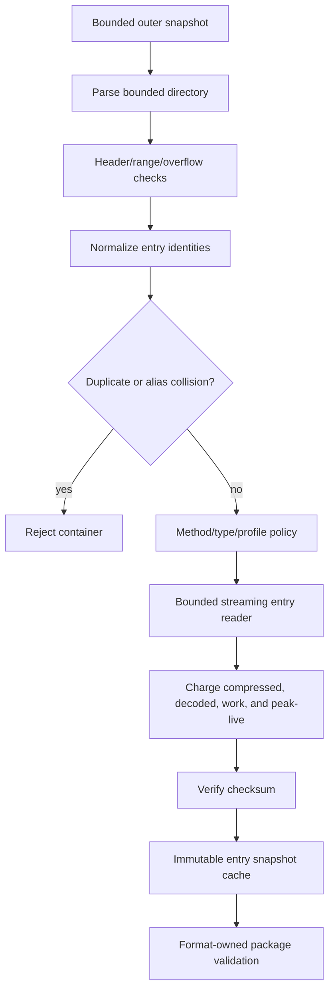

# ADR 0037: Archive and Container Security

## Status and Authority

This ADR is a proposal. It describes the contract an archive-backed importer should implement, but
it is not a current Baozi guarantee and must not be used as a normative dependency by accepted ADRs.
It owns no active archive/container capability, crate, feature, or public API. Until promotion, ADR
0010 remains authoritative for asset IO, ADR 0014 for parser security, and ADR 0022 for resource
accounting; none of them authorizes archive support. Promotion requires a real archive adapter,
format tracer, malformed tests, fuzz coverage, and dependency-admission evidence.

## Context

Future 3MF, USDZ, and other package formats contain a directory of named resources. A ZIP parser can
be memory-safe and still accept path aliases, duplicate names, contradictory headers, overlapping
ranges, encrypted content, or decompression bombs. Extracting to a host directory also turns archive
names into filesystem authority and creates a second path-security problem.

The ZIP container is not itself a 3MF or USDZ conformance profile. 3MF layers OPC parts and
relationships over a package. USDZ requires an uncompressed, unencrypted ZIP subset with alignment
and ordering constraints. A generic adapter must expose container facts without silently declaring a
format-specific package valid.

## Proposed Decision

If promoted, Baozi will parse archives as an immutable, in-memory `AssetIo` namespace over the
session snapshot. It will never extract untrusted entries to arbitrary host paths. Admission validates
the whole directory and reserves aggregate budgets before any format parser opens an entry.



## Proposed Container Admission

Before exposing any entry, the adapter would:

1. Validate end records, directory bounds, entry count, offsets, and all checked additions.
2. Reject multi-disk archives and unsupported ZIP versions or compression methods.
3. Reconcile central-directory and local-header names, flags, methods, CRC, and sizes; disagreement is
   fatal rather than resolved by choosing one copy.
4. Reject encrypted entries and encrypted central directories unless a later, separately admitted
   contract provides key handling.
5. Reject overlapping payload, header, directory, and descriptor ranges.
6. Validate ZIP64 fields before narrowing to host allocation sizes.
7. Normalize every entry identity, then reject duplicate or aliasing identities before entry access.
8. Reject filesystem-special entries such as symlinks, hard-link encodings, devices, FIFOs, sockets,
   and platform metadata that requests extraction side effects.
9. Reserve directory, name, metadata, and peak-live budgets before materializing tables.

Declared uncompressed size is an admission hint, not trusted evidence. Streaming decode stops at the
first exceeded byte, work, ratio, cancellation, or peak-live limit. CRC/checksum verification is
mandatory when the container format defines it.

## Proposed Entry Identity Rules

Archive names are hostile bytes. The adapter would:

- reject NUL, control characters, invalid required encoding, absolute paths, URI schemes, drive and
  UNC prefixes, NT/Win32 namespaces, and empty components
- treat both slash styles as separators for security validation
- eliminate `.` and reject any `..` component rather than normalize an escape away
- reject leading/trailing separators and platform-ambiguous trailing dot/space components
- apply a documented profile-specific case and Unicode collision key
- reject duplicate normalized names even if byte spelling differs
- retain the original name only as bounded, escaped diagnostic evidence

The archive identity is independent from host filesystem syntax and is never passed to `std::fs`.

## Proposed Resource Contract

The session ledger would include at least:

```text
max_container_depth
max_archive_entries
max_archive_directory_bytes
max_archive_name_bytes
max_archive_compressed_bytes
max_archive_uncompressed_bytes
max_archive_entry_uncompressed_bytes
max_archive_expansion_ratio
max_archive_decode_work
max_archive_open_entries
```

Compressed bytes, produced bytes, checksum work, and failed attempts are monotonic. Entry buffers are
live reservations and are released only when their snapshots are no longer retained. Repeated opens
reuse the first immutable entry snapshot or terminal failure.

Nested containers are disabled by default. If a future format requires them, each layer consumes the
same aggregate budgets and a strict depth count; an inner archive does not receive a fresh ledger.

## Proposed Format Profiles

### 3MF

The container adapter would validate generic ZIP safety only. The 3MF importer would separately
validate OPC content types, package relationships, the root model relationship, part MIME types, and
3MF extension requirements. A ZIP entry named like a model part is not sufficient conformance.

### USDZ

The USDZ importer would additionally require zero compression, no encryption, 64-byte file alignment,
allowed file types, and the specified default-layer ordering/name rules. A generic ZIP accepted by the
adapter is not automatically a USDZ package.

## Proposed Dependency Admission

No ZIP crate is admitted by this proposal. Before promotion, the chosen backend must pass:

- `MIT OR Apache-2.0` compatible license review and root/fuzz workspace deny checks
- Baozi MSRV and every claimed portable target
- no public backend types and no ambient filesystem extraction API in parser code
- bounded directory parsing or a Baozi preflight that rejects before backend amplification
- malformed central/local header, ZIP64, overlap, duplicate, descriptor, checksum, and bomb tests
- maintained release/advisory history and a documented replacement boundary

A backend that allocates from declared sizes before Baozi can enforce limits is not admissible.

## Alternatives Considered

### Option A: Let each format crate call a ZIP library directly

Pros:

- Fastest route to first 3MF or USDZ parsing.
- Format crate can use backend-specific conveniences.

Cons:

- Duplicates path, bomb, duplicate-entry, and ledger behavior.
- Backend types and error behavior leak into format policy.
- Makes nested and repeated-entry accounting inconsistent.

Proposed disposition: reject.

### Option B: Extract the archive into a temporary directory

Pros:

- Existing file-oriented parsers can run unchanged.
- Easy manual debugging of package contents.

Cons:

- Creates traversal, symlink, overwrite, cleanup, permission, and disk-quota risks.
- Loses immutable session identity and object-bound authorization.
- Partial extraction exposes state before validation completes.

Proposed disposition: reject for untrusted input.

### Option C: Central immutable archive namespace with format profiles

Pros:

- Reuses session identity and resource accounting.
- Keeps archive names out of the host filesystem.
- Separates generic container safety from 3MF/USDZ conformance.

Cons:

- Requires preflight and streaming wrappers around a backend.
- Retained entry snapshots increase peak-live accounting complexity.
- Promotion requires a new implementation plus all durable conformance evidence below.

Proposed disposition: choose only after the promotion gates pass.

## Promotion Metrics

| Metric | Required target | Measurement |
| --- | --- | --- |
| No extraction | archive import performs no host filesystem writes | recording adapter and source audit |
| Structural admission | contradictory, overlapping, duplicate, and overflow archives fail before entry parse | malformed fixtures |
| Bomb resistance | produced bytes and decode work stop at exact configured limits | scale and streaming tests |
| Stable identity | aliases and repeated entries cannot select different bytes | collision/cache tests |
| Format separation | generic ZIP acceptance does not imply 3MF or USDZ conformance | profile negative tests |
| Parser robustness | arbitrary container bytes do not panic, hang, or return invalid success | sanitizer fuzz target |

## Risks and Mitigations

| Risk | Severity | Likelihood | Proposed mitigation |
| --- | --- | --- | --- |
| Backend trusts declared sizes | Critical | Medium | independent preflight and streaming hard stop; reject backend if unavoidable |
| Unicode/case aliases differ by consumer | High | Medium | profile-specific collision key and reject ambiguity |
| Compression ratio limit rejects valid assets | Medium | Medium | configurable ratio plus absolute byte/work ceilings |
| CRC is treated as authenticity | High | Medium | document integrity-only semantics; no trust/authenticity claim |
| Nested containers multiply budgets | Critical | Medium | disabled by default; shared aggregate ledger and depth limit |
| Proposal is mistaken for current behavior | High | Medium | Proposed status, no tracer, no accepted normative dependency |

## Promotion Checklist

- [ ] Archive adapter implementation tracer exists.
- [ ] One format importer consumes it through the normal facade/session path.
- [ ] Dependency admission is recorded with version, license, MSRV, targets, and unsafe review.
- [ ] Malformed and bomb fixture provenance is documented.
- [ ] Parser-local and facade fuzz targets execute under sanitizer.
- [ ] 3MF or USDZ profile tests distinguish container safety from format conformance.
- [ ] ADR governance checker permits promotion only with the tracer.

## Sources

- [PKWARE ZIP Application Note](https://pkware.cachefly.net/webdocs/casestudies/APPNOTE.TXT) -
  living official document retrieved 2026-07-10; final response body 174,585 bytes; SHA-256
  `0b993022a7d320a0bf704e6980bea36fafd17a6066ab994db0a0c16278a50cd6`.
- [3MF Core Specification at commit `997b385e06f3181cf9aae0c578e0b45ccd48ccb2`](https://github.com/3MFConsortium/spec_core/blob/997b385e06f3181cf9aae0c578e0b45ccd48ccb2/3MF%20Core%20Specification.md).
- [OpenUSD USDZ specification](https://openusd.org/release/spec_usdz.html) - living official
  document retrieved 2026-07-10; final response body 133,322 bytes; SHA-256
  `e6381ca350b84537267bd31f96af61771efee623b76eb23853584a31938ccfc4`.
- [ADR 0010 object-bound asset IO](0010-asset-io-virtual-filesystem-uri-archive-and-path-security.md)
