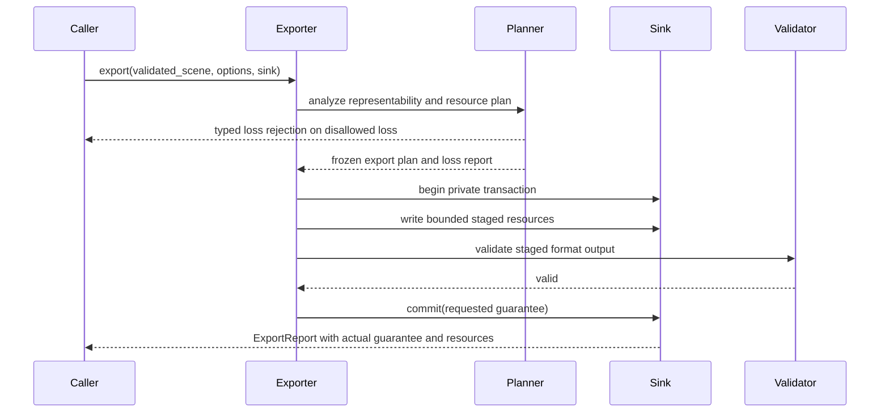

# ADR 0038: Export Transaction and Loss Contract

## Status and Authority

This ADR is a proposal. Baozi has no exporter implementation, published exporter crate, or
transaction sink. The types and behavior below are not current API promises. Promotion requires an
exporter tracer that exercises preflight, loss policy, staging, commit, failure, and recovery through
the public facade.

## Context

Export is not serialization of the Scene structs. A target format may be unable to represent corner
attributes, mixed topology, sparse morphs, multiple UV components, variable skin influences, scene
space, metadata, or material semantics. Writing while discovering those losses can leave a plausible
but incomplete file.

File output also has multiple meanings often collapsed into "save": complete bytes, atomic visibility,
replacement of an existing target, durability after power loss, and atomicity across a primary file
plus sidecars. General filesystems do not provide one portable operation that guarantees all of them.

## Proposed Decision

If promoted, export will be a preflighted transaction with an explicit loss policy and a structured
commit guarantee. The exporter builds and validates a complete plan before the first externally
visible write. Semantic loss is rejected by default.



## Proposed Lifecycle

1. Require a structurally validated Scene and frozen export options.
2. Compile format-owned typed options and target profile.
3. Analyze representability for every behavior-bearing field.
4. Produce a deterministic `LossReport` and reject any disallowed event.
5. Compute output identities, references, byte/work estimates, and collision checks.
6. Begin a private sink transaction with exclusive staging identities.
7. Encode all resources under byte, scratch, peak-live, and work budgets.
8. Validate staged output using format-owned structural checks.
9. Commit using a guarantee the sink actually supports.
10. Return `ExportReport`; on failure, retain the original destination and report cleanup status.

Cancellation is honored through staging. Once commit begins, the operation completes or returns the
actual commit outcome; a late cancellation cannot report "cancelled" while a new target is visible.

## Proposed Loss Model

Each event would identify the source Scene entity and semantic, target limitation, transformation,
and bounded quantitative effect where meaningful.

```text
ExportChange
|- RepresentationOnly
|- Synthesized
|- Quantized
|- Approximated
`- Dropped
```

`RepresentationOnly` includes changes such as lossless compression or key ordering and is not
semantic loss. The other classes require explicit policy. Examples include weight compaction with
discarded mass, `f64` to `f32` time quantization with maximum error, triangulation with face remaps,
material approximation, and dropped metadata keys.

The default profile is `RejectSemanticLoss`. An opt-in policy selects allowed classes or named
semantics; a single `allow_lossy: bool` is too coarse. Exporters cannot downgrade an error to a
warning after bytes have been written.

## Proposed Transaction Guarantees

| Guarantee | Meaning | Required behavior |
| --- | --- | --- |
| `BufferedResult` | caller receives complete bytes or error | no partial buffer is returned as success |
| `AtomicSingleResource` | one destination changes from old to complete new content atomically | same-filesystem private staging plus handle-relative atomic rename/replace |
| `AtomicCreateTree` | a new multi-resource directory appears as a complete tree | destination must not exist; stage sibling tree and atomically rename where supported |
| `ExplicitNonAtomic` | resources can become visible independently | caller must request it; report ordered writes and partial-cleanup risk |

Baozi would not promise atomic replacement of an existing non-empty multi-resource tree. Portable
POSIX/Windows filesystems do not expose a general atomic tree swap with uniform semantics. A backend
with a stronger database/object-store transaction may advertise an additional capability, but the
facade reports that concrete guarantee.

Atomic visibility and durability are separate options. A durable commit requires syncing staged data
and relevant directory metadata where the platform supports it. If the sink cannot prove the
requested durability, it fails before commit rather than silently returning a weaker guarantee.

## Proposed Native Filesystem Commit

For a single resource, the native sink would:

- start from an open destination-directory capability
- validate the logical target and reject devices, streams, symlinks, and ambiguous aliases
- create a same-directory unpredictable staging file with exclusive creation
- encode, flush, optionally sync, and validate that exact handle
- commit with handle-relative `renameat` semantics on POSIX or an admitted Windows replace operation
- sync the parent directory when durable metadata is requested and supported
- never delete or truncate the old target before a successful replacement

The implementation must test replacement races. A `metadata/canonicalize/write` sequence is not an
accepted transaction. Cross-volume moves cannot satisfy `AtomicSingleResource` and fail closed.

Windows `ReplaceFileW` has ACL/stream merge behavior and error-specific recovery semantics; POSIX
`rename` has same-filesystem and directory-entry rules. These are platform adapters behind one sink
capability, not assumed identical operations.

## Proposed Multi-Resource Output

Output names and references are planned before writing. The plan rejects duplicate normalized names,
path escape, case/Unicode aliases for the target profile, reserved names, and references to resources
outside the transaction.

The safe default is either:

- return an in-memory bundle, or
- atomically create a previously absent destination directory where the platform supports it.

Replacing an existing OBJ plus MTL/textures or similar tree is rejected unless the caller explicitly
chooses `ExplicitNonAtomic` or supplies a sink with a real multi-object transaction. Rollback is best
effort cleanup, not an atomicity claim. Any leftover private staging identity is reported without
exposing unrelated host paths.

## Proposed Report

`ExportReport` would include:

- selected format/profile and frozen option identity
- deterministic change/loss events
- emitted logical resources and content digests
- byte, work, scratch, and peak-live statistics
- requested and actual commit guarantee
- validation evidence
- commit state: not started, staged, committed, or outcome unknown
- cleanup outcome for private staging resources
- bounded diagnostics

An I/O error after the platform commit call can make the outcome unknown. The API must represent that
state; it cannot claim rollback without evidence.

## Alternatives Considered

### Option A: Stream directly to caller-provided writers

Pros:

- Simple API and low memory use.
- Works with files, sockets, and custom destinations.

Cons:

- Losses and failures may be discovered after visible partial output.
- Cannot promise replacement atomicity or coordinated sidecars.
- A writer has no standard transaction or durability capability.

Proposed disposition: retain only as explicitly non-atomic low-level tooling, not canonical export.

### Option B: Serialize Scene and call it export

Pros:

- Reuses a generic serialization implementation.
- Round-trips Baozi-owned fields easily.

Cons:

- Does not implement target format semantics.
- Hides representability loss and reference generation.
- Conflates cache/snapshot schemas with interchange output.

Proposed disposition: reject.

### Option C: Preflighted plan plus capability-bearing transaction sink

Pros:

- Loss is known before visible writes.
- Atomicity and durability claims are explicit and testable.
- Supports filesystems, memory bundles, and transactional host stores without one weak abstraction.

Cons:

- Requires additional planning storage and peak-live accounting.
- Multi-file replacement remains limited on ordinary filesystems.
- No implementation exists yet.

Proposed disposition: choose after promotion gates pass.

## Promotion Metrics

| Metric | Required target | Measurement |
| --- | --- | --- |
| Loss honesty | every unsupported Scene semantic produces a typed event or hard error | field-complete exporter tests |
| No partial default output | injected encode/validation failures leave destination unchanged | fault-injection tests |
| Single-file atomicity | observers see old or complete new content, never partial bytes | concurrent reader tests per native OS |
| Guarantee honesty | unavailable atomicity/durability fails before commit | capability negative tests |
| Name safety | sidecar path, alias, device, and collision cases fail before staging | adversarial output-name suite |
| Outcome evidence | commit and unknown-outcome failures remain distinguishable | sink fault tests |

## Risks and Mitigations

| Risk | Severity | Likelihood | Proposed mitigation |
| --- | --- | --- | --- |
| "Atomic" is read as power-loss durable | High | High | separate visibility and durability capabilities in API/report |
| Existing multi-file destination becomes inconsistent | Critical | Medium | reject atomic replacement claim; require new tree or explicit non-atomic mode |
| Loss analysis diverges from encoder | Critical | Medium | frozen plan is consumed by encoder; field-complete tracer tests |
| Windows and POSIX replace semantics differ | High | High | platform adapters and outcome-unknown state; no lowest-common-denominator fiction |
| Cleanup removes caller data | Critical | Low | only capability-bound, exclusively created staging identities are cleanup candidates |
| Proposal is mistaken for shipped export support | High | Medium | Proposed status, no tracer, no published exporter crate |

## Promotion Checklist

- [ ] An exporter and transaction sink implementation tracer exists.
- [ ] Every Scene collection has a representability/loss test.
- [ ] Fault injection covers every stage and commit boundary.
- [ ] Native atomic replacement tests run on Linux, Windows, and macOS.
- [ ] Multi-resource behavior proves either new-tree atomicity or explicit non-atomic evidence.
- [ ] Public docs do not call snapshots, caches, or serde output an export format.
- [ ] ADR governance checker permits promotion only with the tracer.

## Sources

- [POSIX `rename` and `renameat`](https://pubs.opengroup.org/onlinepubs/9799919799/functions/rename.html)
- [Microsoft `ReplaceFileW`](https://learn.microsoft.com/en-us/windows/win32/api/winbase/nf-winbase-replacefilew)
- [Rust `std::fs::rename`](https://doc.rust-lang.org/std/fs/fn.rename.html)
- [ADR 0017 serialization, snapshot, and cache boundary](0017-serialization-snapshot-and-cache-boundary.md)
