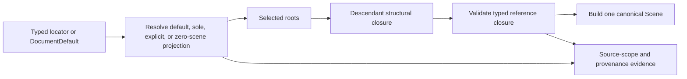

# ADR 0039: Source Document Scene Selection and Import Closure

## Context

The canonical Scene is one rooted tree, but source documents may declare several named scenes that
reuse nodes and refer to asset-global skins, animations, materials, and resources. The current glTF
adapter selects a document default or silently selects scene index zero. That policy has no accepted
owner, makes a document with multiple scenes and no default ambiguous, and does not report the source
content excluded by the projection.

Selection is not a generic renderer preference. It changes which source semantics become canonical,
which references must remain valid, and what provenance an import report must retain. It must be
decided before the U4 aggregate freezes node ownership, animation targets, and source provenance.

## Decision

Each format that has named source scenes owns a typed, frozen selection option through ADR 0016. The
format option identifies the source scene using that format's stable locator; for glTF, the scene
index is the format-owned locator that resolves to a `SourceIdentity`, not a generic `u32` on the
facade. The adapter records the requested mode, actual selection, and resolved source identities in
the Scene provenance and import report.

For glTF, `DocumentDefault` chooses the declared default scene. With no declared default it chooses
the only declared scene, but two or more declared scenes require an explicit index. A document with
zero declared scenes uses all validated parentless nodes as its projection roots and does not invent
a source scene identity. There is no silent first-scene fallback.

Every resolved projection receives one synthetic canonical root with identity TRS. Its ordered
children are the selected source roots in source order, including an empty list for an empty scene.
The synthetic root has `Generated` operation provenance that names the selected projection and does
not invent a source node identity or source scene membership. Applying one rule to zero, one, or many
source roots keeps canonical node ownership, dense IDs, and scene-level provenance deterministic.

Before selection, the adapter validates the complete source document's syntax/schema, index ranges,
declared scene roots, node graph safety, and global required-extension claims under bounded work. It
does not materialize unselected payloads merely to validate those structural facts. The selected roots
and their descendants then form the structural closure.

The adapter computes the retained resource closure through these forward edges only:

- selected source node to its camera, light, and mesh-instance projection;
- mesh instance to logical mesh and optional skin;
- logical mesh to primitives, morph definitions, and default weights;
- primitive to indices, attributes, influences, morph deltas, and material;
- each retained typed data reference through its complete source-storage dependency chain; for glTF,
  this includes accessor and sparse-accessor references to buffer views and buffers, plus image
  references to buffer-view, data-URI, or authorized external payloads;
- material to texture bindings, then texture to image and sampler;
- skin to its joint palette, skeleton-root hint, and inverse-bind resource, provided every referenced
  node is already in the structural closure;
- retained animation clip to its retained channels and their target owners, each channel to its
  sampler, and each sampler to its input/output data dependencies; a shared source sampler is retained
  once; and
- admitted typed extension references through the owning extension schema.

The closure never expands from a globally declared mesh, material, image, skin, or animation back to
otherwise unselected nodes. It then applies the typed cross-reference rules without cloning nodes or
importing arbitrary nodes from an unselected scene:

- resources enter only when reachable from retained canonical owners;
- a skin joint or skeleton root outside the structural closure is a hard error;
- an animation clip with no retained target is omitted as a whole outside the selected source scope;
  a clip whose channels all target retained owners enters unchanged; a mixed-target clip fails by
  default and may omit outside channels only under the caller's explicit loss policy, producing a
  non-empty filtered clip whose clip-level provenance records the projection operation plus one
  deterministic loss/provenance record per omitted channel; and
- required extension references outside the closure fail. Optional extension loss follows its
  existing schema and loss-policy rules.

A clip wholly outside the selected projection is a scope omission, not semantic loss. By contrast,
removing an outside-target channel from a mixed clip changes retained-domain content and therefore
creates one semantic-loss record per removed channel. A retained or filtered clip preserves its
source clip identity, source time domain, original duration, and retained channel source order and
stable source identities. Filtering changes only the channel set and adds projection provenance; it
does not renumber retained source channels or recompute duration from the remaining keys.

A source node listed by both a selected and an unselected scene is one retained node, not two
canonical children. Scene membership outside the selected projection remains source-scope evidence;
it does not create a second parent or a duplicate canonical node.

Selection is a caller or source-document authorization to choose a projection, not blanket authority
to discard semantics inside that projection. The import report records a bounded, deterministic
`SourceScopeRecord` whose outcome is either `DeclaredScene(SourceIdentity)` or
`ParentlessNodeProjection(DocumentIdentity)`. It also records retained counts and omitted counts by
source object kind, omitted scene identities, stable source digests, and loss/provenance entries for
omitted retained-domain semantics. If detail would exceed the report budget, it preserves exact typed
counts and a source digest through ADR 0036's explicit bounded-evidence rules rather than silently
dropping the record. Optional detail collapses only when the caller separately authorizes
`ImportLossKind::ProvenanceEvidenceLoss`; `SourceSemanticLoss` does not imply that authority. The
collapsed record carries a typed source-scope loss subject and explicit fidelity state. Without that
authority, or when the collapsed record plus its loss fact cannot be retained atomically, the import
fails before record submission.

This ADR owns the semantic `SourceScopeRecord` schema, its scene-selection outcome, retained/omitted
object-kind semantics, and completeness rules. ADR 0036 owns the identity, digest, provenance, and
loss representations used by those fields. A downstream lifecycle may provide a ledger-charged
builder and sealed submission/transport capability, but it cannot redefine or partially publish the
record. A parser may finalize at most one record; once recorded, the same evidence survives in either
the success report or a later terminal failure and cannot be replaced by the parser.
`SourceScopeRecord` is report evidence, not another canonical Scene collection. The canonical Scene
carries the selection operation through its scene-level provenance attachment; the import report
retains the bounded selection detail and any loss records.

`AllDeclaredScenes` is deliberately not a v1 option. A union would need to represent scene variants
and duplicate source-root membership without violating the one-tree ownership rule. A caller that
needs several declared scenes imports each explicit projection separately until a later accepted ADR
defines a first-class multi-scene aggregate.

## Considered Options

### Option A: Select the first declared scene when no default exists

This is easy to implement and matches the old adapter behavior, but makes source order an implicit
semantic choice and hides excluded content. Rejected.

### Option B: Always union all declared scenes into the canonical root

This avoids omission, but duplicates or shares source roots and leaves no faithful representation for
source scene variants in the one-tree Scene. Rejected for the canonical v1 model.

### Option C: Typed explicit projection with a checked closure and source-scope evidence

This makes the selected source scene intentional, preserves the one-tree invariant, and makes every
excluded or lossy semantic observable. Chosen.

## Consequences

- Format adapters cannot invent a fallback selection for ambiguous multi-scene documents.
- Source-scene selection stays format-owned while its closure, loss, provenance, and canonical-tree
  consequences are consistent across format adapters.
- glTF import tests must distinguish document default, sole scene, explicit selection, missing
  default, no-declared-scene roots, shared roots, skins, and mixed-target animations.
- A future multi-scene canonical aggregate requires a new ADR rather than extending a selector with
  an ambiguous `all` value.

## Risks and Mitigations

| Risk | Severity | Mitigation |
| --- | --- | --- |
| Existing assets rely on first-scene fallback | High | Return a typed selection-required error and expose explicit format options. |
| Selection hides a meaningful reference | Critical | Validate typed skin, animation, and extension closure before builder entry. |
| Source-scope evidence becomes unbounded | High | Charge records and use deterministic per-kind digest/count collapse only with explicit `ProvenanceEvidenceLoss` authority and atomic loss evidence. |
| A later format needs real scene variants | Medium | Keep `AllDeclaredScenes` out of v1 and require a separate aggregate decision. |

## Success Metrics

| Metric | Target | Measurement |
| --- | --- | --- |
| Selection determinism | No ambiguous document selects a scene by declaration order | multi-scene no-default negative fixtures |
| Closure integrity | Every retained typed reference resolves inside the selected projection | skin, animation, and extension closure tests |
| Evidence completeness | Every projection reports selected and excluded source scope within budget | report/provenance and digest-collapse fixtures |

## Acceptance Criteria

- A glTF document with multiple scenes and no default fails unless the caller selects one explicitly.
- A single declared scene and a declared default select deterministically without first-scene fallback.
- A document with no declared scenes can produce a validated projection only from validated
  parentless nodes and records `ParentlessNodeProjection` rather than inventing a scene identity.
- Every projection receives one deterministic identity-TRS synthetic root with generated scene-level
  provenance, including empty and single-root source scenes.
- Whole-document structural validation rejects malformed unselected indices/graphs without
  materializing unselected resource payloads.
- Any lifecycle consumer retains exactly the recorded source-scope evidence on both success and later
  failure; duplicate recording and uncharged detail fail before publication.
- Exact-budget detail is retained losslessly; excess detail fails under preserve-or-fail, while an
  explicitly authorized collapse retains exact typed counts/digest plus one typed
  `ProvenanceEvidenceLoss` record. Failure to retain that loss record publishes no source-scope record.
- A shared source root is retained once, and a skin or required reference outside the selected closure
  cannot enter the canonical Scene.
- Mixed-target animation channels fail by default or produce deterministic policy-authorized loss and
  provenance evidence; no channel is silently omitted.
- Whole-clip scope omission creates no semantic-loss record, while a filtered clip retains source
  identity, duration, time domain, channel order/identity, and one loss record per removed channel.

## Sources

- [glTF 2.0 scenes and node hierarchy](https://github.com/KhronosGroup/glTF/blob/5ec16c42e5ed044f26ce2a5b741ed5c57cf622f3/specification/2.0/Specification.adoc)
- [ADR 0027 glTF backend ownership](0027-gltf-backend-ownership-and-replacement-policy.md)
- [ADR 0036 source identity and provenance](0036-source-identity-provenance-and-metadata.md)

## Amendment History

### 2026-08-24: Make selection outcomes typed report evidence

- Affected: `SourceScopeRecord` transport, source-scope digest framing, and glTF node preflight.
- New: the record exposes `SourceScopeSelectionOutcome` with a typed
  `DeclaredScene(SourceScopeSourceIdentity)` or
  `ParentlessNodeProjection(SourceScopeDocumentIdentity)` result. The document identity is the
  sanitized primary `AssetPath`; the declared-scene identity additionally carries the format-owned
  source scene index.
- New: selection metadata is included in the versioned source-scope digest, while the existing
  item/digest byte budgets continue to measure only observed source-entity identities. A builder
  rejects an outcome whose document identity does not match the originating parse scope.
- Impact: glTF no longer represents selection as an untyped `Option<usize>`, and zero-scene
  parentless-node projections are distinguishable from declared scene selection in success and
  failure reports.
- Review: 2026-08-24 source-selection evidence implementation review.

### 2026-08-24: Close the first glTF resource-closure evidence slice

- Affected: glTF selected-resource preflight, source-scope rows, and the development verification
  matrix.
- New: selected nodes now compile a bounded forward closure through meshes/primitives, materials,
  textures/images/samplers, skins, accessors/sparse accessors, buffer views, buffers, cameras, and
  retained animation sampler/data references before any dependency IO. Every declared source entity
  in those categories receives a stable selected/omitted row in source index order.
- Verification: resource-closure tests cover omitted external resources, exact work-budget failure,
  closure-phase cancellation before scope publication or dependency references, selected-reference
  failure precedence, source-index ordering, and selected data-URI or buffer-view image materialization.
- Deferred: typed extension closure, complete dependency provenance, and isolation of the bootstrap
  backend's GLB BIN materialization remain U6 admission work; this amendment does not promote glTF to
  the public facade or claim full extension completeness.
- Review: 2026-08-24 glTF resource-closure evidence review.

### 2026-07-17: Own source-scope semantics without owning lifecycle transport

- Affected: front matter dependencies/related links, `Decision`, `Consequences`, and
  `Acceptance Criteria`.
- Previous: source-scene selection and closure depended normatively on the import lifecycle, while
  no decision uniquely owned the bounded `SourceScopeRecord` semantic schema and completeness rules.
- New: ADR 0039 exclusively owns the record's selection outcome, retained/omitted object-kind
  semantics, collapse authority, and completeness; ADR 0020 owns sealed lifecycle submission and
  success/failure transport, ADR 0022 supplies accounting mechanisms, and ADR 0036 owns identity,
  digest, provenance, and loss representations.
- Impact: format adapters and lifecycle code cannot redefine or partially publish source-scope
  evidence, while this decision gains no session, ledger, or report-construction authority.
- Review: 2026-07-17 source-selection and authority-graph review.
- Rationale: semantic evidence must have one owner independent of the mechanism that meters and
  transports it.
