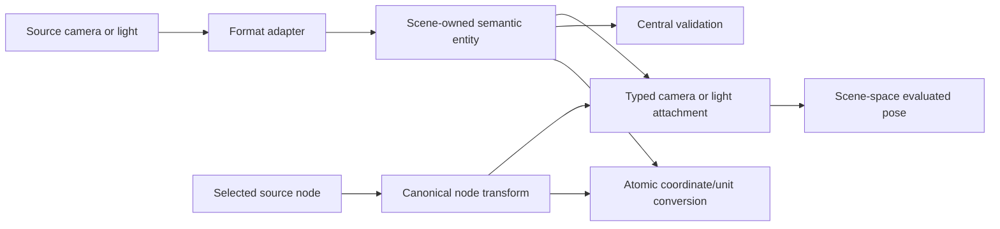

# ADR 0040: Camera and Light Canonical Semantics

## Context

ADR 0003 makes cameras and lights scene-owned entities attached through nodes, and ADR 0008 requires
coordinate conversion to transform them with the rest of the Scene. Neither decision defines their
projection, emission, units, attachment, validation, or loss semantics. Leaving those choices to
format adapters would make equal source facts produce incompatible canonical values.

Assimp demonstrates the required semantic breadth, but its model also mixes node-name attachment,
object-local poses, legacy ambient/area categories, RGB intensity multiplication, and polynomial
attenuation. Baozi needs a smaller source-preserving contract rather than inheriting those legacy
conflations.

## Decision

One scene-owned Camera or Light is a reusable semantic entity. A node attachment supplies its
placement; the entity does not own a second position, orientation, node name, or world transform.
Names are bounded display text, never attachment identity. A node may attach at most one camera and
one light, while one entity may be attached by multiple nodes. Every retained entity has at least one
attachment inside ADR 0039's selected structural closure; an orphan camera or light is invalid. A
global source declaration that is not forward-reachable under the owning format's ADR 0039 selector
and closure rule does not enter the canonical Scene and remains source-scope evidence. Only an
Accepted format rule that explicitly includes a global declaration in the selected projection and
defines its exact pose may create a placement node, with generated-node provenance. This is never an
adapter-local choice.

A source-local camera/light pose is lowered into its placement node. When a source node and attached
entity both carry local poses, the adapter creates a child placement node whose transform composes
them in source-defined order; it never discards either pose or stores a second transform on the
entity. Distinct source-local poses produce distinct placement nodes even when they share one semantic
entity.

### Camera Projection

Canonical v1 supports only perspective and orthographic projections:

- perspective stores a vertical field of view in radians satisfying `0 < vertical_fov < pi`, optional
  positive aspect ratio, positive near distance, and optional far distance greater than near; an
  absent far distance means an unbounded far plane, not a default value;
- orthographic stores positive centered horizontal and vertical half-extents in Scene units plus a
  finite nonnegative near distance and finite far distance greater than near; and
- every numeric value is finite and follows ADR 0008's `f32` policy.

Perspective FOV is the full vertical aperture and aspect is `viewport_width / viewport_height`. A
source full horizontal FOV converts only with known positive aspect by
`vertical_fov = 2 * atan(tan(horizontal_fov / 2) / aspect)`. Each adapter proves whether its source
value is full or half and horizontal, vertical, or diagonal; a backend field name is not proof.

The camera's local viewing convention is forward `-Z` and up `+Y`. Its attached node transforms that
frame into scene space. Adapters convert focal length/sensor size, source view matrices, or different
local axes only when the source contract makes the conversion exact. Off-axis frusta, lens shift,
oblique projection, panorama/fisheye projection, and an unknown FOV convention are unrepresentable in
canonical v1. The adapter preserves original facts in provenance and follows the outcome matrix below
rather than silently approximating them.

There is no implicit default camera and no renderer viewport state in the canonical Scene. Missing
aspect ratio remains absent so a consumer may supply its viewport deliberately.

### Light Emission

Canonical v1 supports directional, point, and spot lights. Directional and spot emission axes are
local `-Z`; local `+Y` is the reference up axis. Ambient, area, image-based, photometric-profile, and
arbitrary source light categories are not mislabeled as those three.

Every light has one unique emission representation: nonnegative finite linear-sRGB/Rec.709 D65 tint
plus a nonnegative finite photometric intensity. For positive intensity, tint is normalized to unit
relative luminance using `0.2126 R + 0.7152 G + 0.0722 B = 1`. Zero emission is represented only as
zero intensity plus white unit-luminance tint. Alpha is not emission and, if a shared color carrier
contains it, is exactly one. Intensity units are kind-specific:

- directional intensity is illuminance in lux;
- point intensity is luminous intensity in candela; and
- spot intensity is peak luminous intensity in candela on the local `-Z` optical axis.

Point and spot lights use inverse-square distance attenuation for positive Scene-unit
`distance_scene`; evaluation exactly at the emitter is undefined, and renderer regularization is not
canonical import behavior. They do not store legacy constant, linear, or quadratic coefficients.
Let `distance_m = distance_scene * SceneSpace.unit_scale_to_meters`. Optional positive Scene-unit
`range_scene` is a behavioral cutoff using
`range_attenuation = clamp(1 - (distance_scene / range_scene)^4, 0, 1)^2`; absence means a factor of
one. Total distance attenuation is `range_attenuation / distance_m^2`, and is zero at or beyond
`range_scene` when that cutoff is present.

An unknown `SceneSpace.unit_scale_to_meters` is distinct from an unknown light-intensity unit. A
light whose source intensity is known to be candela remains source-preserving in a raw Scene with an
unknown length scale, but physical distance attenuation is not evaluable there. A photometric
evaluator returns a typed unknown-Scene-unit-scale failure until ADR 0008's explicit caller override
and atomic conversion establish a finite positive scale; it never substitutes one meter per Scene
unit. A source intensity whose own unit is unknown still fails import under the loss rules below.

A spot light's inner and outer half-cone angles are radians satisfying
`0 <= inner <= outer <= pi/2`; the outer angle must be positive. Directional lights have no range or
cone. Between cones, with `c = cos(theta)`, its angular factor is
`clamp((c - cos(outer)) / (cos(inner) - cos(outer)), 0, 1)^2`; equal cone angles use a hard step.

Basis conversion changes placement node transforms rather than rotating a direction field that the
entity does not own. Unit conversion scales orthographic half-extents and finite light ranges, but
does not scale photometric intensity merely because the asset length unit changes.

### Preservation, Validation, and Loss

Camera and light values carry source or generated-operation provenance under ADR 0036. Format
adapters preserve source category, units, projection parameters, cutoff presence, and attachment
identity. Conversion from known radiometric units, exposure-relative values, legacy attenuation, or
a known unsupported source category is a semantic conversion requiring a format-owned rule,
provenance, and caller-authorized loss when it is not exact.

| Source case | Canonical result |
| --- | --- |
| Exact v1 representation/conversion | canonical value plus original-fact provenance |
| Source specification default | materialized canonical value plus provenance naming the exact default |
| Explicitly admitted recovery or heuristic | policy-authorized loss plus recovery diagnostic and original-fact provenance |
| Admitted typed camera/light behavior | typed behavior with its own validator, conversion, loss, and evidence contract |
| Known non-v1 subject that can be omitted without breaking required projection closure | whole-subject `SourceSemanticLoss` under caller policy, or failure under preserve-or-fail |
| Unknown meaning, required behavior, or omission that would break selected projection closure | typed hard failure |

Generic namespaced metadata/extension values may retain bounded evidence but do not preserve camera or
light behavior. Until a typed Camera/Light behavior owner is admitted by an Accepted amendment or
replacement, a known ambient/area/IES subject, polynomial attenuation, active/default-camera
semantics, animated projection/light parameters, and other known non-v1 behavior may be omitted only
as whole-subject authorized loss when its format contract says omission preserves required closure.
Unknown meaning, required behavior, and closure-breaking omission always fail. No generic extension
turns either case into a source-preserving success.

Central validation checks every numeric invariant, provenance attachment, extension bound, node
reference, reverse-placement count, and projection-closure rule. A source-preserving node transform
may contain scale or shear, but an evaluator requesting a rigid camera/light pose must prove a finite,
nonsingular orthonormal frame or return a typed failure; it never silently orthogonalizes, normalizes,
or decomposes source pose. ADR 0008 coordinate conversion treats nodes and attached camera/light
semantics atomically: a conversion either updates all affected values and SceneSpace together or
publishes nothing.

## Alternatives Considered

### Option A: Copy Assimp's broad camera and light structs

This covers many legacy formats, but duplicates pose on both nodes and entities, relies on names for
attachment, conflates color with energy, and gives polynomial attenuation no format-independent
physical meaning. Rejected.

### Option B: Keep camera and light payloads format-specific

This maximizes source fidelity but prevents common inspection, conversion, validation, and maturity
claims. Every consumer would need format knowledge. Rejected.

### Option C: Small typed physical core plus admitted extensions and explicit loss

This gives common projections and punctual lights one precise meaning while keeping unsupported
semantics honest and extensible. Chosen.

## Consequences

- Camera and light semantics are inspectable without parser or renderer types.
- Node transforms are the only spatial placement authority.
- Formats with legacy or advanced light models must preserve them through admitted schemas or report
  unsupported/loss rather than coercing them into a plausible punctual light.
- Format capability evidence must identify camera and light categories, units, attachment, and loss
  behavior per evidence profile.

## Risks and Mitigations

| Risk | Severity | Likelihood | Mitigation |
| --- | --- | --- | --- |
| Source light intensity has unknown units | High | High | Reject; unknown-unit meaning is never eligible for loss. Whole-subject loss applies only when the subject semantics and omission safety are known. |
| Shared entity attachment surprises consumers | Medium | Medium | Keep placement exclusively node-owned and expose deterministic reverse attachment views. |
| Source cutoff/falloff differs from canonical behavior | High | Medium | Admit only an exact conversion; otherwise use typed behavior, authorized loss, or failure. |
| Coordinate conversion changes pose but not camera/light semantics | Critical | Medium | One ADR 0008 transaction covers placement nodes, camera extents, ranges, and SceneSpace. |
| Advanced categories are silently coerced | High | Medium | Generic extensions are evidence only; behavior requires an admitted typed owner or explicit loss/failure. |
| Non-rigid placement is silently treated as a rigid view frame | High | Medium | Preserve the node transform but make rigid-pose evaluation a checked typed operation. |

## Success Metrics

| Metric | Target | Measurement |
| --- | --- | --- |
| Attachment integrity | every retained entity has a typed placement and evaluated pose comes only from its node | shared/orphan/stale-reference fixtures |
| Projection fidelity | perspective and orthographic round trips preserve declared parameters within field tolerances | format-to-canonical fixtures and snapshots |
| Photometric honesty | every canonical punctual light has known kind-specific units and no hidden legacy attenuation | descriptor/evidence checks and negative fixtures |
| Conversion atomicity | basis/unit conversion changes every affected camera/light fact or publishes no generation | rollback and cross-domain conversion tests |

## Acceptance Criteria

- Perspective fixtures cover full vertical FOV, width/height aspect, horizontal-to-vertical
  conversion, absent/present far, and invalid conventions/ranges; orthographic fixtures cover
  centered half-extents, zero near, and invalid ranges.
- Directional, point, and spot fixtures prove kind-specific intensity units, inverse-square policy,
  exact range/angular factors, cone bounds, unique tint normalization, and local `-Z` direction.
- A known-candela light in a Scene with unknown length scale imports without invented loss, but
  photometric distance evaluation returns the typed unknown-scale failure until an explicit ADR 0008
  override establishes the scale; no path assumes one Scene unit equals one meter.
- Node attachment tests cover shared entities, orphan rejection, source-local child placement,
  invalid IDs, source names that do not match node names, and global declarations that enter only
  through an explicit format-owned projection rule.
- Coordinate/unit conversion fixtures update node poses, orthographic magnitudes, light ranges, and
  SceneSpace consistently while leaving photometric intensity unchanged.
- Rigid-pose evaluation rejects sheared, singular, or otherwise non-rigid placement without changing
  the source-preserving node transform.
- Ambient, area, IES, polynomial-attenuation, active/default-camera, parameter-animation, and other
  known non-v1 whole-subject fixtures fail under preserve-or-fail and may produce explicit
  policy-authorized loss only when the format contract proves omission preserves required closure.
- Unknown-unit or otherwise unknown-meaning fixtures, required behavior, and closure-breaking
  omissions always fail; generic extension evidence alone cannot claim behavior preservation.
- Format maturity evidence cannot claim camera or light support from object counts alone; it records
  the exact supported categories, units, attachments, conversions, and known losses.

## Sources

- [Assimp camera model at the reviewed commit](https://github.com/assimp/assimp/blob/bcc62230fc0471475528d732f4ad108a59bb7f6c/include/assimp/camera.h)
- [Assimp light model at the reviewed commit](https://github.com/assimp/assimp/blob/bcc62230fc0471475528d732f4ad108a59bb7f6c/include/assimp/light.h)
