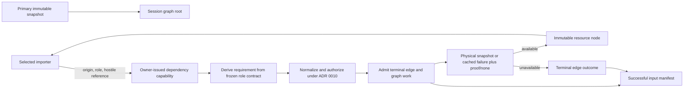

# ADR 0041: Resource Dependency Graph and Successful Input Manifest

## Status and Authority

This accepted ADR is the sole authority for the import session's directed resource-dependency graph,
origin-relative dependency relationships, graph safety limits, unavailable-input replay evidence,
successful input-manifest completeness, and the canonical manifest transcript.

Acceptance defines the required architecture. It does not claim that current dependency APIs,
reports, format adapters, or conformance tooling already implement it.

The ownership boundaries are deliberate:

| Authority | Owned decision |
| --- | --- |
| ADR 0010 | hostile reference normalization, authorization, object-bound open, resolver semantic/negative-observation identity, immutable snapshot acquisition, and atomic authority-qualified physical snapshot/failure-plus-proof caching |
| ADR 0016 | common and format option semantics, precedence, typed compilation, and frozen policy inputs |
| ADR 0046 | downstream import orchestration, lower-cause preservation, and concrete success/failure transport that consumes this graph contract |
| ADR 0021 | immutable registry snapshot and sealed dependency-role contracts |
| ADR 0047 | attempted/consumed/live/committed accounting plus graph/proof count, byte, depth, and work dimensions |
| ADR 0029 | binding the primary immutable snapshot and format-selection evidence |
| ADR 0036 | public sanitized resource identity, content digest, provenance, aliases, and redaction |
| ADR 0039 | selected source Scene projection and retained semantic-object closure inside one source document |
| ADR 0041 | resource-to-resource edges, origin selection, graph invariants, unavailable replay evidence, semantic quotient, and successful manifest transcript |

Producer attestation, trusted closed-input qualification, and a combined import build identity are not
owned here. ADR 0043 records a Proposed, non-authoritative candidate. No Accepted contract may require
or issue those types until that proposal or a replacement is promoted.

ADR 0039's projection closure and this ADR's resource-input closure are not interchangeable. The
former answers which source-document objects enter one canonical Scene. The latter answers which
immutable resource snapshots and unavailable dependency outcomes were mediated by one import
session.

## Context

A flat primary-plus-sidecar list is insufficient for OBJ/MTL and future DCC adapters. A material
library can reference textures relative to itself rather than the primary model. Several spellings
can resolve to one authorized resource, one resource can be shared by several parents, and optional
references can fail without failing the import.

ADR 0010's authority-qualified dependency cache prevents repeated physical opens and keeps
authorization domains isolated. It does not preserve who referenced a resource, which origin supplied
the relative base, whether the descriptor declared the reference required, which alias was used, or
why an optional dependency was unavailable. The private cache is operation machinery, not the public
semantic input graph.

## Decision

Each import operation owns one bounded directed resource graph rooted at the primary immutable
snapshot. The graph module accepts only owner-issued dependency events and returns one sealed
successful manifest or a typed failure with bounded partial evidence. Format code cannot construct
graph node IDs, nominate a base path, choose
requiredness, mutate graph evidence, or publish a manifest.

A successful import publishes one structurally complete `SuccessfulInputManifest` for every
resource and logical request mediated by that session. The manifest has a complete canonical digest
and an input-replay status. It does not claim that trusted extension code used no ambient input and is
not by itself a build, cache, maturity, or output identity.

### Deep Module Interface

The resource graph is one `baozi-import` deep module behind `ParseScope`, not a utility collection
shared with formats. Its external interface accepts only an owner-issued origin, a frozen
`DependencyRoleId`, and the hostile authored reference. It returns an authorized immutable snapshot
or a typed terminal dependency outcome. Requiredness, cache identity, node/edge identity, graph
mutation, negative-proof handling, canonical ordering, and manifest construction remain inside the
module.

The interface enforces this order for every logical request:

1. validate the session issuer, origin, and frozen role before graph, cache, ledger, or IO effects;
2. derive requiredness and admissible outcome classes from the role rather than parser input;
3. admit graph relation, work, and retained evidence before physical acquisition;
4. authorize and resolve relative to the declaring origin through ADR 0010;
5. reuse or create the authority-qualified physical cache entry; and
6. seal exactly one terminal logical edge outcome before returning to format code.

Formats cannot receive a cache handle, graph builder, node identifier, manifest builder, identity
hasher, caller-selected base path, or failure-relabeling hook. Embedded slices inside one already
acquired document remain format-local data and do not become external graph nodes.



### Session-Owned Resource Graph

The primary immutable snapshot is the unique root at depth zero. Every independently acquired
immutable dependency snapshot exposed to the selected importer has exactly one private graph node for
its ADR 0010 authority-qualified physical identity.

Graph origin handles are opaque, session-bound capabilities. They are not `AssetPath`, Scene IDs,
public source identities, serialized values, or cross-operation cache keys. They have no public
equality, ordering, hash, serialization, raw-ID, or value-revealing `Debug` operation. Importers may
only return them to the owner-issued dependency capability as the declaring origin.

After complete terminal-evidence admission succeeds, each logical dependency request creates one
terminal relation containing:

- the session-issued origin node;
- one stable dependency role;
- the `Required` or `Optional` requirement derived from that role's frozen descriptor contract;
- typed reference evidence containing either the bounded normalized resource identity or, when
  normalization rejects the spelling, stable class/code plus a domain-separated SHA-256 digest of
  the complete hostile bytes;
- an authorized target node when one exists;
- exactly one terminal availability outcome; and
- class-local multiplicity equal to the checked number of admitted dependency calls with one byte-
  identical relation key from the same physical origin.

Format-facing dependency calls accept `(origin, role, hostile_reference)`. They do not accept
requiredness. A grammar with genuinely different required and optional cases declares distinct stable
roles. A missing role, duplicate role ID, or attempt to relabel the frozen requirement is a trusted
descriptor/importer contract failure and terminates the session before cache or IO access.

Every request attempt consumes monotonic attempted accounting even when admission later fails, the
relation is interned, the request is denied, the resource is unavailable, or the physical cache is
reused. Cache disposition and raw request-attempt counts remain operation evidence and are excluded
from the canonical manifest.

Each successfully admitted format-facing dependency call is one semantic relation occurrence. A
second byte-identical call from the same physical origin increments class-local multiplicity; the
session cannot infer whether format code revisited one source declaration or observed two authored
declarations because no source-occurrence capability is part of this v1 API. Only duplicate physical
origin instances removed by semantic node-class folding are excluded from multiplicity. An importer
that needs authored-occurrence identity records it through source provenance rather than asking the
resource graph to guess.

Only independently acquired resources are graph nodes. Intra-document accessors, buffer views, GLB
chunks, data-URI payloads, and embedded slices already covered by an enclosing resource digest do not
become separate input nodes merely because ADR 0039 traverses them.

### Origin-Relative Resolution

A dependency reference is resolved relative to the resource whose bytes contain it. The primary node
is the origin only for references authored in the primary resource. A dependency node is the origin
for references authored in that dependency:

```text
models/ship.obj
  -> materials/ship.mtl
       -> ../textures/hull.png
```

The texture is resolved from the MTL resource, not the OBJ root. Snapshots returned for available
dependencies carry the origin capability for their own nested references. A forged, stale, foreign-
session, unavailable, or caller-constructed origin always terminates the session; optionality cannot
authorize it.

ADR 0010 remains authoritative for normalization, escape rejection, role authorization, resolver
namespaces, object-bound opening, and physical cache lookup. This ADR owns only declaring-resource
origin selection and the graph relation produced after that authorization.

### Aliases and Physical Deduplication

Graph relations and physical nodes use different identity rules:

- every logical spelling and role is normalized and authorized independently;
- physical deduplication occurs only after authorization through ADR 0010's private key;
- two allowed aliases may create distinct relations to one physical node;
- equal public names in different authority domains remain distinct physical nodes;
- equal content digests never grant authority or merge physical nodes;
- a denied alias cannot observe or reuse a previously allowed cache entry; and
- requirement and loss disposition remain per relation, not per physical node.

ADR 0036 owns public sanitized aliases and resource identities. No manifest field exposes authority
domains, native paths, handles, credentials, cache keys, or resolver internals.

### Graph Safety, Admission, and Complexity

`baozi-import::ResourceLimits` has independent effective limits for resource nodes, logical
relations, maximum primary-rooted depth, graph-admission work, proof canonical/temporary bytes, proof
verification work, retained manifest bytes, finalization/hash work, and bounded human preview. A
descriptor cap may lower a request value but cannot raise it.

The available-resource subgraph of every successful import is a DAG. Before exposing a proposed
target snapshot, the session performs a bounded iterative cycle and depth check. A self-edge or an
edge whose target can already reach its origin is a cycle. Depth is the longest primary-rooted path;
sharing does not reset it.

The portable baseline algorithm may run iterative reachability over the current graph for each
proposed available adjacency. Each check visits any current node/relation at most once and charges
before every step, but repeated online insertions have an explicit worst-case
`O(E * (N + E))` admission bound. Implementations may use a proven incremental topological-order
algorithm with a tighter measured bound, but they cannot claim total linear discovery merely because
each individual traversal is linear. The hard graph-work budget is the hostile-input bound.

After discovery, whole-graph DAG validation and reverse-topological class construction are iterative
and `O(N + E + B)` before ordering, where `B` is the total canonical payload bytes. Canonical ordering
is separately bounded below.

Node capacity is admitted before creating a new graph record. Relation, terminal-outcome evidence,
and the finalization envelope needed to preserve the complete machine manifest are admitted before a
logical request is retained. Failure creates no half-published relation or parser-visible target.

Cycle, depth, node, relation, graph-work, proof-limit, retained-manifest, canonical-ordering,
finalization-work, cancellation, and deadline rejection are session-terminal in v1. Optionality
cannot recover a failure that prevents the complete terminal relation or final manifest from being
stored and canonicalized.

### Terminal Outcomes

Every admitted logical relation reaches exactly one terminal outcome:

```text
Available(target node)
Unavailable(stable class, stable code, sanitized identity evidence, replay classification)
```

`Available` means the importer received the immutable snapshot. `Unavailable` covers policy denial,
normalization/open/read failure, stable cached failure, and a pre-admitted optional acquisition-byte/
work exhaustion. Backend-native text and executable error objects are never retained.

A required unavailable relation is session-terminal. An optional unavailable relation may enter a
successful manifest only when the frozen role contract declares it optional and the caller's loss
policy authorizes omission. It retains exact typed outcome and bounded diagnostic/loss evidence. A
cached physical failure remains stable for its private physical identity; every relation still
applies its own frozen requirement and loss disposition.

### Replay Classification for Unavailable Inputs

Every `Unavailable` outcome carries one classification:

```text
DeterministicUnavailable(basis identity)
EnvironmentDependentUnavailable(negative proof or none)
SessionDependentUnavailable(reason)
```

`DeterministicUnavailable` is valid only when every deciding value is bound by the relation's exact
canonical basis identity. V1 admits a frozen policy denial, deterministic reference-normalization
rejection, or another class added by a later Accepted amendment with the same complete-input rule. A
live callback, mutable allowlist, process state, or unversioned resolver response is never
deterministic merely because it returned a stable code once. It is session-dependent when optional
continuation is otherwise authorized. Cancellation and deadline observations are session-terminal and
never receive replay classification.

Missing/open/read/remote/namespace observations are `EnvironmentDependentUnavailable`. They are
edge-replayable only when the trusted resolver supplies a Baozi-owned inert `NegativeInputProof`
binding:

- proof scheme/version and stable validity-rule ID;
- exact resolver semantic identity and immutable namespace-snapshot digest, or equivalent per-
  reference assertion digest;
- normalized target identity, exact class/code, and proof digest; and
- the managed validity rule proving the same outcome against that immutable namespace.

ADR 0010 validates the proof under admitted hard canonical-byte, temporary-memory, construction-work,
and verification-work caps. All proof work is precharged through ADR 0047 dimensions. Excess,
malformed, stale, wrong-target/class, cross-namespace, unadmitted-scheme, or executable proof values
terminate the session before cache publication; optionality cannot recover them.

The first authorized cached failure atomically freezes its admitted proof or `none`. ADR 0041 consumes
that inert result unchanged and never calls the resolver again, fabricates proof from host state, or
attaches/upgrades proof after a cache hit. A same-session cached failure is not cross-session proof.

`SessionDependentUnavailable` covers a pre-admitted optional acquisition-byte/work exhaustion whose
result depends on aggregate session consumption or scheduling, plus a permitted optional denial made
by mutable policy, a host callback, or process state. It cannot carry proof and always makes input
replay status `ObservedOnly`. Structural graph/evidence/finalization limits, cancellation, and deadline
are not members of this class because they terminate the session.

### Successful Input Manifest

Successful finalization publishes one immutable bounded `SuccessfulInputManifest` containing:

- manifest schema version and digest algorithm;
- one primary-root class record;
- every available public semantic node class with sanitized resource identity, exact byte length,
  typed ADR 0036 resource-identity stability, complete content digest, and canonical outgoing
  relation;
- the semantic quotient of every admitted logical relation, retaining role, frozen requirement,
  normalized-or-rejected reference evidence, outcome, replay evidence, and class-local multiplicity;
- stable unavailable cause class/code and proof/basis evidence;
- exact semantic-node-class, quotient-relation record/occurrence, available/unavailable record/
  occurrence, and maximum-depth counts; and
- `Replayable` or `ObservedOnly(reasons)` input-replay status.

`Replayable` means every unavailable relation has stable cross-session replay evidence and every
`ResourceIdentity` occurrence in nodes, references, unavailable identity evidence, and negative
proofs carries ADR 0036 `Stable(owner, schema, version)` evidence. It does not prove that trusted code
acquired no ambient input, authenticate a producer, or issue a build identity.
`ObservedOnly` means the session-mediated graph is still structurally complete but an environment-
dependent omission lacks proof, an omission is session-dependent, or at least one resource identity
is `SessionOpaque`. Reasons are exhaustive and canonical.

Before quotienting, the finalizer proves that every graph-mediated physical snapshot and logical
request maps to exactly one terminal relation. Operation evidence may retain raw request, physical
open/cache/node, and authority-partition counts. None is a manifest field.

Physical nodes fold only when their complete public semantic node-class payloads are byte-for-byte
equal. The canonical class emits its outgoing relation once. Equivalent physical origin instances do
not multiply class-local relation multiplicity; repetitions caused only by private authority
partitioning remain operation evidence. Relations inside two candidate physical origins must have
equal per-origin keys and multiplicities before those origins can fold. Repeated admitted calls from
one origin remain visible through that origin's multiplicity.
Changing a public origin/target class or class-local relation multiplicity changes the manifest;
swapping incidence only among byte-identical physical class instances does not.

Manifest construction is preserve-or-fail. The complete machine relation is not eligible for
digest-plus-preview collapse. Human rendering may be bounded and retain exact counts plus complete
manifest digest, while the machine manifest stays complete within hard count/byte/work limits.

### Canonical v1 Manifest Transcript

The transcript is an internal hashing schema, not a stable serialization wire. V1 nevertheless fixes
all bytes needed for independent implementations and known vectors.

```text
u32be(n) = exactly four unsigned big-endian bytes
u64be(n) = exactly eight unsigned big-endian bytes
i64be-two-complement(n) = u64be(the exact two's-complement bit pattern of n)
frame(label, payload) = u64be(label.len) || label || u64be(payload.len) || payload
record(tag, fields) = frame("record-tag", tag) || u64be(fields.count) || fields...
value(kind, payload) = record("identity-value", [frame("kind", kind), frame("payload", payload)])
field(label, encoded-value) = frame(label, encoded-value)
record-value(tag, fields) = value("record", record(tag, fields))
bool-value(byte) = value("bool", byte)
u64-value(integer) = value("u64", u64be(integer))
i64-value(integer) = value("i64", i64be-two-complement(integer))
f32-bits-value(bits) = value("f32-bits", u32be(bits))
f64-bits-value(bits) = value("f64-bits", u64be(bits))
bytes-value(bytes) = value("bytes", bytes)
utf8-value(bytes) = value("utf8", bytes)
enum-value(canonical-id) = value("enum", canonical-id)
digest-value(algorithm, digest-bytes) = record-value("digest", [field("algorithm", enum-value(algorithm)), field("value", bytes-value(digest-bytes))])
item(encoded-value) = frame("item", encoded-value)
sequence(encoded-values) = u64be(encoded-values.count) || item(encoded-values[0]) || ...
set(encoded-values) = sequence(sort_unique_unsigned_lex(encoded-values))
optional-none = value("optional", 00)
optional-some(encoded-value) = value("optional", 01 || frame("some", encoded-value))
sequence-value(encoded-values) = value("sequence", sequence(encoded-values))
set-value(encoded-values) = value("set", set(encoded-values))
union-value(member-tag, fields) = value("union", record(member-tag, fields))
```

Every right-hand `encoded-value` is the complete output of exactly one `*-value`, `record-value`,
`optional-*`, `sequence-value`, `set-value`, or `union-value` constructor; `field` never adds a
second typed-value wrapper. Angle-bracket forms such as `sequence<node-entry>` below are schema
notation only. Their outer kind tokens are exactly `sequence`, `set`, `optional`, or `union`; type
names and angle brackets never enter the transcript.

Labels, tags, kind tokens, and algorithm tokens are the exact lowercase ASCII bytes shown here. Enum values are
either the exact closed tokens listed below or admitted `canonical-id-v1` registry values from their
named owner. Records emit fields in declared order. All lengths/counts use checked `u64`. Every field
payload is one sealed typed value:

| Kind | Canonical payload |
| --- | --- |
| `bool` | `bool-value(00)` or `bool-value(01)` |
| `u64` | `u64-value(value)` |
| `i64` | `i64-value(value)` |
| `f32-bits` / `f64-bits` | the matching bits-value constructor over validated exact IEEE-754 bits |
| `bytes` | `bytes-value(exact-bytes)`, including empty |
| `utf8` | `utf8-value(exact-validated-UTF-8)`, including empty |
| `enum` | `enum-value(exact-canonical-id-v1)` |
| `digest` | `digest-value(...)` with an admitted algorithm and exact-sized value |
| `optional<T>` | `optional-none` or `optional-some(complete T encoded-value)` |
| `sequence<T>` | `sequence-value(...)` over complete `T` encoded values in the schema's semantic order |
| `set<T>` | `set-value(...)` over complete `T` encoded values; compare as unsigned bytes, shorter prefix first, and reject exact duplicates |
| named record | `record-value(its-tag, ...)` whose schema fixes labels, order, and exact value types |
| `union<A, ...>` | `union-value(member-tag, fields)`, where the member tag is exactly one listed closed member; no additional wrapper is allowed |

`canonical-id-v1` is 1 to 96 ASCII bytes matching
`[a-z0-9]+([._:-][a-z0-9]+)*`. ADR 0041 owns this canonical manifest transcript grammar. The
authority named below owns registry membership and normative meaning for each ID. Rust names,
discriminants, debug strings, localized text, registration order, and caller-selected labels are not
canonical IDs.

The transcript performs no implicit Unicode normalization, case/locale folding, path conversion,
float formatting, NaN canonicalization, or display rendering. The owning type validates semantics
before encoding.

An exact record type named in a field schema uses `record-value(its-tag, ...)`. Optional, sequence,
set, and union members are complete encoded values of their declared exact type. These rules are
part of the transcript and are not implementation notation.

V1 uses `schema-version = 1`, `digest-algorithm = sha256`, and these records:

| Record tag | Ordered `label: exact type` fields |
| --- | --- |
| `input-manifest` | `domain: utf8`, `schema-version: u64`, `digest-algorithm: enum`, `primary: primary`, `node-classes: sequence<node-entry>`, `counts: counts`, `input-replay-status: input-replay-status` |
| `digest` | `algorithm: enum`, `value: bytes` |
| `resource-identity-v1` | `value: utf8`, `stability: union<stable-resource-identity, session-opaque-resource-identity>` |
| `stable-resource-identity` | `owner: enum`, `schema-id: enum`, `schema-version: u64` |
| `session-opaque-resource-identity` | `reason: enum` |
| `semantic-identity-v1` | `owner: enum`, `schema-id: enum`, `schema-version: u64`, `semantic-digest: digest` |
| `primary` | `node-class-digest: digest` |
| `node-class` | `resource-identity: resource-identity-v1`, `byte-length: u64`, `content-digest: digest`, `outgoing-relations: sequence<relation>` |
| `node-entry` | `node-class-digest: digest`, `node-class: node-class` |
| `relation-key` | `role: enum`, `requirement: enum`, `reference: union<normalized-reference, rejected-reference>`, `outcome: union<available, unavailable>` |
| `relation` | `key: relation-key`, `multiplicity: u64` |
| `normalized-reference` | `resource-identity: resource-identity-v1` |
| `rejected-reference` | `class: enum`, `code: enum`, `reference-digest: digest` |
| `available` | `target-node-class-digest: digest` |
| `unavailable` | `class: enum`, `code: enum`, `identity-evidence: optional<resource-identity-v1>`, `replay-classification: union<deterministic-unavailable, namespace-snapshot-proof, per-reference-proof, unproven-negative-input, session-dependent-unavailable>` |
| `deterministic-unavailable` | `basis-kind: enum`, `basis-identity: semantic-identity-v1` |
| `namespace-snapshot-proof` | `scheme: enum`, `version: u64`, `validity-rule-id: enum`, `resolver-identity: semantic-identity-v1`, `namespace-snapshot-digest: digest`, `target-identity: resource-identity-v1`, `class: enum`, `code: enum`, `proof-digest: digest` |
| `per-reference-proof` | `scheme: enum`, `version: u64`, `validity-rule-id: enum`, `resolver-identity: semantic-identity-v1`, `assertion-digest: digest`, `target-identity: resource-identity-v1`, `class: enum`, `code: enum`, `proof-digest: digest` |
| `unproven-negative-input` | `reason: enum` |
| `session-dependent-unavailable` | `reason: enum` |
| `input-replay-status` | `status: enum`, `reasons: set<enum>` |
| `counts` | `node-class-count: u64`, `quotient-relation-record-count: u64`, `relation-occurrence-count: u64`, `available-relation-record-count: u64`, `available-relation-occurrence-count: u64`, `unavailable-relation-record-count: u64`, `unavailable-relation-occurrence-count: u64`, `maximum-depth: u64` |
| `resolver-semantic-subject-v1` | `resolver-contract-id: enum`, `resolver-contract-version: u64`, `namespace-semantics-id: enum`, `normalizer-identity: semantic-identity-v1`, `semantic-parameter-schema-id: enum`, `semantic-parameter-schema-version: u64`, `semantic-parameter-digest: digest`, `proof-scheme-identities: set<semantic-identity-v1>` |
| `reference-normalizer-subject-v1` | `normalizer-contract-id: enum`, `normalizer-contract-version: u64`, `namespace-semantics-id: enum`, `canonicalization-profile-id: enum`, `semantic-parameter-schema-id: enum`, `semantic-parameter-schema-version: u64`, `semantic-parameter-digest: digest` |
| `negative-proof-scheme-subject-v1` | `scheme: enum`, `version: u64`, `validity-rule-id: enum`, `subject-kind: enum`, `proof-payload-schema-id: enum`, `proof-payload-schema-version: u64`, `proof-digest-algorithm: enum`, `canonical-byte-cap: u64`, `temporary-byte-cap: u64`, `construction-work-cap: u64`, `verification-work-cap: u64` |
| `compiled-policy-subject-v1` | `policy-contract-id: enum`, `policy-contract-version: u64`, `decision-mode: enum`, `resolver-identity: optional<semantic-identity-v1>`, `authorized-namespace-identities: set<semantic-identity-v1>`, `semantic-parameter-schema-id: enum`, `semantic-parameter-schema-version: u64`, `semantic-parameter-digest: digest` |
| `frozen-policy-denial-subject-v1` | `compiled-policy-identity: semantic-identity-v1`, `rule-id: enum`, `role: enum`, `reference-evidence-digest: digest`, `class: enum`, `code: enum` |
| `normalization-rejection-subject-v1` | `normalizer-identity: semantic-identity-v1`, `reference-digest: digest`, `class: enum`, `code: enum` |

`resource-identity-v1` encodes ADR 0036's exact validated UTF-8 value and its separate sealed stability
evidence. Stability owner/schema/version does not grant authority or prove content equality.

A semantic identity is an owner-admitted digest wrapper. Its digest is SHA-256 over the complete
`record-value(...)` for the subject named by `(owner, schema-id, schema-version)`. It cannot wrap caller-chosen bytes, a debug
representation, or an unregistered parameter schema. V1 admits these mappings:

| Use | `owner / schema-id / version` | Semantic owner |
| --- | --- | --- |
| Resolver identity | `baozi.asset-io / resolver-semantic / 1` | ADR 0010 registry over `resolver-semantic-subject-v1` |
| Reference normalizer | `baozi.asset-io / reference-normalizer / 1` | ADR 0010 registry over `reference-normalizer-subject-v1` |
| Proof-scheme identity | `baozi.asset-io / negative-proof-scheme / 1` | ADR 0010 registry over `negative-proof-scheme-subject-v1` |
| Compiled external-reference policy | `baozi.input-manifest / compiled-external-reference-policy / 1` | ADR 0041 adapter over ADR 0010 policy semantics and ADR 0016's frozen effective configuration, encoded as `compiled-policy-subject-v1` |
| Frozen policy denial basis | `baozi.input-manifest / frozen-policy-denial / 1` | ADR 0041 adapter over its admitted compiled-policy identity and `frozen-policy-denial-subject-v1` |
| Normalization rejection basis | `baozi.input-manifest / reference-normalization-rejection / 1` | ADR 0041 adapter over ADR 0010's admitted normalizer identity and `normalization-rejection-subject-v1` |

`basis-kind` is exactly `frozen-policy-denial` or `reference-normalization-rejection` and must match
the corresponding semantic identity row. The reference-evidence digest is SHA-256 over the complete
`record-value("normalized-reference", ...)` or `record-value("rejected-reference", ...)` already
present in the relation. A
missing or unregistered basis cannot emit `DeterministicUnavailable`; permitted optional continuation
uses `SessionDependentUnavailable(unregistered-semantic-basis)` and is `ObservedOnly`.

For the compiled policy subject, `decision-mode` is exactly `frozen` or `mutable`; only `frozen` may
enter `frozen-policy-denial-subject-v1`. Namespace identities describe public semantic policy subjects,
never authority-domain handles. Every semantic-parameter schema in these subjects has one admitted
owner/version/encoder and known vectors; an opaque digest without that registry entry is unregistered.
ADR 0010 supplies external-reference policy and resolver/namespace semantics. ADR 0016 supplies the
frozen effective configuration after precedence and request
compilation. ADR 0041 exclusively owns the manifest subject schema, canonical encoder, parameter-
schema admission, semantic identity, and known vectors; neither upstream ADR independently issues a
manifest identity.

For this adapter, v1 fixes `policy-contract-id = baozi.external-reference-policy` and
`policy-contract-version = 1`; these values are owned here rather than supplied by ADR 0010. The
`semantic-parameter-digest` is SHA-256 over exactly one of these complete parameter records. Record
fields appear in the listed order; every v1 record has zero fields, because resolver and namespace
identities already occur once in the enclosing `compiled-policy-subject-v1`:

| Effective policy variant | Parameter schema ID / version | Exact parameter record | Enclosing-field constraints |
| --- | --- | --- | --- |
| `Deny` | `baozi.external-reference-policy.deny / 1` | `record-value("external-policy-deny-v1", [])` | `resolver-identity = none`; authorized namespace set is empty |
| `WithinScope` | `baozi.external-reference-policy.within-scope / 1` | `record-value("external-policy-within-scope-v1", [])` | `resolver-identity = none`; authorized namespace set contains exactly the one admitted public namespace identity |
| `AllowListedScopes` | `baozi.external-reference-policy.allow-listed-scopes / 1` | `record-value("external-policy-allow-listed-scopes-v1", [])` | `resolver-identity = none`; authorized namespace set is non-empty, sorted, and duplicate-free; an empty list compiles as `Deny` |
| `Resolver` | `baozi.external-reference-policy.resolver / 1` | `record-value("external-policy-resolver-v1", [])` | `resolver-identity = some` with one ADR 0010-admitted identity; the namespace set is the resolver's complete admitted stable namespace set |

An opaque capability or mutable/dynamic resolver namespace has no public namespace identity. Its
compiled subject uses `decision-mode = mutable` and cannot support a deterministic frozen-policy
denial. `WithinScope` and `AllowListedScopes` are registered only when every namespace identity is
ADR 0010-admitted and stable; `Resolver` is registered only when the resolver identity and its
complete namespace set are admitted. A variant/schema mismatch, wrong optional resolver shape,
empty allow-list record, incomplete resolver namespace set, duplicate identity, or unknown identity
is unregistered rather than normalized by implementation convention.

The canonical deny vector pins both levels of hashing. The zero-field parameter record above is 154
bytes with SHA-256
`325d32a571f7308838f58879c17dc5dbdb784eb91f2303111602be8b18f559c9`. A
`compiled-policy-subject-v1` using that digest, the exact contract/schema tokens above,
`decision-mode = frozen`, `resolver-identity = none`, and an empty authorized namespace set is 1,649
bytes with SHA-256
`e179fda8089aae5c9010a882fad8680c5f89c85d3c2a645159d1ec84011c006b`. These lengths and digests are
normative; implementation tracers must add equivalent vectors for every other registered branch
before that branch may produce a manifest identity.

The initial ADR 0010 asset-IO registry pins both subject and wrapper encodings:

| Value | Canonical bytes | SHA-256 |
| --- | ---: | --- |
| Portable-normalizer parameter record | 166 | `6e87a3b73673588118eb07b94d9fc9a27fb88987e9861622e690920d58a26e19` |
| `reference-normalizer-subject-v1` | 1,592 | `848377934e7d1ceeae1585353640267ba1b25d215e8a912d05164941cbb81d8c` |
| `baozi.asset-io / reference-normalizer / 1` semantic identity | 996 | `738da469d79ec3a770abec5906c0d7f0faa6b3a0bb135065129ce1e8274b711e` |
| Same-authority-resolver parameter record | 168 | `f31f44559bbdbc68b97c1892a5048c99197ec1e442f84392161878261e77e719` |
| `resolver-semantic-subject-v1` with the normalizer identity above and an empty proof-scheme set | 2,588 | `b7b6dd37bd2732279d464f724c219725412ea1412df0d864a948eeea944d2d43` |
| `baozi.asset-io / resolver-semantic / 1` semantic identity | 993 | `124d5e06ccba9d3b1a19a8d1a440270720da75a6cd9609e7948cfd3164ecdfe5` |

These vectors are generated by the same canonical encoder used for manifest records. Registry
membership remains owned by ADR 0010; this ADR owns only the adapter bytes and digests.

The `role` enum is ADR 0021's exact globally qualified `DependencyRoleId` token. Resolver, normalizer,
proof-scheme, and validity-rule IDs use ADR 0010's registry. ADR 0041 owns the manifest cause-pair
registry and delegates normative meaning for ADR 0010's exact IO/policy pairs. ADR 0041 itself owns
the manifest-facing `baozi.budget / acquisition-bytes-exhausted` and
`baozi.budget / acquisition-work-exhausted` pairs; they may be emitted only from ADR 0047 accounting
facts interpreted by the import session and never grant ADR 0041 a second ledger or budget engine. A
downstream transport cannot relabel a pair. Every ID uses `canonical-id-v1`. Requirement tokens are
`required` and `optional`; replay status tokens are `replayable` and `observed-only`.

Closed detailed reason tokens are:

- `missing-negative-proof` for `unproven-negative-input`;
- `session-dependent-acquisition-budget`, `session-dependent-mutable-policy`,
  `session-dependent-host-callback`, `session-dependent-process-state`, and
  `unregistered-semantic-basis` for `session-dependent-unavailable`; and
- `generated-report-identity`, `unregistered-caller-identity`, and
  `unregistered-resolver-identity` for `session-opaque-resource-identity`.

Input replay reasons are the exact coarse tokens `unproven-negative-input`,
`session-dependent-unavailable`, and `unstable-resource-identity`. `replayable` requires an empty
reason set. `observed-only` requires the exact nonempty set of coarse reasons present anywhere in the
manifest, with no extras. The set uses the complete encoded-value ordering above; no second token-only
order applies.

`EnvironmentDependentUnavailable(Proof)` encodes the matching proof-union member directly.
`EnvironmentDependentUnavailable(None)` encodes
`unproven-negative-input(missing-negative-proof)`. Each `SessionDependentUnavailable` encodes its
exact detailed reason. These mappings are exhaustive; implementations do not add a wrapper record or
choose another replay member.

Negative proof is the closed union `namespace-snapshot-proof | per-reference-proof`. The proof's
scheme/version/validity-rule triple must match its ADR 0010 proof-scheme semantic identity and subject
kind. Unavailable class/code, target identity, and resolver identity must match the atomically cached
failure; mismatch is session-terminal rather than another union member.

Every available content digest is SHA-256 over the complete immutable resource bytes. Canonical
classes are constructed after whole-graph cycle validation:

1. In reverse topological order, encode each physical origin's complete
   `record-value("relation-key", ...)` without a multiplicity field and hash each encoded value with
   SHA-256.
2. Sort fixed-size key digests in ascending unsigned-byte lexicographic order. Scan each equal-digest
   run once; unequal payloads with one digest fail closed, while byte-identical payloads group with
   checked `u64` multiplicity. Emit one `relation(key, multiplicity)` per group in that digest order.
3. Build the complete `record-value("node-class", ...)` from resource identity plus stability, byte
   length, content digest, and emitted relations, then compute its SHA-256 digest.
4. Detect equal node-class digests by comparing complete payloads. Unequal payloads with one digest
   fail closed. Byte-identical payloads fold and emit one `node-entry` without physical multiplicity.
5. Sort node entries by fixed-size digest in ascending unsigned-byte lexicographic order and identify
   the primary root class.

All `counts` fields are checked `u64` values over the emitted semantic quotient, never over physical
cache partitions. Record counts count emitted `relation` records once per emitted node class.
Occurrence counts sum their class-local multiplicities once per emitted node class, without
multiplying by folded physical origins. Available/unavailable record and occurrence counts partition
their respective totals. `maximum-depth` is the longest primary-rooted path in the semantic quotient.
Overflow fails finalization.

Here `N` is the number of physical graph nodes before quotienting, `E` is the number of admitted
relation occurrences before grouping, and `B` is the total bytes of all canonical payloads examined
by finalization, including duplicate occurrence payloads before grouping. Payload construction,
comparison, and hashing are `O(B)`. Fixed-digest ordering is `O(E log E + N log N)`. Hash-collision
runs scan each participating payload once and never use a private ID as a tie-breaker. Multiplicity
overflow, unknown semantic schema, unstable bytes, digest collision, or work exhaustion fails
finalization.

The manifest digest is SHA-256 over the complete `record-value("input-manifest", ...)` beginning
with `field("domain", utf8-value("baozi.input-manifest.v1"))`.

### Failure Boundary

The graph module returns typed capability-time and finalization failures with the original lower
cause plus bounded partial graph evidence. DAG validation, quotient construction, manifest
canonicalization, allocation, ledger finalization, or sealing failure never returns a
`SuccessfulInputManifest`. Downstream lifecycle transport owns latching, phase mapping, and public
success/failure placement; it cannot relabel one of these graph failures as optional unavailability
or successful-manifest evidence.

Public evidence contains only Baozi-owned inert values, never a backend/plugin error object, resolver
callback, native handle, authority token, or foreign destructor.

## Non-Goals

This ADR does not:

- redefine source-scene selection or union declared source scenes;
- authorize filesystem, remote, archive, or container access;
- replace ADR 0010 authorization or physical cache;
- prove that trusted extension code has no ambient input path;
- define producer attestation, closure tokens, import build identity, cooker artifacts, output
  equality, package signing, or persistent cache lookup/storage;
- define a stable request wire or public manifest serialization format;
- treat a content digest as authority; or
- treat the manifest as validation proof, provenance, format maturity, or Scene output equality.

## Alternatives Considered

### Option A: Resolve every dependency from the primary and retain a flat digest list

This misresolves nested references, cannot represent sharing/aliases, and loses requirement/outcome
semantics. Rejected.

### Option B: Treat ADR 0010's physical cache as the input manifest

The cache has no public origin relations, roles, requirements, aliases, or stable semantic ordering
and contains private authority identities. Rejected.

### Option C: Delegate graph and manifest semantics to every format or host

This creates competing graph, hashing, safety, and evidence rules and cannot prove facade-wide
completeness. Rejected.

### Option D: One session-owned graph and canonical successful manifest

This gives all formats one origin, admission, outcome, quotient, and failure seam without blocking on
future producer attestation. Chosen.

## Consequences

Positive:

- nested dependencies resolve from the resource that authored them;
- every session-mediated snapshot and request belongs to one inspectable graph;
- aliases preserve logical evidence without repeated physical opens;
- optional unavailability remains explicit and replay-classified; and
- private authority identity stays out of canonical evidence.

Negative:

- dependency APIs carry opaque origin handles and sealed role contracts;
- online cycle admission has an explicit superlinear worst-case bounded by graph work;
- graph, proof, quotient, canonical-ordering, and manifest storage consume bounded resources; and
- a successful manifest alone cannot claim a reproducible producer or build.

## Risks and Mitigations

| Risk | Severity | Likelihood | Mitigation |
| --- | --- | --- | --- |
| Importer relabels a required reference optional | Critical | Medium | requiredness absent from format-facing calls and derived from one sealed role contract |
| Origin handle becomes a path alias | Critical | Low | private session-bound constructor, no comparison/rendering, and forged/stale/foreign tests |
| Repeated online cycle checks become an algorithmic attack | High | Medium | declared worst-case bound, precharged traversal work, hard budget, and insertion-order scale fixtures |
| Optional structural failure makes success request-order dependent | Critical | Medium | every cycle/depth/node/relation/graph/finalization failure is session-terminal |
| Proof verification allocates or loops before admission | Critical | Medium | ADR 0010 scheme caps plus ADR 0047 byte/work precharge before verification |
| Cached absence is mistaken for replay proof | Critical | High | explicit environment-dependent class and immutable proof-or-none frozen with first failure |
| Private authority partition changes manifest | High | Medium | semantic quotient emits class relation once and excludes physical multiplicity/raw attempts |
| Same-origin duplicate calls are inconsistently discarded | High | Medium | every admitted call increments class-local multiplicity; only folded equivalent physical origins are de-duplicated |
| Relation or node digest collision needs a private tie-breaker | Critical | Low | fixed-digest runs compare complete payloads and reject unequal collisions |
| Canonical order exceeds its claimed bound | High | Medium | sort fixed-size digests only; charge payload/hash work separately as `O(B)` |
| Collection framing or a record union is interpreted differently | Critical | Medium | exact `item` frame, counted sequence/set encodings, closed tagged unions, fixed digest comparator, and full-transcript vectors |
| Session-opaque identity is mislabeled replayable | Critical | Medium | encode ADR 0036 stability and require every node to be `Stable` before `Replayable` |
| Mutable policy or callback denial is mislabeled deterministic | Critical | Medium | registered frozen-policy basis or session-dependent `ObservedOnly`; cancellation/deadline remain terminal |
| Trusted extension bypasses the owner-issued dependency capability | Critical | Medium | manifest makes no closed-input claim; future authority requires a separately Accepted decision |
| Manifest leaks paths or credentials | High | Medium | ADR 0036 resource identity/redaction and exclusion of private resolver/cache values |

## Success Metrics

| Metric | Target | Measurement |
| --- | --- | --- |
| Origin correctness | every nested fixture resolves from its declaring resource | OBJ/MTL/texture and sibling-directory fixtures |
| Requirement authority | format code cannot pass or relabel requiredness | compile/API-shape and malicious-importer tests |
| Structural completeness | every mediated snapshot maps to one class and every admitted request to one terminal relation | instrumented scope/cache/finalizer tests |
| Negative replay | every environment-dependent omission has admitted proof or `ObservedOnly` replay status | mutable namespace and proof matrix |
| Replay identity stability | every `Replayable` manifest contains only ADR 0036 `Stable` resource identities in nodes, references, unavailable evidence, and proofs | generated-primary, custom-resolver, missing-target, and fresh-session matrix |
| Admission safety | online insertion always ends within graph-work limits and reports its actual bound | adversarial insertion permutations and 1x/10x/100x work counters |
| Canonical finalization | class construction is linear before fixed-digest ordering; payload/hash bytes are linear | deterministic work counters and collision injection |
| Authority invariance | equal public semantic graphs have equal manifest digest across private authority partitions | dual-scope/partition fixtures |
| Canonical byte uniqueness | independent encoders produce identical bytes for every collection, union, identity, count, and digest-order branch | full-hex vectors and differential encoder tests |
| Relation occurrence honesty | same-origin admitted calls change multiplicity exactly once; folded physical origins never multiply it | authored-duplicate, repeated-call, and authority-partition fixtures |
| Redaction | no manifest exposes host path, credential, authority/cache/handle value, or backend object | structural inspection tests |

## Acceptance Criteria

- The primary snapshot is the unique root at depth zero.
- Dependency calls accept only origin, stable role, and hostile reference; requiredness is derived
  from the frozen role contract and cannot be caller-supplied or relabeled.
- OBJ -> MTL -> texture resolves from the MTL origin; primary-relative resolution fails.
- Two authorized aliases create two public relations and one physical open when authority permits;
  a denied alias cannot hit the allowed cache entry.
- Equal public graphs retain equal canonical digest across session/account/authority partition IDs and
  one-versus-many equivalent physical instances.
- Every admitted request has one terminal outcome; no structural/finalization failure is optional.
- Online cycle/depth checks are iterative, precharged, hard-bounded, and measured against the declared
  per-insertion/total worst case; final DAG/class construction remains linear before ordering.
- Optional missing/denied/open/acquisition-budget outcomes continue only with a complete pre-admitted
  relation and frozen role/loss authority; acquisition-budget outcomes are `ObservedOnly`.
- Frozen-policy denial is deterministic only with the registered policy basis. Mutable allowlist,
  host-callback, and process-state denial is session-dependent `ObservedOnly`; cancellation and
  deadline always terminate.
- Negative proof construction/verification obeys exact byte, temporary-memory, and work caps before
  cache publication. Stale, forged, wrong-target/class, cross-namespace, unadmitted-scheme, executable,
  and post-cache-upgrade proofs never enter a successful manifest.
- Two fresh sessions over the same immutable proof produce equal proof/manifest bytes; proof or
  namespace mutation changes the digest or fails closed.
- Before quotienting, every physical snapshot and raw request maps to exactly one class/relation;
  private raw counts remain operation evidence.
- Equivalent physical origins fold only when complete class payloads and per-origin relation
  multiplicities match; folding does not multiply class-local relations. Every admitted same-origin
  dependency call increments multiplicity, including a repeated call with an identical key.
- A manifest is `Replayable` only when every resource identity occurrence is ADR 0036 `Stable`;
  generated report identities and unregistered caller/resolver identities in a node, reference,
  unavailable identity, or proof target produce the exact
  `ObservedOnly(unstable-resource-identity)` reason.
- Known vectors pin exact schema version/domain/labels, big-endian framing, UTF-8 and invalid UTF-8,
  NFC versus NFD, none versus some-empty, empty versus one-empty item, exact `item` framing, every
  enum/optional/sequence/set/closed-union/record branch, role requirement, proof union, identity
  stability, semantic-schema mapping, relation-key grouping, quotient folding, private-authority
  invariance, multiplicity-weighted counts, unsigned-byte digest order, SHA-256, and collision
  rejection. A primary-only fixture pins full transcript hex and digest.
- Fixed-size digest sort plus equal-run payload scans stays within
  `O(E log E + N log N + B)` and never compares payloads as the general sort key.
- Every graph failure returns its typed lower cause and bounded partial evidence with no successful
  manifest; downstream lifecycle tests own the exact latch and outcome placement.
- The manifest exposes only resource-mediated input evidence. No public/default symbol claims
  producer attestation, closed-input qualification, or import build identity while ADR 0043 remains
  Proposed.

## Amendment History

### 2026-08-19: Freeze the session-owned deep module seam

- Affected: `Decision`, `Deep Module Interface`, ownership references, risks, and acceptance scope.
- Previous: the ADR required a session graph but left too much interface ordering implicit, allowing
  an implementation to consult cache or accounting state before validating origin and role.
- New: one `baozi-import` deep module owns origin/role validation, requiredness, graph admission,
  authority-qualified cache interaction, terminal edge outcomes, and manifest construction in a
  fixed fail-closed order behind `ParseScope`.
- Impact: format-local graphs, cache probes before origin validation, caller-supplied requiredness,
  and manifest-builder exposure are nonconforming.
- Review: [Post-U4 authority-reset review](../knowledge/engineering/verification/2026-08-19T152712Z-post-u4-authority-reset-review.md), required by the canonical architecture implementation plan
  and the `resource-dependency-graph-manifest` nonconforming inventory record.
- Rationale: U4.5 needs one narrow seam before resource-graph implementation grows across format
  adapters; the amendment deepens the module without changing the manifest transcript.

### 2026-07-17: Close replay identity and canonical transcript ambiguity

- Affected: `Session-Owned Resource Graph`, `Replay Classification for Unavailable Inputs`,
  `Successful Input Manifest`, `Canonical v1 Manifest Transcript`, `Risks and Mitigations`,
  `Success Metrics`, and `Acceptance Criteria`.
- Previous: collection item framing, record unions, count semantics, semantic-schema ownership,
  resource-identity stability, duplicate-call multiplicity, and mutable-policy replay disposition
  still required implementation judgment.
- New: v1 has counted `item` framing, closed unions, registered semantic subjects and tokens,
  unsigned-byte digest ordering, multiplicity-aware counts, ADR 0036 stability evidence, exact
  admitted-call multiplicity, and exhaustive session-dependent policy outcomes.
- Impact: independent implementations can share full transcript vectors without treating opaque
  identities or ambient policy decisions as replayable.
- Review: 2026-07-17 negative-proof, semantic-quotient, transcript, and complexity review.
- Rationale: a canonical digest and replay status are useful only when every contributing semantic
  byte and non-replayable branch has one owner and one encoding.

## Sources

- [OpenUSD dependency relationships at commit c32a44659e16a8a3c132d3205dd5c439317f6aee](https://github.com/PixarAnimationStudios/OpenUSD/blob/c32a44659e16a8a3c132d3205dd5c439317f6aee/pxr/usd/pcp/dependency.h)
  demonstrate explicit dependency kinds and graph relationships.
- [OpenUSD cycle errors](https://github.com/PixarAnimationStudios/OpenUSD/blob/c32a44659e16a8a3c132d3205dd5c439317f6aee/pxr/usd/pcp/errors.h)
  treat cycles as graph contract failures rather than parser text.
- [Bazel Remote Execution API at commit becdd8f9ff811df88a22d3eadd6341753d51d167](https://github.com/bazelbuild/remote-apis/blob/becdd8f9ff811df88a22d3eadd6341753d51d167/build/bazel/remote/execution/v2/remote_execution.proto)
  separates a content-addressed input graph from command, execution, and producer metadata.
- [glTF 2.0 URI rules at commit 72ca1b9712532a85652a193ea92f713537362c26](https://github.com/KhronosGroup/glTF/blob/72ca1b9712532a85652a193ea92f713537362c26/specification/2.0/Specification.adoc)
  and [RFC 3986 Section 5](https://www.rfc-editor.org/rfc/rfc3986.html#section-5) motivate explicit
  declaring-resource base resolution.
