# ADR 0042: Shared Canonical Storage Accounts and Generation Lineage

## Status and Authority

This accepted ADR is the sole authority for physical accounting of retained Baozi allocations,
account-bound canonical storage, atomic retained-allocation construction, and account lineage across
validated Scene generations and their published evidence.

Acceptance selects the architecture required by the canonical Scene cutover. It does not claim that
the current reservation-transfer implementation, `SharedStorage`, edit pipeline, import reports, or
postprocess reports already conform.

The adjacent authorities remain separate:

| Authority | Owned decision |
| --- | --- |
| ADR 0003 | Canonical Scene ownership and generation-qualified identity |
| ADR 0009 | Storage representation, borrowing, sharing, and layout policy |
| ADR 0022 | One operation's attempted, consumed, live-attribution, peak, and committed evidence |
| ADR 0025 | Draft, validation, and validated-publication authority |
| ADR 0032 | Edit/postprocess replacement, remap, invalidation, and generation transitions |
| ADR 0042 | Unique retained-allocation charge, physical account admission, allocation-bound lease, and cross-generation account lineage |

ADR 0022 can report why one operation allocated or retained storage, but a completed operation cannot
remain the physical owner of allocations shared by later generations. Conversely, this ADR does not
replace operation work budgets or committed logical-output evidence.

## Context

Immutable canonical payloads may be shared by a parent Scene and many derived generations. Charging
the complete output bytes to every generation multiplies one allocation by branch count. Releasing
the operation reservation at publication without another owner undercounts storage that remains
live. Transferring an old reservation into a later operation mutates completed evidence and cannot
represent siblings with independent lifetimes.

The physical owner must therefore follow the allocation rather than an operation or a Scene handle.
The API must also hide the multi-step admission and rollback protocol from importers, validators,
edit steps, and postprocess code; otherwise every caller can reproduce the same destructor-order and
partial-failure bugs.

## Decision

### Three Non-Interchangeable Measurements

Baozi uses three separately typed measurements:

| Measurement | Meaning | Sharing rule |
| --- | --- | --- |
| Generation logical footprint | Complete canonical owning slots, cells, values, references, and retained capacities reachable from one validated generation | Independent of pointer or `Arc` topology; two logical owning slots count twice even when backed by one allocation |
| Operation attribution | Allocation, staging, container, clone/branch, and retained-output work caused by one import/edit/postprocess operation | Newly allocated storage is attributed once to that operation; inherited payload bytes are reported separately and are not attributed as new physical bytes |
| Physical account state | Unique live retained bytes and allocations owned by one explicit host account | Each backing allocation is charged once from pre-allocation admission until final deallocation; sharing a handle never adds the payload charge |

These values have distinct types and API names. They cannot be added, compared, converted, or used
as substitutes for one another.

### One Deep Retained-Allocation Module

There is one protocol implementation with one physical owner and domain-only wrappers:

- `baozi-operation` owns `PhysicalStorageAccountFactory`, `PhysicalStorageAccount`, the only private
  generic final-owner-extraction backend, the concrete `RetainedAllocation<T>` representation,
  linearizable admission, live/peak/allocation statistics, private pending-charge/lease state, and the
  generic prepare/pending-publication/infallible-handoff transition. No higher crate may reproduce its
  check/charge/bind/rollback/release state machine or implement `Drop` for physical ownership.
- `baozi-core::AccountedAllocation<T>` is a semantic newtype over that operation-owned value. It has
  no custom `Drop`, physical counter, lease, reference count, rollback state, or manual release path.
  `CanonicalAllocationGuard` maps canonical plans and errors onto the leaf operation; it does not
  implement a second allocation protocol. Scene collections and shared payloads contain only this
  semantic wrapper.

Import and postprocess use the same `baozi-operation` primitive behind sealed domain-owned outcome
aggregates for manifests, diagnostics, losses, remaps, and other evidence that outlives operation
finalization. Such wrappers may select domain dimensions and evidence destinations, but cannot own a
second physical admission, lease, bind, rollback, or deallocation-release implementation.

Canonical allocating callers see only `CanonicalAllocationGuard`; outcome finalizers see only their
sealed domain wrapper. Neither manipulates a token state machine. Factory/account construction and
read-only snapshots are bootstrap/observation APIs; an accepted operation's state-changing retained-
payload interface has three semantic transitions: `try_retain`, `try_prepare`, and `handoff`.

`try_retain` constructs either a newly admitted retained allocation or a same-account inherited
share. `try_prepare` performs every remaining fallible account-brand, ownership-graph, control,
validation, evidence-allocation, and attribution transition. `handoff` only moves the frozen outcome
and evidence; it cannot fail. Behind those transitions, the operation-owned implementation:

1. checks operation-attribution admission and physical-account admission before allocator entry;
2. owns both pending admissions while allocation and aggregate construction run;
3. binds the physical charge into the retained aggregate before that aggregate can escape;
4. rolls back both admissions on allocation, construction, bind, validation, unwind, or publication-
   preparation failure; and
5. commits operation attribution to exactly one typed canonical-output or published-outcome-evidence
   destination while leaving the physical lease bound to storage.

`OperationAttributionReservation`, pending physical charge, and bound lease are private mechanisms
behind this interface. No parser, format adapter, Scene builder caller, edit step, postprocess step,
facade, or external host can convert, detach, clone, forge, rebrand, or manually release them.

Crate-graph and API-shape gates permit one private generic final-owner backend and one concrete
`RetainedAllocation<T>` representation in `baozi-operation`, one no-`Drop` semantic
`AccountedAllocation<T>` newtype and one `CanonicalAllocationGuard` in `baozi-core`, and thin sealed
domain adapters only. The same backend deallocates retained payloads and account-control allocations.
A second pending-charge type, lease state machine, final-owner `Drop`, physical counter, canonical
allocation constructor, or manual release path is a conformance failure even when private.

Temporary operation-only storage continues to use ADR 0022's storage-covering reservation and never
crosses successful finalization. Storage intended for a retained outcome is admitted through this
module from its first allocation; temporary storage cannot be relabeled as retained without an
independently allocated and charged copy.

### Allocation and Drop Transaction

A successful retained aggregate owns both its payload/capacity and one account-branded lease. There
is no observable state in which allocated retained storage has neither the construction guard nor a
bound lease.

On every failure path, any constructed payload and capacity are destroyed before the pending or
bound physical charge is released. On final success, only the aggregate's final shared owner destroys
the payload, deallocates every accounted backing block, and then releases the lease exactly once.
Account counters use one checked linearizable transition; concurrent admissions cannot pass a stale
check and oversubscribe the configured limit.

The retained-allocation module owns the actual deallocation boundary. A declared retained footprint
includes the outer shared allocation layout, including its reference-count header, the payload, every
exclusive nested backing allocation, and their observed capacities. The account calls these values
charged retained bytes and blocks, not exact RSS: allocator-private headers, size classes,
fragmentation, and page retention are not portably observable.

The selected safe-Rust backend is one private `FinalOwnerAllocation<T, L>`-shaped wrapper around the
pinned fallible shared-allocation dependency. For retained payloads, `T` is the payload ownership
header and `L` is one non-cloneable bound physical lease. For account-control storage, `T` is the
account state and `L` is one non-cloneable account-factory lease. Every wrapper destruction consumes
its shared reference through the dependency's exactly-one-winner extraction operation. The winning
final owner first extracts the value, which deallocates the outer reference-count/control block, then
destroys `T` and all of its exclusive nested blocks, and finally releases `L`. The raw shared handle,
weak/raw-pointer forms, ordinary post-bind shared-handle drop, and either lease never cross the module
boundary.

This backend currently requires the admitted `triomphe` version's `Arc::into_unique` and
`UniqueArc::into_inner` behavior. Those operations and their deallocation order are part of the
reviewed trusted computing base under ADR 0014 and the pinned dependency admission record. A backend,
version, feature, target, or wrapper-surface change requires requalification before use; it cannot
silently weaken the post-deallocation release rule. Retained payloads are sealed Baozi-owned inert
ownership headers with a checked inline-size ceiling and non-panicking destructors. Input-proportional
storage lives in separately declared fallible backing allocations.

The physical account's administrative state cannot recursively charge itself. Instead, every private
or host-created account is admitted by an explicit host-owned `PhysicalStorageAccountFactory` with
`max_account_control_bytes` and `max_live_accounts`. The factory atomically admits the account's exact
declared shared layout, creates it through the same final-owner backend, and binds an account-factory
lease. On last account-handle release, the backend deallocates the account control block, destroys the
account state, and only then releases the factory bytes/count. A failed account creation deallocates
partial control storage before rolling back factory admission.

The factory's own fixed control object is the explicit recursion boundary: it is host-owned overhead,
not a Baozi retained-account charge or exact RSS claim. Hosts must bound factory instances as part of
their operation/concurrency admission. Baozi exposes no unbounded/default/process-global factory, and
the facade cannot create a fresh factory per request behind an unbounded convenience API. This host
boundary exclusion does not apply to account state, per-payload shared headers, or nested backing
blocks, all of which are admitted and remain charged to their respective owner until deallocation
returns.

A representation such as ordinary `Arc<(T, Lease)>`, or any path that drops the lease before the Arc
control block, does not conform. Allocator-level barriers and exact-limit concurrent admission tests
must prove that another thread cannot consume released headroom before every charged deallocation
completes.

The account state is retained by every bound lease. It outlives the import/edit/postprocess ledger
and any caller-side account handle until the final covered allocation is released.

### Prepared Publication and Terminal Outcomes

Retained canonical payload and retained outcome evidence have separate operation-attribution
destinations but the same physical lifetime rules. Outcome preparation validates the complete account
brand, allocation set, canonical-output commitments, `PublishedOutcomeEvidence` commitments, ledger
arithmetic, cancellation boundary, and ownership/drop graph before producing one linear prepared
publication. A prepared publication owns every still-pending attribution token and every account-bound
aggregate that will cross the boundary.

The prepared handoff is infallible. It performs no allocation, validation, checked arithmetic,
account admission, cancellation poll, user/extension callback, or fallible or panicking lock protocol.
It cannot fail or panic under the published contract. Dropping or unwinding before handoff destroys
unpublished storage before rolling back pending admissions. After handoff, canonical slots become
`CommittedCanonicalOutput`, non-canonical report or
failure slots become `PublishedOutcomeEvidence`, operation-live attribution reaches zero, and the
physical leases remain bound to the published aggregates.

Every failure-capable operation pre-admits one minimal account-bound terminal envelope before risky
work. Ordinary failure may prepare richer bounded evidence. If rich failure-outcome preparation fails,
all partial rich storage is destroyed and the already allocated envelope records that preparation
cause without another fallible operation. The failure handoff therefore records zero committed
canonical output, nonzero-or-zero published outcome evidence, and zero operation-live attribution.

### Account Lineage

Every production import, standalone canonical Scene construction, validation publication, edit, and
postprocess publication has exactly one physical storage account. A host supplies an admitted account
when it needs aggregate control across sessions and retained outcomes; otherwise it supplies an
explicit bounded account factory from which the operation creates one private account. There is no
production no-op, unaccounted constructor, implicit factory, or process-global fallback.

A validated Scene generation and its atomically published report/remap bundle contain retained
allocations from exactly one account. Derived generations inherit the input Scene's account:

- unchanged shared payloads retain their original allocation and lease;
- replacement payloads, generation-local containers, indexes, remaps, and reports are admitted and
  allocated against the same account;
- operations that fail before canonical publication release new unpublished candidate storage and do
  not alter input Scene account state; a successfully prepared failure outcome remains charged to the
  same account and publishes only `PublishedOutcomeEvidence`;
- sibling generations may outlive one another without transferring or recharging shared payloads;
  and
- dropping a parent does not release storage still owned by a child.

Combining allocations from different accounts is rejected before range access, validation success,
generation minting, or outcome publication. Cross-account composition or migration requires a future
explicit materialization operation that allocates and charges a complete independent copy. This ADR
does not authorize multi-Scene composition or account migration.

### Standalone Core Construction and Validation

`baozi-core` owns the real bounded `SceneConstructionOperation` domain. It pairs a private
runtime-neutral operation-attribution ledger with exactly one `PhysicalStorageAccount` and has two
production construction modes:

- `with_account` accepts an explicit host-supplied `PhysicalStorageAccount` plus core-owned
  construction/validation limits; and
- `with_private_account` accepts a host-supplied `PhysicalStorageAccountFactory`, creates a private
  bounded `PhysicalStorageAccount` from explicit physical limits, and uses the same real ledger and
  publication state machine.

The exact Rust parameter layout may remain private, but these two semantic modes and the
`SceneConstructionOperation` owner are normative. A zero-limit default, implicit/unbounded account or
factory, no-op attribution ledger, facade-created per-call factory, or facade-only substitute is
forbidden. Neither mode exposes reservation, pending-charge, or lease tokens.

Standalone builders allocate retained storage through that operation from the first allocation.
Validation may consume and publish only a draft created by the same operation/account lineage, or
materialize a complete independently admitted copy. It cannot retrofit charges onto caller-allocated
legacy storage. Successful validation commits canonical-output and report-evidence attribution,
failure publishes only outcome-evidence attribution, and both end with zero operation-live storage
while physical leases remain with retained results. Import and postprocess use their own operation
owners through the same deep allocation module; core does not borrow an import-specific ledger.

### Sharing and Branch Admission

Allocation-free sharing is not work-free. Before cloning a shared handle or minting a derived
generation, the operation charges monotonic clone/branch work and admits retained handle, wrapper,
container, and branch-count capacity. Dropping a short-lived clone does not refund attempted work.

Reference containers and generation-specific indexes are ordinary retained allocations even when
their elements point at existing shared payloads.

### Semantic Exclusion

Account identity, account limits, physical allocation topology, pointer identity, reference counts,
and allocation/drop order are private implementation facts. They never enter Scene equality,
validation proof, Scene digest, snapshot, resource manifest, future build identity, provenance,
metadata, source identity, serialization, or deterministic ordering.

```mermaid
flowchart LR
    Op[Operation attribution] --> Guard[Retained allocation guard]
    Factory[Host-owned account factory] -->|admit account control| Account
    Account[Physical storage account] --> Guard
    Guard -->|try_retain| Stored[Operation-owned retained allocation]
    Stored -->|prepare all fallible work| Prepared[Prepared publication]
    Prepared -->|infallible handoff| Parent[Validated generation]
    Prepared -->|infallible failure handoff| Failure[Published failure evidence]
    Parent -->|share lease-bound payload| Child[Derived generation]
    Parent -->|final owner drop| Release[Deallocate accounted blocks then release lease]
    Child -->|final owner drop| Release
    Op -->|prepared destinations| Prepared
```

## Alternatives Considered

### Option A: Charge complete output to every generation

This bounds each operation conservatively but reports fictitious physical growth for shared payloads
and eventually rejects safe branching. Rejected.

### Option B: Transfer reservations between operation ledgers

This mutates completed evidence, cannot represent sibling lifetimes, and permits cross-operation or
cross-account rebranding. Rejected.

### Option C: Expose physical and operation tokens to every allocator caller

This makes rollback, bind, commit, and destructor order a distributed protocol repeated across core,
import, formats, and postprocess. Rejected.

### Option D: Pair the payload with an account-resident lease-slot reference

This is implementable in safe Rust and can release after payload deallocation, but duplicates the
shared-handle count, requires a generational slot/ABA protocol, enlarges each handle, and retains a
bounded slot table for the account lifetime. Rejected while final-owner extraction is available from
the already pinned dependency.

### Option E: Treat account-control storage as free fixed overhead

This avoids a bootstrap owner but lets repeated private account creation bypass every library bound
and recreates an early-release problem if an ordinary account Arc holds the charge it releases.
Rejected.

### Option F: Host account factory plus one generic final-owner-extraction module

This keeps operation evidence immutable, charges real storage once, and centralizes the dangerous
transition protocol for both account control and retained payloads without duplicating a reference
count. Chosen.

## Consequences

Positive:

- shared canonical payloads cross generation boundaries without duplicate physical charges;
- every retained allocation has one owner until actual deallocation;
- import, validation, edit, and postprocess cannot diverge in rollback/drop order; and
- success reports and failure outcomes retain evidence without conflating it with canonical output;
- standalone core validation has the same real attribution/account contract as composed operations;
- hosts can bound aggregate retained output across concurrent sessions and later Scene branches.

Negative:

- retained allocation requires two distinct admissions before allocator entry;
- all canonical storage and published evidence aggregates must carry account lineage; and
- canonical shared ownership depends on a pinned and requalified final-owner-extraction surface;
- retained payload headers have a bounded inline size so final extraction cannot create unbounded
  stack pressure;
- hosts must retain and bound an explicit account factory even when each operation wants a private
  account;
- the factory's own fixed host control object is outside Baozi retained-account statistics;
- cross-account composition remains unavailable until an explicit materialization contract exists.

## Risks and Mitigations

| Risk | Severity | Mitigation |
| --- | --- | --- |
| Concurrent admission oversubscribes the account | Critical | one checked linearizable account transition, contention tests at exact/excess limits, and no split check-then-charge API |
| Physical charge releases before a payload or control block is deallocated | Critical | the operation-owned `RetainedAllocation<T>` consumes every clone through the qualified exactly-one-winner extraction path; allocator barriers gate exact-limit admission until every charged block is gone |
| Caller bypasses or duplicates the deep module | Critical | private token constructors, one operation primitive, one core canonical guard, source/API-shape scans, and no accountless production constructor |
| A dependency update changes final-owner extraction semantics | Critical | exact version/checksum/features, narrow wrapper allowlist, source qualification, allocator-order tests, and fail-closed dependency admission |
| Final-owner extraction moves an unbounded inline payload | High | sealed retained payload types, checked inline-size ceiling, and separate fallible backing allocations for input-proportional data |
| Repeated private-account creation bypasses account-control bounds | Critical | every account comes from one explicit host factory with atomic byte/count admission; no implicit/global/per-call factory path |
| Account control adds a second deallocation protocol | Critical | account state and retained payloads use the same private generic final-owner backend with different sealed lease types; source scans permit one physical `Drop` implementation |
| Operation attribution becomes a second physical owner | Critical | publication commits only attribution evidence; no conversion or lease-release path exists |
| Failure outcome has no legal retained terminal state | Critical | separate `PublishedOutcomeEvidence`, a pre-admitted terminal envelope, and one infallible prepared handoff |
| Prepared handoff can still fail or panic | Critical | preparation performs every fallible action and freezes destinations; handoff performs no allocation/check/poll/callback or fallible/panicking lock protocol |
| Standalone core validation uses a no-op attribution path | Critical | normative `SceneConstructionOperation` with explicit-account and private-account modes uses the same operation primitive |
| Sharing topology changes logical evidence | High | logical footprint is schema-owned and account/pointer topology is excluded from every semantic digest |
| Cheap clone/drop or sibling fan-out exhausts CPU/metadata | High | monotonic clone/branch work and retained-handle/container/generation limits before reference-count changes |
| Foreign-account allocation enters one Scene | Critical | account-branded storage and fail-before-access/publication validation |
| Account handle drops while storage remains | Critical | each bound lease retains account state until final payload release |

## Success Metrics

| Metric | Target | Measurement |
| --- | --- | --- |
| Physical uniqueness | each retained payload, capacity, declared shared control block, and account-control allocation is charged exactly once to its respective account or factory | shared-versus-copied, factory/account-control, and parent/sibling probes |
| Failure atomicity | no allocation is uncovered; unpublished debris commits no evidence; prepared failure publishes only outcome evidence | reserve/allocation/bind/validation/preparation/panic fault injection |
| Final-owner safety | concurrent clone/drop releases the lease once and only after every accounted payload/control block is deallocated | allocator-level barrier, exact-limit contention, and destructor-order tests |
| Lineage | import, unchanged edit, changed edit, sibling edit, postprocess, failure, and drop preserve one account | account-brand API and integration matrix |
| Aggregate bound | concurrent sessions/generations cannot exceed account limits, and account creation cannot exceed factory control-byte/live-account limits | exact/excess account and factory contention tests |
| Semantic exclusion | account/limit/sharing/drop permutations leave every semantic value and digest unchanged | mutation matrix across Scene/snapshot/manifest/provenance |
| Prepared handoff | no injected allocator/validator/account/control/callback failure or panic is reachable after preparation succeeds | transition counters and API-shape tests |
| Outcome evidence | success, ordinary failure, and rich-failure-preparation failure report canonical and outcome destinations independently | operation snapshot matrix |
| Standalone parity | explicit and private accounts use one real core operation and produce identical ownership transitions | direct-core integration fixtures |
| Single implementation | production source contains one private operation-owned generic final-owner `Drop` used by account state and `RetainedAllocation<T>`, plus one no-`Drop` core semantic newtype | crate graph, API-shape, and source scans |

## Acceptance Criteria

- `baozi-operation` contains the only generic final-owner `Drop` implementation, concrete
  `RetainedAllocation<T>`, account factory/account state, and physical admission/bind/rollback/release
  primitives; account-control and retained-payload wrappers both delegate to that backend;
  `baozi-core::AccountedAllocation<T>` is a no-`Drop` semantic newtype and
  `CanonicalAllocationGuard` is a domain adapter; thin import/postprocess outcome wrappers contain no
  competing state machine.
- An accepted operation's domain-facing state-changing surface is `try_retain`, `try_prepare`, and
  infallible `handoff`; fallible factory/account/session bootstrap and read-only snapshots expose no
  protocol token.
- Every retained production allocation is constructed through that owner stack from its first
  allocator entry; no preallocated temporary payload can be relabeled as retained.
- Both operation attribution and physical account admission succeed before allocator entry.
- Allocation, construction, bind, validation, unwind, and publication-preparation failures leave no
  uncovered allocation, committed canonical output from the failed candidate, leaked charge, partial
  rich outcome, or modified input Scene account state. A pre-admitted minimal failure envelope may
  still publish typed `PublishedOutcomeEvidence` for the preparation cause.
- Once preparation succeeds, ownership handoff is infallible and reaches zero operation-attributed
  live storage without releasing any physical charge still owned by the canonical or evidence outcome.
- Success-report, ordinary failure-outcome, and rich-failure-outcome-preparation-failure tests prove
  atomic visibility and independent `CommittedCanonicalOutput`/`PublishedOutcomeEvidence` values.
- Parent and sibling generations report complete equal logical payloads while one shared allocation
  remains physically charged once until the last owner drops.
- Concurrent final-owner and clone/drop tests prove exactly one dependency extraction winner and
  release each lease exactly once only after allocator-observed deallocation of every charged payload,
  capacity, reference-count, and control block;
  exact-limit admission on another thread cannot reuse headroom earlier.
- Account-control storage is excluded from the child account's retained bytes but charged to its
  explicit factory until the shared account block is deallocated; factory exact/excess concurrent
  creation tests enforce control-byte/live-account limits. Only the factory's own fixed host-owned
  control object is outside Baozi account statistics.
- Every new wrapper/container/remap/report allocation is charged even when it references inherited
  payloads.
- Clone and generation minting charge work and retained-handle/container/branch limits before the
  reference count or public generation changes.
- No Scene generation or atomic outcome bundle can contain storage from two accounts.
- Direct core tests prove `SceneConstructionOperation::with_account` and
  `with_private_account(factory, limits)` both use a real attribution ledger and bounded
  `PhysicalStorageAccount`; private account creation failure returns before an operation is accepted,
  and no facade participation is required for standalone validation.
- No accountless, no-op, token-conversion, manual-release, or account-rebrand production API exists.
- Changing account identity, limits, allocation sharing, or drop order cannot change any semantic
  equality, ordering, snapshot, manifest, provenance, or digest.
- Import, postprocess, snapshot/golden adapters, fuzz targets, facade workflows, and every format are
  migrated in the canonical Scene cutover before the legacy reservation-transfer path is deleted.

## Amendment History

### 2026-07-17: Close owner, terminal-outcome, standalone, and deallocation boundaries

- Affected: dependencies, `One Deep Retained-Allocation Module`, `Allocation and Drop Transaction`,
  `Prepared Publication and Terminal Outcomes`, `Account Lineage`,
  `Standalone Core Construction and Validation`, alternatives, the flow diagram, `Consequences`,
  `Risks and Mitigations`, `Success Metrics`, and `Acceptance Criteria`.
- Previous: the ADR selected allocation-bound physical accounts but left non-canonical failure
  evidence, standalone attribution ownership, exact protocol placement, and shared control-block
  deallocation insufficiently closed.
- New: `baozi-operation` owns the sole generic final-owner backend, concrete
  `RetainedAllocation<T>`, explicit host account factory, account state, and physical primitive;
  account control and retained payload use that same backend; core's `AccountedAllocation<T>` is a
  no-`Drop` semantic newtype;
  `try_retain`/`try_prepare`/`handoff` are the only semantic transitions;
  `SceneConstructionOperation` has explicit and private bounded accounts; prepared handoff is
  infallible; failure evidence uses `PublishedOutcomeEvidence`; and the pinned final-owner-extraction
  backend releases physical charge only after allocator-observed deallocation of every charged block.
- Impact: the pre-release `SharedStorage` and reservation-transfer implementation must be replaced,
  not adapted or retained as a second publication path.
- Review: 2026-07-17 storage-lineage, bootstrap, account-control, failure-atomicity, standalone-owner,
  and final-owner concurrency review.
- Rationale: unique physical ownership is enforceable only when protocol ownership, every terminal
  publication state, and the actual deallocation boundary have one testable definition.

## Sources

- [Apache Arrow `MemoryPool` at commit `83a5a61970a70d5b8fd0913341b3331be141da56`](https://github.com/apache/arrow/blob/83a5a61970a70d5b8fd0913341b3331be141da56/cpp/src/arrow/memory_pool.h)
  separates live physical bytes from monotonic allocation history and centralizes allocate/free
  statistics. Baozi adds operation attribution, Scene lineage, and publication semantics.
- [Bazel remote caching at commit a5a1bcbe0b7ee56169c598520a0883345c515adc](https://github.com/bazelbuild/bazel/blob/a5a1bcbe0b7ee56169c598520a0883345c515adc/site/en/remote/caching.md)
  separates content-addressed physical blobs from action-result metadata; Baozi similarly keeps
  allocation lifetime distinct from operation evidence.
- [`triomphe::Arc::into_unique` at reviewed commit `1e29128e`](https://github.com/Manishearth/triomphe/blob/1e29128ea8006b1da899cf7a6ceeb615a6b17364/src/arc.rs#L163-L218)
  guarantees one final owner when every private clone uses the extraction path.
- [`triomphe::UniqueArc::into_inner` at reviewed commit `1e29128e`](https://github.com/Manishearth/triomphe/blob/1e29128ea8006b1da899cf7a6ceeb615a6b17364/src/unique_arc.rs#L103-L114)
  deallocates the shared block before returning the inner value to the wrapper's explicit payload-
  then-lease destruction sequence.
