# ADR 0042: Shared Canonical Storage Accounts and Generation Lineage

## Status and Authority

This accepted ADR is the sole authority for physical accounting of retained Baozi allocations,
account-bound canonical storage, atomic retained-allocation construction, and account lineage across
validated Scene generations and their published evidence.

Acceptance selects the architecture required by the canonical Scene cutover. It does not claim that
the current reservation-transfer implementation, `SharedStorage`, edit pipeline, import reports, or
postprocess reports already conform.

Implementation progress as of 2026-07-19 is intentionally narrower than acceptance:

| Slice | Current status |
| --- | --- |
| `baozi-operation` retained account/store/terminal rail | Implemented and locally verified as infrastructure; not sufficient by itself for ADR or U4 conformance |
| Complete keyed fallback phase/global-header evidence and repository conformance gate | Not yet admitted as complete U4 evidence |
| Core `CanonicalBlockRef` and `SceneConstructionOperation` integration | Not implemented |
| Workspace-wide single canonical Scene lifecycle and legacy deletion | Not cut over |
| U4c metrics and U4 exit evidence | Not admitted |

The adjacent authorities remain separate:

| Authority | Owned decision |
| --- | --- |
| ADR 0003 | Canonical Scene ownership and generation-qualified identity |
| ADR 0009 | Storage representation, borrowing, sharing, and layout policy |
| ADR 0022 | One operation's attempted, consumed, live-attribution, peak, and committed evidence |
| ADR 0032 | Edit/postprocess replacement, remap, invalidation, and generation transitions |
| ADR 0042 | Unique retained-allocation charge, physical account admission, allocation-bound lease, and cross-generation account lineage |

ADR 0022 can report why one operation allocated or retained storage, but a completed operation cannot
remain the physical owner of allocations shared by later generations. Conversely, this ADR does not
replace operation work budgets or committed logical-output evidence.

## Context

Immutable canonical payloads may be shared by a parent Scene and many derived generations. Charging
the complete output bytes to every generation multiplies one allocation by branch count. Releasing
the operation reservation at publication without another owner undercounts storage that remains
live. Transferring an old reservation into a later operation mutates completed evidence and cannot
represent siblings with independent lifetimes.

The physical owner must therefore follow the allocation rather than an operation or a Scene handle.
The API must also hide the multi-step admission and rollback protocol from importers, validators,
edit steps, and postprocess code; otherwise every caller can reproduce the same destructor-order and
partial-failure bugs.

## Decision

### Three Non-Interchangeable Measurements

Baozi uses three separately typed measurements:

| Measurement | Meaning | Sharing rule |
| --- | --- | --- |
| Generation logical footprint | Complete semantic presence, cells, values, and references reachable from one validated generation | Independent of pointer, `Arc`, slot, or capacity topology; two logical owning references count twice even when backed by one allocation |
| Operation attribution | Allocation, staging, container, clone/branch, and retained-output work caused by one import/edit/postprocess operation | Newly allocated storage is attributed once to that operation; inherited payload bytes are reported separately and are not attributed as new physical bytes |
| Physical account state | Unique live retained allocations and revision-qualified capacity envelopes owned by one explicit host account | Each backing allocation envelope is charged once from pre-allocation admission until final deallocation; sharing a handle never adds the payload charge |

These values have distinct types and API names. They cannot be added, compared, converted, or used
as substitutes for one another.

### One Deep Retained-Allocation Module

There is one protocol implementation and one concrete domain-facing storage seam:

- `baozi-operation` owns `PhysicalStorageAccountFactory`, `PhysicalStorageAccount`, the only generic
  final-owner-extraction backend, linearizable admission, live/peak/allocation statistics, the shared
  monotonic poison latch/count/fixed evidence, private pending-charge/lease state, and the prepare/
  publication transition. The generic retained rail and
  its `RetainedAllocation<T>`-shaped representation are private or crate-private foundation only.
  They are never a public API, a domain authority, or a construction capability supplied to a
  higher crate.
- The only domain-facing retained-construction seam is an operation-owned concrete metered store.
  It constructs sealed `ScalarSequenceBlock`, `BytesBlock`, `Utf8Block`, and bounded `RecordBlock`
  values whose fields are scalars or store-qualified references and which own no hidden allocation.
  The store owns every
  backing allocation and revision-qualified capacity envelope from its first allocator entry. A
  caller cannot submit an arbitrary owning `T`, backing `Vec`, `String`, `Arc`, `Mutex`, interior-
  mutable container, visitor, attach closure, or self-reported footprint.
- `baozi-core` owns the sealed, unstable canonical in-memory schema and semantic views.
  `CanonicalBlockRef<Schema>` is a non-owning typed projection over one store-qualified slot; it is
  not an allocation, lease, reference-count owner, storage visitor, or manual release capability.
  Import and postprocess own equivalent sealed evidence schemas and cannot reach the raw generic rail.

Canonical and outcome-evidence blocks occupy separate typed tables within one prepared publication.
Each table and each child block is structurally owned by the operation store. The store validates
physical typed variant, table membership, account, destination, set-local slot uniqueness, and
structural ownership closure before a slot can be projected into a domain view. It does not interpret
a Scene root, semantic reachability, or canonical-schema permission. Every new block is completely
constructed through its admitted typed store writer and becomes immutable before the writer returns;
there is no generic `&mut Block` mutation surface. Core validation separately owns schema-allowed
kinds, semantic root/reachability, reference cardinality, and orphan rejection.

Each table has its own checked capacity, maximum-new-block, writer-phase/dimension, typed-batch, root,
and attribution plan. Unused canonical capacity cannot authorize evidence construction, and unused
evidence capacity cannot authorize canonical construction.

The store forbids physical zero-length payload blocks and issues no slot for one. When source meaning
distinguishes `Absent` from `PresentEmpty`, the sealed core/evidence record stores an explicit presence
tag and zero semantic count without a child allocation. Logical footprint and digest include that
semantic distinction, not a fictitious allocation.

Inherited physical sharing has an explicit closed allowlist: only sealed `ScalarSequenceBlock`,
`BytesBlock`, and `Utf8Block` leaves may retain a source allocation. Every `RecordBlock` is rebuilt,
even when one current record shape happens to contain scalars only, because the record kind may carry
source-set-qualified slots. Directories, reference tables, generation-local lookup/index structures,
ownership headers, and all other container/structural blocks are likewise rebuilt with fresh target
storage. Geometry index scalar payload is not such a structure: when sealed as a
`ScalarSequenceBlock`, it follows the same shareable-leaf rule as any other scalar sequence. A future shareable pure-
record kind requires a distinct static reference-free marker, proof that its schema cannot contain a
qualified slot, and an amendment to this ADR; it cannot loosen the current `RecordBlock` rule.

Factory/account construction and read-only snapshots remain bootstrap/observation APIs. An accepted
operation's state-changing retained-payload interface has three semantic transitions:
`try_retain`, `try_prepare`, and `handoff`.

`try_retain` either constructs a newly admitted concrete block or, only for one of the three sealed
shareable leaf kinds above, obtains an authorized same-account inherited allocation share. Every
target table issues a fresh target-set-local `Inherited` membership and slot for that shared
allocation; source slots are never reused, copied into a target directory, or accepted as target
membership. Generation-local records, directories, references, lookup/index structures, and headers
name only target slots and are always rebuilt. A geometry index scalar payload may inherit only as a
sealed scalar-sequence leaf; the target generation still rebuilds every lookup/index structure that
interprets or locates it.
Before set-id creation, work charging, account mutation, reference-count change, or allocator entry,
the store
preflights count, scalar width, record field count, every `count * width` and aggregate overflow,
table capacity, maximum new block count, and the complete attribution plan. The plan covers the table
root plus every block that will actually be `New`; `Inherited` shares consume no new physical-byte
or allocation attribution. The operation still charges inherited clone/work and every new handle,
container, reference, and fan-out allocation before changing a reference count.

`try_prepare` is the fallible terminal-classification and publication-preparation stage. The operation
store validates account brand, both typed
tables, physical root-slot membership/variant, structural ownership closure, control boundary,
destination-qualified attribution, and ledger arithmetic. The core/import/postprocess caller must
first validate its own semantic roots, schema reachability, references, and outcome contract. For a
provisional canonical success, core then reserves ADR 0003's private never-reused generation nonce as the final
fallible pre-freeze identity acquisition. Reservation rejection or exhaustion consumes no nonce and
leaves attribution unfrozen, destroys the canonical candidate, and becomes ordinary rich failure
with preserved evidence and zero canonical output. Only after reservation succeeds does preparation
attempt to freeze every attribution entry into private `PreparedCanonicalAttribution` or
`PreparedOutcomeEvidenceAttribution` and prove current operation-live attribution is zero.
Preparation also completes the final control downgrade and returns an exact `PreparedSuccess`,
`PreparedRichFailure`, or `PreparedMinimalFallback`; only exact success may contain the generation
reservation. Each exact `handoff` is an infallible consuming split: success converts the nonce and
reclassifies both private attribution values into `CommittedCanonicalOutput` and
`PublishedOutcomeEvidence`, while failure reclassifies outcome evidence only. It cannot allocate,
mutate a counter, classify a terminal branch, or fail.

Behind those transitions, the operation-owned implementation:

1. admits the complete operation-attribution aggregate under the ledger lock, releases that lock,
   and then admits the complete physical aggregate under the account lock before the first allocator
   entry;
2. keeps storage covered from that entry and binds each physical charge before its block can escape;
3. destroys storage before its covering reservation, pending admission, or bound lease is released;
4. rolls back unpublished construction state on allocation, construction, validation, or a caught
   non-builder unwind only when cleanup and deallocation completion are verified; a retained-builder
   panic instead follows the startup containment contract below; and
5. freezes prepared attribution without transferring or releasing the physical lease bound to the
   retained aggregate.

`StorageCoveringReservation`, `OperationAttributionReservation`, pending physical charge, and bound
lease are private mechanisms behind the store. No parser, format adapter, Scene builder caller, edit
step, postprocess step, facade, or external host can convert, detach, clone, forge, rebrand, commit,
or manually release them.

Crate-graph and API-shape gates permit one private generic final-owner backend and one private generic
retained representation in `baozi-operation`, plus the public concrete store and thin sealed domain
projections. The same backend deallocates retained payloads and account-control allocations. A public
generic retained constructor, caller-declared footprint, second pending-charge type, second lease
state machine, final-owner `Drop`, physical counter, allocation constructor, visitor, attach path, or
manual release path is a conformance failure even when its immediate caller is safe Rust.

Temporary operation-only storage continues to use ADR 0022's storage-covering reservation and never
crosses successful finalization. Storage intended for a retained outcome is constructed through the
concrete store from its first allocation; temporary or caller-owned storage cannot be relabeled as
retained without an independently allocated and charged copy.

#### Two-Plane Aggregate Admission

Operation attribution and physical retention are separate accounting planes. Every retained
construction first completes pure structural, arithmetic, catalog, capacity, block-count, and
destination preflight. A private two-phase guard then executes this fixed order:

1. under the operation ledger's one lock, atomically admit the complete attribution aggregate for
   every table root and actual `New` block covered by the plan;
2. release the ledger lock, then under the physical account's one lock atomically admit the complete
   physical aggregate and prehold its required account/charge anchors; and
3. promote both owners into one private ready pair before any retained allocator, builder, set ID,
   reference-count change, or externally accepted operation can be reached.

The locks are never nested. The ledger snapshot and physical-account snapshot remain independently
linearized and there is no cross-plane snapshot or common internal linearization point. If the second
transition returns an ordinary typed rejection that proves no physical mutation, including
poison-first or capacity rejection, the guard structurally rolls back the first provisional graph
before returning. A panic, poison observed after physical mutation, or unverified charge/owner
disposition is not a rejection eligible for rollback: `CrossPlaneAdmissionContainment` retains the
provisional attribution coupled with every possible physical owner/anchor, latches poison, and fails
closed without refund, allocator entry, or an accepted operation. The provisional graph is never
queryable as an accepted operation and advances no public `Attempted` or `Consumed` fact. Thus
operation/session acceptance is atomic to callers without conflating the two planes. A failure of the
first transition never touches the physical account.

```mermaid
sequenceDiagram
    participant Owner as Operation owner
    participant Ledger as Attribution ledger
    participant Account as Physical account
    participant Allocator as Retained allocator
    Owner->>Ledger: Admit complete attribution aggregate (one lock)
    Ledger-->>Owner: Provisional ledger guard
    Owner->>Account: Admit complete physical aggregate (one lock)
    alt Typed rejection proves no physical mutation
        Account-->>Owner: Rejection, no physical owner
        Owner->>Ledger: Structurally roll back provisional graph
    else Physical transition completion is uncertain
        Account-->>Owner: Possible physical owner or anchor
        Owner->>Owner: Preserve coupled owners and poison; fail closed
    else Both planes admitted
        Account-->>Owner: Physical aggregate owner
        Owner->>Owner: Promote private ready pair
        Owner->>Allocator: First retained allocation
    end
```

`StoreKeyDomain` is a process-local anti-confusion and minting authority, not semantic identity. The
Baozi-owned result/evidence owner must structurally retain the domain lifetime anchor and the complete
immutable normalized phase/dimension mapping until its last supported evidence query ends. A plugin
receives only host-minted keys for admitted declarations. It may create a foreign process-local
domain, but cannot copy or access the host authority, mint an accepted host-domain key, inject a raw
key, or own the retained mapping; every foreign-domain key is rejected before ledger mutation. Query
after plugin unload uses only the inert copied key and owner-held catalog. Runtime domain values,
allocation order, and raw normalized keys are excluded from Scene/evidence semantic transcripts,
digests, wire formats, persistent cache keys, and build identity.

### Allocation and Drop Transaction

A successful retained aggregate owns both its payload/capacity and one account-branded lease. There
is no observable state in which allocated retained storage has neither the construction guard nor a
bound lease.

On every failure path that reaches `Released` or a safely prepared failure, any constructed payload
and capacity are destroyed before the pending or bound physical charge is released. A contained path
instead retains the exact owners defined below. On final success, only the aggregate's final shared owner destroys
the payload, deallocates every accounted backing block, and then releases the lease exactly once.
Account counters use one checked linearizable transition; concurrent admissions cannot pass a stale
check and oversubscribe the configured limit.

The retained-allocation module owns the actual deallocation boundary.

#### Startup Pair Ownership and Side Disposition

Starting a failure-capable operation preflights the assembly-independent fallback side and its keyed-
evidence side as one exact pair before either retained builder is called. The private guard first
admits their complete ledger aggregate and then their complete physical aggregate as specified above.
Only the resulting ready pair creates the paired side-attribution owners and independent assembly
containers and may enter a builder. An earlier typed no-mutation rejection deterministically rolls
back the provisional ledger graph, accepts no operation, and enters neither physical containment nor
retained allocation cleanup. An uncertain second-plane transition instead enters
`CrossPlaneAdmissionContainment` with the provisional attribution and every possible physical owner;
it neither refunds nor enters a builder. Post-ready cleanup always consumes an existing account owner; it never obtains a
new account clone or reconstructs authority from the shared account reference.

The backticked owner, disposition, and containment names in this section are normative protocol roles,
not stable Rust type names or public API promises. An implementation may use private typestates with
different names only when it preserves the same structural ownership proof.

This ADR uses two normative role names that are neither interchangeable nor owners of one another.
An `AssemblyBatch` is an independent fallible canonical or outcome-evidence assembly container plus
its capacity cover; every `AssemblyBatch` is destroyed by ordinary `Drop` on startup failure,
including after poison evidence is recorded. A `SideAttributionOwner` is the exact typed attribution
batch/reservation already minted for one physical fallback or keyed-evidence side. It drops with that
side's `Released` disposition and remains coupled only with the same side's
`Contained`/`BuiltContained` disposition. Containment never retains an `AssemblyBatch` merely because
it retains a `SideAttributionOwner`.

There is no physical-first `PreAttributionPairContainment` state with zero attribution coverage.
Before the ready pair exists, no allocator entry may exist. A typed no-mutation second-plane
rejection rolls back the provisional ledger graph and leaves no physical owner. An uncertain second-
plane transition retains that graph in `CrossPlaneAdmissionContainment` with every possible physical
owner/anchor rather than refunding it. After readiness, every possible retained allocation outcome
already has matching attribution and physical owners. Containment preserves the owners that actually
remain; no path fabricates a missing owner to satisfy a nominal shape.

Successful startup does not assign a failure disposition. It consumes the exact pair into one
`StartupBaselineOwner`, which keeps the prebuilt fallback and keyed evidence available for later
terminal downgrade. `Released`, `Contained`, and `BuiltContained` classify startup failure cleanup
only after the ready pair exists; releasing the baseline fallback would make later minimal-fallback
publication impossible.

Every post-ready startup failure resolves each physical side to one structural disposition before
control leaves the startup owner. A pre-ready typed no-mutation rejection rolls back the provisional
ledger graph and has no side disposition. Uncertain pre-ready second-plane completion enters
`CrossPlaneAdmissionContainment`, preserves the provisional attribution with every possible physical
owner/anchor, and likewise has no `Released`/`Contained`/`BuiltContained` side disposition:

| Disposition | Structural meaning | Accounting consequence |
| --- | --- | --- |
| `Released` | Any closure-inaccessible unarmed header and any built payload selected for cleanup were verifiably destroyed; the exact pending or bound charge was released only afterward | Every already-minted matching `SideAttributionOwner` drops normally and no physical or attribution owner remains |
| `Contained` | No built retained payload is available as an anchor, but the builder boundary or charge/ownership state is not provably clean | A preheld pending/lease owner and exact charge remain with every matching `SideAttributionOwner` from the ready pair |
| `BuiltContained` | A built allocation still exists, or extraction/destruction/deallocation of that allocation was not verified | The allocation owner and its bound lease or pending charge remain with every matching `SideAttributionOwner` that already exists |

These dispositions are cleanup facts, not public prepared outcomes and not mutable intent flags. No
missing owner, absent expected state, or `None` branch may be interpreted as clean. A retained-builder
panic always leaves the panicked side at least `Contained`, even when its closure-inaccessible unarmed
header was verifiably destroyed, because the closure may have escaped nested storage. If the sibling
was already built, it becomes `Released` only after verified destruction or `BuiltContained`
otherwise. Verified unarmed-header destruction emits no `R`; containment covers possible escaped
nested storage, not uncertainty about that header. Consequently, a retained-builder panic never
downgrades to `PreparedMinimalFallback`.
A non-panicking builder `Err` is an ordinary rejection: after every required side reaches `Released`,
startup returns its original build cause rather than fabricating fallback. Every startup failure
returns without an accepted operation, exact prepared terminal, or fallback publication. Only
successful startup moves both sides into `StartupBaselineOwner`.

Startup cleanup selects fault (`F`) and records unverified-release (`R`) events from local facts.
Builder panic or ownership-graph detection first nominates one deterministic primary-`F` candidate;
it does not record a poison event yet. Cleanup then completes every remaining side/aggregate charge
transition that can reveal counter underflow. If any such observation produces counter `F`, cleanup
records exactly that counter `F` and discards the Builder/Ownership candidate without an event. Only
after all counter-producing cleanup observations finish, and only when none recorded counter `F`, does
cleanup record the nominated candidate exactly once. An attempted extraction, destructor,
deallocation, or release transition whose completion cannot be verified records its independent `R`
when observed.

`ChargeRetainedAfterPoison` reports that an admitted action observed an already-existing or
concurrently published poison after admission. It is containment evidence, not a new counter `F`
created by the current cleanup. Therefore, when cleanup produces no actual counter `F`, the nominated
Builder/Ownership candidate is still recorded exactly once; the existing poison evidence remains a
distinct fact.

The cleanup result keeps three non-interchangeable classes:

| Class | Required evidence and containment |
| --- | --- |
| Storage release unverified | Payload extraction/destruction/deallocation was attempted but not proved complete; record `R` and select `BuiltContained` |
| Ownership unverified | The expected unique or exact owner graph is false before a destructor is attempted; nominate ownership `F`, select `Contained` or `BuiltContained`, and fabricate no `R`; record that candidate only after counter-producing cleanup completes without counter `F` |
| Charge release unverified | Payload destruction is proved, but pending-charge or bound-lease release is not; retain the charge owner. Counter underflow owns and records the sole primary `F`; a panicking release transition records independent `R` |

Each startup attempt has one primary-`F` slot and the two-phase selection above is its only writer.
Aggregate error
selection is order-independent and uses `storage release unverified > ownership unverified > charge`
`release unverified > original cause`. Primary-`F` selection never suppresses an independent `R`
event/count update or broadens containment to a clean sibling; it never permits a second `F`.

An exact-pair shape mismatch is rejected by pure preflight before either plane mutates. A post-ready
ownership mismatch is an ownership fault: cleanup nominates ownership `F`, attempts no aggregate
rollback under a mismatched owner graph, and contains both charges with every matching
`SideAttributionOwner` from the ready pair.
`MissingFaultAnchor` likewise nominates a new outer ownership fault rather than assuming another layer
already recorded one. After all possible counter-producing cleanup completes, counter `F` alone is
recorded when present; otherwise the nominated ownership `F` is recorded once. A clean rollback that
merely observes an already selected outer fault still releases
its exact charge and drops its `SideAttributionOwner` normally.

#### Post-start Unpublished Table Cleanup

Publication block-table cleanup after both admissions but before attribution freeze distinguishes allocation membership. A
`New` allocation must be uniquely
owned, proven by the qualified `Arc::try_unique` transition. If uniqueness fails, the transition
returns the original owner; the publication assembly couples that owner with its matching attribution,
permanent account/charge anchor, and the corresponding assembly batch when that batch still owns the
attribution container. It nominates ownership `F` for the same two-phase selection and does not
attempt a destructor or emit `R`. Unlike startup-failure cleanup, post-start table cleanup may retain
that assembly batch when physical cleanup is not verified. An `Inherited` allocation follows ordinary shared-owner drop semantics, where non-uniqueness is
expected and is not an ownership fault. A retained lease releases at most once: clean release disarms
it before ordinary drop, counter underflow keeps the armed lease in a containment guard, and a
panicking release permanently retains its lease/account witness. No drop path retries either failed
release.

All startup failure dispositions are resolved before an operation is accepted. Later publication
cleanup is a separate protocol: it cleans candidate/report construction while the exact
`StartupBaselineOwner` remains alive. An exact prepared wrapper contains only its selected built
aggregates and private frozen attribution at operation-live zero; it has no pending charge or
rollback-capable attribution token. Prepared drop therefore follows the ordinary aggregate-before-
private-attribution order below and never re-enters startup cleanup.

#### Capacity Envelope Contract

Every fallible backing allocation has a store-created `CapacityPlan` managed-qualified by the exact
concrete-store revision, allocator identity/contract, toolchain, target, physical typed variant,
desired semantic capacity, checked outer layout, and a conservative maximum requested-capacity
envelope. Before allocator entry, attribution and the physical account charge that complete Baozi-
requested envelope/layout, not an assumed exact allocator footprint and not a caller report. Zero
desired capacity creates no physical block or slot. Hostile input therefore cannot make Baozi request
an allocation beyond an admitted qualified envelope.

After allocation, the store's `finish` transition observes the owned backing capacity and requires
`desired <= actual <= envelope`. It does not require `actual == envelope`. A smaller actual capacity
does not refund the conservative envelope while the allocation remains live. If the allocator returns
capacity above the qualified envelope, the store publishes no slot, first destroys the unpublished
storage, then releases its covering owners, returns a typed qualification failure, and marks that
store-revision/allocator/toolchain/target path non-conforming until requalified. No over-envelope value may be
retained under a smaller charge. This post-allocation check is defense in depth: the allocator may
already have transiently overgranted storage before Baozi can observe and drop it, so this rule does
not claim transient process RSS never exceeded the envelope.

The charged retained footprint therefore combines checked Baozi-requested fixed layouts with managed-
qualified capacity envelopes and observed-within-envelope backing capacities. The account calls these
charged retained bytes and blocks, not exact allocator footprint or RSS: allocator-private headers,
size classes, metadata, hidden overgrant, fragmentation, and page retention are excluded because they
are not portably observable. Strict conformance requires the exact allocator/toolchain/target identity
to be managed-qualified; a custom or otherwise unqualified allocator may use the API but cannot claim
this conformance tier. A host that requires a hard process-memory boundary must additionally run the
operation under an OS/subprocess memory limit. Generation logical footprint remains schema-owned and
is computed from semantic presence, lengths, cells, and references rather than capacity envelopes.

The selected safe-Rust foundation is one private `FinalOwnerAllocation<T, L>`-shaped wrapper around
the pinned fallible shared-allocation dependency. For retained payloads, `T` is one private concrete-
store ownership header, never a caller-selected generic payload, and `L` is one non-cloneable bound
physical lease. For account-control storage, `T` is the account state and `L` is one non-cloneable
account-factory lease. Every wrapper destruction consumes its shared reference through the
dependency's exactly-one-winner extraction operation. The winning final owner first extracts the
value, which deallocates the outer reference-count/control block, then destroys `T` and all of its
exclusive nested blocks, and finally releases `L`. The raw shared handle, weak/raw-pointer forms,
ordinary post-bind shared-handle drop, either lease, and generic type parameter never cross the
module boundary.

This backend currently requires the admitted `triomphe` version's `Arc::try_unique`,
`Arc::into_unique`, and `UniqueArc::into_inner` behavior. Those operations and their deallocation order are part of the
reviewed trusted computing base under ADR 0014 and the pinned dependency admission record. A backend,
version, feature, target, or wrapper-surface change requires requalification before use; it cannot
silently weaken the post-deallocation release rule. Retained payloads are sealed Baozi-owned inert
store headers with a checked inline-size ceiling and non-panicking destructors. Input-proportional
storage lives in concrete store-owned fallible backing allocations admitted from their first
allocator entry.

The physical account's administrative state cannot recursively charge itself. Instead, every private
or host-created account is admitted by an explicit host-owned `PhysicalStorageAccountFactory` with
`max_account_control_bytes` and `max_live_accounts`. The factory atomically admits the account's exact
declared shared layout, creates it through the same final-owner backend, and binds an account-factory
lease. On last account-handle release, the backend deallocates the account control block, destroys the
account state, and only then releases the factory bytes/count. A failed account creation deallocates
partial control storage before rolling back factory admission.

The factory's own fixed control object is the explicit recursion boundary: it is host-owned overhead,
not a Baozi retained-account charge or exact RSS claim. Hosts must bound factory instances as part of
their operation/concurrency admission. Baozi exposes no unbounded/default/process-global factory, and
the facade cannot create a fresh factory per request behind an unbounded convenience API. This host
boundary exclusion does not apply to account state, per-payload shared headers, or nested backing
blocks, all of which are admitted and remain charged to their respective owner until deallocation
returns.

A representation such as ordinary `Arc<(T, Lease)>`, or any path that drops the lease before the Arc
control block, does not conform. Allocator-level barriers and exact-limit concurrent admission tests
must prove that another thread cannot consume released headroom before every charged deallocation
completes.

The account state is retained by every bound lease. It outlives the import/edit/postprocess ledger
and any caller-side account handle until the final covered allocation is released.

#### Monotonic Account Poison Latch

`PhysicalStorageAccount` stores one monotonic poison latch inside the same shared account state as
its physical-byte/block counters. Every account handle, bound lease, and account clone observes that
one state. The latch and counter admissions use the same linearization lock/transition; there is no
split check-then-charge window and no per-clone poison cache.

When a retained-builder boundary, ownership graph, release, extraction, or deallocation cannot be
verified, one infallible fixed-evidence transition keeps the existing charge coupled to its preheld
account/charge anchor or built storage, changes `poisoned` only from `false` to
`true`, increments the checked `poison_event_count`, and retains the first inert Baozi-owned
`AccountPoisonEvidence`. That evidence contains only fixed codes/ordinals and owns no allocation,
external object, callback, function pointer, vtable, or fallible destructor. Further uncertain
release events from work that linearized before the first poison leave the latch set, retain the first
evidence, and increment the same count. The count is bounded by the account's already admitted live
work/allocation domain; count arithmetic is validated in the same transition and can never make the
latch or existing charge disappear.

A read-only physical-account snapshot exposes `poisoned`, `poison_event_count`, and the first poison
evidence together with the existing current/peak bytes and live-allocation counts. Poison is
administrative containment evidence, not Scene semantics, and does not enter a Scene digest.

The linearization order is normative:

1. If poison linearizes first, every later retained-allocation admission, inherited-share attempt,
   fresh or derived operation start, and explicit-account reuse returns typed `AccountPoisoned`
   before work charging, operation/account counter mutation, slot/set creation, range/refcount access,
   or allocator entry.
2. If one admission linearizes first, its complete charge still covers any storage it creates. A
   later poison does not refund or detach that charge. Every subsequent retain/share admission fails,
   and the admitted operation's final preparation/publication-eligibility transition must observe the
   poison under the same shared state, return `FinalizationContainmentError`, publish no prepared
   terminal, and make handoff unreachable.
3. If final publication eligibility linearizes before a poison transition, its exact prepared value
   is already authorized and pure handoff performs no new account observation. This ordering is the
   only way to preserve an infallible handoff without allowing a poison-first publication.

There is no reset, unpoison, reuse, ignore-poison, epoch-rebrand, or privileged bypass API. Dropping
all external account handles does not clear poison while any lease retains the shared state. An
advanced explicit account that is poisoned remains observable for cleanup/snapshot purposes but can
never start another operation or admit/share another allocation.

### Prepared Publication and Terminal Outcomes

Retained canonical payload and retained outcome evidence have separate operation-attribution
destinations but the same physical lifetime rules. Domain preparation first validates canonical or
evidence semantics with its owning core/import/postprocess validator. The operation store then
validates the complete account brand, allocation set, physical typed tables/root slots, structural
ownership closure, commitments, ledger arithmetic, cancellation boundary, and drop graph. Canonical
provisional success atomically reserves `ReservedSceneGeneration` as the final fallible pre-freeze
identity acquisition. Rejection or exhaustion consumes no nonce, destroys unpublished canonical
storage, leaves attribution unfrozen, and enters ordinary rich-failure preparation with preserved
evidence and zero canonical output. It does not select minimal fallback merely because no nonce was
available. Only successful reservation permits success preparation to bind every attribution slot to
private `PreparedCanonicalAttribution` or `PreparedOutcomeEvidenceAttribution` and prove operation-
live attribution is zero.

The final publication-eligibility step is part of preparation and linearizes against the account's
poison latch. A poison-first observation returns `FinalizationContainmentError` before an exact
prepared wrapper exists. Therefore handoff neither checks nor ignores poison: it is reachable only
from a publication eligibility transition that already linearized successfully.

Preparation completes final control downgrade and returns a closed, already classified terminal
transport containing exactly one `PreparedSuccess`, `PreparedRichFailure`, or
`PreparedMinimalFallback`. It is not one opaque success-capable prepared value classified during
handoff. Only exact `PreparedSuccess` structurally owns the private generation reservation, account-
bound canonical aggregate, and prepared canonical attribution. Both exact failure wrappers
structurally contain no generation reservation, canonical aggregate, or canonical attribution. All
three may own an account-bound evidence aggregate plus `PreparedOutcomeEvidenceAttribution`, and none
contains a pending/live attribution token.

Each exact prepared handoff is infallible. It performs no allocation, validation, checked arithmetic,
account admission, counter mutation, terminal classification, cancellation poll, user/extension
callback, or fallible or panicking lock protocol. It cannot fail or panic under the published
contract. A freeze/ledger/product-graph preparation failure after successful reservation destroys
unpublished canonical aggregates, burns the private never-reused generation gap, and attempts rich-
failure preparation. Dropping an exact prepared wrapper before handoff likewise destroys unpublished
aggregates, burns the gap only for exact success, and discards private prepared attribution; it does
not roll back a pending attribution or claim that evidence was already committed/published. An
unwind reaches this ordinary drop path only under the verified-cleanup case below.

Handoff is a pure consuming split and owner/type reclassification. Exact success converts the
reserved nonce into public `SceneGenerationId`, constructs `ValidatedScene`, and reclassifies the
private attribution as `CommittedCanonicalOutput` and `PublishedOutcomeEvidence`. Exact rich failure
or minimal fallback reclassifies only `PreparedOutcomeEvidenceAttribution` as
`PublishedOutcomeEvidence`. Physical leases remain bound and no counter changes.

Every failure-capable operation pre-admits one minimal account-bound terminal envelope before risky
work. Ordinary failure, including generation reservation rejection/exhaustion, may prepare richer
bounded evidence. If appending, validating, or preparing that rich failure after downgrade itself
fails, all partial rich storage is destroyed and the assembly-independent already allocated envelope
records that preparation cause without another fallible operation. An invalid root or equivalent
non-unwind integrity fault follows the same path once partial rich storage is demonstrably destroyed.
The three publishable prepared forms are therefore: success publishes canonical plus outcome
evidence; ordinary rich failure publishes outcome evidence only; and minimal fallback publishes the
pre-admitted evidence only. Every exact prepared form has zero operation-live attribution before
handoff.

Unwind containment has three distinct outcomes and cannot be summarized as panic-to-fallback:

1. A non-builder unwind caught after successful startup may continue to rich-failure or minimal-
   fallback preparation only after every candidate/publication cleanup side is verified released,
   dependency/final-owner cleanup completes, operation live is proven zero, and the exact
   `StartupBaselineOwner` remains intact. A retained candidate/report builder panic instead records
   its local fault and contains that construction side; it never publishes fallback. A startup-
   baseline builder panic already returned a start error and created no operation.
2. If the process survives but dependency extraction, destructor completion, backing-storage
   deallocation, owner-graph exactness, or lease/charge release cannot be verified, Baozi selects the
   applicable `Contained`/`BuiltContained` disposition, atomically records fixed `F`/`R` evidence and
   latches the shared physical account poisoned under its counter lock, marks the affected operation/
   extension path poisoned, and returns a fixed typed `FinalizationContainmentError`. It publishes no
   prepared fallback, performs no optimistic refund, and makes no zero-leak claim. This error is not a
   fourth prepared publication form.
3. A double panic, `panic = "abort"`, process exit, or OOM has no in-process terminal-publication or
   cleanup guarantee. Only an admitted process-isolation boundary can contain and externally account
   for those failures.

### Account Lineage

Every production import, standalone canonical Scene construction, validation publication, edit, and
postprocess publication has exactly one physical storage account. A host supplies an admitted account
when it needs aggregate control across sessions and retained outcomes; otherwise it supplies an
explicit bounded account factory from which the operation creates one private account. There is no
production no-op, unaccounted constructor, implicit factory, or process-global fallback.

A validated Scene generation and its atomically published report/remap bundle contain retained
allocations from exactly one account. Derived generations inherit the input Scene's account:

- unchanged shareable `ScalarSequenceBlock`, `BytesBlock`, and `Utf8Block` leaves, including eligible
  attribute, geometry index scalar, image, and animation payloads, may retain their original physical
  allocation and lease, but the target table always assigns a fresh target-set-local `Inherited`
  membership and slot;
- every `RecordBlock`, generation directory, reference table, ownership header, generation-local
  lookup/index structure, changed leaf, remap, and report is rebuilt and admitted against the same
  account, even when a current record instance contains only scalar fields;
- ordinary operations that fail before canonical publication and reach `Released` release new
  unpublished candidate storage and do not alter input Scene account state; fatal containment instead
  retains only the exact affected `SideAttributionOwner` plus its account/charge anchor or built
  storage. An exact prepared failure wrapper remains charged to the same account, and only its handoff
  publishes `PublishedOutcomeEvidence`;
- sibling generations may outlive one another without transferring or recharging shared payloads;
  and
- dropping a parent does not release storage still owned by a child.

Same account is necessary but not sufficient for inheritance. Fresh construction has no inheritance
source. A derived `SceneConstructionOperation` privately owns one unforgeable
`CanonicalInheritanceSource` issued from its exact input `ValidatedScene`; that capability authorizes
only the canonical allocation identities semantically reachable from that input generation. Core
checks this authorization before range access, reference-count change, or calling the operation store.
The store then independently checks physical source-table membership, liveness, same account, typed
variant, and fresh target-slot issuance. The store does not interpret Scene lineage, while core never
implements physical admission or cloning.

Two independent validated Scenes that happen to use the same explicit host account cannot inherit
from one another. A source slot presented as a target slot, an allocation outside the authorized input
reachable set, a second Scene on the same account, and a foreign account all fail before range access
or reference-count change. Parent-to-child and parent-to-multiple-siblings inheritance are legal when
each operation has the corresponding parent-issued source. An explicit host account represents a
retention/accounting domain, not semantic lineage authority.

Combining allocations from different accounts is rejected before range access, validation success,
generation reservation, or outcome publication. Cross-account composition or migration requires a
complete independently admitted materialization copy. Multi-Scene composition remains outside this
ADR; merely sharing an account never enables it.

### Standalone Core Construction and Validation

`baozi-core` owns the real bounded `SceneConstructionOperation` domain. It pairs a private
runtime-neutral operation-attribution ledger with exactly one `PhysicalStorageAccount` and has two
production construction modes:

- `with_account` accepts an explicit host-supplied `PhysicalStorageAccount` plus core-owned
  construction/validation limits; and
- `with_private_account` accepts a host-supplied `PhysicalStorageAccountFactory`, creates a private
  bounded `PhysicalStorageAccount` from explicit physical limits, and uses the same real ledger and
  publication state machine.

`with_account`, import/postprocess explicit-account entry, and every derived-operation constructor
perform an account operation-start admission under the poison/counter linearization state before
creating domain work or touching inherited refcounts. `with_private_account` creates a fresh
unpoisoned state, but all later transitions obey the same latch. A poisoned explicit or inherited
account returns typed `AccountPoisoned`; callers may inspect/drop it but cannot reuse it.

The exact Rust parameter layout may remain private, but these two semantic modes and the
`SceneConstructionOperation` owner are normative. A zero-limit default, implicit/unbounded account or
factory, no-op attribution ledger, facade-created per-call factory, or facade-only substitute is
forbidden. Neither mode exposes reservation, pending-charge, or lease tokens.

Account provisioning is orthogonal to canonical lineage. Fresh construction has no inheritance
source. Derived construction is created from one exact `ValidatedScene`, inherits that Scene's
account, and privately carries its `CanonicalInheritanceSource`; callers cannot combine an arbitrary
explicit account with an unrelated source or construct the source capability themselves.

Standalone builders allocate retained storage through that operation from the first allocation.
Validation may consume and publish only a draft created by the same operation/account lineage, or
materialize a complete independently admitted copy. It cannot retrofit charges onto caller-allocated
legacy storage. `SceneDraft` contains only its construction brand and canonical directory-slot
descriptor; it does not own an independently mutable Scene aggregate or a generation identity.
Preparation remains fallible until prepared state exists: after complete validation it performs the
final fallible pre-freeze identity acquisition by reserving
`ReservedSceneGeneration`, then freezes canonical/report attribution with zero operation-live
storage and completes exact terminal classification. Only `PreparedSuccess` owns the reservation,
canonical aggregate, and private prepared attribution; exact failure wrappers structurally contain no
reservation. Handoff infallibly consumes the already reserved nonce into `SceneGenerationId`,
constructs `ValidatedScene`, and reclassifies private attribution without a generation allocation or
counter mutation. Reservation rejection or exhaustion consumes no nonce and becomes ordinary rich
failure. Any later freeze/ledger/product-graph preparation failure, cancellation, caught unwind, or prepared-
success drop after successful reservation may burn an invisible never-reused gap but publishes no
generation/proof. Import and postprocess
use their own operation owners through the same deep allocation module; core does not borrow an
import-specific ledger.

### Facade Account Lifecycle

Low-level core/import APIs require an explicit bounded account or factory. The common facade does not
expose physical-account or ledger types: a long-lived facade runtime/importer object is constructed
from an ordinary documented bounded resource profile, creates and retains one bounded
`PhysicalStorageAccountFactory`, and creates a private account per import. A default facade profile,
if offered, is finite, documented, and testable. There is no process-global factory and no factory
created afresh for each request.

An advanced host may supply an explicit account to represent a deliberate aggregate retention domain,
such as one editor project or managed asset cache. This changes aggregate physical admission only; it
does not authorize inheritance between independent Scenes. Cross-account reuse requires a complete
independently admitted copy, while same-account inheritance still requires the exact input Scene's
private lineage source.

### Sharing and Branch Admission

Allocation-free sharing is not work-free. Before cloning a shared handle or reserving a derived
generation, the operation charges monotonic clone/branch work and admits retained handle, wrapper,
container, and branch-count capacity. Dropping a short-lived clone does not refund attempted work.

Only sealed scalar-sequence, bytes, and UTF-8 leaves are shareable. `RecordBlock`, reference
containers, directories, headers, and generation-specific indexes are ordinary new retained
allocations even when their current fields/elements point only at existing shared payloads. Store and
core compile-fail/API-shape tests reject an inheritance request for every non-shareable kind. A future
pure-record optimization requires a new static reference-free marker plus an ADR amendment rather
than reinterpreting `RecordBlock`.

### Semantic Exclusion

Account identity, account limits, physical allocation topology, pointer identity, reference counts,
allocation/drop order, concrete-store block kind, slot ordinal, table order, capacity, alignment,
padding, and the sealed in-memory schema are private implementation facts. The physical representation
is unstable and is not a serialization or compatibility wire. None of these facts enters Scene
equality, validation proof, semantic Scene digest, snapshot, resource manifest, future build identity,
provenance, metadata, source identity, serialization, or deterministic ordering. Digests traverse
schema-owned semantic values and references, never storage layout.

```mermaid
flowchart LR
    Op[Operation attribution] --> Preflight[Capacity and structural preflight]
    Factory[Host-owned account factory] -->|admit account control| Account
    Account[Physical storage account] --> Preflight
    Preflight -->|try_retain New| Store[Concrete metered store]
    Input[Exact input ValidatedScene] --> Source[Core inheritance authorization]
    Source -->|reachable allocation only| Inherit[Physical source check and fresh target slot]
    Account --> Inherit
    Inherit --> Store
    Store --> Canonical[Canonical typed table]
    Store --> Evidence[Outcome-evidence typed table]
    Canonical --> Domain[Core semantic validation]
    Domain --> Reserve[Reserve never-reused generation nonce]
    Reserve -->|success| Freeze[Freeze private attribution]
    Reserve -->|rejected/exhausted; no nonce consumed| PrepareRichFailure
    Evidence --> Freeze
    Freeze -->|success; live = 0| PreparedSuccess[Exact PreparedSuccess]
    Freeze -->|failure; burn reserved gap| PrepareRichFailure[Prepare rich failure]
    Evidence -->|ordinary failure| PrepareRichFailure
    PrepareRichFailure -->|append/validate/prepare succeeds| PreparedRichFailure[Exact PreparedRichFailure]
    PrepareRichFailure -->|rich preparation fails| PreparedMinimalFallback[Exact PreparedMinimalFallback]
    Fallback[Pre-admitted minimal fallback] --> PreparedMinimalFallback
    PreparedSuccess -->|pure consuming split| Parent[Validated generation]
    PreparedRichFailure -->|pure consuming split| Failure[Published failure evidence]
    PreparedMinimalFallback -->|pure consuming split| Failure
    Parent -->|share lease-bound payload| Child[Derived generation]
    Parent -->|final owner drop| Release[Deallocate accounted blocks then release lease]
    Child -->|final owner drop| Release
```



## Alternatives Considered

### Option A: Charge complete output to every generation

This bounds each operation conservatively but reports fictitious physical growth for shared payloads
and eventually rejects safe branching. Rejected.

### Option B: Transfer reservations between operation ledgers

This mutates completed evidence, cannot represent sibling lifetimes, and permits cross-operation or
cross-account rebranding. Rejected.

### Option C: Expose physical and operation tokens to every allocator caller

This makes rollback, bind, commit, and destructor order a distributed protocol repeated across core,
import, formats, and postprocess. Rejected.

### Option D: Pair the payload with an account-resident lease-slot reference

This is implementable in safe Rust and can release after payload deallocation, but duplicates the
shared-handle count, requires a generational slot/ABA protocol, enlarges each handle, and retains a
bounded slot table for the account lifetime. Rejected while final-owner extraction is available from
the already pinned dependency.

### Option E: Treat account-control storage as free fixed overhead

This avoids a bootstrap owner but lets repeated private account creation bypass every library bound
and recreates an early-release problem if an ordinary account Arc holds the charge it releases.
Rejected.

### Option F: Host account factory, private generic foundation, and concrete retained store

This keeps operation evidence immutable, charges real storage once, centralizes the dangerous
transition protocol for both account control and retained payloads, and limits the domain-facing
construction vocabulary to storage whose complete physical ownership can be derived and tested.
Chosen.

### Option G: Expose a generic `T` plus a caller-declared allocation plan

Even safe Rust can hide allocations behind `Vec`, `Arc`, `Mutex`, interior mutability, replacement,
or an ownership visitor whose observed graph changes after admission. The module cannot prove that a
caller-supplied plan covers the value's actual lifetime graph without making that graph the public
protocol. Rejected; the generic rail remains private foundation only.

### Option H: Store every canonical value in one byte-oriented stable wire

A byte-only wire makes physical accounting simple, but gives up zero-copy typed scalar views, turns
ordinary Scene traversal into repeated decode/alignment work, and prematurely freezes an in-memory
compatibility format. Rejected; the concrete store has typed scalar/record views while its layout
remains private and unstable.

### Option I: Prevalidate destinations but commit attribution during handoff

This appears to keep prepared state reversible, but any atomic checked counter transition, destination
mutation, rollback branch, or generation allocation is state-changing work rather than a pure
ownership move. It also makes prepared-drop semantics depend on pending-token rollback and recreates
the destructor-order ambiguity. The selected and rejected boundaries differ concretely:

| Property | Chosen: freeze during preparation | Rejected: commit during handoff |
| --- | --- | --- |
| Terminal classification | Exact success, rich failure, or minimal fallback exists before return | One success-capable prepared value can remain opaque until handoff |
| Attribution state | Private `PreparedCanonicalAttribution`/`PreparedOutcomeEvidenceAttribution`; operation live is zero | Pending/live attribution or an uncommitted destination transition remains |
| Handoff work | Pure consuming split and owner/type reclassification; no counter mutation | Checked counter/destination mutation plus possible rollback/failure |
| Prepared drop | Destroy unpublished storage and discard private frozen attribution without calling it published | Roll back pending attribution while coordinating storage destruction |
| Generation | Only exact success already owns its reservation | Reservation/allocation can remain inside the final boundary |

Rejected; preparation reserves generation identity, completes final downgrade, and freezes private
attribution, while exact handoff only consumes and reclassifies prepared ownership.

### Option J: Use a fixed by-value terminal fallback after session bootstrap

A fixed value avoids retained allocation, but post-bootstrap terminal evidence must carry the actual
dimension/phase ledger values, whose bounded content varies by operation, and that evidence itself
must remain physically charged when returned. The selected account-bound representation has a fixed
`FallbackHeader<P>` owner and sealed keyed evidence cells. Its header carries `schema_revision`, a
Baozi-owned inert `terminal_cause`, optional `last_completed_phase`, `dimension_count`, `phase_count`,
and the operation-wide `current_live_bytes`, `peak_live_bytes`, `active_reservations`,
`current_evidence_bytes`, and `peak_evidence_bytes`. These global facts are not derivable from the
per-dimension or per-phase entries: in particular, operation-wide and evidence-storage high-water
marks must be copied exactly. Successful prepared fallback proves `current_live_bytes == 0`,
`active_reservations == 0`, and `current_evidence_bytes == 0` while retaining both peak values.

`FallbackDimensionCell<D>` contains one copied `D` and one `DimensionSnapshot`;
`FallbackPhaseCell<P>` contains one copied `P` and one `PhaseSnapshot`. `D` and `P` are sealed,
fixed-size Baozi operation-domain keys. They contain no `Drop`, external or plugin object, trait
object/vtable, function pointer, or executable callback. Extension/plugin keys are normalized into
those domain-owned values before their first ledger entry or the entry is rejected. The Baozi-owned
result/evidence owner retains the `StoreKeyDomain` lifetime anchor and immutable complete mapping
through the last supported query. Plugins receive only host-minted keys for admitted declarations;
foreign-domain keys are rejected. Lookup after plugin unload uses only the copied key and owner-held
mapping; neither cell ownership nor query can retain or invoke plugin code. Process-local brand values
never enter semantic transcripts, digests, wire formats, cache keys, or build identity.

The complete semantic payload shape is derived only with checked `Layout` operations in this order:

```rust
let layout = Layout::new::<FallbackHeader<P>>();
let dimensions = Layout::array::<FallbackDimensionCell<D>>(dimension_count)?;
let phases = Layout::array::<FallbackPhaseCell<P>>(phase_count)?;
let (layout, dimension_offset) = layout.extend(dimensions)?;
let (layout, phase_offset) = layout.extend(phases)?;
let complete_layout = layout.pad_to_align();
```

Each array layout includes the key, snapshot, alignment, and complete cell padding. `complete_layout`
is a bootstrap semantic aggregate preflight for shape, offsets, and arithmetic overflow; it is not a
claim that one allocator receives that layout. The fixed header owner and one or more keyed ledger-
evidence backings may be distinct actual allocations. Each actual allocation requires its own
managed-qualified `CapacityPlan`, requested layout/capacity envelope, and lifetime charge. Before any
allocator entry, bootstrap checked-sums all requested envelopes and block counts, admits the complete
ledger aggregate first, and admits the complete physical aggregate second through the private guard.
If a future implementation combines them into one backing, it must preserve the same admission,
rollback, query, evidence, failure, and accounting observations without nesting or merging the two
locks.

Counts are checked-converted to `usize` first. Any count conversion, multiplication, addition,
`Layout::array`, `Layout::extend`, final semantic-layout operation, per-backing plan, aggregate-
envelope sum, or block-count failure rejects session bootstrap before an operation is accepted or
risky work begins. The offsets are private construction facts, not stable wire offsets. No dimension-
only formula, unchecked `size_of` arithmetic, truncation, fixed inline maximum, or aggregate-layout-
as-single-allocation shortcut is conforming.

| Property | Fixed by-value fallback | Account-bound fallback owner |
| --- | --- | --- |
| Complete dimensions | Requires one global dimension cap and a correspondingly large inline value, or truncates evidence | Retains the operation's complete bounded dynamic dimension set |
| Return/stack cost | Copies the large inline maximum by value on terminal paths | Returns one small fixed owner while evidence stays in the preallocated envelope |
| Physical lifetime | Inline bytes have no separate retained account owner | Bound lease keeps the dynamic evidence physically charged through result lifetime |
| Additional allocation failure surface | None after bootstrap only if the global inline maximum is accepted | Only the bootstrap-time admission/allocation of the minimal envelope; none during terminal handoff |

A caller-owned fixed inline return cannot simultaneously preserve complete dynamically sized evidence
and its retained physical-account lifetime: either the value embeds a global maximum and incurs the
large copy, truncates dimensions, or points at separately owned storage and is no longer a by-value
owner. Rejected for accepted operations in favor of the pre-admitted account-bound minimal envelope.
A fixed allocation-free by-value `SessionStartError` remains correct before a ledger/session/fallback
owner exists. ABI-shape tests derive expectations from platform `Layout`/`size_of` and the checked
algorithm above; they do not hardcode platform byte counts.

### Option K: Replace the concrete store with a complex schema-generated typed arena

A generated arena could encode complex records more directly, but would add a larger ownership and
authoring surface before real canonical producers falsify the smaller store. It is not an automatic
fallback. U4's complex-schema tracer must stop the cutover and amend this ADR if the selected store
requires extra hidden owned allocations, unacceptable copies, non-zero-copy hot views, or materially
inflated authoring code; a sealed schema-generated arena is the explicit redesign direction for that
review. U4c records both candidates on the same fixtures and applies all of these exact thresholds:

| Counter | Required concrete-store result |
| --- | --- |
| Unchanged shareable hot leaf | `0` copied payload bytes and `0` new payload backing allocations |
| Typed hot view | `0` allocations, `0` per-element decodes, and `O(1)` checked lookup/variant dispatch |
| Schema plumbing | `0` extra owned allocations created solely for schema plumbing |
| Producer operation count | `<= semantic_cells + references + 3 * blocks` |
| Handwritten adapter size | Both normalized non-test adapter LOC and lexical-token counts satisfy integer `2 * concrete <= 3 * candidate` |

Any threshold violation stops U4 and requires an ADR amendment before implementation continues; it
cannot be waived as an implementation detail.

### U4c Reproducible Falsification Gate

The U4c comparison is executable repository evidence, not a prose or reviewer estimate. The checked-
in `docs/conformance/u4c-metrics.toml` specification freezes its schema revision, exact candidate and
concrete source allowlists, fixture and expected semantic-digest values, event taxonomy, tool
versions, and thresholds. The pinned command is
`cargo run --locked -p baozi-xtask -- u4c-metrics --spec docs/conformance/u4c-metrics.toml`; any
unlisted file, fixture-digest drift, tool drift, or counter-taxonomy drift invalidates the result.

The metric vocabulary is exact:

- one `semantic_cell` is one non-reference scalar unit present in the frozen fixture transcript. Each
  scalar-sequence element and each bytes/UTF-8 byte counts once; each stored non-reference record
  field, presence discriminator, and semantic count counts once. References, capacity, padding,
  allocator metadata, digests, and test-only labels do not count;
- one `reference` is one target-table-qualified slot edge occurrence in the frozen semantic output,
  including root/directory, record, and reference-table edges. Aliases count by occurrence; transient
  validation or lookup repetitions do not count; and
- one `block` is one concrete retained block membership reachable from the candidate's target root,
  whether `New` or `Inherited`. The table aggregate itself is not a block.

The producer tracer has exactly five counted event kinds: `write_semantic_cell`, `write_reference`,
`begin_block`, `seal_block`, and `publish_slot`. It emits at most one cell event per `semantic_cell`,
one reference event per `reference`, and the three lifecycle events per `block`; internal branches,
checked arithmetic, and test harness work are not relabeled as producer events. Therefore the gate is
the declared inequality `producer_events <= semantic_cells + references + 3 * blocks`.

Checked lookup uses the fixed event taxonomy `check_table_brand`, `check_slot_set`, `check_range`,
`load_member`, `check_variant`, `check_schema_tag`, `project_view`, and `return_view`. The same lookup
fixture runs against tables with `N`, `2N`, and `4N` reachable members. Every successful or rejected
lookup emits at most eight events, and the maximum event count must be identical at all three sizes;
this is the measured `O(1)` claim.

Schema-only allocation is measured in a dedicated single-threaded subprocess. After the harness,
allocator tracer, factory, and account reach a frozen baseline, the xtask records both physical-
account deltas and allocator allocation/deallocation event deltas. Any owned allocation not
attributable to a declared semantic block/table payload, its required store header, or the already
admitted outcome envelope is schema-only; the selected concrete store must produce zero such live or
cumulative allocations. Concurrent noise, RSS sampling, and heap-profile inference are not accepted
substitutes.

Adapter size is measured after the exact pinned `rustfmt` version formats both source allowlists.
Logical LOC excludes tests, generated files, blank lines, and comment-only lines. Lexical tokens use
the exact pinned `rustc_lexer` package version and exclude whitespace and comments. Both gates use
integer arithmetic with no rounding: `2 * concrete <= 3 * candidate`. Before measurement, an
independent reviewer freezes the spec and expected digests and confirms that both candidates expose
the same fixtures, semantics, typed views, validation proof, and required producer functionality.
Dead code, padding code, deliberately duplicated helpers, and functionality omitted from either
candidate invalidate the comparison.

## Consequences

Positive:

- shared canonical payloads cross generation boundaries without duplicate physical charges;
- every retained allocation has one owner until actual deallocation;
- domain callers cannot hide unmetered ownership behind an arbitrary generic payload;
- canonical typed views remain zero-copy without turning the in-memory layout into a stable wire;
- import, validation, edit, and postprocess cannot diverge in rollback/drop order; and
- success reports and failure outcomes retain evidence without conflating it with canonical output;
- standalone core validation has the same real attribution/account contract as composed operations;
- same-account physical retention does not become cross-Scene semantic inheritance authority;
- the common facade can hide physical machinery behind one bounded long-lived runtime profile; and
- hosts can bound aggregate retained output across concurrent sessions and later Scene branches.

Negative:

- retained allocation requires two distinct admissions before allocator entry;
- every canonical/evidence schema shape must map onto the concrete scalar/bytes/record vocabulary;
- every record, generation directory, reference block, generation-local lookup/index structure, and
  header is rebuilt even when a sealed scalar/bytes/UTF-8 leaf, including geometry index scalar
  payload, is shared;
- conservative capacity-envelope charges may exceed the allocator's observed capacity;
- strict capacity conformance requires a managed-qualified allocator/toolchain/target identity, and a
  hard process-memory bound additionally requires an OS/subprocess limit;
- later preparation failure or failed prepared success after reservation may burn invisible
  generation nonce gaps;
- all canonical storage and published evidence aggregates must carry account lineage; and
- canonical shared ownership depends on a pinned and requalified final-owner-extraction surface;
- retained payload headers have a bounded inline size so final extraction cannot create unbounded
  stack pressure;
- hosts must retain and bound an explicit account factory even when each operation wants a private
  account;
- the factory's own fixed host control object is outside Baozi retained-account statistics;
- cross-account composition remains unavailable until an explicit materialization contract exists.

## Risks and Mitigations

| Risk | Severity | Mitigation |
| --- | --- | --- |
| Concurrent admission oversubscribes the account | Critical | one checked linearizable account transition, contention tests at exact/excess limits, and no split check-then-charge API |
| The two accounting planes are mistaken for one nested-lock transaction | Critical | ledger-first and physical-second each admit a complete aggregate under one non-nested lock; a private guard rolls back the ledger graph only for typed no-mutation rejection, contains coupled owners for uncertain completion, and makes only external operation/session acceptance atomic |
| One account clone misses or clears containment poison | Critical | one monotonic latch in shared account state, fixed first evidence plus event count in snapshots, and no reset/unpoison/reuse/ignore API |
| Retain/share or operation start races an unverified release | Critical | poison and admissions use the same account-state lock; poison-first rejects before work/counter/refcount/allocator effects, while retain/share/start-admission-first retains its charge and final preparation must observe poison and return fatal containment before any prepared handoff exists |
| Physical charge releases before a payload or control block is deallocated | Critical | the private operation-owned final-owner foundation consumes every clone through the qualified exactly-one-winner extraction path; allocator barriers gate exact-limit admission until every charged block is gone |
| Caller bypasses or duplicates the deep module | Critical | private generic rail and tokens, one concrete store, non-owning typed projections, source/API-shape scans, and no accountless production constructor |
| A generic or interior-mutable value hides unmetered storage | Critical | no public generic retained constructor, no caller-declared footprint, sealed store element/record schemas, and compile-fail coverage for owning or mutable payload submission |
| Structural arithmetic mutates state before discovering an invalid table | Critical | preflight count/width/overflow/table/max-new/attribution structure before set-id, work, account, or allocator side effects |
| Allocator returns capacity outside the qualified envelope | Critical | `CapacityPlan` charges the full Baozi-requested envelope before entry; `finish` accepts desired-through-envelope, but immediately destroys over-envelope unpublished storage before owner release and marks the path non-conforming. Do not claim this postcheck prevented transient RSS overgrant. |
| Physical-account bytes are mistaken for exact RSS | Critical | Define them as requested qualified layout/capacity only, exclude allocator metadata/size classes/hidden overgrant, require exact managed allocator/toolchain/target qualification for strict conformance, and use an OS/subprocess limit for a hard process-memory boundary. |
| A dependency update changes final-owner extraction semantics | Critical | exact version/checksum/features, narrow wrapper allowlist, source qualification, allocator-order tests, and fail-closed dependency admission |
| Final-owner extraction moves an unbounded inline payload | High | sealed retained payload types, checked inline-size ceiling, and separate fallible backing allocations for input-proportional data |
| Repeated private-account creation bypasses account-control bounds | Critical | every account comes from one explicit host factory with atomic byte/count admission; no implicit/global/per-call factory path |
| Account control adds a second deallocation protocol | Critical | account state and retained payloads use the same private generic final-owner backend with different sealed lease types; source scans permit one physical `Drop` implementation |
| Operation attribution becomes a second physical owner | Critical | publication commits only attribution evidence; no conversion or lease-release path exists |
| Failure outcome has no legal retained terminal state | Critical | private prepared outcome attribution, a pre-admitted terminal envelope, and exact rich-failure/minimal-fallback handoffs that alone produce `PublishedOutcomeEvidence` |
| A retained-builder panic is downgraded to clean fallback | Critical | startup panic returns a start error with `Contained`/`BuiltContained`; later candidate/report builder panic returns fatal containment; only verified candidate cleanup with an intact `StartupBaselineOwner` may reach fallback |
| Startup cleanup loses or invents ownership | Critical | pure preflight precedes a complete ledger aggregate and then a complete physical aggregate; typed no-mutation rejection rolls back the first before any allocator, uncertain second-plane completion preserves coupled attribution/physical owners, and the ready pair structurally couples every later allocation with matching owners, classifies `Released`/`Contained`/`BuiltContained`, and forbids rollback-time account cloning |
| Storage, ownership, and charge failures collapse into one result | Critical | preserve local `F`/`R` events, counter-fault precedence, order-independent storage-over-ownership-over-charge severity, and side-local containment |
| Prepared handoff can still fail or panic | Critical | preparation completes terminal classification, performs every fallible action, freezes private attribution, and proves live attribution is zero; exact handoff performs only a consuming reclassification |
| Prepared drop claims publication or rolls back frozen attribution | Critical | exact prepared types contain no pending/live token; drop destroys unpublished aggregates and discards private attribution without naming it committed/published |
| Generation exhaustion remains after attribution freeze | Critical | reserve `ReservedSceneGeneration` as the final fallible pre-freeze identity acquisition; later preparation failure may burn it, while prepared handoff only consumes the reserved nonce |
| Standalone core validation uses a no-op attribution path | Critical | normative `SceneConstructionOperation` with explicit-account and private-account modes uses the same operation primitive |
| Sharing topology changes logical evidence | High | logical footprint is schema-owned and account/pointer topology is excluded from every semantic digest |
| A process-local evidence key outlives its mapping or becomes persistent identity | Critical | the Baozi-owned result/evidence owner retains the `StoreKeyDomain` anchor and immutable normalized catalog through query lifetime; foreign-domain keys reject, plugins receive only host-minted keys, and transcript/digest/wire/cache/build-identity tests exclude runtime brands |
| Same-account independent Scene smuggles storage into a derived Scene | Critical | core requires the exact input's unforgeable `CanonicalInheritanceSource` before store/refcount/range access; account equality alone grants nothing |
| A source slot is reused as target membership | Critical | every target table issues a fresh set-local inherited slot and target directories reject all source slots |
| A record that currently looks scalar-only is inherited and later gains a source-set slot | Critical | only sealed scalar-sequence/bytes/UTF-8 leaves are shareable; every `RecordBlock` is rebuilt, and a future pure-record marker requires static reference-free proof plus an ADR amendment |
| Cheap clone/drop or sibling fan-out exhausts CPU/metadata | High | monotonic clone/branch work and retained-handle/container/generation limits before reference-count changes |
| Foreign-account allocation enters one Scene | Critical | account-branded storage and fail-before-access/publication validation |
| Account handle drops while storage remains | Critical | each bound lease retains account state until final payload release |
| Facade creates an unbounded/global/per-request factory | Critical | one long-lived facade runtime owns a finite documented factory and creates bounded private accounts per import; low-level/advanced APIs remain explicit |
| The concrete store passes qualitative review but hides copy/view/authoring regressions | Critical | run the checked-in U4c spec through the pinned xtask on frozen equivalent candidates and stop/amend on any exact copy, allocation, fixed-event lookup, producer-count, or integer adapter-size threshold violation |

## Success Metrics

| Metric | Target | Measurement |
| --- | --- | --- |
| Physical uniqueness | each retained payload's Baozi-requested qualified capacity envelope, fixed shared control block, and account-control allocation is charged exactly once to its respective account or factory without claiming exact RSS | desired/actual/envelope, shared-versus-copied, factory/account-control, and parent/sibling probes |
| Failure atomicity | verified-cleanup failures leave no allocation uncovered and publish at most exact outcome evidence; retained-builder panic or uncertain release yields exact side-local `Contained`/`BuiltContained` ownership and typed fatal containment without fallback or refund | reserve/allocation/bind/validation/preparation/startup-side/unwind fault injection |
| Startup disposition | typed pre-ready no-mutation rejection rolls back provisional ledger state and reaches no physical owner or allocator; uncertain second-plane completion enters coupled containment with no allocator; every post-ready failed startup resolves each side exactly once as `Released`, `Contained`, or `BuiltContained` and returns no terminal; successful startup instead owns one exact `StartupBaselineOwner`; startup assembly batches always drop normally | aggregate-order/rollback/uncertain-containment, exact-pair/mismatch, pre-ready zero-entry, missing-anchor, builder panic, sibling cleanup, success-baseline, and owner-count probes |
| Cleanup evidence | Builder/Ownership first nominate without recording; after every counter-producing cleanup observation, exactly counter `F` or the candidate is recorded once; independent `R` events remain; public severity is order-independent | selection-order permutations and injected counter/extraction/destructor/release tests |
| Poison fail-closed | all account clones expose one monotonic poison state/count/evidence; poison-first retain/share/start has zero side effects, and retain/share/start-admission-first storage stays charged but cannot pass later preparation/publication eligibility | deterministic two-order barrier tests, allocator/refcount/counter probes, clone snapshots, explicit-account reuse rejection, and no-bypass API scans |
| Final-owner safety | concurrent clone/drop releases the lease once and only after every accounted payload/control block is deallocated | allocator-level barrier, exact-limit contention, and destructor-order tests |
| Lineage | import, parent/child/sibling edit, postprocess, failure, and drop preserve one account plus exact input-source authority; independent same-account Scenes cannot share | account-brand/source-capability API and integration matrix |
| Aggregate bound | hostile input cannot make Baozi request beyond admitted envelopes; concurrent sessions/generations cannot exceed requested account limits, and account creation cannot exceed factory control-byte/live-account limits | exact/excess account and factory contention plus OS/subprocess hard-limit tests |
| Semantic exclusion | account/limit/sharing/drop permutations leave every semantic value and digest unchanged | mutation matrix across Scene/snapshot/manifest/provenance |
| Concrete authority | no downstream crate can construct an arbitrary retained `T`, supply backing ownership, or declare a footprint | rustdoc/source gates and compile-fail tests for `Vec`, `Arc`, `Mutex`, interior mutability, and external schema implementations |
| Structural preflight | invalid count/width/overflow/table/max-new/attribution plans cause no set-id, work, account, or allocator side effect | exact/excess and fault-injection counters |
| Prepared handoff | reservation rejection/exhaustion consumes no nonce and becomes ordinary rich failure; later freeze/ledger/product-graph preparation failure may burn the successful reservation; final account-poison eligibility has already linearized successfully; only exact `PreparedSuccess` owns a reservation, all exact wrappers own private attribution with no pending/live token, and no allocator/validator/account/control/callback/classification/counter transition is reachable during handoff | exhaustion, poison/publication barriers, transition counters, drop probes, and API-shape tests |
| Outcome evidence | exact success, ordinary rich failure, and minimal fallback freeze private attribution independently and expose public committed/published destinations only through handoff | operation snapshot matrix |
| Standalone parity | explicit and private accounts use one real core operation and produce identical ownership transitions | direct-core integration fixtures |
| Single implementation | production source contains one private operation-owned generic final-owner `Drop`, one concrete retained store, and only non-owning domain projections | crate graph, API-shape, rustdoc, and source scans |
| Semantic digest authority | checked-in independent explicit semantic transcripts and per-field mutation vectors cover the first canonical families; layout changes are supplemental and never the sole oracle | hand-authored expected vectors plus block/slot/capacity/padding/share permutation fixtures |
| Facade boundedness | common facade imports use one runtime-held bounded factory and one private account per import without exposing physical types | default/custom profile, repeated-import, lifetime, and API-shape tests |
| Shareable-kind closure | only sealed scalar-sequence, bytes, and UTF-8 leaves, including geometry index scalar payload, inherit physical backing; every record/directory/reference/header/generation-local lookup-index structure is rebuilt | positive leaf inheritance plus negative `RecordBlock`/structural-kind compile-fail and runtime probes |
| Capacity threat boundary | strict conformance names exact managed allocator/toolchain/target identity; over-envelope postcheck prevents publication but makes no transient-RSS claim | qualification drift, custom allocator rejection, overgrant drop, and subprocess-limit fixtures |
| U4c falsification | the frozen spec proves `0/0` hot-leaf copy/allocation, `0/0` hot-view allocation/decode, fixed `<= 8` lookup events at `N/2N/4N`, zero tracer-proven schema-only allocations, producer-event bounds, and `2 * concrete <= 3 * candidate` for both normalized LOC and tokens | pinned xtask, allocator/account tracer, exact event taxonomy, independently frozen fixtures/digests, pinned rustfmt and `rustc_lexer` |
| Fallback representation | sealed key-bearing dimension/phase cells plus a complete global-evidence header; checked semantic aggregate layout, independent actual-allocation `CapacityPlan`s, and ledger-first/physical-second complete aggregate admission before allocator entry | key normalization/catalog lifetime/post-plugin-unload query, brand-exclusion vectors, full-cell/header layout and global-field tests, actual-backing plan plus aggregate-envelope/block overflow probes, no nested locks, no shared linearization point, no hardcoded ABI, and no single-backing assumption; small account-bound owner after bootstrap and by-value `SessionStartError` before it |

## Acceptance Criteria

- `baozi-operation` contains the only generic final-owner `Drop` implementation, private generic
  retained foundation, account factory/account state, physical admission/bind/rollback/release
  primitives, and public concrete metered retained store. Account-control and concrete-store wrappers
  delegate to that backend. No public API exposes the raw generic rail, accepts an arbitrary owning
  payload or backing container, or trusts a caller-declared footprint.
- The concrete store supports sealed `ScalarSequenceBlock`, `BytesBlock`, `Utf8Block`, and bounded
  allocation-free `RecordBlock` values. Canonical and outcome evidence use separate typed tables, and only non-owning qualified
  projections such as `CanonicalBlockRef<Schema>` cross into domain views. Thin core/import/
  postprocess projections contain no competing state machine or physical owner.
- Inheritance APIs accept only the three sealed shareable leaf kinds. Compile-fail/API-shape and
  runtime tests reject `RecordBlock`, directory, reference, header, generation-local lookup/index
  structure, and other structural-kind inheritance even when a fixture is scalar-only. A geometry
  index scalar payload is eligible only when represented as a sealed `ScalarSequenceBlock`. A future
  pure-record kind is unavailable without a separate static reference-free marker, proof that it
  cannot contain source-set slots, and an ADR amendment.
- Physical zero-length blocks and slots are impossible. Core/evidence record headers preserve
  `Absent` versus `PresentEmpty` through explicit presence plus semantic count.
- Operation-store tests cover only physical typed variant, table/account/destination membership,
  fresh slot issuance, and structural ownership closure. Core tests exclusively cover schema-allowed
  kinds, canonical root/reachability, semantic references/cardinality, and orphans; neither layer
  duplicates the other's authority.
- An accepted operation's domain-facing state-changing surface is `try_retain`, `try_prepare`, and
  infallible `handoff`; fallible factory/account/session bootstrap and read-only snapshots expose no
  protocol token.
- Physical-account snapshots expose one shared `poisoned` latch, exact `poison_event_count`, and fixed
  first `AccountPoisonEvidence` across every clone. Compile-fail/source/API-shape gates find no reset,
  unpoison, reuse, ignore-poison, state replacement, or per-clone override path. Dropping and
  reacquiring explicit handles cannot clear the latch while any lease retains the account state.
- Deterministic barriers force both linearization orders between an unverified-release poison
  transition and each of retain admission, inherited share, fresh/derived operation start, and final
  publication eligibility. Poison-first retain/share/start returns typed `AccountPoisoned` with zero
  work, operation/account counter, set/slot, refcount/range, or allocator deltas; poison-first final
  eligibility returns `FinalizationContainmentError` with no exact wrapper or handoff. Retain/share/
  start-admission-first cases keep the complete charge through storage deallocation; every later
  retain/share fails and final preparation returns `FinalizationContainmentError`. A publication-
  eligibility-first control case alone may complete pure handoff.
- Unverified-release fault injection proves the poison transition cannot allocate, invoke external
  code, panic, or fail: it atomically retains the first inert evidence, increments the shared exact
  event count once per distinct linear release event, and never refunds the coupled charge. All
  account clones and read-only snapshots observe the same latch/count/evidence.
- Every retained production allocation is constructed through that owner stack from its first
  allocator entry; no preallocated temporary payload can be relabeled as retained.
- Count, scalar width, record field count, multiplication/aggregate overflow, canonical/evidence table
  capacity, maximum new blocks, and root-plus-actual-`New` attribution structure are validated before
  set-id creation, work charging, account mutation, or allocator entry. The private two-phase guard
  then admits the complete attribution aggregate under the ledger lock, releases that lock, and admits
  the complete physical aggregate under the account lock. Tests prove the locks are never nested, no
  common internal linearization point is reported, typed no-mutation second-plane rejection restores
  the provisional ledger graph exactly, panic/post-mutation poison/uncertain disposition retains
  coupled owners without refund, and no allocator entry is reachable until both planes form the ready pair.
- Every backing allocation uses a managed-qualified exact revision/allocator/toolchain/target
  `CapacityPlan`; the complete Baozi-requested envelope/layout is charged before allocator entry,
  `finish` accepts any observed capacity in `desired..=envelope`, and the envelope charge remains
  conservative for the allocation lifetime. Hostile input cannot make Baozi request beyond that
  admitted envelope. Over-envelope results are immediately destroyed before owner release, publish no
  slot, return a typed qualification failure, and fail that path's conformance, but tests and docs do
  not claim the postcheck prevented transient RSS overgrant. Allocator metadata, size classes, hidden
  overgrant, fragmentation, and page retention are excluded from physical-account bytes; custom/
  unqualified allocators cannot claim strict conformance, and a hard process-memory claim requires an
  OS/subprocess limit.
- Startup tests prove each plane admits its exact complete pair aggregate, external startup acceptance
  is atomic, every account/charge anchor is preheld after readiness, and rollback performs no account
  clone. Before readiness both sides have zero retained allocator entries. Typed no-mutation rejection
  leaves no physical owner and rolls back the provisional ledger graph; uncertain second-plane
  completion retains the graph with every possible physical owner in cross-plane containment. After readiness,
  each side has matching attribution and physical owners and resolves exactly once to `Released`, `Contained`, or
  `BuiltContained`. A retained-builder panic always contains the panicked side and never prepares
  fallback; a clean sibling releases independently; every start failure returns no accepted operation
  or terminal. Successful startup instead moves the exact pair into `StartupBaselineOwner`. Canonical
  and evidence `AssemblyBatch` values always use ordinary drop and never become containment anchors.
- Exact-pair mismatch and `MissingFaultAnchor` nominate ownership `F` and retain their required
  containment. Only after all counter-producing cleanup completes does the primary slot record either
  counter `F`, when present, or the nominated candidate exactly once. Independent `R` events remain observable, and cleanup permutations
  select storage over ownership over charge over the original cause without changing side-local
  containment.
- Post-ready unpublished `New` cleanup uses `Arc::try_unique`; failure returns and retains the original owner
  coupled to its typed attribution and account/charge anchor, nominates ownership `F` for two-phase
  primary selection, and performs no
  destructor or `R`. `Inherited` cleanup permits ordinary sharing. Clean lease release occurs exactly
  once; underflow retains an armed no-retry guard, while release panic permanently retains its
  account/charge witness without another release attempt.
- Allocation, construction, bind, validation, and publication-preparation failures with verified
  cleanup leave no uncovered allocation, committed canonical output from the failed candidate,
  leaked charge, partial rich outcome, or modified input Scene account state. After successful
  startup, a non-builder unwind may publish the pre-admitted `PublishedOutcomeEvidence` fallback only
  after candidate/publication cleanup is verified, dependency cleanup completes, operation-live
  attribution is zero, and `StartupBaselineOwner` remains exact. Otherwise
  tests require the exact side-local containment, shared poison evidence, and a typed
  `FinalizationContainmentError` with no fallback/refund/zero-leak claim. Double panic,
  `panic = "abort"`, process exit, and OOM have only process-isolation containment.
- A safely completed preparation completes final downgrade and returns exact `PreparedSuccess`,
  `PreparedRichFailure`, or `PreparedMinimalFallback`. Every attribution is frozen into private
  `PreparedCanonicalAttribution`/`PreparedOutcomeEvidenceAttribution`, operation live is zero, and no
  pending/live token remains. Final account-poison publication eligibility has linearized
  successfully before any exact wrapper exists. Only exact success structurally owns `ReservedSceneGeneration` plus
  canonical attribution; both failure wrappers structurally contain neither. Type-specific handoff
  infallibly performs a pure consuming split/reclassification, constructs
  `SceneGenerationId`/`ValidatedScene` only for exact success, and mutates no counter. Dropping exact
  success burns its gap; dropping any wrapper discards unpublished aggregates/private attribution
  without claiming it was committed/published or attempting pending rollback.
- Success-report, ordinary rich-failure, and minimal-fallback tests prove atomic visibility and
  independent `CommittedCanonicalOutput`/`PublishedOutcomeEvidence` values. Generation reservation
  rejection/exhaustion consumes no nonce and publishes ordinary rich failure with preserved evidence;
  only a subsequent failure to append/validate/prepare that downgraded evidence, an invalid root, or
  equivalent non-unwind integrity fault with verified candidate cleanup and an intact
  `StartupBaselineOwner` reaches the assembly-independent minimal fallback. Retained candidate/report
  builder panic and uncertain cleanup instead reach typed
  fatal containment and are not counted as prepared outcomes.
- Minimal-fallback shape tests use checked conversion plus
  `Layout::array::<FallbackDimensionCell<D>>(dimension_count)`,
  `Layout::array::<FallbackPhaseCell<P>>(phase_count)`, ordered semantic `Layout::extend`, and
  `pad_to_align` rather than hardcoded ABI bytes or a dimension-only formula. Each array accounts for
  the complete key-bearing cell. Compile-fail/shape tests reject `Drop`, external/plugin objects,
  trait objects/vtables, and function pointers. Authority tests prove plugins receive only host-minted
  keys for admitted declarations, foreign process-local domains cannot mint accepted host-domain
  keys, and every foreign-domain key rejects before ledger mutation. The Baozi-owned result/evidence
  owner retains its `StoreKeyDomain` lifetime anchor and immutable normalized catalog through the last
  query; evidence remains queryable after plugin unload. Runtime brand variation leaves semantic
  transcripts, digests, wire values, persistent cache keys, and build identity unchanged.
- `FallbackHeader<P>` snapshots schema revision, terminal cause, last completed phase, both counts,
  operation-wide current/peak live bytes, active reservations, and current/peak evidence-storage
  bytes. Tests prove no global field is reconstructed from per-cell values; safely prepared fallback
  has zero current live, active reservations, and current evidence bytes while retaining exact peaks.
- The complete semantic layout is only aggregate overflow/offset preflight. Header and keyed-evidence
  backings may be independent actual allocations, each with its own managed-qualified `CapacityPlan`
  and full layout/capacity charge. Exact/excess/fault tests prove all conversions, arithmetic, arrays,
  extends, final semantic layout, actual-backing plans, aggregate requested-envelope sums, block
  counts, ledger-first aggregate admission, physical-second aggregate admission, exact rollback on
  typed no-mutation rejection, and coupled containment on uncertain completion complete before the
  first allocator entry. The account-bound
  fallback returns a small owner while preserving complete dynamic keyed evidence and physical
  lifetime; a future single backing preserves the same observable contract, and pre-session
  `SessionStartError` remains allocation-free and by value.
- Parent and sibling generations report complete equal logical payloads while one shared allocation
  remains physically charged once until the last owner drops.
- Eligible attribute, geometry index scalar, image, and animation backing may remain shared only when
  represented by sealed scalar-sequence/bytes/UTF-8 leaves within one account lineage. Every
  generation rebuilds and accounts every record, directory, reference, header, generation-local
  lookup/index structure, and changed leaf.
- Every inherited allocation receives a fresh target-set-local `Inherited` slot; target directories
  accept only target slots. Core's exact-input `CanonicalInheritanceSource` authorizes only input-
  reachable allocations before range/refcount/store access. Independent same-account Scenes, source-
  slot reuse, unauthorized input allocations, and foreign accounts fail before access or cloning;
  parent/child and parent/sibling cases succeed.
- Concurrent final-owner and clone/drop tests prove exactly one dependency extraction winner and
  release each lease exactly once only after allocator-observed deallocation of every charged payload,
  capacity, reference-count, and control block; exact-limit admission on another thread cannot reuse
  headroom earlier. Fault injection separately proves that uncertain extraction/deallocation keeps
  storage, lease, and attribution conservatively coupled and poisoned rather than refunding early.
- Account-control storage is excluded from the child account's retained bytes but charged to its
  explicit factory until the shared account block is deallocated; factory exact/excess concurrent
  creation tests enforce control-byte/live-account limits. Only the factory's own fixed host-owned
  control object is outside Baozi account statistics.
- Every new wrapper/container/remap/report allocation is charged even when it references inherited
  payloads.
- Clone and generation reservation charge work and retained-handle/container/branch limits before the
  reference count or public generation changes.
- No Scene generation or atomic outcome bundle can contain storage from two accounts.
- Direct core tests prove `SceneConstructionOperation::with_account` and
  `with_private_account(factory, limits)` both use a real attribution ledger and bounded
  `PhysicalStorageAccount`; private account creation failure returns before an operation is accepted,
  and no facade participation is required for standalone validation. A poisoned explicit account and
  a derived operation whose inherited account is poisoned are rejected before operation work or
  storage/refcount admission; a private-account path receives a new unpoisoned account state.
- `SceneDraft` is only a construction brand plus canonical directory-slot descriptor. Generation
  exhaustion/reservation is the final fallible pre-freeze identity acquisition;
  `ValidatedScene` construction is unreachable before handoff. Exact/exhausted tests prove
  reservation failure consumes no nonce. Separate later-preparation-failure, cancellation, caught-unwind,
  and prepared-drop tests prove any path after successful reservation may burn at most one gap, while no failed
  path publishes or reuses a generation.
- One long-lived common facade runtime owns a finite documented factory and creates one private
  account per import without exposing account/ledger types. No global or per-request factory exists;
  advanced explicit accounts represent bounded retention domains but grant no Scene lineage and
  cannot be reused for a new operation after poison.
- No accountless, no-op, token-conversion, manual-release, or account-rebrand production API exists.
- Changing account identity, limits, allocation sharing, block order, slot ordinal, capacity, padding,
  or drop order cannot change any semantic equality, ordering, snapshot, manifest, provenance, or
  digest. The sealed in-memory schema is not a stable wire or serialization surface.
- Before U4 exit, checked-in independently authored explicit semantic transcript vectors cover the
  first canonical families and per-field mutations; layout permutations are supplemental. Large-
  corpus and cross-platform expansion remains U8 evidence rather than a substitute for these vectors.
- U4c runs the checked-in `docs/conformance/u4c-metrics.toml` through the pinned `baozi-xtask`
  subcommand. The independently frozen spec fixes fixtures/digests, candidate and concrete source
  allowlists, event taxonomy, rustfmt and `rustc_lexer` versions, and candidate parity before
  measurement. The concrete store must produce zero copied bytes/new backing allocations for an
  unchanged hot leaf; zero allocation/per-element decode for a hot view; at most eight fixed-taxonomy
  lookup events with the same maximum at `N`, `2N`, and `4N`; zero schema-only allocation under the
  single-thread allocator/account tracer; producer events no greater than
  `semantic_cells + references + 3 * blocks`; and, for both normalized non-test LOC and lexical
  tokens, `2 * concrete <= 3 * candidate`. Tests use this ADR's exact cell/reference/block/event
  definitions and reject fixture/tool/digest drift, dead or padding code, and unequal functionality.
  Any violation stops U4 and requires an ADR amendment.
- Import, postprocess, snapshot/golden adapters, fuzz targets, facade workflows, and every format are
  migrated in the canonical Scene cutover before the legacy reservation-transfer path is deleted.

## Amendment History

### 2026-07-20: Compose separate accounting planes with a private startup guard

- Affected headings: `One Deep Retained-Allocation Module`, `Two-Plane Aggregate Admission`,
  `Allocation and Drop Transaction`, fixed-fallback alternative, `Risks and Mitigations`,
  `Success Metrics`, and `Acceptance Criteria`.
- Previous rule: the physical fallback/evidence pair could be admitted before matching operation
  attribution existed, requiring a physical-first `PreAttributionPairContainment` state. “Atomic dual
  admission” did not distinguish per-plane atomicity from externally atomic startup and could imply
  nested locks or one cross-plane snapshot. The process-local fallback key mapping also had no
  structural lifetime owner.
- New rule: complete pure preflight is followed by one complete ledger aggregate admission under the
  ledger lock and then one complete physical aggregate admission under the account lock. The locks
  are never nested and have no common internal linearization point. A private two-phase guard rolls
  back the provisional ledger graph only for typed no-mutation rejection, preserves coupled owners on
  panic/post-mutation poison/uncertain completion, exposes no accepted operation before both succeed,
  and makes the first retained allocator reachable only from the ready pair.
  Consequently physical-first pre-attribution containment is forbidden; every post-ready allocation
  outcome already has matching attribution and physical owners. `StoreKeyDomain` remains a public
  process-local authority type, so a plugin may create a foreign domain, but it cannot copy/access the
  host authority or mint an accepted host-domain key. The Baozi-owned result/evidence owner retains
  the host domain anchor and immutable normalized catalog through query lifetime. Runtime brands are
  excluded from semantic transcripts, digests, wire, cache, and build identity.
- Compatibility impact: pre-release admission order, startup/containment typestates, result owner,
  key-query internals, and fault instrumentation change; no compatibility adapter or stable in-memory
  wire is retained.
- Required review: complete per-plane aggregate admission, lock-order/non-nesting probes, typed no-
  mutation rejection rollback, post-mutation/panic/uncertain coupled containment, zero pre-ready
  allocator entry, post-ready owner
  coupling and cleanup, foreign-domain rejection, mapping-owner drop order, post-plugin-unload query,
  and brand-exclusion vectors.
- Rationale: operation attribution and unique physical lifetime cannot share an honest snapshot.
  Private linear ownership and deterministic rollback provide atomic external acceptance without a
  distributed lock, while structural catalog ownership keeps inert evidence queryable after producer
  unload.

### 2026-07-19: Supersede clean builder-unwind fallback with structural startup disposition

- Affected headings: `Allocation and Drop Transaction`, `Prepared Publication and Terminal Outcomes`,
  `Risks and Mitigations`, `Success Metrics`, and `Acceptance Criteria`.
- Previous rule: the earlier 2026-07-19 amendment permitted a caught retained-builder unwind to reach
  minimal fallback after a general verified-cleanup test. It did not define exact paired startup
  ownership, factual per-side cleanup states, missing-owner handling, event/severity precedence,
  assembly-batch lifetime, strict `New` uniqueness, or no-retry lease containment.
- New rule: startup atomically admits the fallback/evidence pair and preholds every account/charge
  anchor. Side attribution and assembly containers are created later and may be absent on early
  containment; that path requires zero retained allocator entries and never fabricates an owner.
  Failed startup resolves each side structurally as `Released`, `Contained`, or `BuiltContained` and
  returns no terminal; successful startup instead creates exact `StartupBaselineOwner`. Retained-
  builder panic always contains its affected construction side and never prepares fallback. Exact-pair mismatch and
  `MissingFaultAnchor` nominate ownership `F`; after counter-producing cleanup completes, exactly
  counter `F` or that candidate is recorded, never both;
  independent `R` remains observable; and cleanup severity is storage over ownership over charge over
  the original cause. Independent canonical/evidence assembly batches always drop normally on startup
  failure. Post-start table cleanup is separate: `New` pre-attribution cleanup requires
  `Arc::try_unique` and may retain its corresponding attribution/assembly batch when physical cleanup
  is not verified, while `Inherited` permits ordinary sharing. An unverified lease release is
  contained without retry. All of these transitions precede exact prepared wrappers, which contain no
  rollback-capable token.
- Compatibility impact: pre-release startup/finalization typestates, poison evidence, cleanup errors,
  and fault-injection expectations change; no compatibility adapter or stable in-memory wire is kept.
- Required review: exact-pair and mismatch permutations, pre-attribution zero-entry/no-fabrication,
  missing-anchor, preheld-account/no-clone,
  builder-panic/sibling-cleanup, counter-versus-builder `F`, independent `R`, severity-order,
  assembly-batch drop, `New` escaped-clone versus `Inherited` sharing, lease single-release/no-retry,
  prepared-boundary, source/API-shape, and ADR checks.
- Rationale: a cleanup claim must follow the owners that actually remain. Treating a builder panic or
  missing owner as clean can uncover escaped storage, while structural side disposition preserves the
  exact charge and attribution without poisoning unrelated clean containers.

### 2026-07-19: Close fallback evidence, account poison, index terminology, and U4c evidence

- Affected headings: authority table, `One Deep Retained-Allocation Module`,
  `Allocation and Drop Transaction`, `Prepared Publication and Terminal Outcomes`, `Account Lineage`, fixed-fallback and
  typed-arena alternatives, `Consequences`, `Risks and Mitigations`, `Success Metrics`, and
  `Acceptance Criteria`.
- Previous rule: the authority table still presented superseded ADR 0025 as current; account poison
  named a containment outcome without defining shared-state ownership, admission linearization,
  clone/reuse behavior, or publication races; dynamic fallback
  size used a dimension-only arithmetic sketch without key ownership, non-derivable global fields, or
  an aggregate-versus-actual-allocation distinction; every retained-builder panic was described as a
  clean fallback; “index” ambiguously meant both shareable geometry scalar payload and generation-
  local lookup structure; and U4c thresholds lacked a reproducible metric/test-tool contract.
- New rule: current authority excludes ADR 0025. Bootstrap computes the complete fallback semantic
  shape with checked `Layout::array` values for sealed key-bearing dimension and phase cells, ordered
  `Layout::extend`, and `pad_to_align`; the header stores all operation-wide live/reservation/evidence-
  storage facts that cells cannot derive. Keys are inert Baozi-owned copies normalized before ledger
  entry, preserving query after plugin unload. Every actual header/evidence backing has an independent
  managed-qualified `CapacityPlan`, while aggregate envelopes/blocks are checked-summed and atomically
  admitted before allocator entry; the semantic aggregate layout is not a single-backing promise. Any
  conversion/arithmetic/layout/plan/aggregate-admission overflow rejects bootstrap. A caught single unwind
  reaches fallback only after verified cleanup and zero live attribution; uncertain in-process release
  conservatively keeps payload/lease/attribution coupled, atomically latches fixed evidence/count in
  the shared physical-account state, and returns typed `FinalizationContainmentError`. Poison and all
  retain/share/start/publication admissions use one linearization lock: poison-first rejects before
  side effects; retain/share/start-admission-first keeps its charge and cannot later prepare or hand off; all clones
  observe the latch and no reset/reuse/bypass exists. Abort/double panic/exit/OOM require process
  isolation. Sealed
  geometry index scalar payload may share as a scalar-sequence leaf, but every generation-local
  lookup/index structure is rebuilt. The checked-in U4c spec and pinned xtask freeze exact metric
  vocabulary, events, fixtures/digests, allocator tracing, rustfmt/lexer versions, fair-candidate
  rules, and integer thresholds before measurement.
- Compatibility impact: pre-release fallback evidence/layout, fatal-finalization error, shared account
  poison snapshot/admission state, store
  terminology, tracer schema, and xtask interfaces change without a compatibility adapter or stable
  in-memory wire promise.
- Required review: ADR authority/link checks; fallback key-shape/normalization/post-unload-query,
  global-field, actual-backing and aggregate-admission exact/excess/overflow/offset tests; single-
  unwind versus uncertain-cleanup versus process-loss fault injection; two-order concurrency barriers,
  clone/snapshot/reuse, retain/share/start zero-side-effect, pre-admitted-finalization, no-reset API,
  and poisoning/no-refund probes;
  scalar-index sharing and lookup-index rebuild tests; independently frozen U4c fixtures/digests,
  `N/2N/4N` lookup counters, allocator/account deltas, source allowlists, and pinned source metrics.
- Rationale: publication can claim no leak only when deallocation is proved; a shared account cannot
  remain a safe admission domain after one unverified release, and a monotonic linearized latch closes
  both clone and race bypasses. Dynamic evidence must
  include phases as well as dimensions, and a quantitative architecture gate is useful only when
  another reviewer can reproduce the same workload and counts.

### 2026-07-18: Seal shareable kinds, capacity claims, and exact publication terminals

- Affected headings: `One Deep Retained-Allocation Module`, `Allocation and Drop Transaction`,
  `Capacity Envelope Contract`,
  `Prepared Publication and Terminal Outcomes`, `Account Lineage`,
  `Standalone Core Construction and Validation`, `Facade Account Lifecycle`,
  `Sharing and Branch Admission`, `Semantic Exclusion`, the flow diagram, alternatives, consequences, risks, success
  metrics, and acceptance criteria.
- Previous rule: the ADR planned a domain-visible generic `RetainedAllocation<T>`, core-owned
  `AccountedAllocation<T>`/`CanonicalAllocationGuard` wrappers, and a prepared publication that still
  owned pending attribution tokens until handoff.
- New rule: the generic final-owner rail is private foundation; one operation-owned concrete metered
  store constructs sealed scalar, bytes/UTF-8, and bounded-record blocks; only sealed scalar-sequence,
  bytes, and UTF-8 leaves may inherit physical backing, while every `RecordBlock`, directory,
  reference, header, and index is rebuilt. A future pure-record share requires a separate static
  reference-free marker and another amendment. Core exposes only non-owning
  `CanonicalBlockRef<Schema>` projections over an unstable sealed schema. Qualified capacity
  envelopes are charged before allocation; they cover Baozi-requested managed-qualified revision/
  allocator/toolchain/target layout and make no exact/transient-RSS claim. Over-envelope postcheck
  prevents publication but cannot erase transient allocator overgrant; unqualified allocators cannot
  claim strict conformance, and hard process memory requires an OS/subprocess limit. Physical zero-
  length blocks are forbidden; operation owns physical structure while core owns semantics. Every inherited allocation receives a fresh target
  slot and requires the exact input Scene's core-owned lineage source, not merely the same account.
  Preparation completes control downgrade into exact success, rich-failure, or minimal-fallback
  wrappers and freezes private attribution at live zero. Only exact success can own a never-reused
  generation reservation; rejection/exhaustion consumes no nonce and becomes ordinary rich failure,
  while only rich-failure preparation failure or an unrecoverable builder/root integrity fault uses
  minimal fallback. Handoff only consumes and reclassifies prepared ownership; prepared drop discards
  private attribution without a publication claim. At that amendment point the account-bound fallback
  was described by a dimension-only sketch and U4c by a decimal authoring ratio; the 2026-07-19
  amendment replaces both with complete checked dimension-plus-phase `Layout` construction and exact
  integer/tool-pinned metrics. `SessionStartError` remains by value. A long-lived bounded facade
  factory creates private per-import accounts. Independent semantic transcript vectors, not layout
  permutation alone, gate the cutover.
- Compatibility impact: the project is pre-release. Planned generic retained constructors, owning
  core wrappers, caller-declared footprint paths, source-slot reuse, same-account-only inheritance,
  post-freeze generation allocation, prepared-token rollback semantics, `SharedStorage`, and the
  legacy dual rail are removed rather than adapted; no stable wire changes because the in-memory
  schema is explicitly non-wire.
- Required review: concrete-store API/source scans, shareable-kind negative gates, managed capacity-
  plan allocator/toolchain/target qualification and subprocess threat-boundary tests,
  safe-Rust ownership counterexamples, structural-versus-semantic authority tests, exact-input
  lineage and sibling concurrency, exact-terminal generation exhaustion/never-reuse/prepared-drop
  probes, rich-failure-versus-fallback classification, complete fallback `Layout`/`size_of` tests,
  facade lifetime/profile tests, independent digest vectors plus layout permutations, exact U4c dual-
  candidate counters, full workspace cutover review, and ADR checking.
- Rationale: a safe generic value can hide or later replace owned storage, so only a concrete owner
  can prove complete physical coverage. Correct inheritance needs both physical account membership
  and semantic input lineage; qualified request envelopes prevent hostile input from asking Baozi to
  exceed admission without pretending to control allocator RSS; exact terminal typing plus private
  attribution removes the last fallible/destructor-order ambiguity from publication; and quantitative
  U4c gates make the concrete-store choice falsifiable rather than aesthetic.

### 2026-07-17: Close owner, terminal-outcome, standalone, and deallocation boundaries

- Affected: dependencies, `One Deep Retained-Allocation Module`, `Allocation and Drop Transaction`,
  `Prepared Publication and Terminal Outcomes`, `Account Lineage`,
  `Standalone Core Construction and Validation`, alternatives, the flow diagram, `Consequences`,
  `Risks and Mitigations`, `Success Metrics`, and `Acceptance Criteria`.
- Previous: the ADR selected allocation-bound physical accounts but left non-canonical failure
  evidence, standalone attribution ownership, exact protocol placement, and shared control-block
  deallocation insufficiently closed.
- New: `baozi-operation` owns the sole generic final-owner backend, concrete
  `RetainedAllocation<T>`, explicit host account factory, account state, and physical primitive;
  account control and retained payload use that same backend; core's `AccountedAllocation<T>` is a
  no-`Drop` semantic newtype;
  `try_retain`/`try_prepare`/`handoff` are the only semantic transitions;
  `SceneConstructionOperation` has explicit and private bounded accounts; prepared handoff is
  infallible; failure evidence uses `PublishedOutcomeEvidence`; and the pinned final-owner-extraction
  backend releases physical charge only after allocator-observed deallocation of every charged block.
- Impact: the pre-release `SharedStorage` and reservation-transfer implementation must be replaced,
  not adapted or retained as a second publication path.
- Review: 2026-07-17 storage-lineage, bootstrap, account-control, failure-atomicity, standalone-owner,
  and final-owner concurrency review.
- Rationale: unique physical ownership is enforceable only when protocol ownership, every terminal
  publication state, and the actual deallocation boundary have one testable definition.

## Sources

- [Apache Arrow `MemoryPool` at commit `83a5a61970a70d5b8fd0913341b3331be141da56`](https://github.com/apache/arrow/blob/83a5a61970a70d5b8fd0913341b3331be141da56/cpp/src/arrow/memory_pool.h)
  separates live physical bytes from monotonic allocation history and centralizes allocate/free
  statistics. Baozi adds operation attribution, Scene lineage, and publication semantics.
- [Bazel remote caching at commit a5a1bcbe0b7ee56169c598520a0883345c515adc](https://github.com/bazelbuild/bazel/blob/a5a1bcbe0b7ee56169c598520a0883345c515adc/site/en/remote/caching.md)
  separates content-addressed physical blobs from action-result metadata; Baozi similarly keeps
  allocation lifetime distinct from operation evidence.
- [`triomphe::Arc::into_unique` at reviewed commit `1e29128e`](https://github.com/Manishearth/triomphe/blob/1e29128ea8006b1da899cf7a6ceeb615a6b17364/src/arc.rs#L163-L218)
  guarantees one final owner when every private clone uses the extraction path.
- [`triomphe::UniqueArc::into_inner` at reviewed commit `1e29128e`](https://github.com/Manishearth/triomphe/blob/1e29128ea8006b1da899cf7a6ceeb615a6b17364/src/unique_arc.rs#L103-L114)
  deallocates the shared block before returning the inner value to the wrapper's explicit payload-
  then-lease destruction sequence.
