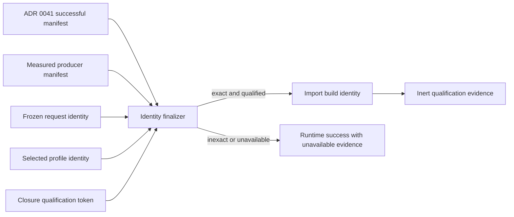

# ADR 0043: Producer Attestation, Closed-Input Qualification, and Import Build Identity

## Status and Authority

This ADR is Proposed and non-authoritative. It records the candidate design for exact producer
attestation, closed-input qualification, and import build identity. It grants no production,
default, maturity, cache, cooker, release, or publication authority.

No Accepted ADR depends normatively on this proposal. Runtime import and the ADR 0041 resource graph
must work without these types. Until an Accepted promotion lands, Baozi publishes no qualified import
build identity and no format, descriptor, maturity token, or report may imply one.

The proposal was separated from ADR 0041 so origin-qualified resource discovery and the complete
successful input manifest can be implemented before Baozi has a real cooker consumer, authenticated
producer measurement, exact nested identity schemas, and a managed qualification issuer.

## Context

ADR 0041 can prove which session-mediated resources and unavailable outcomes affected an import. It
cannot by itself prove that trusted importer or resolver code used no ambient behavior-changing input,
or that the exact executable producer can be reconstructed. A reproducible offline artifact must
bind the resource manifest to the producer, frozen request, selected semantic profile, and an
authenticated closed-input claim.

The previous combined draft specified those concepts inside the resource-graph ADR before their
nested schemas, issuer inventory, measured loader/build seam, or production consumer existed. That
made graph adoption depend on speculative release infrastructure and let Accepted documents consume
types that no production seam could issue.

## Proposed Decision

### Separate Identity Components

One candidate `ImportBuildIdentity` would combine four separately owned component digests:

| Component | Candidate owner and content |
| --- | --- |
| Input manifest | ADR 0041 complete canonical resource manifest digest and replay status |
| Producer | Exact measured executable/library/native/runtime-data closure plus source, resolved dependencies, behavior configuration, generated outputs, target, and toolchain |
| Frozen request | ADR 0016 effective common policy, limits, selection, loss/recovery/conformance policy, and every submitted/selected typed option |
| Selected profile | Candidate composition of ADR 0021's exact format/specification/extension declaration identity with ADR 0016's effective compiled option and recovery-profile identities; neither owner is redefined |

Changing any semantic component changes its component digest and the final identity. Audit-record IDs,
timestamps, issuer database revisions, and evidence renewal do not change semantic identity after the
same exact subject is reverified.

### Producer Manifest and Measurement

The candidate `ProducerManifestV1` has no caller-populated constructor. It can be sealed only by:

- a repository-managed build attestation that measures the artifacts it produced; or
- an object-bound loader measurement that compares the manifest with the executable, libraries,
  native binaries, and runtime data actually loaded for this import.

Both source-closure-bound and artifact-bound modes include the complete behavior-relevant runtime
artifact closure. Package versions, mutable tags, plugin filenames, display labels, function
pointers, `TypeId`, caller-reported digests, or unattached manifests are insufficient. Unknown or
unmeasured source, dependency, generated, configuration, native, runtime-data, target, or toolchain
components yield a typed unavailable producer identity.

### Closed-Input Qualification

The candidate design uses two non-convertible types:

- `ClosureQualificationToken` is a sealed, short-lived authority consumed only by the session
  identity finalizer. Its subject binds the exact producer identity, implementation declaration,
  selected profile, closure-relevant request predicate, capability-contract version, exact resolver
  semantic identity, proof schemes/rules, isolation/admission mode, and target predicate.
- `ClosureQualificationEvidence` is bounded inert audit output retained after token consumption. It
  cannot recreate a token or authorize another session.

Only a repository-managed conformance inventory and gate set may issue the token. Descriptors,
plugins, `SelfAttested`, ADR 0011 `BaoziVerified`, source hashes, and exact artifacts cannot construct
or convert it. Maturity and closed-input qualification remain independent axes.

The exact resolver semantic identity is derived from the resolver actually bound to the session, not
from caller text. Any ambient-capable IO path, subject mismatch, stale token, bypassable resolver,
unadmitted proof scheme, or target drift prevents qualification.

### Closed Internal Hashing Schemas

Every component uses ADR 0041's sealed typed value algebra, but this proposal does not become
Accepted until every nested record has a canonical schema owner, stable tag/version, ordered fields,
value kinds, enum tokens, collection order/duplicate rules, and complete known vectors. An opaque
blob, debug rendering, map iteration order, registration ordinal, pointer, host path, or adapter-
selected byte layout is forbidden.

The candidate top-level build record is domain-separated and includes algorithm identity:

```text
import-build-identity-v1(
  manifest-schema-version,
  manifest-digest,
  producer-identity,
  request-identity,
  selected-profile-identity
)
```

The exact byte transcript remains deliberately non-authoritative while this ADR is Proposed.

### Failure and Availability Boundary

Identity work begins only after ADR 0041 has atomically finalized the complete successful manifest.
Manifest graph/canonicalization/allocation/ledger/publication failure remains an `ImportFailure` and
cannot be relabeled as identity unavailability.

If the complete manifest and a bounded identity-unavailable reason slot are already admitted, an
identity-only measurement, schema, qualification, or identity-work failure may leave ordinary runtime
import successful with typed `IdentityUnavailable` evidence. A cooker or workflow requiring
reproducibility rejects before artifact publication.

### Cache and Maturity Boundaries

This proposal does not define a persistent cache lookup key, cache storage, eviction, artifact
schema, release signature, or format maturity. A build identity is post-discovery and cannot alone
serve as a pre-import lookup key. ADR 0017 authorizes no persistent-cache key or implementation and
requires a separate consumer-backed decision; ADR 0011 retains maturity evidence authority.



## Promotion Gates

This proposal cannot become Accepted until one atomic reviewed change supplies:

1. a real cooker, conformance, or reproducible-artifact consumer that rejects unavailable identity;
2. complete canonical schemas and independent known vectors for every nested producer/request/profile/
   closure/build record;
3. one measured build/loader implementation that detects stale, forged, dirty, untracked, generated,
   native, and runtime-data drift;
4. one managed closure inventory, unique token issuer, exact subject matcher, renewal/revocation
   behavior, and non-conversion tests against maturity/descriptor authority;
5. exact resolver semantic/proof-scheme binding and ambient-IO bypass rejection;
6. separate manifest-failure versus identity-unavailable fault-injection tests;
7. implementation, test, and CI tracers in the repository conformance inventory; and
8. an atomic update to ADRs 0011, 0017, 0020, 0021, 0022, 0041, and 0042, the authority index,
   asset-cooker/artifact policy, and the implementation plan wherever they choose to consume the
   accepted identity.

Trial code, if any, stays unreachable from production defaults and published package surfaces and
must remain removable.

## Alternatives Considered

### Option A: Keep producer/build identity inside ADR 0041

This gives one large document but blocks the resource graph on unimplemented attestation and nested
schema decisions. Rejected for the current Accepted architecture.

### Option B: Use package version or commit as producer identity

These values omit dirty/untracked input, generated output, native/runtime data, dependency closure,
and the artifacts actually loaded. Rejected.

### Option C: Let descriptors or maturity evidence issue closed-input authority

Declaration, maturity, and closed-input qualification answer different questions and have different
issuers. Rejected.

### Option D: Isolate this candidate until a consumer and evidence seam exist

This lets graph/manifest work proceed while preserving the design for evidence gathering and later
promotion. Proposed.

## Risks and Mitigations

| Risk | Severity | Mitigation before promotion |
| --- | --- | --- |
| Nested records still permit adapter-defined bytes | Critical | closed schema registry, exact owner sections, and independent known vectors |
| Producer manifest is stale or forgeable | Critical | object-bound measurement or authenticated managed build attestation |
| Resolver/proof semantics are absent from the closure subject | Critical | bind exact session resolver identity and admitted proof scheme/rules |
| Maturity token impersonates closure authority | Critical | distinct sealed types, inventories, constructors, and negative conversion tests |
| Identity failure hides manifest-finalization failure | Critical | identity phase starts only after complete atomic manifest publication |
| Proposed types leak into public/default production API | High | package/API scans and no Accepted consumer until promotion |
| Identity is mistaken for output equality | High | pair later with ADR 0026 complete Scene digest and reject unequal output for one identity |
| Post-discovery identity is used as a cache lookup key | High | ADR 0017 separate decision and candidate-hit verification requirement |

## Evidence Required

- one-field mutation matrices for source, artifact, dependency, configuration, generated, native,
  runtime-data, request, profile, resolver, target, and toolchain components;
- stale/forged/unmeasured manifest and actual-loaded-object mismatch fixtures;
- complete transcript hex/digest vectors independent from the production encoder;
- token issuer, subject mismatch, renewal, expiry, revocation, and cross-authority conversion tests;
- cooker rejection for every unavailable or unqualified identity cause; and
- authenticated provenance validation rather than an unauthenticated `builder.id` field.

## Sources

- [Bazel Remote Execution API at commit becdd8f9ff811df88a22d3eadd6341753d51d167](https://github.com/bazelbuild/remote-apis/blob/becdd8f9ff811df88a22d3eadd6341753d51d167/build/bazel/remote/execution/v2/remote_execution.proto)
  separates the content-addressed input root, action/command identity, result, and worker metadata.
- [SLSA build provenance v1.2](https://slsa.dev/spec/v1.2/provenance)
  separates build definition, resolved dependencies, run details, builder, invocation, and subjects;
  its requirements also distinguish authenticated provenance from merely recording an identity.
