# ADR 0044: Retained Physical Storage Ownership and Account Lineage

## Status and Authority

This accepted ADR is the sole authority for the physical ownership, charging, release, and
cross-generation lineage of retained Baozi storage. It supersedes ADR 0042, whose concrete U4
protocol, type names, measurement commands, source closures, thresholds, and amendment history remain
useful implementation history but are no longer architectural authority.

This decision does not claim that the current workspace conforms. ADR acceptance, implementation
conformance, format maturity, and release readiness remain separate axes under the ADR governance
policy.

The adjacent owners remain distinct:

| Concern | Authority |
| --- | --- |
| Canonical Scene ownership and generation identity | ADR 0045 |
| Representation and sharing policy | ADR 0009 |
| Operation work, live attribution, peaks, and committed evidence | ADR 0047 |
| Retained physical allocation lifetime and account lineage | ADR 0044 |
| Edit remaps, invalidation, and generation transition | ADR 0032 |

## Context

One immutable canonical payload may be reachable from a source Scene and several derived Scene
generations. Charging the payload once per Scene handle overcounts one allocation. Releasing every
charge when the creating operation finishes undercounts storage that remains live. Moving an old
operation reservation into a later operation also rewrites completed evidence and cannot model
sibling generations.

The physical owner must therefore follow the allocation, while operation evidence continues to
describe why work and allocation happened. The protocol is failure-sensitive: allocation,
membership, publication, and final release span storage and accounting state whose destructor order
matters. Reimplementing that protocol in core, importers, or postprocess steps would multiply
partial-failure and optimistic-refund bugs.

ADR 0042 selected this direction but also made temporary U4 implementation choices normative. It
specified concrete block variants, source hashes, collector commands, test vectors, and exact
performance thresholds. Those details must remain replaceable without an architecture amendment as
long as the ownership guarantees in this ADR continue to hold.

## Decision

### Three Non-Interchangeable Measurements

Baozi keeps three separately typed measurement planes:

| Measurement | Meaning | Retained-sharing rule |
| --- | --- | --- |
| Generation logical footprint | Semantic values, presence, and references reachable from one Scene generation | Counts logical ownership independently of allocation topology |
| Operation attribution | Work, temporary live storage, new retained storage, and committed output caused by one operation | A new retained allocation is attributed to the operation that creates it; inherited payload is not new allocation |
| Physical account state | Unique live retained allocation envelopes in one host-selected retention domain | Each allocation envelope is charged once until final verified deallocation |

No plane may authorize, reconstruct, or substitute for another. In particular, a logical footprint is
not a physical allocation plan, and an operation commitment is not an allocation owner.

### Allocation-Bound Physical Ownership

Every retained allocation belongs to exactly one physical account for its complete lifetime:

1. The complete physical envelope is checked and charged before allocator entry.
2. Successful allocation binds storage and its physical charge into one owning state.
3. Copying or sharing a reference does not create another payload charge.
4. The charge cannot be transferred, rebranded, detached, or refunded while the allocation may
   remain live.
5. Final verified release destroys the owning storage before releasing its account-bound charge.

The account is a host-owned retention domain, not a Scene identity and not an import session. Account
equality is necessary for sharing but grants no lineage by itself.

### Account Creation, Shared State, and Observation

An account is created only through an explicit host-owned bounded account factory. The factory admits
the complete account-control envelope and one live-account slot before account creation. Final
account destruction destroys its control storage before releasing the corresponding factory charge.
The factory control object is the explicit recursion boundary and remains host overhead. Baozi
exposes no unbounded, default, or process-global factory, and no convenience API creates a fresh
hidden factory per request.

Every account handle, clone, and allocation-bound owner observes the same account state. One
account-local linearization domain orders physical admission and release, monotonic poison, and final
publication eligibility. Its checked counters prevent concurrent admission from passing stale limits.
The required ordering is:

1. Poison before operation start or allocation/share admission rejects before work, reference-count,
   account-counter, or allocator effects. Poison before final publication eligibility exposes no
   prepared terminal.
2. Admission before poison keeps its complete charge. Later admission rejects, and an operation that
   has not passed final publication eligibility cannot publish.
3. Final publication eligibility before poison yields an already qualified exact terminal owner.
   Pure handoff performs no further account observation or mutation.

A read-only account snapshot reports current physical bytes, peak physical bytes, live allocation
count, poison state, poison-event count, and first inert poison evidence as one account-qualified
observation. It cannot authorize work or reconstruct ownership. The operation ledger and physical
account remain independently linearized and expose no combined atomic snapshot.

### One Deep Physical Subsystem

`baozi-operation` owns one deep subsystem that implements physical admission, allocation binding,
membership, final-owner release, account poisoning, and publication-side disposition. The subsystem
may change its private data structures and concrete APIs without revising this ADR.

Core owns shareable private typed tables and immutable pools through an operation-owned
`SharedRetainedStorage<T>`. Its single shared header and complete backing capacities are admitted
before allocation; derived generations share the existing final-owner allocation and charge.
Import uses the inline `RetainedStorage<T>` mechanism for actual manifest, diagnostic,
loss, source-scope, and failure data without adding a shared header for every path or row. Both
forms use the same account and storage-first final release. This replaces the opaque-aggregate-only restriction: an owning
header may expose borrowed typed data while keeping its physical lease private and inseparable.
It does not grant Scene identity, validation authority, or an independent publication route.

An inline owner does not allocate another shared header for every path or vector. Its containing
allocation covers its inline fields; its lease covers only its own qualified backing allocations.
Separately owned children retain their own charge and are not also counted in the parent. Sharing
an immutable table or page uses the existing admitted shared-allocation mechanism when needed.
For an aggregate containing shared children, central admission covers its handle-vector capacities
before preparation acquires those existing child handles. Preparation and table construction consume
the same admission. A returned failure destroys the prepared handles and backing vectors before
releasing that admission. This is one storage ownership path, not a second domain allocator.
Both ownership forms use the same storage-first release and poison handling, including ordinary
host unwind. A destructor failure preserves uncertain charges rather than reporting clean release.

Trusted integration adapters derive admission from the same existing `CapacityPlan` values consumed
by allocation. Already-owned caller storage is admitted when ownership transfers into the library.
Producer and supported consumer APIs do not expose raw physical accounts, leases, detachable payload
ownership, or arbitrary footprint authority. A typed owner exposes no consuming payload accessor or
unrestricted mutable borrow that could detach its backing allocation. Domain layers do not implement
another account, allocator protocol, or cleanup-containment mechanism.

Semantic validation remains in core. The physical subsystem proves allocation ownership, account
membership, destination membership, and the structural closure required by its own publication
protocol; it does not interpret Scene semantics.

### Construction and Publication

Physical planning and execution form one linear authority. The implementation must derive physical
shape and charge from the same sealed construction description that execution consumes. A detached
count, copied footprint, or caller-maintained table shape cannot independently authorize retained
construction.

```mermaid
flowchart LR
    Semantic[Core semantic construction request]
    Plan[Operation-owned linear physical plan]
    Admit[Account and operation admission]
    Build[Retained allocation construction]
    Validate[Physical and semantic validation]
    Prepare[Freeze attribution and destination]
    Handoff[Pure ownership handoff]
    Release[Final storage-first release]

    Semantic --> Plan
    Plan --> Admit
    Admit --> Build
    Build --> Validate
    Validate --> Prepare
    Prepare --> Handoff
    Handoff --> Release
```

Ordinary rejection before mutation, or after complete verified rollback, may preserve a linear retry
capability. Once cleanup, owner disposition, or accounting conservation cannot be verified, the path
is abandoned: it exposes no retry or success-capable owner.

Preparation freezes the operation's attribution and destination commitments before a terminal owner
is exposed. Handoff performs no allocation, callback, accounting mutation, validation, or fallible
work; it only moves already-qualified owners into their exact terminal domain.

### Failure Containment

Release follows a conservative rule:

- storage is destroyed before its physical charge is released;
- a known intact allocation remains charged;
- an uncertain release preserves every possibly live owner/charge coupling;
- uncertainty poisons the account monotonically and rejects later admission; and
- an uncertain path returns typed fatal containment rather than a clean fallback, retry, or zero-leak
  claim.

A caught unwind can only produce an ordinary domain outcome after the physical protocol proves the
required cleanup and ownership state. Double panic, `panic = "abort"`, process termination, and OOM
remain process-isolation boundaries.

### Cross-Generation Sharing

A derived generation may share an unchanged immutable payload only when all of these are proved:

1. the payload kind is explicitly admitted as shareable;
2. the source allocation is a live member of the same physical account;
3. the operation possesses lineage authority for the exact input generation; and
4. the target publication creates its own generation-local reference and validates reachability.

Same-account but unrelated Scenes cannot share. Source generation-local references are never reused
as target references. Changed payloads and structural records that encode target-local references are
rebuilt. Cross-account composition materializes a complete independently admitted copy.

The implementation may narrow the shareable-kind set without an ADR amendment. Expanding it requires
proof that the new kind is immutable, contains no generation-local reference, preserves semantic
ownership, and cannot smuggle source membership into the target.

### Semantic Exclusion

The following physical facts never enter canonical Scene identity, semantic digest, provenance,
stable wire, or format evidence:

- account and allocation identifiers;
- pointer, reference-count, slot, table, or capacity topology;
- allocator-observed capacity and padding;
- whether an admitted payload is new or inherited; and
- private construction-plan or publication-state representations.

Equivalent Scene semantics therefore remain equivalent across allocator, block layout, sharing, and
private protocol changes.

### Replaceable Implementation Specification

Concrete block kinds, table and directory layouts, plan instruction syntax, branch cursors, collector
event names, source allowlists, hash anchors, benchmark fixtures, commands, and thresholds are
implementation or conformance specification. They belong in source, tests, plans, and
`docs/conformance/`, not in this ADR.

Changing those details requires normal implementation review and executable evidence. An ADR change
is required only when the change moves this concern, introduces another physical owner, weakens
storage-before-charge release, permits optimistic refund, broadens lineage without proof, or allows
physical topology to affect semantics.

## Alternatives Considered

### Option A: Charge the complete logical Scene to every generation

Pros:

- simple per-Scene totals;
- no explicit lineage authority.

Cons:

- multiplies one allocation by branch count;
- cannot describe physical retention truthfully;
- makes cheap immutable edits appear to duplicate all payloads.

Decision: rejected.

### Option B: Transfer operation reservations across publications

Pros:

- reuses the operation ledger mechanism;
- initially avoids a separate physical account.

Cons:

- mutates completed operation ownership;
- cannot model sibling generations;
- couples allocation lifetime to unrelated later work.

Decision: rejected.

### Option C: Expose generic owning allocations and reservations to domain crates

Pros:

- lets each domain build arbitrary retained structures;
- minimizes the central subsystem's surface.

Cons:

- duplicates rollback, destructor-order, and poisoning protocols;
- lets a safe generic value hide unaccounted nested storage;
- makes review depend on every caller preserving global invariants.

Decision: rejected.

### Option D: One operation-owned physical protocol with opaque owners and non-owning semantic views

Pros:

- gives physical ownership one implementation;
- keeps accounting conservation and cleanup order locally provable;
- permits private layout and planning refactors without semantic changes;
- supports exact-input immutable sharing without exposing physical authority.

Cons:

- requires a deliberate construction vocabulary;
- concentrates substantial failure-state complexity in one subsystem;
- requires cross-layer integration tests at publication boundaries.

Decision: accepted.

## Consequences

Positive:

- one allocation has one physical charge regardless of branch count;
- operation evidence remains immutable after completion;
- core can evolve its semantic schema without owning lease or destructor machinery;
- uncertain cleanup cannot become an optimistic refund or successful publication; and
- private storage layout and measurement tooling remain replaceable.

Negative:

- retained construction must pass through a sealed linear plan;
- same-account sharing still needs exact lineage proof;
- cross-account composition pays for a complete copy; and
- publication and final release require extensive fault-injection coverage.

## Risks and Mitigations

| Risk | Severity | Mitigation |
| --- | --- | --- |
| A detached footprint diverges from executed storage | Critical | Derive shape and charge from one linear execution authority; reject incomplete or extra execution before preparation |
| Domain code obtains owning physical authority | Critical | Keep raw owner/reservation/lease types private and enforce compile-fail plus source-boundary tests |
| Cleanup releases charge before storage | Critical | Make storage-first release structural and inject failures at every stable owner state |
| Same-account Scenes smuggle unrelated storage | Critical | Require exact-input lineage authority and fresh target-local references |
| Uncertain cleanup is reported as retryable | Critical | Poison monotonically, retain possible charges, and expose only typed fatal containment |
| Private topology changes semantic output | High | Exclude all physical facts from identity, digest, provenance, and wire; compare semantic transcripts across layout permutations |
| The deep subsystem becomes a generic storage framework | High | Admit only production-driven construction operations and reject arbitrary owning payload APIs |

## Success Metrics

| Metric | Target | Measurement |
| --- | --- | --- |
| Bounded account creation | Account-control storage and live-account slots remain admitted until final storage-first account destruction | Factory creation/destruction fault injection |
| Unique physical charge | Every live retained allocation envelope is charged exactly once | Account snapshots and allocation fault injection |
| Account-state ordering | Concurrent admission cannot exceed limits; poison/admission/final-eligibility races follow the three specified orders | Barrier tests and account snapshots |
| Release ordering | Storage release precedes the final charge release on every verified path | Destructor-order probes |
| Failure conservation | No uncertain path refunds or exposes retry/success ownership | Panic, poison, and cleanup-failure state-machine tests |
| Lineage isolation | Unrelated same-account Scenes cannot share; exact derived inputs can share admitted immutable payloads | Cross-generation positive and negative tests |
| Authority boundary | Private typed owners expose borrowed data while keeping payload ownership and physical leases inseparable | Compiler boundaries and owner/drop tests |
| Semantic independence | Equivalent semantics keep the same digest across private layout and sharing permutations | Independently authored semantic vectors |

## Acceptance Criteria

- One operation-owned subsystem is the only implementation of retained physical ownership and
  release; runtime allocation owners remain bound to their storage and charge.
- Accounts come only from an explicit host-owned bounded factory, and account-control storage remains
  covered until final storage-first account destruction.
- Every account clone observes one linearized counter/poison/publication state and one
  account-qualified current/peak/live-allocation snapshot.
- Private domain storage may use central inline typed owners or admitted shared aggregates;
  public semantic reads borrow data and do not expose physical control or detachable ownership.
- Physical planning and execution consume one linear authority; caller-declared totals cannot authorize
  allocation or publication.
- Every successful allocation is precharged, remains charged while live, and releases storage before
  its final physical charge.
- Every uncertain cleanup path is fail-closed and cannot return retry, fallback, or success ownership.
- Cross-generation sharing requires admitted kind, account membership, exact-input lineage, and fresh
  target-local references.
- Physical topology is absent from Scene identity, digest, provenance, and stable interchange.
- Current implementation status is recorded outside this ADR and no concrete U4 metric or source hash
  is treated as architectural authority.

## Sources

- [Fallible shared-storage admission research](../research/fallible-shared-storage-admission.md)
- [Active library delivery plan](../plans/2026-10-29-001-refactor-library-delivery-plan.md)
