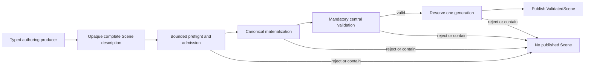

# ADR 0045: Canonical Scene Ownership, Construction, and Generation

## Status and Authority

This accepted ADR is the sole authority for canonical Scene aggregate ownership, construction,
mandatory validation, publication, and generation identity. It supersedes ADR 0003, whose detailed
U4 state names, failure matrices, command sequences, and amendment history remain useful historical
context but are no longer architectural authority.

Semantic domain ADRs continue to own the meaning of geometry, appearance, deformation, animation,
spatial data, and provenance. ADR 0032 owns edit remaps and derived-data validity. ADR 0044 owns
retained physical allocation lifetime. This ADR owns how those domains become one valid Scene.

Acceptance does not itself claim implementation conformance, format maturity, or release readiness.

## Context

Baozi must accept untrusted format input without exposing partially valid Scene state, mutable
canonical storage, or publication authority to parsers. A canonical Scene contains several semantic
domains whose references, ownership, work, storage shape, and validation must agree. Treating those
facts as independent caller-provided inputs creates mix-and-match plans and bypassable validation.

The completed canonical cutover established one retained representation and one public owner. The
architecture now needs a durable statement of that seam without freezing the private table layout or
the internal activation state machine.

## Decision

### One Opaque Construction Description

`baozi-core` owns one opaque, single-use Scene construction description. Format and import code may
submit complete typed authoring values through the approved authoring interface, but cannot own,
inspect, replace, serialize, clone, or reactivate unpublished canonical storage.

The same sealed description determines:

- semantic work admission;
- retained and temporary storage requirements;
- canonical record and payload shape;
- validation inputs; and
- materialization execution.

Callers cannot supply an independent work total, shape, validation proof, or execution payload. A
construction-description mismatch is a contract failure, never a recoverable format rejection.

### Mandatory Construction Sequence

Preflight is authority-free with respect to publication. Materialization cannot expose a public
Scene. Central validation is non-bypassable and uses the materialized canonical root plus the sealed
description's exact evidence. Generation reservation occurs only after validation succeeds and
before the infallible public handoff.

Construction must work on the caller's normal platform stack in debug and release builds. Large
execution plans belong in fallible, metered preflight storage and are borrowed by materialization;
they must not be copied through each activation wrapper. This storage is released before its live
reservation and before the operation verifies that scoped planning work has ended. No terminal
transition needs to allocate a replacement plan or require a larger host stack.

### Descriptor and Owner Separation

`SceneDraft` is a non-owning, non-cloneable descriptor paired with exactly one pending construction
owner. It contains no public canonical storage, generation, validation proof, or publication
authority. Only the matching owner may consume it. Missing, duplicate, stale, or foreign descriptors
cannot publish.

`ValidatedScene` is the opaque owner of one centrally validated canonical generation. It owns the
retained storage transitively, exposes only bounded semantic observation, and releases its ownership
when dropped. Public code cannot name raw retained blocks, mutable tables, internal validation
members, or physical-account authority.

### Immutability and Edits

A published Scene is immutable. A mutation request compiles into one transaction against an exact
source generation. Success publishes a new generation; failure leaves the source generation
unchanged. Storage sharing may be used internally only when ADR 0044's lineage and final-owner rules
hold. ADR 0032 owns operation-specific remaps, invalidation, and reports.

### Private Typed Storage

The private `SceneStorage` root owns `SceneTables`, containing the actual node, geometry, profile,
spatial, and deformation owners. Node rows retain an explicit synthetic/Matrix/TRS transform, ordered child
ranges, optional name ranges, and optional
spatial attachments. Geometry rows retain typed logical indices and ranges into contiguous scalar
pools. A row does not carry a publication-local concrete-store slot for another typed row or pool.
Dense F32/F64/U32/I32 values, sparse indices and defaults, and Vertex/Corner/Face cardinalities remain
explicit. Spatial storage owns an inline `SceneSpace`, typed camera projections, and typed light
definitions. The existing bounded extension identities remain inline values; no second schema-name
pool, offset codec, or publication-local spatial reference is needed. Public borrowed views project
these actual tables without allocating another model.

Deformation uses one retained owner for seven row tables and ten contiguous payload buffers.
Skins retain ordered logical node indices, whole inverse-bind matrices, names, skeleton hints,
and inline matrix-space corrections. Geometry-aligned rows retain logical morph definitions,
primitive influences and deltas, and instance skin/weight selections. Vertex offsets and the three
influence columns remain directly borrowable; sparse morph omissions require no allocated default
tuple. An explicit empty sparse stream or weight override retains its presence. Owner indices and
payload ranges are independent of Scene generations; public lookup qualifies identities at the
Scene boundary. No deformation directory, scalar codec, or record rewrite is retained.

Core defines the row layout and exact `CapacityPlan` values. Operation owns admission, the physical
account, retained leases, shared ownership, and storage-first release. A core builder runs only inside
that central admission. It verifies the observed Vec capacities before returning its complete owner.
Core must not create an independent allocator, lease, or ledger protocol.

Canonical-byte admission for migrated domains counts their initialized typed storage header, rows,
and used scalar/name elements under the target ABI. Matrix and TRS variants occupy the same node
row width; sparse payloads count their retained indices, explicit values, and defaults. Inline
extension names and digests are included once. The remaining Scene record directory contributes
its current encoding once, independently of node and geometry. Retired record/reference/transform
leaf formulas and an empty-geometry-directory placeholder have no role in typed domain limits.
Unused capacity and retained-owner infrastructure remain in operation's separate physical admission.
These canonical-byte counters do not describe allocator overhead or process RSS.

Typed table owners use operation's final-owner-backed `SharedRetainedStorage<T>`, with one centrally
admitted and charged shared header per table owner; inline evidence and path storage retain their
existing `RetainedStorage<T>` owner without a separate header per path.

Central validation borrows the actual immutable tables and scalar pools. It allocates only mutable
marks, traversal state, and caches required by an algorithm; immutable node, geometry, spatial, or deformation
rows are not copied into a second validation projection. Reads and semantic validation remain
cancellable and metered. Complete owner coverage, topology, payload shape, finite values, range
bounds, sparse index order, and cross-domain references remain mandatory before generation reservation.

A node-transform edit replaces its node table and shares the unchanged geometry, spatial, and deformation owners.
Geometry tables and their payload pools retain their original addresses and one physical charge
across source and destination generations. No generic geometry-record rebuild or dynamic payload-slot scan is part
of that edit. Spatial declarations and camera/light definitions retain their original owner while
node placement references remain centrally checked. A Matrix/TRS width change does not change the
node table layout. Deformation validation borrows its real rows and payloads, retaining only
per-logical-mesh palette maxima and bounded uniqueness marks. Animation target-width checks borrow
the same deformation and geometry owners rather than constructing cross-domain descriptors.
Semantic cursors borrow validation authority when needed; typed geometry and deformation cursors
derive lengths directly from their proof-qualified tables without copying the cross-domain proof.

Typed owners follow the same rejection, publication, and ordinary host-unwind lifecycle as the
directory-backed domains. Dropping either generation first leaves shared geometry, spatial, and deformation data
available to the survivor; the final generation releases the storage before its charge. A refused
build action drops partially initialized vectors before the central admission is released. Retained
rows, scalar pools, and their charge never escape as independently movable parts.

During the domain cutover, appearance and animation storage may
remain in the existing retained owner under the same Scene root. Their node/geometry dependency
checks borrow the actual typed tables. This is a migration boundary between domains, not a second
Scene representation or a permanent compatibility adapter. Each subsequent domain cutover deletes
its replaced record schema and conversion/validation projection in the same change.

Profile state owns the current typed owner/attachment table, immutable lineage segment handles,
and owner-bearing metadata descriptors. Each lineage segment and the metadata payload pools have
independent retained owners. Operation digests are inline typed values. Lineage text and metadata
text are `String` values, retaining UTF-8 validity through construction and cancellation. The central
profile validator borrows these actual tables and pools, allocating only one depth value per
provenance node. There is no parallel scalar-record encoding or full immutable-payload projection.

An edit derives its owner catalog from its concrete final domain layout. Every changed owner gets
its own operation node with its actual parent attachments; unaffected attachments preserve their
segment qualification. Existing node-transform and triangulation edits share ancestor lineage and
metadata payloads. New operations that change owner coordinates must update the same concrete
mapping for attachments and metadata descriptors before publication. Neither a fixed input-owner
row count nor an independent optional geometry plan authorizes the output layout.

The D1 behavior gates cover borrowed Vertex/Corner/Face data, dense F64 values, sparse defaults and
ordered indices, malformed ranges and references, interruption before a validation or copy action,
Matrix/TRS replacement, and sharing across generation drop order and host unwind. The delivery
plan's ignored scale fixtures record deterministic work and allocator-request observations separately
from process memory. These gates and the combined build must execute on the integrated source before
the cutover is reported as accepted; the storage design and this ADR alone are not runtime evidence.

### Interface Ownership

| Interface | Owner | Guarantee |
| --- | --- | --- |
| Typed authoring values | `baozi-core` semantic domains | Describe canonical meaning without storage or publication authority |
| Construction continuation | `baozi-core` | Owns one complete unpublished construction and consumes it once |
| Draft descriptor | `baozi-core` | Identifies the matching pending construction without owning it |
| Validated Scene | `baozi-core` | Owns one immutable, centrally validated generation |
| Import orchestration | ADR 0046 | Holds the import outcome owner and pairs parser result with construction |
| Ledger accounting | ADR 0047 | Admits and records work, temporary storage, and committed output |
| Physical retained storage | ADR 0044 | Owns allocation lifetime and cross-generation lineage |

## Alternatives Considered

### Option A: Public mutable Scene collections with caller-invoked validation

This is easy to construct but makes invalid intermediate state public and lets callers forget or
bypass validation. Rejected.

### Option B: A parser DTO followed by a separately derived canonical model

This creates two semantic authorities, doubles validation and conversion work, and makes work/shape
counts drift from execution. Rejected.

### Option C: One core-owned opaque construction and validated generation

This keeps semantic description, admission, materialization, validation, and publication in one
single-use lifecycle while hiding storage mechanics. Chosen.

## Consequences

Positive:

- no producer can publish partially validated canonical state;
- one description owns work, shape, validation, and execution facts;
- storage layout can evolve without changing the public Scene contract;
- failure cannot mint a generation or expose a partial Scene; and
- edit transactions preserve immutable source generations.

Negative:

- custom producers must build the complete typed description before publication;
- direct mutation and raw-buffer ownership are intentionally unavailable; and
- bounded observation may require explicit snapshot or typed-view work.

## Risks and Mitigations

| Risk | Severity | Mitigation |
| --- | --- | --- |
| Description, work, and execution drift | Critical | derive all three from one opaque sealed description and contain mismatches |
| Parser obtains publication authority | Critical | expose only typed authoring values and a non-owning draft descriptor |
| Validation becomes optional | Critical | make publication consume the central validation result structurally |
| Generation is burned on ordinary rejection | High | reserve only after validation and preserve zero-publication failure paths |
| Public inspection leaks raw storage | High | expose bounded semantic methods and typed views, never retained blocks |
| Shared storage outlives its final owner incorrectly | Critical | delegate allocation lifetime and lineage to ADR 0044 |

## Success Metrics

| Metric | Target | Measurement |
| --- | --- | --- |
| Production Scene rails | exactly one canonical construction/publication path | workspace source and package-surface review |
| Validation bypass | zero public path from authoring input to `ValidatedScene` without central validation | construction and negative API tests |
| Descriptor pairing | missing, duplicate, stale, and foreign descriptors publish zero Scenes | import/core contract tests |
| Failure generation use | ordinary pre-publication failures commit zero generations | generation and terminal evidence tests |
| Raw storage exposure | zero public retained-block or mutable-table type | rustdoc and packaged-consumer checks |
| Drop correctness | all retained live storage reaches zero after final owner drop | account and multi-generation lifetime tests |

## Acceptance Criteria

- One opaque complete description determines work, shape, validation, and execution.
- `SceneDraft` remains non-owning and can publish only with its exact pending owner.
- Central validation is mandatory and precedes generation reservation.
- `ValidatedScene` is immutable, owns one generation, and exposes no raw retained storage.
- Failure or containment exposes no partial Scene and cannot be relabeled as success.
- Edits publish a new generation transactionally and never mutate the source generation.
- Format, import, facade, snapshot, fuzz, and postprocess consumers use this same Scene model.
