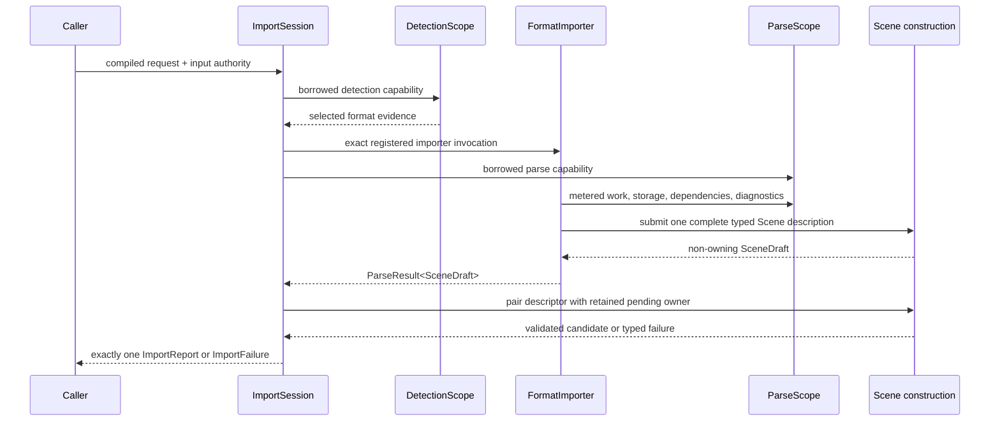

# ADR 0046: Import Session Lifecycle and Outcome Ownership

## Status and Authority

This accepted ADR is the sole authority for import-session ownership, detection and parse
capabilities, phase evidence, terminal outcome construction, cause preservation, and final Scene
handoff. It supersedes ADR 0020, whose private activation states, exhaustive failure matrices, and
migration-era call sequences remain historical context rather than architectural authority.

ADR 0045 owns canonical Scene construction. ADR 0047 owns operation accounting. ADR 0041 owns the
resource graph and successful input manifest. This ADR owns the orchestration that consumes those
modules into exactly one import result.

Acceptance does not itself claim implementation conformance, format maturity, or release readiness.

## Context

Import spans request compilation, primary binding, format detection, parser invocation, dependency
access, diagnostics, canonical Scene construction, validation, and final publication. If each stage
owns its own mutable context or terminal result, failures can be relabeled, evidence can be lost, and
more than one ledger or finalizer can emerge.

The lifecycle therefore needs one owner from bootstrap through terminal publication and narrow
borrowed capabilities for untrusted format code.

## Decision

### One Session Owner

After request and typed option compilation succeeds, one fallible bootstrap creates `ImportSession`.
The session owns:

- the sole import operation and ledger;
- stable primary-input and selected-format evidence;
- the dependency resolver and session resource state;
- bounded diagnostics, loss, source-scope, and graph evidence;
- the terminal-cause latch and outcome builder; and
- one dormant, single-use canonical Scene activation authority.

No parser, format adapter, core construction, or facade layer may create a second import operation,
outcome builder, or finalizer.

Large construction state must be admitted before activation and borrowed through its phase work.
Failure transitions cannot allocate replacement state. Any session storage surviving central
validation must account for early fallback preparation as well as the normal finalizer; introducing
a new long-lived scratch reservation cannot silently change which failure paths may freeze.
The import state slot and semantic vocabulary live in one startup-admitted `AccountedVec` cell.
Phase transitions borrow that cell instead of moving the full state through the outer import
frames. Before terminal preparation, the session extracts its pending linear owner, destroys
the empty cell allocation, and releases its charge. Early fallback paths obey the same lifetime
boundary; no additional allocation occurs at the terminal pivot.
Dropping an intact dormant session, including during unrelated host unwind, destroys its healthy
operation baseline normally. A host that extracts that owner from its stable session slot marks
the transient activation obligation explicitly. Abandoning that transfer or an active scoped
driver remains an ownership fault and invokes containment; a panic flag alone does not establish
that fault.

### Capability-Limited Stages

`DetectionScope` can inspect only the stable primary input and bounded detection facilities.
`ParseScope` borrows metered work, temporary storage, dependency, diagnostic, option, source-scope,
and Scene-authoring capabilities. Neither scope can escape the session, finalize an outcome, obtain
the raw operation, or publish a Scene.

The registry invokes exactly the selected importer. Format failures cross the seam only as bounded
Baozi-owned inert evidence; foreign error objects, callbacks, handles, and destructors do not enter
the terminal result.

### Draft Pairing and Scene Activation

The parser returns `ParseResult<SceneDraft>`. The session privately retains the matching construction
owner and consumes both together after parser-local buffers and borrows have ended. Missing,
duplicated, already-consumed, stale, or foreign descriptors are trusted-extension contract failures.

Scene activation consumes the session's dormant authority once. Core receives only the bounded
construction lane required by ADR 0045, never the import outcome-evidence owner or a second ledger.
Success performs one no-fail publication pivot and pure handoff. Failure retains zero public Scene.

### Terminal Cause and Outcome

After bootstrap, every survivable path returns exactly one `ImportReport` or `ImportFailure`.
Containment failures that cannot produce trustworthy terminal evidence return a distinct
`ImportRunError` containment outcome and never fabricate a normal failure report.

The first authoritative lower cause is preserved. Later control, ledger, product-graph, or contract
faults may strengthen containment according to their owning ADRs but cannot be hidden by a parser
catching an earlier error or returning a different value. The terminal ledger evidence is the sole
authority for final operation class and code; a parallel runtime classifier is forbidden.

Successful reports own the validated Scene, ledger snapshot, phase evidence, diagnostics, source
scope, loss evidence, and any completed successful input manifest. Failures own only evidence that
was safely finalized. Actual container and path storage moves into these outcomes with its central
physical lease; moving to a terminal draft never releases a live token while retaining an unowned
allocation. `ImportEvidence` remains an independent owner when a caller moves out or drops the Scene.
Rich failure and minimal fallback retain the same safely captured evidence, including bounded
required-dependency context and format failure detail. Replacing a failure cause destroys its old
payload before releasing its matching lease. Handoff allocates and copies no output storage.
Postprocess begins a separate operation and is never an import phase.

The private `AccountedErrorContext` carries an import cause and its captured-detail lease together
from finalization into `ImportFailure`. Rich and minimal failure use this same owner. Terminal cause
selection replaces a payload through that owner rather than extracting a bare cause or duplicating
its destructor protocol in the report.

An owned parser failure transport can outlive its parse call when extension code retains it. Its
format-failure envelope therefore carries the lease for its actual evidence buffers. The session's
capture marker detects swallowed or duplicate failures without owning those external buffers. A
terminal rejection cannot release their physical charge while the extension still owns the payload.
The envelope keeps only a descriptor handle and a one-element vector handle. Its concrete cell
contains the packed evidence and the existing reservation for all three backing allocations.
The cell capacity is admitted and fallibly allocated with both payload buffers before any producer
callback. Destruction extracts the lease, destroys the evidence and cell allocation, then releases
the charge through the central storage-release API. No shared header or generic allocation
framework is introduced. Size guards keep parser failure transport below the large-error threshold;
normal-stack consumer coverage remains the acceptance check for cumulative call frames.

Ambiguous detection also returns a small vector handle. Its concrete one-element cell moves the
existing accounted candidate vector without copying its identities; the cell's own allocation is
admitted separately before it is allocated. Public cause transport therefore stays bounded without
adding per-function large-error exceptions. The candidate and cell allocations both release through
their actual owners.

The public ledger snapshot owns the already retained frozen ledger and projects semantic rows on
demand. It does not materialize another complete dimension/phase table in each result or error.
Borrowed reads neither allocate nor share an account handle. The snapshot has linear ownership;
an implicit `Clone` must not introduce unadmitted retained sharing or an unaccounted table copy.

### Stable Lifecycle Phases

The public lifecycle distinguishes request compilation, primary binding, detection, parsing,
canonical construction, validation, outcome finalization, and handoff. Implementations may refine
private states, but public phase evidence must be monotonic, cannot claim a milestone that did not
complete, and must not expose private typestate names.

## Alternatives Considered

### Option A: Let each importer construct its own report and Scene

This gives format code terminal authority, duplicates policy, and permits evidence omission or
validation bypass. Rejected.

### Option B: Let core own the complete import operation

Core would need registry, IO, dependency, diagnostics, and format-failure policy and would reverse
the crate ownership direction. Rejected.

### Option C: One session owner with borrowed capabilities and one finalizer

This keeps lifecycle and evidence authority in `baozi-import` while core owns only canonical Scene
construction. Chosen.

## Consequences

Positive:

- every admitted import has one operation, outcome owner, and terminal result;
- parser code cannot publish, relabel terminal causes, or access raw storage authority;
- format panics and failures can be contained at one invocation seam;
- draft/owner pairing prevents foreign or caught-error publication; and
- resource, diagnostic, loss, and phase evidence reach one result consistently.

Negative:

- parser interfaces are capability-oriented rather than convenience-oriented;
- finalization may fail closed when evidence ownership is inconsistent; and
- direct format-level report construction is intentionally unavailable.

## Risks and Mitigations

| Risk | Severity | Mitigation |
| --- | --- | --- |
| A parser catches a construction failure and returns success | Critical | latch construction failure in the session before control returns |
| A foreign draft publishes another construction | Critical | pair every descriptor with one private retained owner and brand |
| Early failures bypass the canonical terminal path | Critical | create the session owner before primary binding and detection |
| Core starts a second import ledger | Critical | pass only a bounded construction lane from the session-owned operation |
| Runtime error and ledger terminal disagree | High | derive final class/code only from terminal ledger evidence |
| Capability or foreign destructor escapes | High | return only session-borrowed capabilities and inert Baozi-owned evidence |
| Milestone evidence advances too far on cancellation | High | advance phases only after the corresponding boundary completes |

## Success Metrics

| Metric | Target | Measurement |
| --- | --- | --- |
| Import operation owners | exactly one per admitted session | session and ledger ownership tests |
| Terminal results | exactly one normal report/failure, or one containment error | cancellation, panic, and finalization matrix |
| Descriptor misuse | zero publication for missing, duplicate, stale, or foreign drafts | malicious importer tests |
| Parser authority leakage | zero raw operation, retained store, finalizer, or publication type | rustdoc and packaged-consumer checks |
| Phase correctness | every cancellation stage reports the last completed public milestone | stage-boundary tests |
| Resource release | zero live temporary and retained failure storage after terminal owners drop | ledger/account tests |

## Acceptance Criteria

- Request and option compilation completes before the session touches primary IO.
- Bootstrap creates the only import operation and outcome owner before detection.
- Detection and parsing receive borrowed, bounded, non-finalizing capabilities.
- Exactly the selected registered importer is invoked, and foreign failures become inert evidence.
- The parser returns one non-owning draft descriptor paired with a session-held construction owner.
- Missing, duplicate, caught-error, stale, or foreign descriptors cannot publish.
- Success returns one centrally validated Scene; failure returns no partial Scene.
- Terminal class and code come from one ledger-evidence authority.
- Postprocess uses a separate operation and lifecycle.
