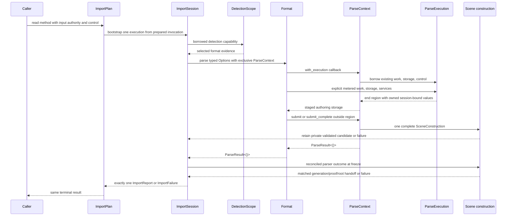

# ADR 0046: Import Session Lifecycle and Outcome Ownership

## Status and Authority

This accepted ADR is the sole authority for import-session ownership, detection and parse
capabilities, phase evidence, terminal outcome construction, cause preservation, and final Scene
handoff. It supersedes ADR 0020, whose private activation states, exhaustive failure matrices, and
migration-era call sequences remain historical context rather than architectural authority.

ADR 0045 owns canonical Scene construction. ADR 0047 owns operation accounting. ADR 0041 owns the
resource graph and successful input manifest. This ADR owns the orchestration that consumes those
modules into exactly one import result.

Acceptance does not itself claim implementation conformance, format maturity, or release readiness.

## Context

Import spans request compilation, primary binding, format detection, parser invocation, dependency
access, diagnostics, canonical Scene construction, validation, and final publication. If each stage
owns its own mutable context or terminal result, failures can be relabeled, evidence can be lost, and
more than one ledger or finalizer can emerge.

The lifecycle therefore needs one owner from bootstrap through terminal publication and narrow
borrowed capabilities for untrusted format code.

## Decision

### Typed Invocations and Executable Plans

Registration accepts `Format` with an associated `Options` type. The selected invocation calls
`parse(&self, &Self::Options, &mut ParseContext<'_>) -> ParseResult<()>`. Defaults and submitted layers
compile to `CompiledOptions<Self::Options>` through the host's bounded `RegistryBuildScope` and
`OptionCompileScope`. Their `finish` methods check outstanding reservations and account result bytes;
formats without options use the metered `NoFormatOptions::compile_defaults` helper.
Format implementations are shared, semantically reentrant capabilities and may not retain
per-session parse or option state.

The registry privately erases the concrete format and its correctly typed options together. Public
codec/runtime-key agreement and parse-side options downcasting are unnecessary. Descriptor and
wire-schema metadata are captured once at registration. Versioned envelopes, schema-owner and
version checks, aggregate/per-target compilation bounds, cached snapshot defaults, stable
registration/override order, and preset/caller field-presence semantics remain required. ADR 0016
owns option policy; ADR 0021 owns registry lifecycle, callable trust, and shared poison health. The
private adapter retains their unwind containment and racing-poison checks, with the same invocation
path for built-in and custom formats.

`RegistrySnapshot::plan(&ImportRequest, OptionCompileLimits)` returns an immutable `ImportPlan` after
validating all submitted targets and compiling their options before any session or primary IO.
The plan owns its registry snapshot, resolved configuration, prepared typed invocations, and storage
account factory. It executes its own `read_bytes`, `read_asset`, and `read_asset_with_resolver`
methods; another `Importer` is not paired with it at execution time. The facade's default reads
compile and execute this same plan path. `ImportPlan` replaces `PreparedImportRequest` without a
compatibility alias.

A plan retains no input, active work, or mutable operation control. Each execution creates a fresh
session; independent invocations remain concurrent. Clones share the compiled invocations and
storage-account admission limit rather than resetting that limit. Direct-byte input still grants
no secondary asset authority; asset and resolver methods retain the object-bound authorization and
stable snapshot rules of ADRs 0010 and 0029.

### One Session Owner

After plan compilation succeeds, one fallible bootstrap creates `ImportSession` for that execution.
The session owns:

- the sole import operation and ledger;
- stable primary-input and selected-format evidence;
- the dependency resolver and session resource state;
- bounded diagnostics, loss, source-scope, and graph evidence;
- the terminal-cause latch and outcome builder; and
- one dormant, single-use canonical Scene activation authority.

No parser, format adapter, core construction, or facade layer may create a second import operation,
outcome builder, or finalizer.

Large construction state must be admitted before activation and borrowed through its phase work.
Failure transitions cannot allocate replacement state. Any session storage surviving central
validation must account for early fallback preparation as well as the normal finalizer; introducing
a new long-lived scratch reservation cannot silently change which failure paths may freeze.
The import state slot and semantic vocabulary live in one startup-admitted `AccountedVec` cell.
The state slot is an ordinary exclusively accessed value, without a whole-owner `RefCell` or a
saved host that parser containers can reacquire. Execution regions borrow disjoint work, storage,
and control views from the existing dormant owner. Short per-service cells and ADR 0047's numeric
work borrows do not become an alternate owner. Phase transitions borrow the admitted cell instead
of moving the full state through the outer import frames. Before terminal preparation, the session
extracts its pending linear owner, destroys the empty cell allocation, and releases its charge.
Early fallback paths obey the same lifetime boundary; no additional allocation occurs at the
terminal pivot.
Dropping an intact dormant session, including during unrelated host unwind, destroys its healthy
operation baseline normally. An activation transition that extracts that owner from its stable slot
marks the transient activation obligation explicitly. Abandoning that transfer or an active scoped
driver remains an ownership fault and invokes containment; a panic flag alone does not establish that
fault.

### Capability-Limited Stages

`DetectionScope` can inspect only the stable primary input and bounded detection facilities.
`ParseContext<'session>` holds exclusive access to the session owner and is the only parser-facing
Scene submission capability. `with_execution<R, E>` lends `ParseExecution<'region, 'session>` through
a higher-ranked callback, `for<'region> FnOnce(&mut ParseExecution<'region, 'session>) -> Result<R, E>`,
with `E: From<ParseFailure>`. The result is independent of the region lifetime. Bound work groups,
work scopes, and control cannot escape that region or cross threads; neither the context nor its
execution view can finalize an outcome, obtain the raw operation, or publish a Scene.

Execution provides explicit metered work, storage, dependency, diagnostic, loss, and source-scope
services. It holds no pointer back to the context and cannot submit a Scene. Immutable primary-input
and origin getters expose their actual session lifetimes. Metered containers retain their values,
reservations, independent session issuer, and terminal latch, without borrowing the context or
execution. They may leave a region and supply borrowed authoring input after it ends; growth
receives the current matching execution explicitly. Text cursors, source-scope builders, and
dependency handles retain their genuine source, IO, issuer, and storage lifetimes rather than a
context-address token or saved host. ADR 0047 owns their accounting and release rules.

The registry invokes exactly the selected prepared format. Format failures cross the seam only as
bounded Baozi-owned inert evidence; foreign error objects, callbacks, handles, and destructors do not
enter the terminal result.

### Candidate Submission and Scene Activation

`ParseContext::submit(StaticSceneBuilder<'_>)` and `submit_complete(SceneAuthoringBatch<'_>)` return
`ParseResult<()>`. The static builder reuses the existing omitted-domain and document-provenance
defaulting implementation; complete input follows the same core construction path. Authoring
allocations run in execution regions that end before submission consumes the dormant owner.
Complex scenes stage owned payloads and descriptor tables in outer locals, then borrow those tables
for the final batch. No self-referential prepared object or second canonical model is required.

Submission synchronously materializes and centrally validates the candidate, retaining its linear
owner privately in the session. There is no public `SceneDraft` delivery. Parser success is an
independent `ParseResult<()>`, checked after parser-local borrows and owners end. Success requires
exactly one validated submission and no latched scope/construction failure, swallowed format
failure, parser error or panic, or registration poison, including a racing poison. A second
submission latches failure while preserving the original pending owner for safe cleanup. Missing
submission and caught errors cannot become successful publication.

Scene activation consumes the session's dormant authority once. Core receives only the bounded
construction lane required by ADR 0045, never the import outcome-evidence owner or a second ledger.
The session supplies its reconciled `SceneParseOutcome` at the existing freeze boundary. Core retains
construction-brand, validation-proof, generation-admission, and prepared-root/handoff checks;
rejection cannot reserve a generation for the candidate. Success performs one no-fail publication
pivot and pure handoff. Failure retains zero public Scene.

### Terminal Cause and Outcome

After bootstrap, every survivable path returns exactly one `ImportReport` or `ImportFailure`.
Containment failures that cannot produce trustworthy terminal evidence return a distinct
`ImportRunError` containment outcome and never fabricate a normal failure report.

The first authoritative lower cause is preserved. Later control, ledger, product-graph, or contract
faults may strengthen containment according to their owning ADRs but cannot be hidden by a parser
catching an earlier error or returning a different value. The terminal ledger evidence is the sole
authority for final operation class and code; a parallel runtime classifier is forbidden.

A final checkpoint can observe cancellation after the operation has already selected a ledger
failure. Retain that control observation alongside the primary failure rather than rejecting the
terminal owner or relabeling its ledger class. `ImportFailure::terminal_control_cause` exposes this
later interruption. When the operation selects control as primary, the public cause retains the
exact control origin. The existing authoritative Scene-validation exception remains unchanged.

Optional-dependency loss authority does not turn the hard aggregate `TotalAssetBytes` ceiling into
an unavailable input. Reject that attempted acquisition with its original ledger cause before
cache/loss/diagnostic work can obscure it. Acquisition-local per-resource byte/work limits retain
their separately authorized optional omission and session-dependent manifest semantics.

Successful reports own the validated Scene, ledger snapshot, phase evidence, diagnostics, source
scope, loss evidence, and any completed successful input manifest. Failures own only evidence that
was safely finalized. Actual container and path storage moves into these outcomes with its central
physical lease; moving to a terminal draft never releases a live token while retaining an unowned
allocation. `ImportEvidence` remains an independent owner when a caller moves out or drops the Scene.
Rich failure and minimal fallback retain the same safely captured evidence, including bounded
required-dependency context and format failure detail. Replacing a failure cause destroys its old
payload before releasing its matching lease. Handoff allocates and copies no output storage.
Postprocess begins a separate operation and is never an import phase.

The private `AccountedErrorContext` carries an import cause and its captured-detail lease together
from finalization into `ImportFailure`. Rich and minimal failure use this same owner. Terminal cause
selection replaces a payload through that owner rather than extracting a bare cause or duplicating
its destructor protocol in the report.

An owned parser failure transport can outlive its parse call when extension code retains it. Its
format-failure envelope therefore carries the lease for its actual evidence buffers. The session's
capture marker detects swallowed or duplicate failures without owning those external buffers. A
terminal rejection cannot release their physical charge while the extension still owns the payload.
The envelope keeps only a descriptor handle and a one-element vector handle. Its concrete cell
contains the packed evidence and the existing reservation for all three backing allocations.
The cell capacity is admitted and fallibly allocated with both payload buffers before any producer
callback. Destruction extracts the lease, destroys the evidence and cell allocation, then releases
the charge through the central storage-release API. No shared header or generic allocation
framework is introduced. Size guards keep parser failure transport below the large-error threshold;
normal-stack consumer coverage remains the acceptance check for cumulative call frames.

Ambiguous detection also returns a small vector handle. Its concrete one-element cell moves the
existing accounted candidate vector without copying its identities; the cell's own allocation is
admitted separately before it is allocated. Public cause transport therefore stays bounded without
adding per-function large-error exceptions. The candidate and cell allocations both release through
their actual owners.

The public ledger snapshot owns the already retained frozen ledger and projects semantic rows on
demand. It does not materialize another complete dimension/phase table in each result or error.
Borrowed reads neither allocate nor share an account handle. The snapshot has linear ownership;
an implicit `Clone` must not introduce unadmitted retained sharing or an unaccounted table copy.

### Stable Lifecycle Phases

The public lifecycle distinguishes request compilation, primary binding, detection, parsing,
canonical construction, validation, outcome finalization, and handoff. Implementations may refine
private states, but public phase evidence must be monotonic, cannot claim a milestone that did not
complete, and must not expose private typestate names.

## Alternatives Considered

### Option A: Let each importer construct its own report and Scene

This gives format code terminal authority, duplicates policy, and permits evidence omission or
validation bypass. Rejected.

### Option B: Let core own the complete import operation

Core would need registry, IO, dependency, diagnostics, and format-failure policy and would reverse
the crate ownership direction. Rejected.

### Option C: One session owner with borrowed capabilities and one finalizer

This keeps lifecycle and evidence authority in `baozi-import` while core owns only canonical Scene
construction. Chosen.

## Consequences

Positive:

- every admitted import has one operation, outcome owner, and terminal result;
- parser code cannot publish, relabel terminal causes, or access raw storage authority;
- format panics and failures can be contained at one invocation seam;
- private candidate ownership and independent parser acceptance prevent caught-error publication; and
- resource, diagnostic, loss, and phase evidence reach one result consistently.

Negative:

- parser interfaces are capability-oriented rather than convenience-oriented;
- finalization may fail closed when evidence ownership is inconsistent; and
- direct format-level report construction is intentionally unavailable.

## Risks and Mitigations

| Risk | Severity | Mitigation |
| --- | --- | --- |
| A parser catches a construction failure and returns success | Critical | latch construction failure in the session before control returns |
| A candidate or proof from another construction publishes | Critical | keep candidates private and verify construction brand, core proof, and prepared-root/handoff pairing |
| Region borrows block storage growth or escape into submission | High | use disjoint execution views, independent session issuers, and a higher-ranked result boundary |
| Early failures bypass the canonical terminal path | Critical | create the session owner before primary binding and detection |
| Core starts a second import ledger | Critical | pass only a bounded construction lane from the session-owned operation |
| Runtime error and ledger terminal disagree | High | derive final class/code only from terminal ledger evidence |
| Capability or foreign destructor escapes | High | return only session-borrowed capabilities and inert Baozi-owned evidence |
| Milestone evidence advances too far on cancellation | High | advance phases only after the corresponding boundary completes |

## Success Metrics

| Metric | Target | Measurement |
| --- | --- | --- |
| Import operation owners | exactly one per admitted session | session and ledger ownership tests |
| Terminal results | exactly one normal report/failure, or one containment error | cancellation, panic, and finalization matrix |
| Submission misuse | zero publication for missing/duplicate submission, caught failure, post-submission error/panic, or poison | malicious format and session tests |
| Candidate pairing | zero publication for a mismatched construction brand, proof, or prepared root | core/import handoff tests |
| Region lifetime | work/control cannot escape; owned session-bound storage can leave a region before submission | compile-fail and custom-format compile-pass coverage |
| Parser authority leakage | zero raw operation, retained store, finalizer, or publication type | rustdoc and packaged-consumer checks |
| Phase correctness | every cancellation stage reports the last completed public milestone | stage-boundary tests |
| Resource release | zero live temporary and retained failure storage after terminal owners drop | ledger/account tests |

## Acceptance Criteria

- `Format` binds one associated `Options` type through bounded compilation and a private erased invocation.
- `ImportPlan` compiles before session creation or primary IO and executes against its own registry.
- Plan clones preserve the shared account limit; independent reads create independent sessions.
- Bootstrap creates the only import operation and outcome owner before detection.
- Detection and parsing receive borrowed, bounded, non-finalizing capabilities.
- Exactly the selected prepared format is invoked, and foreign failures become inert evidence.
- Higher-ranked execution regions borrow the existing work/storage/control views; containers retain
  independent session identity and receive execution explicitly for growth.
- The ordinary admitted state slot has no whole-owner `RefCell` or parser-container host fallback.
- Only outer context submission accepts a Scene; submission and parsing return `ParseResult<()>`.
- Missing/duplicate submission, caught failure, post-submission error/panic, and poison cannot publish.
- Core brand/proof/root pairing and generation admission remain mandatory at freeze/handoff.
- Success returns one centrally validated Scene; failure returns no partial Scene.
- Terminal class and code come from one ledger-evidence authority.
- Postprocess uses a separate operation and lifecycle.

## Amendment History

### 2026-11-02: Bind typed format plans to exclusive parse contexts

- Affected: `Decision / Typed Invocations and Executable Plans`, `One Session Owner`,
  `Capability-Limited Stages`, `Candidate Submission and Scene Activation`, and their verification
  requirements.
- Previous: `ParseScope` exposed authoring and work through the session host, and the parser returned
  `SceneDraft` for later pairing with the retained owner.
- New: `Format` binds associated options in a private prepared invocation; `ImportPlan` executes its
  own snapshot. Outer `ParseContext` submits unit results while higher-ranked `ParseExecution`
  regions lend disjoint capabilities from the ordinary state slot. The candidate remains private.
- Impact: this breaks the former importer, request, scope, and draft APIs without compatibility
  aliases. Pre-IO option rejection, concurrency, single ownership, authorization, poison containment,
  cause precedence, central validation, and terminal storage lifetimes remain required.
- Review basis: the [typed-format/context design](../research/2026-11-02-typed-format-context-design.md),
  including its independent feasibility review, and the production sources above. Integration must
  verify the affected compiler and runtime gates; this amendment claims no executed result.
- Rationale: import retains its sole session/finalizer and core retains canonical publication.
  Narrowing the borrowed interfaces preserves the original lifecycle and security decision.
