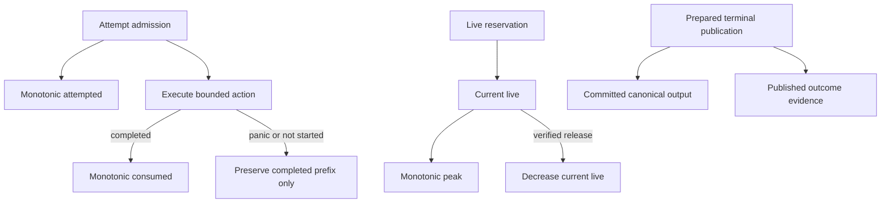

# ADR 0047: Operation Ledger Evidence and Resource Accounting

## Status and Authority

This accepted ADR is the sole authority for operation attempted, consumed, live, peak, committed,
terminal-evidence, and phase-accounting semantics. It supersedes ADR 0022, whose private typestates,
complete dimension enumerations, byte transcripts, and migration-era command sequences remain
historical implementation context rather than architectural authority.

ADR 0044 separately owns retained physical allocation lifetime and account lineage. Domain crates
own their phase and dimension vocabularies. This ADR owns the common accounting meaning and the
rules that make evidence non-refundable and fail closed.

Acceptance does not itself claim implementation conformance, format maturity, or release readiness.

## Context

Local limits do not bound aggregate hostile work or simultaneous memory. A refundable counter lets
repeated failed attempts erase attacker-controlled work. A debit-only byte counter cannot describe
temporary live storage, peak use, retained output, or published failure evidence. Sharing physical
storage across Scene generations further requires logical operation evidence to remain distinct from
allocation ownership.

Baozi therefore needs one small accounting model shared by import, standalone Scene construction,
and postprocess without exposing a generic resource policy to format code.

## Decision

### One Ledger per Operation

Every admitted import, standalone canonical construction, and postprocess invocation owns one
operation ledger. Distinct operations never merge their histories into one ambiguous total. A facade
may present several snapshots together but cannot add counters with different phases or meanings.

`baozi-operation` owns the runtime-neutral accounting mechanism. The operation-owning crate defines
the closed phase and dimension vocabulary, limits, public interpretation, and typed outcome. Format
code can use only capabilities issued by that owner.

### Evidence Planes

The planes are non-interchangeable:

| Plane | Meaning | Refund rule |
| --- | --- | --- |
| Attempted | admitted work or item amount before the action | never decreases |
| Consumed | action units that completed, including a completed semantic rejection | never decreases |
| Live | currently owned temporary or attributable storage | decreases only after verified release |
| Peak | greatest live amount observed | never decreases |
| Committed output | logical canonical output published by the operation | written only at terminal preparation |
| Outcome evidence | protected terminal evidence published by the operation | written only through the terminal owner |

Attempted and consumed are not reservations. Live storage is not work. Committed logical output is
not a physical allocation owner. Published failure evidence is not ordinary parser capacity.

### Admission and Completed Prefixes

Known work is admitted before its action. Multi-dimension admission is atomic where one semantic
action requires all dimensions. A failed admission executes no action and records no fabricated
consumption.

Work completion is action-scoped. Normal return consumes the completed unit even when it reports a
domain rejection. Panic, cancellation observed before action start, or an action that never returns
does not consume that unit. Previously completed units are never refunded. Chunked work completes
each real chunk before admitting or polling the next one.

An exact semantic envelope is admitted once before canonical materialization or validation. Actual
actions consume that envelope through scoped units. Under-run, overrun, wrong dimension, or mismatched
description is a contract failure and cannot be repaired by caller-provided counts.

Asset snapshot byte admission grants reusable payload capacity within the operation. Legal short
reads consume only observed bytes and carry unused admitted capacity into later reads without
refunding or repeating attempted charges. Serial acquisition also carries unused capacity into later
resources by deriving each dimension's balance from `attempted - consumed`; no second budget is
created. Resource-class and aggregate dimensions are topped up independently, so their attempted
envelopes need not add up after credit crosses a resource-class boundary. Rejected attempted charges
are evidence of failure, never reusable credit. Each read call separately admits one `WorkUnits` action;
normal return, including EOF or a returned read error, completes that action, while panic leaves
only the earlier completed call prefix. Cooperative cancellation is checked before the next call.

Once payload credit reaches a resource/backend or aggregate byte limit, one nonempty one-byte probe
may validate EOF. A zero result succeeds; a positive result causes a typed limit failure and is never
stored as payload. The probe is validation/read work rather than payload storage, and cannot enlarge
the successful snapshot's admitted byte envelope. Truthfully observed excess may advance existing
byte counters before rejection; a rejected attempted charge never fabricates consumed bytes or
erases previously completed consumption. Exact-length contract errors remain backend failures.

Input-byte ceilings constrain payload counters, independently of allocator capacity. Snapshot
capacity, allocator slack, and the temporary overlap of an admitted replacement buffer use the
existing `max_live_bytes` ceiling. Tightening a file's byte limit must not lower the live-memory
ceiling to that file length or reject an otherwise legal short-read stream during buffer growth.

### Live Storage

Live capacity is reserved before allocation or growth, bound to one operation/session owner, and
resized to the actual admitted capacity. Release occurs only after the owned allocation or evidence
has been destroyed and owner identity has been verified. `mem::forget`, wrong-owner release,
uncertain deallocation, or baseline drift fails closed rather than optimistically refunding.

Temporary parser storage uses one `baozi-import`-owned metered-storage module. Format crates may wrap
it semantically but cannot implement competing reserve/grow/shrink logic. Canonical retained storage
uses ADR 0044's physical owner and account; the operation ledger records why new retained storage was
created, not how long every shared allocation remains alive.

The same retained mechanism applies to import evidence and resource manifests. Graph-owned paths,
projected manifest paths, provisional quotient tables, and canonical hash scratch overlap until their
actual owners are destroyed. Sealing a manifest freezes its semantics; it does not release arrays or
path storage that remain in the provisional manifest during Scene construction.

Allocation-bound output attribution keeps its original phase/dimension placement. The central ledger
accumulates it in its existing fixed catalog rows while owners retain their physical leases. A weak
edge to that existing ledger allocation permits exact pre-publication rollback without allocating a
shared header per payload. No terminal reservation array grows with the maximum resource-relation
count. The joint terminal transition validates these amounts with its existing batches, then retires
operation attribution. The immutable terminal snapshot can therefore report zero operation-live
bytes while retained data remains truthfully charged to its physical account. An early token drop
without an allocation-bound physical owner is not a transfer.

Import's retained admission registers output attribution before allocating its evidence storage.
The containing owners keep the same reservations through terminal preparation, so this path does
not require a second unmetered walk over every diagnostic or manifest relation at finalization.
Transient graph/hash storage still uses ordinary reservations and is destroyed before the snapshot.
An operation-live zero at terminal therefore does not assert that physical evidence has been freed.

### Terminal Accounting

Each operation pre-admits a bounded protected terminal allowance inside the caller's hard total.
Ordinary work cannot spend that authority. Terminal preparation consumes it to publish rich failure
evidence or the minimal fail-closed fallback. Handoff exposes already prepared owners and performs no
new accounting mutation.

Recoverable central evidence-construction or validation failures return an unprepared linear
fallback owner when the call may still borrow caller-owned charged scratch. The caller ends those
borrows, destroys scratch, and only then prepares the protected terminal evidence. Deferring that
freeze preserves the original failure and cleanup protocol; it does not refund work, relax terminal
eligibility, or turn uncertain cleanup into an ordinary failure. Import retains this continuation
until parser storage is released, and geometry edits release their generated values before using it.

Terminal cause is sticky and monotonic. A later contract, control, product-graph, or ledger failure
cannot be hidden by an earlier requested rejection. Public snapshots expose domain-owned semantic
views, not raw mutable ledger keys or control internals.

## Alternatives Considered

### Option A: Independent local limits only

This cannot bound aggregate work, repeated dependency attempts, or simultaneous memory. Rejected.

### Option B: One refundable bytes-used counter

This conflates work, memory, output, and evidence and allows failed hostile attempts to regain budget.
Rejected.

### Option C: Separate attempted, consumed, live, peak, committed, and evidence planes

This preserves non-refundable work prefixes, exact memory lifetime, and terminal evidence while
keeping physical allocation ownership separate. Chosen.

### Ordinary Handle Work

Ordinary retained-handle cloning and construction consume the operation's general work budget.
Their envelope is independent of the number of record-store Scene members: resource acquisition,
manifest ownership, and report ownership also share retained handles. Scene structural-work limits
cover the actual record-store assembly and publication work. A typed-domain cutover can reduce that
record count without reducing the work admitted for unrelated resource ownership.

## Consequences

Positive:

- hostile retries cannot erase attempted or consumed work;
- current and peak memory remain observable independently of work;
- failure, panic, and cancellation preserve exact completed prefixes;
- terminal evidence remains available without unbounded emergency allocation; and
- physical sharing does not rewrite completed operation evidence.

Negative:

- every operation owner must define a complete phase/dimension vocabulary;
- actions must report completion at real semantic boundaries; and
- uncertain destruction or ownership mismatch deliberately causes containment.

## Risks and Mitigations

| Risk | Severity | Mitigation |
| --- | --- | --- |
| Work is charged before the action and falsely consumed | Critical | separate attempted admission from action-scoped completion |
| Panic refunds completed work or consumes the panicking unit | Critical | finalize only returned units and retain prior prefix |
| Item limits are bypassed by repeated replenishment | High | bind item limits to one logical item and reject unqualified replenishment |
| Allocation occurs before budget admission | Critical | reserve and validate ownership before allocation/growth |
| Live bytes are refunded while storage remains reachable | Critical | release only after verified owner destruction; contain uncertain release |
| Shared retained storage is charged once per Scene | High | separate operation attribution from ADR 0044 physical ownership |
| Ordinary work exhausts failure reporting | High | protect a bounded terminal allowance inside the hard total |
| Raw ledger keys become public policy | High | expose only domain-owned dimensions and immutable snapshots |

## Success Metrics

| Metric | Target | Measurement |
| --- | --- | --- |
| Failed admission side effects | zero action calls and zero consumed units | exact-limit and one-short tests |
| Panic prefix | consumed equals the exact normally returned prefix | caught-panic action tests |
| Cancellation prefix | last completed chunk is retained and next action is not run | chunk-boundary cancellation tests |
| Live release | current live and active reservations reach zero after owner drop | allocation/drop-order tests |
| Peak accuracy | peak equals the greatest simultaneously owned admitted capacity | staged allocation tests |
| Semantic envelope | actual consumed work equals the sealed description on success | canonical construction/validation tests |
| Physical/logical separation | shared payload is physically charged once without changing operation evidence | multi-generation lineage tests |
| Terminal availability | bounded rich failure or minimal fallback exists for every safely finalizable operation | terminal-budget matrix |

## Acceptance Criteria

- Every admitted operation has one ledger and one domain-owned phase/dimension vocabulary.
- Attempted, consumed, live, peak, committed output, and outcome evidence remain distinct.
- Attempted and consumed counters never decrease; completed work is never refunded.
- An action consumes only after normal return, including a returned semantic rejection.
- Live storage is admitted before allocation and released only after verified destruction.
- Semantic work comes from one sealed description and cannot be paired with arbitrary execution.
- Protected terminal work is bounded, included in the hard total, and inaccessible to ordinary work.
- Retained physical ownership follows ADR 0044 and cannot be reconstructed from ledger counters.
- Public outcomes expose immutable semantic evidence, not raw ledger or retained-store authority.
