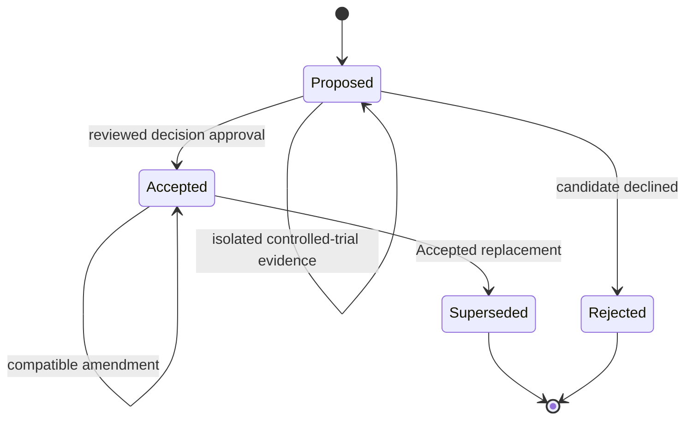

# ADR Governance

This document is Baozi's living contribution policy for Architecture Decision Records (ADRs). It
governs how decisions are proposed, accepted, amended, superseded, indexed, evidenced, and
reviewed.
It does not define product architecture: each Accepted ADR remains the sole semantic authority for
the concern it owns. This policy is maintained like any other repository contribution policy. It
does not need, and cannot derive authority from, an ADR that attempts to authorize its own
lifecycle.

## Authority Model

Baozi separates four roles:

1. Each `status: accepted` ADR is the semantic authority for its owned architectural decision.
2. The [ADR index](../adr/README.md) is the canonical registry for decision ownership, stable
   requirement-to-authority traceability, titles, and lifecycle status.
3. This document is the ADR process policy.
4. Source code, tests, plans, research, conformance inventories, and progress records are evidence or
   execution state. They never silently override an Accepted ADR.

ADR number, file date, and merge order do not establish precedence between overlapping Accepted
ADRs. The ownership registry must identify one owner, or an Accepted replacement must explicitly
supersede the old decision. Plans may schedule work but cannot acquire architecture authority.

Decision authority, implementation conformance, format maturity, and publication readiness are
independent axes:

| Axis | Canonical record | Meaning |
| --- | --- | --- |
| Decision authority | ADR status plus the ADR index | which architectural contract governs work |
| Implementation conformance | repository conformance inventory, direct tracers, and executable gates | whether current code satisfies an Accepted contract |
| Format maturity | ADR 0011 plus format evidence | how much one exact format profile has proved and who verified it |
| Publication readiness | ADR 0006 plus release/package gates | whether artifacts may be published and supported |

An Accepted ADR may therefore be unassessed, partially implemented, conforming, or nonconforming.
Implementation lag does not by itself change the ADR back to Proposed. A known disagreement is
recorded as partial or nonconforming until code changes or an Accepted replacement changes authority.

## Lifecycle



The only lifecycle values are `proposed`, `accepted`, `superseded`, and `rejected`:

- Proposed records a candidate and grants no production, default, publication, or compatibility
  authority.
- Accepted is normative for the concern assigned to it by the index.
- Superseded and Rejected are historical records and own no active concern.
- Trial is not a lifecycle value. It is isolated evidence-gathering work under a Proposed ADR.

An Accepted ADR becomes Superseded, never Rejected. Historical files remain in place so links and
rationale remain reviewable.

ADR IDs are permanent, monotonically assigned labels rather than a dense sequence. IDs are never
reused and later ADRs are never renumbered to close a gap. A genuine decision that entered reviewed
history remains as Rejected or Superseded; an erroneous pre-release record that never represented an
architectural decision may be removed during baseline cleanup, leaving its ID intentionally unused.
Every such ID is recorded in the [retired-ID registry](../adr/README.md#retired-adr-ids). That registry
is identifier governance, not an ADR or semantic owner. During review, maintainers must verify that
active and retired ADR IDs are disjoint, every ID from 0001 through the maximum active-or-retired ID
belongs to exactly one set, retired entries are unique four-digit values in numeric order with the
canonical `Permanently unassigned` disposition and a nonempty reason, and a newly assigned ID is
greater than that maximum.

## Amendments And Supersession

An Accepted ADR may be amended in place only when it keeps the same canonical concern, seam, selected
architectural direction, and load-bearing guarantees. Clarifying an invariant, closing an ambiguity,
or strengthening evidence/security without invalidating the original rationale is normally an
amendment.

A replacement ADR is required when a change:

- moves, splits, or merges canonical ownership;
- selects an alternative the ADR rejected or materially changes its primary seam;
- removes or reverses a load-bearing guarantee;
- makes the original rationale, alternatives, consequences, or compatibility impact materially
  false; or
- needs both old and new contracts to remain understandable as distinct decisions.

Every authority-affecting amendment updates `updated` and appends an `## Amendment History` entry.
The entry records the date, affected headings, previous rule, new rule, compatibility/security
impact, review evidence, and why amendment is appropriate instead of supersession. Authors are not
implicitly approvers. Editorial changes that do not alter normative meaning need neither `updated`
nor an amendment entry.

Template:

```markdown
## Amendment History

### YYYY-MM-DD: Short description

- Affected: `Decision / ...`
- Previous: ...
- New: ...
- Impact: ...
- Review: pull request, commit, or named review record
- Rationale: why this refines rather than replaces the decision
```

### Initial Pre-Release Baseline

The reviewed change that first adds this policy establishes Baozi's initial pre-release ADR
baseline. Authority-affecting wording already present in that same change does not require
reconstructed amendment entries or retroactive approver claims. Existing `updated` dates remain
historical metadata. Every later authority-affecting amendment must follow the amendment rule above.

Supersession is atomic and reciprocal. A Superseded ADR lists one or more Accepted replacements in
`superseded_by`; every replacement lists the historical ADR in `supersedes`. Proposed and Rejected
ADRs cannot declare supersession authority. The ownership registry changes in the same reviewed
change.

## Frontmatter

Every numbered ADR uses the strict frontmatter subset below. Scalars use `field: value`. Lists use a
two-space block list or the literal `[]`. Reviewers must reject unknown fields, duplicate keys,
invalid null aliases, and duplicate normalized paths.

| Field | Cardinality | Meaning |
| --- | --- | --- |
| `status` | Required scalar | One legal lifecycle value. |
| `date` | Required scalar | Original decision date in `YYYY-MM-DD`. |
| `updated` | Optional scalar | Latest authority-affecting amendment date; cannot precede `date`. |
| `authors` | Required non-empty list | Decision authors, never inferred approvers. |
| `decision_type` | Required scalar | Stable navigation classification. |
| `depends_on` | Optional list | Normative ADR dependencies. Accepted ADRs depend only on Accepted ADRs. |
| `related` | Optional list | Non-normative navigation with no precedence or authority implication. |
| `supersedes` | Optional list | Accepted ADRs replaced by this Accepted ADR. |
| `superseded_by` | Optional list | Accepted replacements for this historical ADR. |
| `evidence` | Optional list | Durable repository-local facts, measurements, or conformance artifacts. |
| `tracers` | Optional list | Exact repository files directly implementing or executing the decision. |
| `promotion_requires` | Optional list | Stable promotion gate IDs resolved through the repository gate catalog. |

`depends_on` is the only dependency field that affects authority, and its graph must be acyclic.
`related` is navigation only and cannot make a Proposed ADR normative.

## Evidence And Tracers

Evidence explains why a decision is credible. A tracer is stronger: it names one exact repository
regular file that directly implements the decision or executes an assertion through a production,
test, or CI path.

Directories, globs, plans, placeholders, prose status notes, generated transient output, and
unrelated files are not tracers. Every tracer, regardless of ADR status, must resolve with exact
casing to a regular file that is tracked or staged, is not Git-ignored, and crosses no symbolic-link,
junction, reparse, `.git`, or `repo-ref` component. Reviewers must verify these structural conditions
and then judge whether the tracer directly demonstrates the claimed behavior; structural validity is
not proof of semantic directness.

Repository-local evidence must exist in a clean checkout and obey the same path-containment rules.
An evidence file may be new and unstaged while a complete change is being prepared; a promotion
tracer must already be tracked or staged at the promotion boundary.

External evidence is written in ADR prose, never in `tracers`, and uses a reproducible identity:

- source/history uses a full commit object ID rather than a branch, mutable tag, or release page;
- registry packages use an exact version and content checksum;
- immutable specifications use an exact edition/version and official versioned URL; and
- a living official page without an immutable edition records its canonical URL, retrieval date,
  final response-body byte length, and SHA-256 digest after redirects.

A floating URL without that capture is navigation, not acceptance or promotion evidence. ADR
Markdown uses inline links so every destination passes through the same path validation.

## Controlled Trials And Promotion

A Proposed ADR may reference an isolated trial implementation, tests, and measurements. Trial code:

- is unreachable from production defaults and released feature sets;
- creates no support, compatibility, or publication promise;
- cannot make another Accepted ADR conform to the proposal; and
- remains removable if the proposal is rejected.

Promotion is one atomic reviewed change containing the decision, implementation state, exact tracer
metadata, gate evidence, index update, and `status: accepted` transition. An implementation may be
developed before acceptance; its authority changes only at promotion.

Promotion requirements are stable gate IDs, not ADR-number special cases. The canonical gate catalog
is `docs/conformance/gates.toml`; it defines the implementation, test, and CI tracer classes plus the
executable command or workflow that supplies passing evidence. An unknown gate, absent required
tracer class, or missing passing result blocks promotion. Tracer presence alone never proves a gate
passed. A cataloged `success_condition` describes how an external runner recognizes success; it is
not itself a passing result.

Every future first transition from Proposed to Accepted, and every authority-affecting amendment,
must retain a repository-auditable approval record identifying the approver, approval date, reviewed
commit, pull request, or named review record, and the exact decision or amendment scope. Authors are
not approvers merely by authorship. This rule is prospective: maintainers must not fabricate
retroactive approval metadata for the initial pre-release baseline.

ADR 0037 and ADR 0038 retain `implementation_tracer` while they remain deferred proposals. Any
temporary compatibility exception in a proposal must be recorded as implementation-conformance debt
and removed through a later reviewed policy or implementation change; it does not create authority.

## Ownership Registry

The [ADR index decision-ownership table](../adr/README.md#decision-ownership) is the only handwritten
concern-to-owner registry. It assigns ownership but does not restate semantic rules. Moving,
splitting, merging, or intentionally removing ownership updates the registry and affected ADRs in one
reviewed change.

The index also keeps stable requirement-to-authority traceability. Delivery units, milestones, and
progress remain in plans. Generated reports may mirror the registry, but no second handwritten owner
catalog is allowed.

## Conformance Inventory

The canonical architecture conformance inventory is `docs/conformance/contracts.toml`. It is separate
from ADR status. Its minimum record contains:

- stable `contract_id` and one Accepted `authority_adr`;
- `conformance_status`: `unassessed`, `partial`, `conforming`, or `nonconforming`;
- separate tracked implementation, test, and CI tracers; and
- one or more stable gate IDs resolved through the executable gate catalog.

`conforming` requires every tracer class applicable to the contract plus at least one passing
executable gate. Missing files, unknown gates, non-Accepted authority, or self-reported status without
gate evidence fail closed. Format maturity and publication readiness remain in their own inventories
and may reference the same stable contract IDs.

Until that inventory exists, plans and progress records may locate incomplete work but cannot claim
repository-wide conformance, format maturity, or release readiness.

`docs/conformance/contracts.toml` and `docs/conformance/gates.toml` are the only handwritten
structured authorities for architecture conformance and executable gate identity. Each file carries
an explicit schema revision. Contract records identify their evidence subject and revision; gate
records identify their gate class, exact command or workflow/job identity, applicability, success
condition, and evidence identity. This policy owns the schema semantics; `baozi-xtask` implements the
bounded parser and checker but cannot infer or extend fields from source or ADR prose. A change that
adds or removes a required gate updates both files atomically.

The focused repository checker reads only these two TOML files and repository-relative paths they
explicitly reference. It must not scan ADR prose, the ADR index, source prose, Git history, or the
repository tree to infer contracts or gates, and it must not recursively invoke Cargo. Human ADR
review remains responsible for semantic authority, workflow identity, and directness; the checker
validates the bounded structured inventory and its explicit references. The structural checker does
not authenticate command execution or parse workflow contents. Until an admitted external result
verifier supplies passing gate evidence, a structural invocation rejects every `conforming`
declaration.

## Human Review Responsibilities

ADR structure and lifecycle are reviewed as part of the change that edits them. Repository-wide
structural validation is not a separate policy gate, and local tooling is only an optional aid. The
review record is responsible for confirming all of the following:

- each numbered ADR has one canonical filename, matching heading, title, status, and index row;
- frontmatter uses only the fields and scalar/list forms defined above, with no duplicate keys or
  normalized paths;
- active and retired IDs obey the permanent, disjoint, exhaustive, and monotonic assignment rules;
- every `depends_on` target is an Accepted ADR and the dependency graph is acyclic, while `related`
  remains non-normative navigation;
- every supersession is legal and reciprocal, and an amendment has the required `updated` date and
  amendment history;
- local links, fragments, fenced examples, and referenced paths resolve with exact casing and stay
  within the repository; and
- evidence, tracers, promotion gates, and conformance claims are directly relevant and supported by
  the recorded review or executable gate evidence.

Reviewers must also assess semantic ownership, competing prose, whether an amendment should instead be
a superseding decision, and whether the claimed architecture is complete. These judgments cannot be
replaced by file-presence or syntax checks. Current implementation conformance and publication
readiness remain separate axes; implementation lag does not weaken the authority of an Accepted ADR.

## Change Checklist

- The ADR answers one architectural decision and includes at least two genuine alternatives.
- Architecture flow or state relationships have a Mermaid diagram.
- Risks have concrete mitigations and success criteria are measurable.
- The owner registry and stable requirement traceability identify the correct Accepted authority.
- Normative dependencies are Accepted and use `depends_on`; navigation uses `related`.
- Every local evidence/tracer path is durable, exact-case, and directly relevant.
- An Accepted amendment has `updated` plus amendment history, or a replacement ADR uses reciprocal
  supersession.
- Promotion gates and conformance claims have executable evidence rather than file-presence claims.
- First acceptance and authority-affecting amendments retain an auditable approval record, and any
  required contract/gate catalog change is atomic.
- ADR index, lifecycle, dependency, and link changes receive direct review against the checklist above.
