# Baozi Canonical Scene IR

Baozi has one Rust-native, source-preserving scene intermediate representation shared by importers,
postprocess operations, and read-only consumers. Backend-native models stay private to their format
crates. The canonical scene is not a C ABI mirror, a renderer vertex layout, or a format-specific
object model.

This document is the explanatory entry point. Accepted ADRs remain the normative authority if this
summary and a decision ever disagree:

- [ADR 0045: Canonical Scene Ownership, Construction, and Generation](../adr/0045-canonical-scene-ownership-construction-and-generation.md)
- [ADR 0008: Math, Coordinate, Units, and Numeric Policy](../adr/0008-math-coordinate-units-and-numeric-policy.md)
- [ADR 0009: Data Ownership, Zero-Copy Lifetimes, and Memory Layout](../adr/0009-data-ownership-zero-copy-lifetimes-and-memory-layout.md)
- [ADR 0012: Material, Image, Texture, Sampler, and Color-Space Policy](../adr/0012-material-texture-image-and-color-space-policy.md)
- [ADR 0046: Import Session Lifecycle and Outcome Ownership](../adr/0046-import-session-lifecycle-and-outcome-ownership.md)
- [ADR 0023: Material and Custom Attribute Extension Model](../adr/0023-material-and-custom-attribute-extension-model.md)
- [ADR 0030: Logical Mesh, Primitive, and Attribute Domain Contract](../adr/0030-logical-mesh-primitive-and-attribute-domain.md)
- [ADR 0031: Animation, Skin, Morph, and Deformer Contract](../adr/0031-animation-skin-morph-and-deformer-contract.md)
- [ADR 0032: Postprocess Remap, Edit Transaction, and Derived Data Contract](../adr/0032-postprocess-remap-and-derived-data-contract.md)
- [ADR 0036: Source Identity, Provenance, and Metadata Contract](../adr/0036-source-identity-provenance-and-metadata.md)

## State Model

Construction, publication, and mutation use different capabilities:

```mermaid
stateDiagram-v2
    [*] --> SceneConstruction: import session or trusted producer creates
    SceneConstruction --> SceneDraft: bounded authoring returns branded descriptor
    SceneDraft --> ValidatedSceneG: exact owner plus descriptor validates
    SceneDraft --> [*]: validation fails
    ValidatedSceneG --> SceneEdit: begin edit
    SceneEdit --> PrivateCandidate: apply declared effects
    PrivateCandidate --> SceneEdit: local checks pass
    SceneEdit --> ValidatedSceneNext: full central validation and commit
    SceneEdit --> ValidatedSceneG: cancel or fail; input unchanged
```



- The opaque core-owned `SceneConstruction` continuation owns unvalidated construction state. An
  import session retains it while `ParseScope` lends parsers only bounded authoring capabilities.
- `SceneDraft` is a branded, non-owning directory-slot descriptor, not publishable scene proof. A
  format importer returns `ParseResult<SceneDraft>` to the session that owns the exact continuation.
- The central validator in `baozi-core` is the only constructor of `ValidatedScene`. Import sessions,
  postprocess code, and downstream producers may call it, but cannot forge its proof.
- `ValidatedScene` exposes read-only views and typed iterators. Its collections are not publicly
  mutable.
- `SceneEdit` isolates replacements and scratch state from its input. A successful commit publishes a
  fresh generation after full validation; failure and cancellation publish nothing.

The common import-and-inspect workflow therefore uses `ImportReport::scene()` without exposing proof
internals. Mutation is an explicit opt-in operation rather than a property of ordinary scene access.

## Aggregate Ownership

The private scene aggregate owns typed collections with one canonical direction for every ownership
edge:

| Owner | Canonical contents | References or local ownership |
| --- | --- | --- |
| Scene | scene space, nodes, mesh instances, logical meshes, materials, images, samplers, textures, skins, animation clips, cameras, lights, metadata, provenance arena, scene bounds | generation-qualified scene IDs |
| Node | authored matrix-or-TRS base transform, ordered child IDs, optional camera/light attachments | node, camera, and light IDs |
| Logical mesh | one or more primitives, morph target definitions, default morph weights, logical-mesh bounds | owner-qualified primitive and morph-target IDs |
| Primitive | topology, optional index stream, vertex/corner/face attributes, optional material, morph deltas, influence rows, primitive bounds | primitive-local domains and material ID |
| Mesh instance | one owner node, one logical mesh, optional skin, optional morph overrides, instance attributes | node, logical-mesh, and skin IDs |
| Material | typed factors, texture bindings, bounded namespaced extensions | texture IDs |

Reciprocal storage is not canonical. Derived indexes may accelerate reverse queries, but validation
can rebuild them from the owner edge and they do not become a second source of truth.

All semantic domains use private typed tables in one `SceneStorage` root. Node transforms are
explicit Matrix/TRS values, children are ordered logical indices, and optional names preserve absent
versus present empty text. Geometry descriptors use typed ranges into contiguous scalar pools;
Vertex/Corner/Face domains, sparse defaults, and F64 custom values remain directly borrowable.
These ranges describe semantic ownership within a table and never identify allocator blocks or a
publication's dynamic slot numbers.

Construction derives each Vec capacity before entering operation's retained admission. The same
central mechanism binds physical charges to the actual table owner and releases storage before its
lease. Central validation reads those actual tables, without allocating complete immutable row
projections. A node-transform edit shares the unchanged geometry table owner and all its scalar
pools, together with the other unchanged domain owners. Appearance has an inline root with
independent shared row and payload owners, so a material length conversion can replace rows while
preserving the exact encoded-image and text allocations.

The local matrix exposed by a node view is derived from its preserved authored transform form. TRS
animation overlays only TRS-authored base-pose components; it does not implicitly decompose a
matrix-authored node. Source documents with scene declarations follow
[ADR 0039](../adr/0039-source-document-scene-selection-and-import-closure.md): every selected
projection receives one identity-TRS synthetic root with generated provenance, and its selected
source roots become ordered children.

## Identity and Handles

Every published scene owns an opaque, collision-free `SceneGenerationId`. Central validation of each
completed draft and each successful edit commit publish a fresh token. Two edits branched from the
same input receive distinct tokens even when their content is equal.

Scene-wide handles are typed pairs:

```text
(SceneGenerationId, dense_index)
```

Primitive and morph-target handles are owner-qualified triples:

```text
(SceneGenerationId, logical_mesh_index, local_index)
```

Constructors and numeric components are private. Every lookup checks entity kind, generation, owner
when applicable, and range before returning a view. A numerically equal index from another generation
or logical mesh is a stale or foreign handle, never an implicit match. Private storage may keep local
typed index components, but no unqualified number crosses the public read, edit, or remap boundary.

Dense IDs are runtime addresses, not persistence keys. `SourceIdentity` and provenance provide source
continuity; generation-qualified remaps provide continuity across edits.

## Hierarchy and Instances

The node hierarchy is one rooted tree:

- the root has no parent;
- each non-root node appears in exactly one ordered child list;
- every node is reachable exactly once; and
- a node stores children canonically while parent lookup is derived.

Shared geometry does not create shared child nodes. A `MeshInstance` owns exactly one `NodeId` and
references exactly one `LogicalMeshId`; multiple instances may reference the same logical mesh. The
node-to-instance query is derived from instance ownership. This keeps hierarchy, transform,
animation, skin, and remap ownership unambiguous.

## Logical Meshes and Primitives

A `LogicalMesh` preserves source-level mesh identity and owns one or more homogeneous `Primitive`
values. Each primitive has exactly one topology and at most one material binding. Splitting geometry
by topology or material therefore does not destroy the identity that grouped those primitives in the
source.

Raw topologies include producer-backed points, lines, triangles, strips/fans/loops, and polygons with
explicit face boundaries. An absent index stream means non-indexed geometry, not an empty indexed
stream. Topology and the index/vertex counts determine vertex, corner, and face cardinalities without
consulting attribute payloads.

Canonical storage does not silently triangulate polygons, expand independent corner indices, weld
vertices, or force an interleaved renderer layout. Canonical edits are explicit operations with
applicable loss evidence and remaps. Read-only application views instead expose the current source
relation without changing or republishing the Scene.

`postprocess::triangle_vertices(PrimitiveRef)` is a zero-heap-allocation view over one TriangleList.
It exposes one application tuple per draw Corner with an implicit `0..corner_count` index stream.
Vertex fields use that Corner's source Vertex, Corner fields use the Corner itself, and Face fields
use `corner / 3`. Every retained field remains available by its full semantic/source-domain key.
Influences and primitive-specific morph deltas follow the same source Vertex; skin and morph-weight
choices remain instance-owned. There is no deduplication, minimum vertex-count guarantee, owned
map, retained artifact runtime, or operation/account report. Source storage, including unreferenced
vertices, remains unchanged. The application allocates its own final buffers. See
[the triangle-buffer reading guide](reading-scenes.md#application-triangle-buffers) and
[ADR 0030](../adr/0030-logical-mesh-primitive-and-attribute-domain.md#borrowed-triangle-application-layout)
for the complete API, lifetimes, and capability boundary.

## Attribute Domains

Each attribute declares a semantic, domain, closed logical format, dense or sparse payload, and
provenance. The domain determines its exact cardinality:

| Domain | Cardinality owner | Typical data |
| --- | --- | --- |
| Vertex | primitive vertex count | positions, welded normals, custom vertex properties |
| Corner | primitive corner count | independently indexed UVs/normals, per-loop tangents |
| Face | primitive face count | smoothing groups, source face properties |
| Instance | exactly one value for the owning mesh instance | per-instance color or source key |

Within one owner, normalized `(semantic, domain)` keys are unique. Dense payload length must equal its
domain count. Sparse indices are sorted, unique, in range, and paired with an explicit logical count
and same-format default. All count, cell, and byte products are checked before allocation.

`POSITION` is vertex-domain geometry. Normals and tangents may be vertex- or corner-domain under ADR
0030. Skin influences are dedicated variable-length `InfluenceRows`, not a fixed-width generic
attribute. Renderer-oriented expansion or numeric lowering is explicit and never redefines the raw
canonical domain.

`AttributeRef::element(index)` borrows one typed F32/F64/U32/I32 element, with O(1) dense selection
or O(log explicit count) sparse selection and `None` outside the logical domain. It preserves lanes
and scalar bits and borrows the retained default for a sparse omission. The complete source
representation remains available through `AttributeRef::data()`; sampling allocates no dense copy.

## Materials and Image Resources

Resource identity, sampling, and material usage are separate:

- `Image` owns one immutable bounded encoded payload and media/encoding evidence.
- `Sampler` owns filter and address behavior; an explicit default exists when the source omits one.
- `Texture` pairs one `ImageId` with one `SamplerId` and carries no material role.
- A material `TextureBinding` owns role, a direct zero-based `uv_set: u16`, transform, channel
  mapping, color interpretation, scale/strength, and other representable usage semantics.

One image can therefore be sampled in multiple ways or used once as color and once as data without
duplicating or mislabeling it. Typed material fields preserve stable cross-format concepts; uncommon
properties use validated bounded extensions. Metadata never substitutes for behavior that needs a
typed field and validator.

The binding model supports UV sets only, including index 65535 independently of a primitive's
available UV streams. `MaterialBindingRef::uv_set()` returns the index by value. An absent stream
remains absent; no object-position, object-normal, or reflection-vector coordinate generator is
implied. The two-dimensional transform acts on the selected UV coordinates under ADR 0012. Wider
source indices are checked before authoring. Snapshot encoding retains the existing coordinate
kind zero and the index as `u32`, so this API shrink changes no UV transcript bytes or revision.

Supplemental material thickness is a nonnegative Scene-unit length. A Displacement binding's
strength is a signed Scene-unit length. Whole-Scene space conversion applies the positive unit
ratio `s` to both, with a binary64 intermediate and one checked binary32 rounding. Handedness does
not add a displacement sign. Signed zeros survive; overflow and nonzero underflow to zero fail at
the material or binding. All other fields, factor bits, optional factor groups, names, source keys,
and order remain unchanged. Thickness binding strength stays one, and normal strengths are
dimensionless.

### Appearance storage and accounting

The private ownership layout is:

```text
SceneTables
  appearance: AppearanceStorage                 (inline root)
    rows: SharedRetainedStorage<AppearanceRows>
      images, samplers, textures, bindings, materials  (five Vec tables)
    payloads: SharedRetainedStorage<AppearancePayloads>
      image_bytes, text                             (two Vec<u8> pools)
```

Rows contain checked ranges into the pools. Text concatenates image media types, binding source
keys, then material names, in source order within each section. It is not interned. Equal image
content does not merge source identities, and a present empty material name differs from absence.
Both retained children use operation's existing admission and storage-first release; neither
exposes its lease or owned buffers to callers.

| Edit behavior | Row owner | Payload owner |
| --- | --- | --- |
| Appearance is unaffected | Shared | Shared |
| Thickness or displacement changes bits | Newly admitted five-table replacement | The exact original owner is shared |
| Converted appearance values retain their bits | Shared | Shared |

One `SceneSpacePlan` derives all domain conversions from the same immutable `SceneTables` root.
Another root cannot be substituted even if its generation matches. Appearance preflight covers all
bindings and materials. Correspondence requires payload-owner pointer identity and complete row
agreement with that same source plan; a new pool with equal bytes is rejected. Building or checking
the row replacement copies no payload bytes and contributes zero rebuilt name bytes. Image/text
addresses remain stable across the conversion. Central validation still checks actual row/range
and text semantics; explicit snapshot capture separately meters the bytes it hashes.

The initialized canonical footprint includes `size_of::<AppearanceStorage>()`,
`size_of::<AppearanceRows>()`, and `size_of::<AppearancePayloads>()`, then the five initialized row
tables and used image/text bytes. Empty appearance still has all three data headers. Shared pools
remain part of each candidate's logical footprint. The complete checked formula is in
[ADR 0045](../adr/0045-canonical-scene-ownership-construction-and-generation.md#private-typed-storage).

Physical retention uses two independent owners, each with one shared-header allocation and its
qualified Vec backing allocations. The root's inline handles belong to the containing Scene
allocation; there is no third appearance shared header. Each physical shared header already contains
its rows or payloads data header, along with private ownership/account infrastructure. Spare
capacity and this separately allocated infrastructure are excluded from canonical bytes but included
in physical admission; the complete inline handles remain included in the canonical root header.
An unchanged payload owner keeps one physical charge until its own last shared handle
drops, independently of the row owner's lifetime. Neither accounting measure is process RSS or
allocator-private overhead.

## Skinning, Morphing, and Animation

A `Skin` owns an ordered joint palette, one inverse-bind matrix per joint, explicit matrix-space
semantics, and an optional skeleton-root hint. Primitive influence rows contain a variable number of
finite non-negative weighted palette-local joint indices for each vertex. An instance selects the skin
that interprets those indices; the logical mesh does not own one implicit skin.

A logical mesh owns ordered morph target definitions and default weights. Each primitive owns the
target's source-preserving delta streams over its vertex domain, while a mesh instance may provide a
full override vector. Missing delta data means zero deformation, not a new target identity.

An animation clip preserves its source time domain. Key times and duration use finite `f64`; sample
values and tangents use their typed `f32` payloads. Current producer-backed targets are node TRS and
mesh-instance morph weights, addressed by dense handles rather than names. Step, linear, and cubic
interpolation keep distinct validated cardinality and tangent contracts.

Baozi stores deformer and animation inputs. It is not a runtime animation evaluator, inverse-kinematic
system, or renderer palette implementation.

## Derived Data

Published optional derived values have exactly two states:

```text
Derived<T> =
    Absent { reason }
  | Valid { value, generation, input_stamp, producer }
```

`Absent` contains no stale value. `Valid` is tied to the owning scene generation, a deterministic
digest of declared inputs, and a producer identity. Dirty or invalidated values may exist only inside
an edit; commit must remove them or replace them with a valid value.

Primitive-local bounds, logical-mesh-local bounds, and scene-space bounds have different owners and
cannot substitute for one another. Normals and tangents are canonical attributes rather than hidden
caches: a write to their dependencies must prove preservation, remap or recompute them, or remove them
with structured invalidation/loss evidence before publication.

## Central Validation

Central validation covers the complete candidate, including:

- collection ownership, typed references, generation/owner qualification, and ranges;
- rooted-tree reachability and unique hierarchy ownership;
- mesh-instance, material, texture, skin, morph, animation, camera, and light references;
- topology-derived domain cardinality and every dense/sparse payload shape;
- finite numeric and declared coordinate/unit policies;
- derived-data generation and input-stamp validity;
- bounded extension schemas, metadata, strings, and payloads; and
- provenance-arena ordering, references, ownership, and acyclicity.

Validation is a full linear pass over total graph edges, entities, references, and payload cells. A
boolean check, public constructor, parser claim, or previously validated ancestor cannot mint proof
for a changed candidate.

## Edits and Remaps

Every edit operation declares its read sets, write sets, invalidation sets, remap obligations, and
structural loss classes. It builds only affected replacements and validates affected postconditions in
a private candidate state. Final commit still runs complete central validation.

Each passing private step receives a distinct generation token. Final commit publishes the last
passing step token together with the only new validation proof. A successful report contains ordered
per-step remaps and composed input-to-final remaps. Remaps are relations:

- deletion maps one old identity to none;
- splitting maps one old identity to ordered new identities;
- merging maps ordered old identities to one new identity; and
- generated identities have no old identity and carry derivation provenance.

Vertex, corner, face, and instance domains follow the same contract. A vertex, corner, or face
endpoint is exactly `(PrimitiveId, domain_index)`; `PrimitiveId` supplies the generation,
logical-mesh owner, and primitive-local index. An instance-domain endpoint is exactly the owning
generation-qualified `MeshInstanceId`. A topology-changing operation must remap all present
affected-domain attributes or fail. Failed private candidates publish neither scene nor remap
evidence.

## Source Identity, Provenance, and Metadata

Baozi keeps four concepts separate:

- dense handles address entities in one generation;
- `SourceIdentity` combines a sanitized resource identity with a typed format object locator;
- provenance records bounded source and operation lineage; and
- metadata stores bounded descriptive, non-behavioral values.

Each scene owns an immutable provenance DAG in deterministic topological order. Imported data points
to source leaves; generated, repaired, split, and merged data points to operation nodes and its parent
lineage. Provenance follows per-step and composed remaps. Host paths, credentials, backend handles,
and numeric dense IDs encoded as strings are not valid public identity or metadata.

## Public Workflow and Cutover Rules

The intended public workflow is progressive:

1. submit an import request;
2. inspect the validated scene through report read views;
3. iterate logical meshes, primitives, instances, and typed attributes;
4. optionally compile and execute a postprocess plan; and
5. consume the new validated generation together with diagnostics, losses, statistics, and remaps.

Callers do not manipulate proof constructors, ledgers, backend models, or raw collection indices for
that workflow. The pre-release breaking cutover keeps one canonical v1 vocabulary. Obsolete prototype
types and mutation paths are removed rather than retained as `V2` names, aliases, adapters, or
compatibility shims.

Any future canonical field must land with all of its obligations in the same change: one owner,
identity and remap behavior where applicable, authoring/edit construction, central validation, budget
accounting, provenance, snapshots, and read-only public access.
