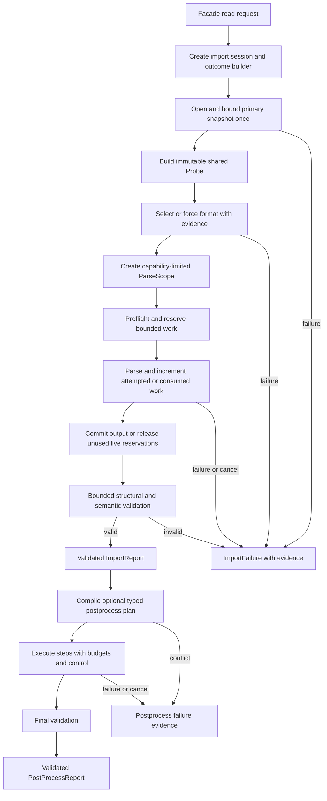
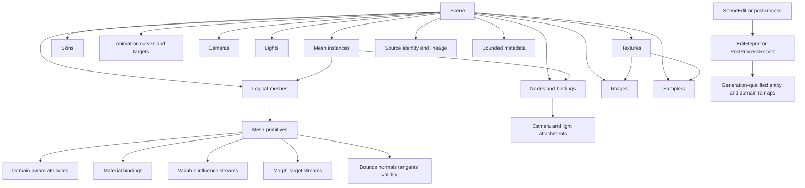
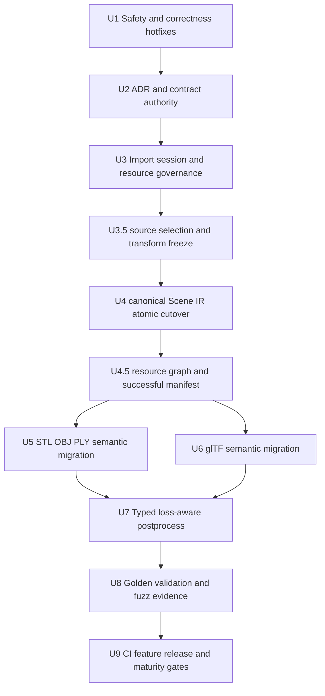

# Baozi Canonical Architecture Fearless Refactor - Plan

## Goal Capsule

| Field | Value |
| --- | --- |
| Objective | Replace Baozi's prototype import, Scene IR, validation, postprocess, and engineering contracts with a source-preserving, bounded, evidence-producing architecture before more complex formats or stable releases land. |
| Planning inputs | The user's explicit authorization for breaking changes and deletion, the 2026-07-10 Baozi-versus-Assimp audit, current source and tests, Accepted ADRs, format support documents, and the clean-room licensing boundary. |
| Execution profile | Refactor fearlessly. Do not preserve unpublished APIs through compatibility shims or parallel models. Keep each completed implementation unit buildable and tested, and delete superseded code and tests in the same unit that replaces them. |
| Stop conditions | Stop only for a genuine scope contradiction, an unavoidable native/FFI dependency in the default build, an unresolved licensing issue, or a required external dependency that fails the plan's license/MSRV/WASM gates with no acceptable fallback. |
| Tail ownership | The executor owns implementation, focused and workspace verification, code review, logical Conventional Commits, documentation alignment, and final repository quality gates. |

---

## Product Contract

This section is a non-normative execution summary derived from the stable requirement labels in the
ADR index and their owning Accepted ADRs. R/AE/KTD entries schedule and test implementation work; they
do not own architecture semantics. If wording conflicts, the ADR index identifies the canonical
owner and that Accepted ADR governs. Change the owning ADR before changing the plan's derived rule.

### Summary

This plan hardens the current four-format importer, replaces the public Scene and import lifecycle contracts, migrates every built-in producer and consumer, and turns architecture claims into machine-enforced tests, fuzzing, CI, and release evidence.
It deliberately deletes the current prototype API and makes the replacement Baozi's first canonical public contract, with no compatibility layer or version-suffixed duplicate model.

### Problem Frame

Baozi has the right high-level separation: an owned Rust Scene IR, format crates, virtual IO, explicit postprocessing, typed diagnostics, and a public facade.
The current implementation nevertheless contains directly triggerable failures and several accepted decisions that the code contradicts.
The OBJ detector can abort registry detection at the probe limit, binary PLY can loop without consuming input, glTF node construction is recursively unbounded, sidecar policy is format-local, and a third-party importer can return an invalid Scene that is labeled validated.

The deeper risk is architectural lock-in.
The current `Mesh` is a single primitive with one material, attributes are effectively vertex-only, skinning is fixed to four influences, animation time is `f32`, image/texture/sampler identities are conflated, derived data has no invalidation contract, and postprocess requests are unconfigured enum flags that cannot report remaps or losses.
Assimp demonstrates the maintenance cost of those constraints; Baozi should borrow its coverage dimensions while rejecting its public C layout, name-based identity, stateful importer, string property bag, process-global logger, and implicit lossy transformations.

### Requirements

**Bounded import and security**

- R1. Format detection must use a shared bounded probe whose exhaustion is an inconclusive result rather than a global IO failure, and detection order must not change the selected result.
- R2. Every input-controlled parser or validator loop must either consume input or spend a bounded operation budget. Individual graph traversals are iterative and bounded; online dependency admission may revisit existing reachability under the explicit `O(E * (N + E))` worst-case contract in ADR 0041, while whole-graph validation and class construction remain linear before their separately bounded digest ordering. Separate node, edge, depth, and work limits are mandatory.
- R3. External dependency access by first-party parsers must flow through one central required/optional resource API that binds authorization to the opened object and enforces path, scope, policy, byte, open, depth, and cancellation rules before backend IO.
- R4. The facade must independently validate every importer result, including results from trusted third-party importers, before constructing any successful validated-stage report; in-process extension code is not treated as a sandboxed adversary.

**Import lifecycle and resource evidence**

- R5. One import session must use one stable primary-resource snapshot and an authority-qualified dependency table. Every logical reference is role-checked and authorized before lookup; the first physical resolution stores a bounded immutable snapshot or terminal structured failure reused only for `(authority domain, normalized resource identity)`, so reopen behavior cannot change selected or parsed bytes and one scope/resolver cannot reuse another's authority.
- R6. Successful and failed imports must preserve source identity, source-scope selection evidence once recorded, candidate/selected format evidence, last completed stage, diagnostics, and resource statistics; callers must not be able to forge stage transitions or replace sealed report evidence, and terminal public errors must retain only Baozi-owned inert facts rather than executable backend/plugin objects.
- R7. Resource accounting must distinguish monotonic attempted/consumed work, releasable live reservations, and committed output; it must bound snapshot, decoded, canonical, scratch, peak-live, graph, attribute, animation, metadata, and diagnostic bytes/cells before material allocations or loops, with one `baozi-import` ParseScope-bound metered-storage implementation covering first-party parser collections.
- R8. Typed per-format options, source-scene selection, conformance/recovery/loss profiles, and runtime-only cancellation/progress/tracing controls must have separate ownership and precedence; source-semantic and provenance-evidence loss require independent caller authorities; the unused BZIR request wire remains pre-release experimental and U9 removes its public package reachability before publication, while any later stable wire requires a new Accepted architecture update plus a real consumer and compatibility evidence.

**Canonical Scene IR**

- R9. A logical Mesh must own one or more primitives; topology, indices, material binding, face/corner data, and primitive bounds must not be conflated with logical mesh identity.
- R10. Attributes must declare semantic, storage format, normalization, and domain (`Vertex`, `Corner`, `Face`, or `Instance`) with deterministic cardinality validation and remapping.
- R11. Canonical skinning must preserve variable influence counts and explicit matrix spaces; fixed-four renderer data is produced only by an explicit lossy postprocess request.
- R12. Morphs and animation must preserve source time as `f64`, interpolation/extrapolation, default and per-instance morph weights, sparse/dense representation, authored matrix-or-TRS node base poses, TRS and morph targets, and bounded source metadata; ADR 0031 keeps target identity extensible without producerless concrete variants.
- R13. Image, Texture, and Sampler must be separate identities; Scene space must include handedness, axes, unit, front-face winding, UV origin, tangent-basis conventions, and a derived local-matrix view that does not erase the authored transform form.
- R14. Scene-local dense IDs, persistent source identity/provenance, editable collections, validation proofs, remaps, and derived-data invalidation must be distinct concepts with explicit APIs.

**Format and postprocess behavior**

- R15. STL, OBJ/MTL, PLY, and glTF must migrate to the canonical IR without silently dropping known source semantics, required extensions, corner/smoothing data, typed scalar ranges, multiple primitives, variable influences, source-scene selection/closure, or resource failures.
- R16. Postprocess requests must compile into a typed plan with parameters, dependencies, conflicts, loss policy, cancellation and budget checks before consuming a Scene.
- R17. Postprocess must distinguish not requested, requested-but-unchanged, and changed success; every requested run returns postprocess-owned diagnostics, per-step statistics, losses, explicit outcomes, and a validated result, while only a committed change mints a generation/remaps and geometry changes invalidate or recompute affected derived data.
- R18. Triangulation must handle supported concave simple polygons robustly, preserve winding and domain data, and reject unsupported self-intersecting or materially non-planar polygons instead of emitting plausible but wrong geometry.

**Governance and executable evidence**

- R19. ADR lifecycle, authority, supersession, public compatibility, target support, archive/export future contracts, and current implementation evidence must be unambiguous and machine checked where practical.
- R20. Real golden files, stable full-data digests, facade-path integration tests, adversarial fuzz targets, feature/platform matrices, dependency audits, issuer-qualified maturity evidence, and isolated package verification must make the above contracts non-bypassable; only Baozi-managed exact-identity evidence may issue a Baozi maturity claim.
- R21. The breaking public API must keep the common import-inspect-process workflow progressive: a downstream consumer can import bytes, inspect logical meshes/primitives and typed positions, apply an optional preset, and handle structured failure evidence without manipulating validation-proof, budget-ledger, or backend-internal types.
- R22. Each import session must own one bounded origin-qualified resource graph that separates logical dependency edges from authority-qualified physical acquisition, rejects cycles and node/edge/depth/work exhaustion before partial publication, and publishes a structurally complete successful semantic quotient manifest. Every mediated resource and logical request has one terminal outcome, and environment-dependent omissions without immutable negative proof remain explicitly `ObservedOnly`; structural graph/finalization failures are terminal. Private authority partitions and physical counts never enter the manifest identity. Producer attestation, closed-input qualification, and import build identity remain outside this Accepted requirement until ADR 0043 or a replacement is promoted.

### Acceptance Examples

- AE1. With OBJ enabled, a valid STL, PLY, or glTF larger than the probe budget is still detected and imported; exact-budget exhaustion does not become an IO error.
- AE2. A binary PLY file declaring a huge unknown element with no properties fails before row iteration, allocation, or per-row diagnostics.
- AE3. A glTF self-cycle, multi-node cycle, shared child, duplicate root, layered diamond, over-depth graph, or over-budget graph fails deterministically in O(nodes + edges) work without recursion overflow or duplicate Scene nodes.
- AE4. A trusted custom importer that returns an invalid root, reference, index, non-finite value, or over-budget Scene, or raises an unwindable panic, never produces a validated success report.
- AE5. Optional MTL denial, absence, or acquisition-budget exhaustion preserves OBJ geometry with a structured diagnostic, while a required glTF buffer failure remains fatal. Environment-dependent absence qualifies only with immutable negative proof; acquisition-budget omission remains `ObservedOnly`; structural graph-limit failure is fatal regardless of optionality.
- AE6. A mutable `AssetIo` that would return different bytes on a second open is opened once for the primary resource and cannot create a detect/parse mismatch.
- AE7. A logical glTF mesh with two primitives and materials remains one Mesh with two primitives, while node bindings and default morph weights retain their source identity.
- AE8. OBJ corners sharing a position but using different UVs, normals, or smoothing boundaries remain distinguishable without unnecessary position duplication in canonical data.
- AE9. A vertex with more than four valid skin influences round-trips through import, validation, snapshot, and raw facade output without loss; explicit compaction reports discarded weight mass.
- AE10. Animation with long-duration `f64` time, node TRS/morph targets, cubic interpolation, and extrapolation metadata remains observable in validation and golden output.
- AE11. Concave clockwise and counter-clockwise polygons triangulate with matching area, winding, material, face/corner attributes, and source-face remap; self-intersection fails explicitly.
- AE12. Editing positions invalidates stale bounds, normals, and tangents, and a successful postprocess output always passes the final validation profile.
- AE13. Default, every single public format feature, all-formats, and all-features facade tests execute real tests rather than compile-only checks.
- AE14. A release dry run builds an isolated downstream consumer from packaged artifacts in dependency order, and a format cannot claim maturity without its machine-readable evidence set.
- AE15. Repeated oversized, truncated, denied, or failing optional sidecars cannot refund consumed IO or work, exceed the aggregate budget, or exploit an authorize/open path replacement; repeated authorized references to one authority-qualified identity reuse its first snapshot or terminal failure even when the backend later changes, different scopes/resolver namespaces remain isolated, an allowed cache entry cannot satisfy a denied alias, and skipped resources remain visible in diagnostics and statistics.
- AE16. Deeply nested or object-dense glTF/GLB input is rejected by backend-admission limits before unbounded decode amplification, and snapshot/decode/canonical/scratch buffers never exceed the configured peak-live budget.
- AE17. An isolated packaged consumer implements the common import-inspect-process workflow with ergonomic public views and errors, while validation proofs and budget machinery remain enforced behind the facade.
- AE18. Typed format options compile through a versioned envelope and the object-safe registry; unknown, disabled, duplicate, version-mismatched, or wrong-format options fail before primary IO, while each parser receives only its checked concrete type. U9 removes the unused BZIR wire from public package reachability without weakening the typed option path.
- AE19. A glTF document with multiple scenes and no default requires explicit selection; selected roots retain one checked reference closure, unselected scope produces bounded evidence, and cross-selection skins or unauthorized animation-channel omission cannot publish a Scene.
- AE20. A near-affine glTF bottom row fails before canonical construction; exact affine rows preserve authored bits, while tolerance applies only to the frozen decomposition/no-shear predicate.
- AE21. A format/backend error is synchronously packed into bounded descriptor/code/details, then remains printable and droppable after every registry/session/plugin object is gone without calling foreign code or exposing a concrete-source downcast.
- AE22. Injected parser-storage growth, transfer, and rollback failures leave allocation and reservation ownership aligned; all first-party format crates share the one import-owned implementation and release backing capacity before its budget token.
- AE23. An external descriptor is visibly `Unverified` or issuer-scoped `SelfAttested`; only an exact passing `docs/formats/evidence.toml` entry can produce `BaoziVerified`, and changing implementation/profile/target/gate identity removes that authority until review.
- AE24. An OBJ -> MTL -> texture chain resolves the texture from the MTL origin, records every logical alias and optional terminal outcome while physically acquiring each authorized identity once, rejects cycles/depth/work excess without half-published graph state, and produces one order-independent complete manifest whose digest changes when any mediated dependency bytes, resource identity, role/requirement, reference evidence, terminal outcome, multiplicity, or replay proof changes. A session-cached missing/open/read failure cannot become cross-session replay evidence without an immutable resolver-snapshot or per-reference negative proof.

### Scope Boundaries

- The plan includes breaking all current public Rust APIs and deleting superseded types, methods, enum variants, tests, fixtures, and documents.
- The plan includes complete migration of the existing STL, OBJ/MTL, PLY, and glTF slices; it does not add FBX, Collada, MMD, 3MF, USDZ, or another new format.
- The plan defines archive/container and exporter contracts in ADRs but does not implement archive extraction or exporters.
- The plan does not add a C ABI, dynamic plugin ABI, native parser backend, network IO backend, persistent cache, image pixel decoder, or `no_std` support.
- The plan keeps `gltf-rs` private while the current bootstrap backend remains useful; replacement is evidence-driven, not required solely for architectural purity.
- In-process custom importers, `AssetIo` implementations, and resolvers are trusted extension code that may be buggy but cannot be sandboxed by Baozi; hosts must isolate genuinely untrusted plugins in another process.
- The plan may add pure-Rust development or algorithm dependencies only after license, MSRV, WASM, maintenance, and failure-semantics validation.
- Assimp code and fixtures remain read-only reference material and must not be copied into Baozi.

---

## Planning Contract

### Key Technical Decisions

- KTD1. Fix triggerable safety and correctness defects before schema work, with regression evidence that survives later refactors.
- KTD2. Make ADR 0006 the single public compatibility authority, supersede ADR 0024, keep decision ownership and traceability in the ADR index, and keep lifecycle and evidence rules in the contribution policy.
- KTD3. Replace per-importer stream probing with one immutable shared Probe produced by the import session; detectors never own rewind or cursor restoration.
- KTD4. Separate stable input snapshot, dependency resolver, operation budget, diagnostic sink, runtime control, and outcome/report responsibilities instead of extending the current monolithic `ImportContext`.
- KTD5. Treat failure evidence as a first-class outcome and a validated stage as an internal proof, not an enum value callers can assign.
- KTD6. Keep canonical IR source-oriented. Runtime/GPU lowering, coordinate normalization, influence compaction, topology conversion, and graph optimization are explicit loss-aware postprocess operations.
- KTD7. Use Logical Mesh to Primitive composition and domain-aware attributes as the central geometry model; importers must not recover logical identity by matching names.
- KTD8. Keep IDs dense and scene-local for traversal efficiency, and use a separate provenance side table for source IDs, aliases, source spans, synthetic objects, and split/merge lineage.
- KTD9. Make validation iterative, bounded, deterministic, and multi-issue. Structural errors, recoverable quality issues, and repair actions use stable codes and object paths.
- KTD10. Compile postprocess plans before mutation. Ordinary requests do not silently add prerequisites; presets may expand to complete inspectable plans.
- KTD11. Default loss policy is preserve-or-error. Lossy lowering requires explicit caller authority and records the exact loss in the report.
- KTD12. Prefer a maintained pure-Rust tessellator for supported simple polygons, but keep Baozi responsible for 3D projection, planarity/self-intersection policy, output validation, winding, and remap.
- KTD13. Keep parser-local tests for grammar details and add facade/session contract tests for validation, policy, statistics, stage, and failure evidence.
- KTD14. Use checked-in golden snapshots with bounded previews plus a stable digest of complete canonical values; counts or key names alone are insufficient evidence.
- KTD15. Make format maturity, evidence authority/issuer, public feature membership, platform support, fuzz status, and package publishability structured data checked by an internal xtask and CI.
- KTD16. Create ImportSession before any open or detection work. It owns the single outcome builder and exposes only a capability-limited ParseScope to parsers; parsers cannot access raw AssetIo, construct reports or stages, or finalize validation.
- KTD17. Treat asset bytes, reference strings, and returned Scene data as untrusted. Treat in-process importer, AssetIo, and resolver implementations as trusted extension code; catch unwindable panics at boundaries, document the limits of in-process containment, and require host process isolation for hostile plugins.
- KTD18. Split resource evidence into non-refundable attempted/consumed counters, releasable live reservations, and committed output. Track phase ownership and max peak-live bytes so stable snapshots, backend decode, normalized models, canonical output, and scratch storage cannot silently multiply memory.
- KTD19. Use SceneBuilder as the sole pre-validation construction API and ValidatedScene as the public invariant-bearing result. Structural edits consume validation proof through SceneEdit and return a new proof, complete remaps, and derived-data invalidation.
- KTD20. Keep validation and post-discovery graph/class construction linear in their declared inputs, but state hostile online dependency admission honestly: the portable bounded reachability algorithm has worst-case `O(E * (N + E))` total work before final `O(N + E + B)` DAG/class construction and `O(E log E + N log N)` fixed-digest ordering. Explicit work limits, not timeouts, are the primary bound.
- KTD21. Make postprocess steps transactional at the affected-buffer level: preflight and reserve first, construct replacements off to the side, validate, then atomically swap. Failure or cancellation discards staging without cloning or partially publishing the whole Scene.
- KTD22. Preserve an acyclic crate graph: `baozi-operation` is a runtime-neutral dependency leaf that owns `OperationControl`, reservation/ledger state machines, and their coordinator; core owns IR, validation proof, remap, and domain errors; io owns paths, backends, handles, and IO-local hard caps; import owns sessions, request limits/effective budgets, conformance/loss policy, and outcomes; postprocess owns plans and reports; facade constructs or re-exports common policy and alone composes public errors.
- KTD23. Keep FormatImporter object-safe while format crates own typed options. A versioned envelope keyed by stable FormatId compiles through importer-provided object-safe codecs into a type-erased FormatOptionStore before session start; ParseScope permits only the selected importer to checked-downcast its concrete option type, and the public API never exposes a string property bag.
- KTD24. Freeze source-scene selection before U4. For glTF, `DocumentDefault` resolves a declared default or the sole declared scene, an explicit selector resolves a stable source identity, and a zero-scene document projects validated parentless roots; two or more scenes without a default never fall back to source order. The selected projection then validates one structural and typed reference closure.
- KTD25. Preserve a node's authored matrix-or-TRS base pose. A local matrix is derived, component animation overlays only TRS base values, and any representation lowering is explicit, provenance-bearing, and loss-authorized.
- KTD26. Require an exact canonical affine bottom row and validate glTF authored matrices with one Baozi-owned, backend-independent f64 decomposition/no-shear predicate over the frozen orthogonality threshold. Preserve valid matrix bits, accept zero/negative scale representations, reject near-affine glTF instead of recovering it, and never use backend decomposition as conformance authority.
- KTD27. Seal native format failures at the selected ParseScope into Baozi-owned inert descriptor/code/detail evidence; native errors are synchronous adapter inputs, never terminal trait objects, downcast targets, or plugin-lifetime anchors.
- KTD28. Put parser collection reservation, capacity, transfer, rollback, and destructor ordering in one `baozi-import` metered-storage module; format crates retain semantic models but delete their private accounting state machines.
- KTD29. Keep postprocess loss policy, diagnostics, and outcomes in `baozi-postprocess`; preserve the input generation for not-requested/unchanged outcomes and mint a new generation only through a changed `SceneEdit` commit.
- KTD30. Separate format maturity level from evidence authority (`Unverified`, `SelfAttested`, `BaoziVerified`) and reserve Baozi claims for exact identities admitted by the managed evidence inventory.
- KTD31. Separate per-generation logical Scene footprint, per-operation allocation/work attribution, and host physical storage accounting. Bind every retained canonical backing allocation to one non-rebrandable account for its full lifetime, inherit that account across derived generations, never recharge a shared payload merely because its reference is cloned, and still precharge clone/branch work plus handle/container/fan-out limits.
- KTD32. Make `ImportSession` the only resource-graph, terminal-edge, replay-evidence, and successful-manifest authority. Parsers request dependencies with non-comparable session-issued origin handles and frozen ADR 0021 role IDs; authorization and atomic failure-plus-proof caching remain below the graph; ADR 0041 exclusively owns the canonical public semantic quotient transcript. Environment-dependent omissions require immutable negative proof, session-dependent omissions remain `ObservedOnly`, and structural graph failures are terminal. Producer attestation, closed-input qualification, and import build identity remain the separate Proposed ADR 0043 boundary. Private authority counts, maturity tokens, registry declarations, and conformance evidence revisions never become manifest inputs.

### Assumptions

- A1. Baozi has not shipped a stable consumer contract. Delete the prototype API, tests, and documentation in the same cutover; do not add compatibility shims, migration APIs, `V2` suffixes, or a v1-to-v2 guide. The replacement is canonical v1 behavior.
- A2. `default-formats` remains a curated maturity set, while `all-formats` literally includes every first-party format regardless of maturity.
- A3. A primary asset may be buffered into one bounded immutable snapshot because every current importer already reads the primary asset fully; a future true-streaming API is a separate contract.
- A4. Optional resources may be skipped only when the format contract classifies them optional and the resulting loss is diagnosed; strict fail-on-loss can promote that diagnostic.
- A5. U2 admitted GeoRust `earcut` 0.4.10 behind Baozi's backend-neutral triangulation adapter after verifying its API, `f64`, license and bundled notices, MSRV, WASM build, maintenance, unsafe surface, and invalid-input behavior. `lyon_tessellation` is a replacement candidate, never an automatic runtime fallback. U7 must resolve and verify the exact admitted package identity and closure before use; version, feature, source, fork, checksum, or reviewed-commit drift reopens full admission, while transitive drift reruns policy, portability, notice, and adapter-conformance gates.
- A6. Archive and exporter ADRs are included because their contracts reveal constraints on current IO, provenance, and loss design, but they remain Proposed and non-authoritative until a future implementation tracer exists.
- A7. Capability-relative or handle-verified filesystem opening is implementable on declared native target tiers; a platform that cannot bind authorization to the opened object must reject symlink/reparse traversal by default rather than claim a scope guarantee.

### High-Level Technical Design

#### Import lifecycle

#### Canonical Scene IR relationships

#### Scene ownership and cardinality constraints

| Concept | Owner and identity | Cardinality/remap rule |
| --- | --- | --- |
| Logical Mesh | Scene-local MeshId; source identity lives in provenance | Owns one or more primitives but no primitive-local topology or material state. |
| Primitive | Exactly one logical Mesh; stable only within the current validated Scene | Owns topology, indices, material binding, primitive bounds, morph streams, and Vertex/Corner/Face attribute streams. |
| Mesh instance | Scene-owned, generation-qualified `MeshInstanceId`; stores exactly one owner `NodeId` and one `LogicalMeshId` | Owns Instance-domain data, optional skin binding, and per-instance morph-weight overrides; it never changes primitive cardinality. Node-to-instance lookup is derived and no reciprocal node binding is canonical. |
| Attribute stream | One primitive or instance binding | Cardinality is derived from its declared domain; typed views borrow canonical storage and never duplicate it. |
| Skin influences | Primitive vertices plus a Scene-local SkinId binding | Offset/value storage preserves every source influence; remap follows vertex lineage and validates joint ranges. |
| Morph targets | Primitive-local streams with logical-mesh defaults and instance overrides | Sparse/dense semantics and delta/absolute meaning are explicit; cross-primitive sharing is not inferred by name. |
| Provenance | Scene-owned arena and bounded entity references | `SourceIdentity` persists across generations and repeated imports while its resolver identity, format, and object locator retain meaning. Private `ProvenanceNodeId` values are addresses in one Scene-owned arena, never persistent identities or remap endpoints; lineage follows published remaps. |
| Remap | `EditReport` or `PostProcessReport`, never the Scene | Every map names exact source and destination generations, uses owner-qualified endpoints where required, and covers affected entity/domain IDs. Reports retain ordered per-step maps plus composed input-to-final maps, and composition requires matching generation boundaries. |

#### Implementation dependency graph

#### Crate ownership and dependency direction

| Crate layer | Owns | Must not own or expose |
| --- | --- | --- |
| `baozi-operation` | Runtime-neutral operation control, reservation/ledger state machines, phase-neutral accounting coordinator, host physical-storage accounts, and the sole concrete retained-allocation/final-owner implementation | IO, import policy, Scene types, format models, facade errors, executors or worker pools |
| `baozi-core` | Scene IR, drafts, validation proofs, domain errors, remaps, no-`Drop` canonical storage newtypes/domain guards, and canonical account-lineage policy | Physical lease/final-owner protocol, IO, import policy, format backends, facade errors, postprocess plans |
| `baozi-io` | Logical paths, scoped/capability handles, backends, IO errors, IO-local hard caps | Scene, import stages, request policy or effective budgets |
| `baozi-import` | Session, Probe, ParseScope, origin-qualified resource graph, successful input manifest/replay status, dependency policy, request limits/effective budgets, conformance/loss policy, diagnostics, outcomes | Format-specific models, producer/build identity, public facade composition, duplicate IO authorization/cache or ledger/control machinery |
| `baozi-format-*` | Private decode and normalized format models plus Scene construction | Raw AssetIo access, report/stage construction, public backend types |
| `baozi-postprocess` | Typed plans, transactional steps, losses, statistics, reports | Import lifecycle and format-specific types |
| `baozi` | Public composition and error mapping | New domain state duplicated from lower crates |

### System-Wide Impact

- Every workspace crate consumes either the import lifecycle or Scene IR and therefore participates in the U3/U4 contract cutovers.
- Public users see renamed or removed fields, types, helpers, error handling, postprocess configuration, and feature semantics.
- Format maintainers gain shared probe, dependency, budget, diagnostic, provenance, validation, and evidence helpers but must meet stricter parser manifests and maturity gates.
- Security claims apply to untrusted asset data and first-party parser boundaries, not arbitrary hostile code already executing in-process; the public extension contract states this explicitly.
- Filesystem scope moves from string validation to authorization bound to an opened handle or a conservative no-follow policy, which changes native backend implementation and platform tests.
- CI and release maintainers gain more jobs and a package-graph validation tool; fuzzing remains Linux sanitizer-authoritative with platform builds separated from sanitizer evidence.

### Risks and Mitigations

| Risk | Impact | Mitigation |
| --- | --- | --- |
| U4 leaves the workspace red for too long | Blocks all parallel work and obscures regressions | Prepare tests and the new core model first, migrate all consumers in one unit, and commit only when the full workspace is green. |
| A new generic attribute model becomes harder to use | Format and engine code becomes verbose | Keep ergonomic typed accessors/views over one canonical domain/storage model; do not maintain duplicate storage. |
| Budget accounting becomes inconsistent | False safety or rejected valid files | Centralize reservation names and semantics, use rollback tests, and prohibit parser-owned counters for shared dimensions. |
| Format-local storage wrappers diverge or release tokens before capacity | A parser undercounts live memory during failure/unwind | Make `baozi-import` the single metered-storage owner, delete duplicate state machines, and test drop/rollback order under injected failures. |
| Rollback refunds real attacker-controlled work | Repeated optional failures bypass aggregate IO/CPU limits | Keep attempted opens, bytes, decode work, and diagnostic bytes monotonic; roll back only unused live reservations. |
| Stable snapshots and staged transforms multiply memory | Valid inputs exhaust the process before any nominal limit trips | Define phase ownership, checked allocation reservations, prompt intermediate release, and a max peak-live gate covering simultaneous buffers. |
| Path authorization races path opening | Symlink, junction, or reparse replacement escapes the declared scope | Open relative to an authorized capability or verify the opened handle; reject unsupported traversal rather than relying on pre-open canonicalization. |
| glTF backend allocates before Baozi preflight | Deep or object-dense JSON causes OOM, abort, or long uncancellable decode | Keep the slice disabled and unregistered until GLB/JSON admission plus Linux sanitizer and subprocess RSS/timeout gates pass; Experimental cannot waive baseline safety. |
| Callers mistake facade validation for plugin sandboxing | Hostile in-process code can allocate, loop, abort, or read files outside Baozi | Publish the trust model and require host-managed process isolation for untrusted plugins. |
| A terminal error outlives unloaded extension code | Formatting, source traversal, or destruction dispatches through an unmapped vtable | Pack only inert Baozi-owned evidence synchronously and forbid native objects/callbacks/downcasts in outcomes. |
| The admitted triangulation dependency identity or closure drifts before U7 | Unreviewed source, unsafe, license, or portability behavior enters postprocess | Match the exact version, features, source, checksum, and reviewed commit and rerun full admission on identity drift; rerun lockfile, policy, portability, notice, and adapter-conformance gates on transitive drift. |
| Golden files become noisy | Reviewers ignore semantic diffs | Normalize ordering/floats, bound previews, include complete digests, and keep raw and processed goldens separate. |
| Platform CI becomes too slow | Slow feedback encourages bypasses | Split fast PR gates from scheduled fuzz/powerset jobs while keeping all promotion and release gates mandatory. |
| Self-attested third-party maturity appears first-party verified | Users rely on a support promise Baozi did not test | Store level and issuer authority separately; only managed exact-identity evidence may construct `BaoziVerified`. |
| glTF backend still aborts under sanitizer | Cannot enter first-party inventory or public reachability | Keep the slice disabled and unregistered; harden, replace, or process-isolate it and rerun baseline admission before restoring the public facade feature. |
| Shared Scene payload is charged once per generation or loses its charge after publication | Host limits either reject valid edits or undercount retained memory | Give every allocation one lifetime-bound physical account, keep logical/operation/physical metrics typed separately, and reject cross-account rebranding. |
| A format omits or order-dependently hashes one dependency | Cooker artifacts are falsely reproducible | Centralize graph/manifest finalization in `ImportSession`, require one terminal edge outcome, and use permutation plus one-field mutation vectors. |
| A future cache invents a partial dependency key | A stale dependency closure returns a false hit | ADR 0017 authorizes no persistent-cache owner, key, schema, or API; any future cache requires a separate consumer-backed Accepted decision and must prove complete input equality before success. |

### Deferred to Implementation

- Exact internal module and helper names may change as U3 and U4 deepen domain-owned modules; file
  size alone does not justify a new interface or seam.
- U7 consumes the triangulation backend decision recorded by U2, verifies the exact package/source/feature/checksum/reviewed-commit identity and closure before use, reopens full admission on identity drift, and reruns policy/portability/notice/conformance gates on transitive drift; the public postprocess contract remains backend-neutral.
- Exact progress work units are format-specific, but stage ordering, monotonicity, cancellation bounds, and callback safety are fixed by U2/U3.

---

## Implementation Units

### U1. Harden Triggerable Input and Boundary Failures

- **Goal:** Eliminate the current registry poisoning, parser non-progress, unbounded graph traversal, validation bypass, sidecar bypass, and obvious facade inconsistencies before broader refactoring.
- **Requirements:** R1-R4, R7, R15, AE1-AE5.
- **Dependencies:** None.
- **Files:** `crates/baozi-import/src/registry.rs`, `crates/baozi-import/src/context.rs`, `crates/baozi-io/src/limits.rs`, `crates/baozi/src/lib.rs`, `crates/baozi-format-obj/src/detect.rs`, `crates/baozi-format-obj/src/mtl.rs`, `crates/baozi-format-obj/src/obj.rs`, `crates/baozi-format-ply/src/parser.rs`, `crates/baozi-format-gltf/src/parser.rs`, `crates/baozi/tests/importer_api.rs`, `crates/baozi/tests/detection_facade.rs`, `crates/baozi-format-obj/tests/materials.rs`, `crates/baozi-format-ply/tests/malformed.rs`, `crates/baozi-format-gltf/tests/node_graph.rs`, `fuzz/corpus/ply_import/`, `fuzz/corpus/gltf_import/`.
- **Approach:** Replace the detector error-string convention with typed Match/NoMatch/Inconclusive(ProbeExhausted)/Fault evidence. Primary snapshot faults are fatal; importer-local faults remain structured candidate evidence; the strongest deterministic valid match wins despite local faults; and no-match plus faults returns an aggregate detection failure. Reject zero-width repeated binary PLY records; preflight glTF graphs iteratively with dense color/parent state and O(nodes + edges) work; force facade validation; add the smallest central sidecar Deny guard; make optional MTL budget failures diagnostic; make `Default` equivalent to `new`; remove or rename diagnostics-dropping helpers; intern or segment-build repeated OBJ state instead of cloning large names per face.
- **Execution note:** Add or rewrite the regression tests first and observe the expected failures before changing production behavior. The temporary current-context sidecar guard is deliberately deleted when U3 replaces that context; it must not become a second policy path.
- **Patterns to follow:** Checked arithmetic and preflight validation in `crates/baozi-format-gltf/src/parser.rs`; malformed and limits test organization in each format crate; facade contract tests in `crates/baozi/tests/importer_api.rs`.
- **Test scenarios:** Probe limits at zero, one below, exact, and above budget; large valid STL/PLY/glTF with OBJ registered; every registration-order permutation with greedy, faulting, and valid detectors; out-of-range probe reads; PLY nonzero count with zero properties and huge count; glTF self-cycle, mutual cycle, many roots sharing a subtree, layered diamond, wide fan-out, duplicate root, and exact/excess node/edge/depth/work budgets; trusted importer invalid Scene or unwindable panic; sidecar Deny before IO; optional MTL missing/denied/over-budget; required glTF buffer control case; `Default` and `empty` registry behavior.
- **Verification:** Focused import, facade, OBJ, PLY, and glTF tests pass; new corpus cases terminate within the configured test timeout; the full workspace remains green.

### U2. Establish ADR Authority and Canonical Architecture Contracts

- **Goal:** Make the decisions governing the breaking implementation unambiguous before new public types land.
- **Requirements:** R8-R22.
- **Dependencies:** U1.
- **Files:** `Cargo.toml`, `Cargo.lock`, `README.md`, new `crates/baozi-xtask/`, `CONTEXT.md`, `crates/baozi-format-gltf/src/lib.rs`, `crates/baozi/Cargo.toml`, `crates/baozi/src/lib.rs`, `crates/baozi/tests/detection_facade.rs`, removal of `crates/baozi/tests/gltf_facade.rs`, `crates/baozi/tests/importer_boundary.rs`, `docs/adr/README.md`, every existing numbered ADR under `docs/adr/`, `docs/contributing/ci.md`, `docs/contributing/fuzzing.md`, `docs/contributing/release-policy.md`, `docs/formats/gltf.md`, `docs/formats/support-matrix.md`, `docs/research/assimp-replication-study.md`, `docs/research/native-filesystem-bound-handle-admission.md`, `docs/research/triangulation-backend-admission.md`, `docs/security/parser-threat-model.md`.
- **Approach:** Define lifecycle states, acyclic crate ownership, schema ownership/cardinality, validation-proof/edit transactions, trust boundaries, and authority order; accept or supersede implemented proposed ADRs; merge 0024 into 0006; resolve the direct-mutation conflict between 0003 and 0025; update ADR 0016 with the KTD23 versioned-envelope/object-safe-codec/compiled-store transport for format-owned typed options, including bounded pre-session compilation and runtime type-key checks; keep 0037/0038/0043 Proposed and non-authoritative until future implementation tracers exist; assign concurrent-session admission to the host in ADR 0002 and the threat model; run two blocking admission studies: select and record the `cap-std` native-filesystem strategy using reviewed source, license/MSRV/target analysis, and a limited Windows smoke spike while explicitly deferring complete executable platform conformance to U3, and admit a pure-Rust triangulation backend against the complete dependency and failure-semantics gates; move transient implementation status out of durable decisions; add an R1-R22 requirement-to-authority table and a minimal xtask checker for ADR index/status/link/supersession invariants that U9 later extends.
- **Execution note:** Treat this as contract work, not a narrative rewrite. Every normative claim must map to a planned implementation unit or a clearly deferred boundary.
- **Patterns to follow:** Existing ADR context/decision/consequence format and repo-relative evidence links; durable decision logs under `docs/knowledge/engineering/decisions/` as historical input only.
- **Test scenarios:** ADR index contains every numbered ADR exactly once; accepted ADRs do not normatively depend on unresolved proposed ADRs; 0037/0038/0043 cannot become Accepted without tracer evidence; superseded ADRs point to their authority; links resolve; every IR collection has an owner/cardinality rule; every crate boundary has one error and capability owner; the threat model distinguishes untrusted data from trusted extension code; native-filesystem selection evidence and the limited spike pass their declared dependency/design checks without claiming platform conformance; triangulation passes its complete dependency-admission matrix; all R1-R22 implementation contracts are traceable.
- **Verification:** The minimal ADR xtask and documentation checks pass at the U2 boundary; no duplicate authority remains for public compatibility, import stages, Scene identity, or postprocess semantics; U3 does not start until both dependency selections and admission records exist, and `native-fs` remains non-conforming until U3 completes its platform-local executable gates.

### U3. Rebuild Import Session, Failure Evidence, and Resource Governance

- **Goal:** Replace the monolithic context and reopen-based facade with one non-bypassable import session contract.
- **Requirements:** R1-R8, R19, AE1, AE4-AE6, AE15, AE18.
- **Dependencies:** U2.
- **Files:** `Cargo.toml`, `Cargo.lock`, new `crates/baozi-operation/`, `crates/baozi-core/Cargo.toml`, `crates/baozi-core/src/error.rs`, `crates/baozi-core/src/lib.rs`, `crates/baozi-core/src/scene.rs`, `crates/baozi-core/src/validation.rs`, focused core state-boundary tests, `crates/baozi-io/Cargo.toml`, `crates/baozi-io/src/lib.rs`, `crates/baozi-io/src/path.rs`, `crates/baozi-io/src/limits.rs`, `crates/baozi-io/src/fs.rs`, new IO-owned error modules and native/path contract tests, `crates/baozi-import/Cargo.toml`, `crates/baozi-import/src/lib.rs`, `crates/baozi-import/src/context.rs`, `crates/baozi-import/src/error.rs`, `crates/baozi-import/src/format.rs`, `crates/baozi-import/src/registry.rs`, new focused modules under `crates/baozi-import/src/`, `crates/baozi-postprocess/Cargo.toml`, `crates/baozi-postprocess/src/lib.rs`, postprocess-owned error modules, `crates/baozi-format-stl/src/`, `crates/baozi-format-obj/src/`, `crates/baozi-format-ply/src/`, `crates/baozi-format-gltf/src/`, their format causes and session-boundary tests, `crates/baozi-test-support/src/`, `crates/baozi/src/lib.rs`, facade-owned error composition, facade/examples/benchmark tests, `crates/baozi-import/tests/detection_contract.rs`, `crates/baozi-import/tests/sidecar_policy.rs`, `crates/baozi/tests/importer_boundary.rs`, `crates/baozi/tests/thread_safety.rs`, `crates/baozi-xtask/`, new structured native dependency-admission evidence, `fuzz/Cargo.toml`, `fuzz/fuzz_targets/`.
- **Approach:** Introduce `baozi-operation` first as a runtime-neutral dependency leaf, move the single reservation/ledger/control state machine there, and make import/core/postprocess consume it without any executor, worker pool, or duplicated accounting path; split the legacy core aggregate `BaoziError` so core retains only Scene/domain/validation causes, IO/import/registry/postprocess/format crates own their causes, and only the facade composes public errors; introduce the durable `SceneDraft`/central-validator/`ValidatedScene` state boundary in core during U3, initially with the current Scene payload fully private behind it, so format traits stop returning publishable Scene and U4 can replace the payload schema without another authority model or public adapter; precompile and type-check every codec default when freezing `RegistrySnapshot`, then compile only caller-submitted format envelopes under a bounded `OptionCompileScope` before creating `ImportSession`, so request work is O(submitted envelopes) and an unselected codec cannot poison requests; compare every compiled output key with the descriptor's private stable runtime type key and map request codec panic to bounded failure with zero session and zero IO; create the session and its single-finalize outcome builder before opening input; open the primary resource once and share one immutable backing store between Probe and ParseScope; cache the first immutable snapshot or terminal failure for each normalized dependency identity while charging physical IO once and logical reference/work per use; expose only capability-limited dependency access and the selected concrete option downcast to every built-in parser; separate runtime `OperationControl` from frozen options; return an import-owned sealed `ParseFailure` transport that distinguishes capability-produced, session-latched scope aborts from format-owned causes while synchronously packing only stable codes and bounded structured details into Baozi-owned inert evidence, with no retained concrete source/downcast/backend chain; keep pre-session `RequestError` distinct from post-session `ImportFailure`; meter backend reads and work incrementally; define peak-live as the sum of reserved capacities for Baozi-owned storage, require checked reservations before capacity growth, centralize parser collection capacity/transfer/rollback/destructor behavior in one ParseScope-bound `baozi-import` metered-storage module, and reserve a documented conservative allowance for opaque backend decode while using subprocess RSS as a separate maturity gate; track non-refundable attempted/consumed values, releasable live reservations, and committed output across sealed import, ledger, and progress phases with explicit mappings; apply the U2-selected bound-handle filesystem strategy through Baozi-created opaque directory capabilities, reject unverified raw/std root handles on Windows, require a directory root opened without `FILE_SHARE_DELETE`, and reject Win32/NT device namespaces plus reserved device basenames, extensions, and trailing-dot/space aliases before IO; on Unix perform the capability-relative open once with `O_RDONLY | O_NONBLOCK`, validate regular-file type from that same returned handle, and reject directories/FIFOs/sockets/devices without path metadata, pathname reopen, blocking, or fallback; pin exact `cap-std 4.0.2`, `cap-primitives 4.0.2`, direct `rustix 1.1.4`, features, sources, checksums, and target closures in machine evidence so any path-resolution dependency change reopens admission; cap and escape diagnostic bytes without exposing host roots; keep report/stage constructors private, make the core central validator the only legal validation-proof constructor, and let session/edit/postprocess/downstream paths invoke it without cross-crate friend assumptions; add a fully ordered forced/preferred/extension detection contract; remove payload-free policies, the core aggregate error, direct parser returns of public `Scene`, public `map_scene*` transitions, retained backend failure objects, and format-local accounting state machines; migrate all existing examples, benchmarks, tests, and fuzz clients in the same cutover.
- **Security refinement:** Authorize every dependency role/reference before consulting the physical cache, key that cache by `(authority domain, normalized resource identity)`, and keep requiredness/loss disposition outside the key. Require shared importers/detectors/codecs to be semantically reentrant with immutable selected options; a request-codec, detector, or parser unwind atomically poisons its published registration and every later entry path returns stable `ExtensionPoisoned` evidence without reinvocation.
- **Execution note:** Characterize current read/open, stats, strict diagnostics, and failure behavior first; then replace the contract without keeping the old context API as a compatibility layer.
- **Patterns to follow:** Domain-owned typed causes and facade-only error composition; `Send + Sync` assertions in `crates/baozi/tests/thread_safety.rs`; current ledger checked arithmetic, upgraded to reservation semantics.
- **Test scenarios:** Registry freeze default-codec success/panic/type/budget gates; typed request envelope round-trip/default/precedence plus unknown, disabled, duplicate, version-mismatched, wrong-format, codec-panic, runtime-key mismatch, compile-budget rejection, unrelated bad codec isolation, and O(submitted envelopes) work before session/IO while `FormatImporter` stays object-safe; API-shape checks require exactly `FormatImporter::parse(&mut ParseScope) -> ParseResult<SceneDraft>` and forbid parser-supplied proof or outcome paths; primary open once with a mutable backend and no snapshot duplication; repeated normalized dependency identity reuses the first snapshot/failure even when the backend later changes; shared probe cursor isolation; open/detection failures finalize once; forced format success and contradiction; preferred-versus-extension conflicts at every confidence tier; optional and required dependency classification; repeated oversized/truncated/erroring optional sidecars consume aggregate IO/work even when skipped; Deny before backend IO; scoped/custom resolver handles and identities; path NUL/control/absolute/drive/UNC/ADS/length, Win32/NT device namespaces, reserved basename aliases, 8.3 aliases, and unverified external root handles, plus authorize/open symlink, junction, reparse, and root-rename replacement; Unix directory/FIFO/socket/device inputs fail from the same nonblocking opened handle under a deterministic deadline; complete platform-local Linux, Windows, and macOS capability-root, symlink/reparse, rename/replacement, object-type, retry/work, and fail-closed matrices, with `native-fs` disabled or unregistered on an affected target until its matrix passes; exact `cap-std 4.0.2`/`cap-primitives 4.0.2`/`rustix 1.1.4` target closure, feature, source, checksum, unsafe-boundary, license, advisory, and version-drift gates; attempted/live/committed accounting and peak-live phase release; checked count-times-element-size allocation plus shared metered Vec/String growth/transfer/rollback/drop-order fault injection and source scans rejecting first-party format-local accounting copies; conservative opaque-backend allowance and separate RSS failure; compile-fail/runtime rejection of reservation clone, forgery, cross-ledger transfer, and commit under the wrong operation owner; overlong/control-character/path-bearing diagnostics; dependency, IO, budget, cancellation, diagnostic, builder, and core `ScopeAbort` causes retain their owner/phase and remain terminal even when a trusted importer catches the opaque `ParseFailure` and returns `Ok(SceneDraft)`; format-owned native causes synchronously pack stable owner/code/detail into inert `FormatFailureEnvelope` evidence and are gone before return, with no native downcast/source chain and outcomes remaining safe after registry/session/plugin teardown; final central validation failures bypass parser transport and retain core cause ownership; pre-session request errors remain distinct from post-session import failures; failure retains bounded diagnostics/stats/stage/detection evidence; cancel before and during parsing; monotonic progress; callback panic containment policy; an injected host gate bounds concurrent sessions, dependency/symbol checks find no global semaphore/queue/pool, and no worker thread is created without a host executor; external code cannot directly construct proof but can obtain it only through core validation; every existing fuzz target compiles against the new session/options API.
- **Additional blocking scenarios:** Dual scopes with the same logical path, different resolver namespaces, and allowed-then-denied aliases prove cache authority isolation. Barrier tests compare concurrent and serial results for one snapshot with distinct inputs/options. Request-codec, detector, and parser panic fixtures prove one-way poisoning and no reinvocation. Cancellation covers primary/dependency reads, detector boundaries and scans, parsing, Scene construction, validation, final progress delivery, and the last pre-publication checkpoint; an observer may start a nested operation without any Baozi-owned registry, ledger, cache, resolver, IO-wrapper, allocator, or outcome lock being held.
- **Verification:** Import/IO/facade contract tests pass, all format crates compile against the exact `ParseResult<SceneDraft>` session boundary, scope-abort latching and inert format-evidence ownership tests pass, linear reservation misuse is rejected, no importer trait returns public `Scene` or proof, no public outcome retains a backend/plugin object, one import-owned metered-storage protocol replaces format-local copies, no core aggregate error or IO-to-core dependency remains, production parser code has no direct policy-bypassing IO access, and no target claims conforming `native-fs` before its exact dependency and platform-adversarial gates pass.

### U3.5. Freeze Source Selection and Authored Transform Semantics

- **Goal:** Resolve the remaining source-scene and node base-pose decisions before the canonical aggregate becomes public.
- **Requirements:** R6, R8, R12-R13, R15, R19, AE10, AE18-AE19.
- **Dependencies:** U3.
- **Files:** `crates/baozi-import/src/config.rs`, `crates/baozi-import/src/lib.rs`, `crates/baozi-import/src/request_wire.rs`, `crates/baozi-import/tests/config_wire.rs`, `docs/adr/0003-core-scene-ir-and-material-model.md`, `docs/adr/0008-math-coordinate-units-and-numeric-policy.md`, `docs/adr/0016-import-options-presets-and-configuration-precedence.md`, `docs/adr/0020-import-lifecycle-and-report-contract.md`, `docs/adr/0021-extension-registry-and-format-descriptor-governance.md`, `docs/adr/0027-gltf-backend-ownership-and-replacement-policy.md`, `docs/adr/0031-animation-skin-morph-and-deformer-contract.md`, `docs/adr/0036-source-identity-provenance-and-metadata.md`, new `docs/adr/0039-source-document-scene-selection-and-import-closure.md`, `docs/adr/README.md`, `docs/model/scene-ir.md`, superseded `docs/plans/2026-07-09-007-feat-gltf-resource-and-skin-plan.md`, and this plan.
- **Approach:** Make source-scene selection a format-owned typed option; reject ambiguous multi-scene fallback; define structural and typed reference closure plus bounded source-scope/loss/provenance evidence; assign the concrete ledger-bound builder, typed loss subject, atomic sealed outcome transport, and independent `ProvenanceEvidenceLoss` authority to ADRs 0016/0020/0036, and the selection/closure semantics to ADR 0039; preserve a node's authored matrix-or-TRS base pose; define derived local-matrix, target-specific `SourceDefault`, and component-channel overlay behavior; require the canonical Matrix bottom row to be exactly affine, freeze glTF matrix/TRS mutual exclusion and the Baozi-owned f64 decomposition/no-shear predicate with tolerance only for orthogonality, and preserve valid authored bits plus zero/negative scale behavior; keep registry-owned codec/detector/parser health under ADR 0021 and host-owned IO/resolver/observer failures operation-local under ADRs 0020/0033 rather than adding a duplicate health owner; seal format failure objects into inert host evidence under ADRs 0020/0021 and assign ParseScope-bound metered-storage ownership under ADRs 0018/0022; keep BZIR explicitly experimental now and require U9 to remove its public package reachability; defer the implementation-conformance and maturity-authority inventories to U9 without weakening typed option authority.
- **Test scenarios:** ADR ownership/index/links and generic-to-format dependency direction remain coherent; glTF default, sole, explicit, ambiguous, and zero-declared-scene cases have one normative outcome; shared roots are not cloned; cross-selection skin/animation behavior is explicit; accessor/buffer, image-payload, and animation-sampler storage closure is complete; whole-clip scope omission differs from filtered-channel semantic loss while filtered clips retain identity, duration, time domain, and channel order/identity; exact-budget source-scope detail succeeds, preserve-or-fail excess aborts, authorized `ProvenanceEvidenceLoss` collapse retains exact counts/digest, and loss-evidence/diagnostic budget failure submits no record; matrix/TRS mutual exclusion, exact affine bottom-row acceptance including signed zero, every next-representable near-affine rejection, orthogonality boundaries at 0.5x, exactly 1x inclusive, next-above, and 2x, one/two/three zero scales, nonzero near-zero scales, odd/even negative scales, valid authored-bit preservation, rejected shear, partial TRS animation, duplicate targets, and target-specific `SourceDefault` have one backend-independent validator/evaluator contract; inert failure and unique metered-storage ownership have one canonical ADR owner; experimental BZIR vectors retain deterministic regression behavior without a stability claim.
- **Verification:** `cargo run --locked -p baozi-xtask -- adr-check` and the focused `baozi-import` config-wire tests pass, the updated authority table names ADR 0039 exactly once, and U4 contains no unresolved source-selection, source-scope loss classification/transport, matrix/TRS representation, numeric matrix predicate, or base-pose evaluation choice.

### U4. Cut Over the Entire Workspace to the Canonical Scene IR

- **Goal:** Atomically replace the old geometry, material/texture, skin/morph/animation, identity, validation, and derived-data model and restore a green workspace before semantic format work continues.
- **Requirements:** R2, R4, R6-R7, R9-R14, R19, R21, AE7-AE10, AE12, AE17.
- **Dependencies:** U3, U3.5.
- **Files:** `Cargo.toml`, `crates/baozi-operation/Cargo.toml`, `crates/baozi-operation/src/`, `crates/baozi-core/Cargo.toml`, `crates/baozi-core/src/scene.rs`, `crates/baozi-core/src/shared_storage.rs`, `crates/baozi-core/src/material.rs`, `crates/baozi-core/src/validation.rs`, `crates/baozi-core/src/lib.rs`, new focused core modules under `crates/baozi-core/src/`, `crates/baozi-core/tests/scene_validation.rs`, new tests under `crates/baozi-core/tests/`, `crates/baozi-test-support/src/snapshot.rs`, `crates/baozi-import/src/`, `crates/baozi-postprocess/src/`, `crates/baozi-format-stl/src/`, `crates/baozi-format-obj/src/`, `crates/baozi-format-ply/src/`, `crates/baozi-format-gltf/src/`, `crates/baozi/src/`, affected `fuzz/fuzz_targets/`, `docs/adr/0042-shared-canonical-storage-accounts-and-generation-lineage.md`, `docs/research/fallible-shared-storage-admission.md`.
- **Approach:** Use SceneBuilder as the only pre-validation construction API and ValidatedScene as the invariant-bearing result; model logical Mesh and MeshPrimitive under the ownership/cardinality table above; provide one domain-aware attribute representation with zero-copy typed public views; preserve exactly affine authored matrix-or-TRS node base poses plus derived local matrices, variable influences, explicit skin spaces, sparse/dense morphs and default/instance weights, `f64` animation curves, separate Image/Texture/Sampler, complete SceneSpace, and bounded metadata/provenance; mint a fresh collision-free `SceneGenerationId` for every published or private immutable state, expose scene-wide IDs as generation-qualified handles and primitive/morph targets as generation-and-owner-qualified handles, and reject stale, foreign-generation, or foreign-owner lookups before range access; bind every retained canonical backing allocation, including shared payloads and generation-local containers, to the Scene lineage's one host physical-storage account, keep generation logical footprint and operation attribution separate, inherit the account across edits/siblings, charge reference containers but not cloned payloads, and reject foreign-account storage before publication or generation minting; place the sole concrete `RetainedAllocation<T>`, physical lease, and final-owner `Drop` path in `baozi-operation`, keep core's `AccountedAllocation<T>` as a no-`Drop` semantic newtype, expose only domain guards over `try_retain`, perform every fallible publication action in `try_prepare`, and make `handoff` a pure infallible ownership move; requalify the pinned `triomphe` final-owner extraction surface and bound account-control storage separately from charged retained payload blocks; implement SceneEdit transactions that consume proof and return new proof, exact generation-qualified remaps, and invalidation; add an import-owned, incremental ledger-charged `SourceScopeRecord` builder plus a sealed `ParseScope` recorder that accepts at most one finalized record, latches it into success or later failure evidence, retains exact typed counts and stable digest, and collapses optional over-budget detail only under explicit `ProvenanceEvidenceLoss` authority by atomically publishing the record, typed loss subject, and diagnostic without changing `ParseResult<SceneDraft>`; keep graph-only traversal iterative `O(nodes + edges)`, while complete `ValidationReport` construction is iterative `O(total graph edges + total entities + total references + total payload cells)` under graph, cell, byte, and work budgets. Mechanically migrate every consumer and delete the old fields, direct structural mutation, validators, full-output SharedStorage recharge workaround, and dual accounting paths rather than keeping parallel storage.
- **Storage cutover gate:** Implement ADR 0042's one operation-owned retained-allocation/final-owner module and atomically migrate import, postprocess, snapshot/golden adapters, fuzz targets, facade workflows, and every format to account-bound canonical storage. Source/API-shape gates must find exactly one physical `Drop` protocol, one no-`Drop` core semantic newtype, and no raw shared handle or lease escape. Only after the full workspace uses one physical account lineage may U4 delete legacy reservation transfer, full-output recharge, accountless construction, and duplicate publication paths; no compatibility adapter survives the unit.
- **Execution note:** This is the only intentionally broad schema cutover, but execute it through internal green milestones: private replacement core/validator; physical-account mechanism and SharedStorage lifetime binding; snapshot/import/postprocess consumers and the sealed source-scope evidence channel; one end-to-end OBJ corner/smoothing facade tracer plus core SceneBuilder fixtures for glTF multi-primitive/skin/morph/animation shape; remaining format/facade mechanical consumers; then expose the replacement as canonical v1 and delete every legacy type and temporary adapter. The parser-reachable glTF facade tracer remains in U6 after baseline admission. Migration scaffolding may exist only inside U4 and the U4 exit gate must prove it is gone; U5/U6 retain the remaining semantic breadth.
- **Patterns to follow:** Owned vectors, typed IDs, deterministic BTreeMap ordering, boundary validation, and existing snapshot normalization; deepen modules only at proven domain seams. Do not split `ParseScope`, canonical validation, or provenance merely because a file is large; let the canonical OBJ and glTF producer paths expose the smallest useful authoring interface first, and do not create a generic framework crate.
- **Test scenarios:** Multi-primitive logical mesh; OBJ Corner through the facade and backend-free core fixtures for glTF multi-primitive/morph/skin/animation shape; mixed topology/material; valid and invalid domain cardinality; one/two/three component UV storage; over-four influences and invalid offsets/joints/weights; skin matrix-space invariants; sparse/dense morph and defaults; Image/Texture/Sampler sharing; all SceneSpace conventions; authored matrix versus TRS base pose, component-channel overlay, target-specific `SourceDefault`, and no implicit matrix decomposition; long `f64` times, node TRS/morph targets, interpolation/extrapolation; no source-scope record, one valid record, duplicate-record rejection, exact-budget detail, preserve-or-fail excess, authorized charged detail collapse with typed loss subject, loss-evidence/diagnostic-budget rollback before submission, and failure-after-record retention; provenance aliases and lineage; `SourceIdentity` continuity across generations while private `ProvenanceNodeId` values never escape their arena; stale/foreign-generation and foreign-owner handle rejection before range lookup; sibling edits from one input receive different output generation tokens; shared payloads report complete logical footprint in each generation but one physical account charge until final drop; changed edits attribute new wrappers/replacements without recharging inherited payloads; foreign-account clone/rebrand, account-limit, allocation, validation, and publication failures leave the input account unchanged and mint no generation; concurrent final-owner extraction has exactly one winner, allocator barriers keep charged headroom unavailable through outer-control and nested-backing deallocation, dependency-wrapper faults leak conservatively rather than refund early, account-control bytes/live accounts remain independently bounded, and retained inline payloads cannot exceed the declared extraction ceiling; exact entity and Vertex/Corner/Face/Instance remap envelopes name their `from_generation`/`to_generation`, Vertex/Corner/Face endpoints use `(PrimitiveId, domain_index)`, and Instance endpoints use `MeshInstanceId`; ordered per-step remaps compose into deterministic input-to-final relations only across matching generation boundaries, including deletion, split, merge, generated, and explicitly unchanged cases; provenance lineage agrees with the composed relation; multiple ValidationIssues in stable order; deep, wide, shared-subtree, and diamond graphs with deterministic linear work counts; large aggregate attribute/influence/morph/animation cell budgets; public API compile-fail coverage for direct proof construction/direct structural mutation plus a positive downstream test that obtains proof only through the central validator, and a common-workflow facade test that never handles proof or ledger internals; derived-data invalidation and generation rebinding; all affected fuzz targets compile after the public cutover.
- **Verification:** Core, operation-account, import source-scope outcome, and snapshot tests pass, `FormatImporter::parse(&mut ParseScope) -> ParseResult<SceneDraft>` remains exact, all workspace crates compile, legacy symbol/API searches are empty, old fixed-four/single-primitive/conflated-texture and direct-mutation paths are absent, no retained canonical allocation can exist without one account or be rebranded across accounts, the conservative complete-output recharge workaround is deleted, validation/remap/allocation scale counters stay within their declared envelope, and the full workspace test suite is green at the unit boundary.

### U4.5. Centralize the Resource Graph and Successful Input Manifest

- **Goal:** Make every parser-visible external resource part of one bounded, origin-correct, non-bypassable graph and complete successful manifest before format-specific semantic migration grows new dependency behavior.
- **Requirements:** R2-R8, R15, R20, R22, AE5-AE6, AE15, AE18-AE19, AE24.
- **Dependencies:** U4.
- **Files:** `crates/baozi-import/src/`, new focused graph/manifest modules and tests under `crates/baozi-import/`, `crates/baozi-io/src/`, `crates/baozi-test-support/src/`, mechanical ParseScope call-site updates under `crates/baozi-format-*/src/`, facade/session tests under `crates/baozi/tests/`, affected `fuzz/fuzz_targets/`, `docs/adr/README.md`, `docs/adr/0010-asset-io-virtual-filesystem-uri-archive-and-path-security.md`, `docs/adr/0020-import-lifecycle-and-report-contract.md`, `docs/adr/0021-extension-registry-and-format-descriptor-governance.md`, `docs/adr/0036-source-identity-provenance-and-metadata.md`, `docs/adr/0041-resource-dependency-graph-and-successful-input-manifest.md`.
- **Approach:** Create one session-owned graph rooted at the immutable primary snapshot; return opaque, non-comparable session-bound origin handles with every independently acquired dependency; require the frozen ADR 0021 `DependencyRoleId` and hostile reference for every logical request, with requiredness derived from that role and never supplied by parser code; authorize each edge through ADR 0010 before authority-qualified physical-cache lookup; retain one physical node per authorized cache identity and one terminal edge outcome per logical request; make ADR 0010 atomically freeze the first failure with admitted negative proof or none, with no post-cache upgrade; classify optional outcomes as deterministic, environment-dependent, or session-dependent, accept environment-dependent outcomes for cross-session `Replayable` status only with an admitted immutable namespace/per-reference proof, force acquisition-budget outcomes to `ObservedOnly`, and make every structural graph/work/evidence/canonicalization failure plus cancellation/deadline session-terminal; prove every physical node/request maps to a public semantic quotient graph, hash only semantic node classes and logical edge multiplicity, and keep private authority partition/count evidence outside the manifest digest; precharge iterative cycle, depth, node, edge, retained-manifest, canonical-ordering, and graph-work admission before exposing snapshots or retaining evidence; keep embedded/intra-document slices out of the external resource graph; freeze the exact v1 SHA-256 transcript with a sealed typed value algebra, exact ASCII labels/schema versions, u64 big-endian framing, exact UTF-8 bytes, reverse-topological node classes, semantic folding, deterministic digest-key sorting, collision failure, and declared `O(N + E + B)` construction plus `O(E log E + N log N)` ordering bounds; finalize a complete bounded `SuccessfulInputManifest` only on success and bounded partial evidence only on failure. Producer attestation, closed-input qualification, and import build identity remain outside this unit and ADR 0041 while ADR 0043 is Proposed. Formats receive no raw cache, caller-constructed base path, comparable graph IDs, manifest builder, identity hasher, producer-manifest constructor, closure-token constructor, or failure-relabeling authority.
- **Execution note:** Land the resource graph and manifest machinery behind fake/import-session fixtures first, then mechanically require origin handles and frozen role IDs at every current dependency call site. U5/U6 own source-format semantic mappings and broad fixtures; U4.5 owns the one central graph, limits, terminal outcomes, canonical ordering, and manifest implementation they must use.
- **Patterns to follow:** ADR 0010 object-bound authorization and immutable cache; ADR 0020 sealed outcome builder; ADR 0022 linear permits/reservations; ADR 0029 stable primary binding; ADR 0036 sanitized identity/digest types; no format-local graph or hashing helpers.
- **Test scenarios:** Primary root and foreign/stale/unavailable/non-comparable origin handles; nested fake primary -> sidecar -> texture resolution and public target identity; allowed and denied aliases; equal names in separate authority domains; physical success/failure reuse with role-derived requiredness; optional structural cycle/depth/node/edge/work/manifest failures always abort under every request/task permutation; optional acquisition-budget exhaustion returns session-dependent `ObservedOnly`; cancellation/deadline and injected allocation/finalization failures abort; frozen policy/normalization deterministic omissions; two fresh sessions over mutable namespace missing/open/read with no proof, equal immutable namespace proof, per-reference proof, changed namespace/proof, stale/forged/wrong-target/wrong-class/cross-namespace/unadmitted proof, cache-only failure, and attempted post-cache proof upgrade; parser traversal, registry insertion, cache-hit, hash-map, and task-order permutations; exact UTF-8/no-normalization including NFC/NFD, invalid UTF-8, every bool/integer/float-bits/bytes/enum/optional/sequence/set/record branch, reverse-topological semantic class folding, equivalent-instance incidence swaps, logical edge multiplicity, private authority/account/session/count invariance, digest-collision rejection, primary-only transcript hex, and framing/domain/SHA-256 vectors; deterministic work counters for graph/class/hash and bounded `E log E`/`N log N` ordering; one-field mutations across bytes, resource identity, role/requirement, canonical origin/target, multiplicity, terminal outcome, and replay proof; role-table duplicate/foreign/requirement-relabel attempts; and reproducible manifest permutation/collision fixtures.
- **Verification:** Focused import/IO/facade tests and affected fuzz targets pass; every parser-visible external snapshot maps to one semantic node class and every logical request to one terminal quotient edge/multiplicity; no format crate can resolve relative to an arbitrary primary/base path, compare/hash/render origins, access the physical cache, construct a manifest or identity authority, or publish partial graph state; equal public semantics produce equal manifest digests across traversal/authority/task permutations; environment-dependent absence without immutable proof and every session-dependent omission remain explicitly non-replayable; structural graph failures are order-independent terminal outcomes; canonicalization matches the declared complexity; and ADR/index checks name ADR 0041 as the single graph/manifest/replay owner while registry declaration, maturity, and the Proposed ADR 0043 authority remain separate.

### U5. Migrate STL, OBJ, and PLY Source Semantics

- **Goal:** Use the canonical IR to preserve the simple formats' real source semantics and eliminate parser-local lossy workarounds.
- **Requirements:** R2, R7, R8, R10, R15, R20, R22, AE2, AE5, AE8, AE24.
- **Dependencies:** U4.5.
- **Files:** `crates/baozi-format-stl/src/`, `crates/baozi-format-stl/tests/`, `crates/baozi-format-obj/src/`, `crates/baozi-format-obj/tests/`, `crates/baozi-format-ply/src/`, `crates/baozi-format-ply/tests/`, `crates/baozi/tests/stl_facade.rs`, `crates/baozi/tests/obj_facade.rs`, `crates/baozi/tests/ply_facade.rs`, `fuzz/fuzz_targets/stl_import.rs`, `fuzz/fuzz_targets/obj_import.rs`, `fuzz/fuzz_targets/ply_import.rs`, their corpora, `docs/formats/stl.md`, `docs/formats/obj.md`, `docs/formats/ply.md`.
- **Approach:** Map STL to logical meshes and triangle primitives while treating invalid normals as missing/repairable evidence; map OBJ objects to logical meshes, material/topology segments to primitives, tuple attributes to Corner domain, smoothing to Face domain, groups and names to provenance, and optional MTL through the session; resolve MTL-owned texture references from the MTL origin handle so aliases, physical reuse, and optional outcomes enter ADR 0041's central graph/manifest; map typed PLY vertex/face properties to the correct domains with declared integer range checks and bounded unknown retention; introduce typed format options and conformance/recovery profiles; split parser, normalized format model, and Scene builder where files currently mix all three; migrate STL/OBJ/PLY collection growth to the shared `baozi-import` metered-storage module and delete their format-local reservation/rollback implementations.
- **Execution note:** Preserve parser-local characterization tests while rewriting production-path facade and golden expectations for the new model.
- **Patterns to follow:** OBJ's existing parser/MTL/mesh-builder separation, promoted into backend/normalized-model/builder boundaries; current checked binary endian parsing in PLY and STL.
- **Test scenarios:** Hand-authored or specification-derived independent expected outputs and explicit tolerated-difference records for each format; STL ASCII/binary and zero normal; OBJ multiple objects/materials/groups, `s off` and smoothing groups, shared positions with different corner UV/normal, homogeneous vertex `w`, vertex colors, typed options, optional MTL paths and limits, nested OBJ -> MTL -> texture origin resolution, allowed/denied aliases, shared texture acquisition, optional terminal outcomes, manifest sensitivity and permutation stability, encoding and recovery profiles; PLY ASCII/big/little endian, declared scalar range overflow, Vertex/Corner/Face properties, typed options, CRLF detection, unknown property/element retention and budgets; facade/session evidence and parser-reachable fuzz coverage for each format.
- **Verification:** All three format crates, facade feature tests, and affected fuzz targets pass or compile at their declared gate; raw goldens agree with independent source expectations and preserve source distinctions; OBJ/MTL nested dependencies produce the complete origin-correct manifest through the central session; no format bypasses session IO/graph, shared metered storage, budgets, diagnostics, or final validation, and no first-party format-local accounting or dependency-graph state machine remains.

### U6. Migrate glTF as the Complex IR Proof Format

- **Goal:** Demonstrate the full Scene IR and import-session contracts with glTF/GLB without exposing the bootstrap backend, then restore glTF to the first-party inventory and public facade feature only after every baseline admission gate passes.
- **Requirements:** R2, R6-R15, R20, R22, AE3, AE5-AE10, AE16, AE19.
- **Dependencies:** U4.5.
- **Files:** `crates/baozi-format-gltf/src/`, `crates/baozi-format-gltf/tests/static_mesh.rs`, `crates/baozi-format-gltf/tests/skinning.rs`, new glTF tests under `crates/baozi-format-gltf/tests/`, `crates/baozi/Cargo.toml`, `crates/baozi/src/lib.rs`, restored `crates/baozi/tests/gltf_facade.rs`, `crates/baozi/tests/detection_facade.rs`, `crates/baozi/tests/importer_boundary.rs`, `fuzz/fuzz_targets/gltf_import.rs`, `fuzz/corpus/gltf_import/`, `docs/formats/gltf.md`, `docs/formats/support-matrix.md`, `docs/research/gltf-rs-backend-notes.md`.
- **Approach:** Keep the current glTF crate as an unpublished internal candidate with check-only fuzz reachability while it is absent from first-party inventory, `all-formats`, and the public facade. Require a bounded streaming pre-decode admission gate using the backend's JSON grammar family that validates GLB structure, rejects duplicate keys and ambiguous constructs, and caps JSON bytes, nesting, tokens, objects, arrays, and declared expansion before invoking `gltf-rs`; any admission/backend disagreement fails closed, then supplementary post-decode checks account for backend copies/uncancellable work; acquire every external buffer/image through U4.5's origin-qualified session graph while embedded GLB chunks/data payloads remain covered by their enclosing resource digest, and require the complete successful manifest before any downstream workflow can inspect mediated inputs; reproducible producer/build qualification remains deferred to ADR 0043; fully convert accepted backend state into a Baozi-owned format-private `NormalizedGltf`, reconstruct stable raw ranges when the backend does not expose source spans, retain the document default plus every declared scene/root/source identity, release backend reservations before Scene building, and keep SceneBuilder unable to depend on backend modules; compile the format-owned source-scene selector before IO, reject ambiguous no-default multi-scene input, build only the selected structural/resource closure including accessor/buffer-view/buffer, image-payload, and animation-channel/sampler/data chains, populate U4's sealed `SourceScopeRecord` channel, and enforce the ADR 0039 scope/loss/provenance and filtered-clip identity/duration/order rules; reject raw matrix/TRS combinations and any non-exact affine bottom row before backend access, validate authored matrices with ADR 0027's fixed Baozi-owned f64 orthogonality predicate without decomposition, reject component animation targeting a matrix-authored node, and preserve every valid authored Matrix or Trs form bit-for-bit; migrate glTF collection growth to the shared import-owned metered-storage module and delete its format-local accounting state machine; preserve one logical mesh with its primitives; share indexed Image/Texture/Sampler identities; merge every paired JOINTS/WEIGHTS set; preserve skins, sparse/dense morphs, mesh defaults and node overrides; map step/linear/cubic animation to `f64` curves; preflight graph/accessor/buffer budgets; reject unsupported required extensions and diagnose or bounded-retain optional extensions/extras. Re-add the facade feature, built-in registration, `all-formats` membership, facade tests, and support-matrix row atomically only after all baseline admission gates pass.
- **Execution note:** Use fixtures that exercise the target IR before broadening implementation. A bounded-memory/work, panic/abort, required-semantics, source-mapping, or strict-decoding baseline admission failure disables and unregisters the affected first-party slice until it is hardened, replaced, or moved behind an admitted process boundary. Only after baseline safety passes may missing semantic breadth, sustained campaign history, independent-oracle, or packaging evidence retain Experimental maturity.
- **Patterns to follow:** Existing safe backend panic boundary and accessor preflight; format-private dependency policy in ADR 0027; the normalized-model ownership and builder invariants frozen in U4. U5 and U6 do not share a generic format-model framework.
- **Test scenarios:** Specification-derived independent expected outputs and tolerated-difference records; pure normalized fixtures build through SceneBuilder without linking/importing the backend module; stable raw-range reconstruction when backend spans are absent; backend reservation release before builder allocation and peak-live evidence that catches overlap; document default, sole scene, explicit selection, ambiguous no-default scenes, no declared scene, shared roots, cross-selection skins, whole-clip scope omission, mixed-target animation loss, shared animation samplers, retained filtered-clip identity/duration/time-domain/channel order, and bounded source-scope evidence retained on success and later failure; complete accessor/sparse-accessor/buffer-view/buffer and image-payload closure; valid authored Matrix and Trs preservation, omitted TRS defaults, matrix/TRS mutual-exclusion failure before backend access, exact affine bottom row including signed zero, next-representable near-affine rejection, orthogonality boundaries at 0.5x, exactly 1x inclusive, next-above, and 2x, one/two/three zero scales, nonzero near-zero scales, odd/even negative scales, NaN/infinity, generated `T * R * S` properties, above-threshold injected shear, matrix-bit preservation, matrix-target animation failure, partial TRS channel base pose, duplicate target rejection, and target-specific `SourceDefault`; shared metered-storage growth/rollback/drop-order cases; multi-primitive/material logical mesh; shared images/samplers; GLB/data/external buffers and images; typed options; malformed chunk lengths; deeply nested and object-dense JSON under subprocess RSS/timeout limits; admission/backend differential and property cases for escapes, Unicode, numbers, duplicate keys, malformed UTF-8, GLB padding/chunks, and budget-relevant fields; required versus optional extensions; all JOINTS/WEIGHTS sets; multiple skins and matrix spaces; sparse morph, defaults and instance overrides; step/linear/cubic animation with long times; graph safety matrix including shared and diamond graphs; invalid accessor/buffer/stride/count; aggregate cell/byte/work/peak-live budgets and cancellation; injected baseline admission failures prove the affected importer is absent from first-party registration and `all-formats`, while fixtures missing only non-safety promotion evidence remain eligible for Experimental; facade failure evidence, raw golden, and parser-reachable fuzz coverage after baseline admission.
- **Verification:** The internal glTF crate, normalized-model tests, and check-only fuzz target pass before registration; the SceneBuilder dependency gate proves it consumes only Baozi-owned normalized fixtures; backend reservations are released before builder work; parser collections use the one import-owned metered-storage protocol; and Linux sanitizer plus subprocess RSS/timeout admission executes successfully before first-party reachability. U6 restores the facade feature, built-in registration, `all-formats` membership, facade tests, and truthful support-matrix entry only after that baseline passes. Any baseline-unsafe slice stays disabled/unregistered or is replaced/process-isolated rather than retained as Experimental; no `gltf` crate type appears in public rustdoc.

### U7. Replace Postprocess Flags with Typed Loss-Aware Plans

- **Goal:** Build a configurable, prevalidated postprocess system that preserves domain data, reports transformations, and refuses unsafe geometry or silent loss.
- **Requirements:** R2, R7, R10-R11, R14, R16-R18, R20, AE9, AE11-AE12.
- **Dependencies:** U5, U6.
- **Files:** `Cargo.toml`, `Cargo.lock`, `deny.toml`, new `THIRD_PARTY_NOTICES.md`, `docs/research/triangulation-backend-admission.md`, `crates/baozi-postprocess/Cargo.toml`, `crates/baozi-postprocess/src/lib.rs`, `crates/baozi-postprocess/src/pipeline.rs`, `crates/baozi-postprocess/src/preset.rs`, new focused modules under `crates/baozi-postprocess/src/`, `crates/baozi-postprocess/tests/`, `crates/baozi/src/lib.rs`, `crates/baozi/tests/obj_facade.rs`, `crates/baozi/tests/gltf_facade.rs`, `fuzz/fuzz_targets/obj_postprocess.rs`, new generic postprocess target if introduced in this unit.
- **Approach:** Replace unit enum flags and unimplemented variants with parameterized implemented operations; give `baozi-postprocess` its own loss policy, diagnostics, step outcomes, report, and failures; compile dependency/conflict/loss/budget rules first and classify the result as `NotRequested`, `Unchanged`, or `Changed`; preserve the input proof/digest/generation and publish no remaps for the first two states, and open/commit `SceneEdit` only for `Changed`; return a structured report; enforce per-polygon vertex/corner and tessellation-work caps before projection or scratch allocation; add backend-neutral 3D polygon validation/projection/triangulation; before backend entry prove finite/simple/planar input and source-corner mapping, then postflight exact `n - 2` cardinality, index/distinctness/finite-area validity, retained-corner coverage, directed boundary/interior edge incidence, disk Euler characteristic, no improper crossing/outside/overlap, source winding, area agreement, and determinism inside the declared cap; remap every affected domain in a single pass; implement hard/smooth normal modes, coordinate-space conversion, bounds modes, and explicit influence compaction; invalidate derived data from operation read/write sets; transactionally build only affected replacement buffers, validate, and atomically swap so failure/cancellation preserves the input proof and digest without cloning or publishing a partial Scene.
- **Execution note:** Before implementation, resolve the lockfile and verify the exact admitted `earcut` 0.4.10 package version, features, source, checksum, reviewed upstream commit, transitive closure, unsafe surface, license and bundled `LICENSE-ISC`, MSRV/WASM portability, advisory/source policy, and complete adapter conformance. Version, feature, source, fork, checksum, or reviewed-commit drift reopens the full backend selection and admission matrix; transitive drift reruns lockfile, policy, portability, notice, and adapter-conformance gates. Begin with failing concave/remap and faulty-backend postflight tests, and do not retain the old pipeline or an automatic fallback backend.
- **Patterns to follow:** Core remap and validation types from U4; current explicit raw-versus-postprocess facade boundary; mature algorithm backend only behind Baozi-owned checks and reports.
- **Test scenarios:** Plan compile dependencies/conflicts/duplicates; presets expand visibly; no request produces no postprocess report and preserves generation; explicit empty/effect-free/already-satisfied plans produce coded `Unchanged` outcomes with a report but no edit, remap, committed output, digest change, or new generation; a value-only or structural write produces `Changed` and a fresh generation; postprocess report/loss/diagnostic types have no import dependency; concave CW/CCW area and winding; repeated points, long collinear chains, near-degenerate concavity, self-intersecting/non-planar/non-finite failure across 1x/10x/100x/1000x bounded scales; per-polygon and tessellation-work exhaustion before allocation; an injectable faulty adapter returns too few/many triangles, out-of-range or repeated indices, zero/non-finite area, omitted retained corners, wrong boundary/interior edge incidence, invalid Euler count, crossing/outside/overlapping triangles, reversed winding, wrong area, and nondeterministic indices, and every case fails transactionally; Face/Corner/Vertex remaps plus ordered per-step and composed generation-qualified input-to-final reports; flat/smooth/crease normals; coordinate conversion across geometry/nodes/skins/animation/cameras/lights; influence compaction ordering/tie/normalization/dropped mass; fill/validate/recompute bounds; idempotence and determinism; injected step failure, backend panic, cancellation, budget exhaustion, and final validation failure preserve the input proof/digest; peak-live scratch and affected-cell work counters; exact package/source/checksum/commit/feature/closure drift fixtures plus `LICENSE-ISC`, unsafe/source audit, repository deny, MSRV/WASM, notice-preservation, and adapter-conformance gates; final validation of every success.
- **Verification:** Postprocess and facade integration tests pass, no public unimplemented operation remains, every requested operation produces a validated postprocess-owned report, unchanged plans preserve the input generation without fabricated remaps, changed plans publish complete generation-qualified remaps under a fresh generation, every malformed backend output is rejected before publication, and the resolved triangulation closure matches the admitted package/source/checksum/reviewed commit and passes unsafe/source, license/`LICENSE-ISC`, advisory, MSRV/WASM, notice-preservation, and complete adapter-conformance gates.

### U8. Build Real Golden, Validation, and Fuzz Evidence

- **Goal:** Make semantically wrong but shape-compatible output observable and exercise every adversarial boundary through production paths.
- **Requirements:** R2, R4, R7, R9-R22, AE1-AE12, AE15-AE17, AE24.
- **Dependencies:** U1-U7, including U3.5 and U4.5.
- **Files:** `crates/baozi-test-support/src/snapshot.rs`, `crates/baozi-test-support/tests/`, format and facade tests under `crates/*/tests/`, checked-in goldens under format test directories, `fuzz/Cargo.toml`, `fuzz/fuzz_targets/`, `fuzz/corpus/`, `docs/security/parser-threat-model.md`, `docs/testing/snapshot-and-fixture-policy.md`, `docs/contributing/fuzzing.md`.
- **Approach:** Replace the prototype snapshot format in place with canonical snapshot schema v1; traverse canonical values once into a versioned/domain-separated digest sink and bounded preview sink without materializing full normalized text; render bounded human input-closure previews while retaining complete machine manifests, add known vectors and permutation/mutation goldens for Scene and input-manifest framing, and keep partial failure evidence distinct from successful closure claims; use checked-in raw and processed goldens; consolidate U5/U6 source expectations into a Baozi-owned normalized differential harness and explicit tolerated-difference records so importer-generated snapshots are not their own only oracle; keep optional Assimp comparison non-authoritative and run it only as an opt-in external subprocess over explicitly trusted fixtures with no network, minimal read-only input scope, bounded output/time/memory, and validation of untrusted results; never link it in-process or feed it fuzz/arbitrary user corpora; delete old substring/count assertions instead of supporting both schemas; add shared facade contract harnesses; fuzz registry detection, origin-qualified dependency graphs/sidecars, Scene validation, and generic postprocess; make successful fuzz outputs validate and finalize a complete graph or remain explicit non-success; add small-budget and injected IO failure modes; document corpus provenance and crash-to-regression policy.
- **Execution note:** Each behavior-bearing field must gain validator, snapshot, direct test, and parser-reachable fuzz evidence in the same unit that exposes it; U8 closes systemic gaps rather than postponing all tests.
- **Patterns to follow:** Existing deterministic snapshot ordering and float normalization; existing per-format fuzz target layout; Linux sanitizer as execution authority.
- **Test scenarios:** Mutation beyond preview changes digest; million-scale indices/attributes keep snapshot text and auxiliary memory bounded; Scene and input-manifest digest schema/domain separation have known vectors; exact UTF-8/NFC/NFD, typed framing, enum/optional/sequence/set/record, semantic node-class folding/logical multiplicity, private authority/count invariance, and collision vectors agree across targets; manifest discovery/cache/registry/task permutations are equal while every node/edge/optional-outcome/resource-role/proof mutation changes the manifest digest; no-proof versus immutable-negative-proof versus session-dependent optional omissions remain distinct; transform, metadata value, material property, embedded image, inverse bind matrices, influences, morph and animation values are visible; golden equality across platforms; detection fuzz does not poison candidates; repeated sidecar, non-comparable origin-handle, alias, cycle/depth/work, negative-proof/post-cache-upgrade, and PLY/glTF admission/graph corpora; arbitrary invalid Scene terminates under bounds; postprocess success validates; duplicate/minimized corpus handling.
- **Verification:** Test-support and all format/facade suites pass, all fuzz targets compile, public parser and generic targets complete short sanitizer smoke runs, and no checked-in source fixture lacks provenance.

### U9. Enforce Feature, Target, Maturity, and Release Contracts

- **Goal:** Turn the completed architecture into CI and release gates that cannot be bypassed by editing one feature, maturity value, or document row.
- **Requirements:** R8, R19-R22, AE13-AE14, AE17-AE18, AE24.
- **Dependencies:** U8.
- **Files:** `Cargo.toml`, `Cargo.lock`, `rust-toolchain.toml`, `LICENSE-MIT`, `LICENSE-APACHE`, `crates/baozi/Cargo.toml`, all publishable crate manifests, `crates/baozi-import/src/lib.rs`, `crates/baozi-import/src/request_wire.rs`, internal request-wire tests, `crates/baozi-xtask/`, `.github/workflows/ci.yml`, `.github/workflows/fuzz.yml`, new `.github/workflows/release.yml`, `deny.toml`, `fuzz/Cargo.toml`, `fuzz/Cargo.lock`, `docs/adr/0006-public-api-versioning-and-crate-stability-policy.md`, `docs/adr/0011-format-support-tiers-and-compatibility-charter.md`, `docs/adr/0016-import-options-presets-and-configuration-precedence.md`, `docs/adr/0021-extension-registry-and-format-descriptor-governance.md`, `docs/adr/0041-resource-dependency-graph-and-successful-input-manifest.md`, `docs/adr/0043-producer-attestation-closed-input-qualification-and-import-build-identity.md`, `docs/contributing/adr-governance.md`, new `docs/architecture/conformance.toml`, `docs/formats/evidence.toml`, `docs/formats/support-matrix.md`, `docs/contributing/ci.md`, `docs/contributing/release-policy.md`, `docs/research/crates-io-baozi-0.0.1-registry-evidence.md`, `docs/architecture/public-api.md`, `README.md`, `docs/roadmap.md`, `CHANGELOG.md`.
- **Approach:** Make all-formats complete and default-formats curated; run default, per-feature, all-formats, and all-features tests; add bounded cargo-hack powerset coverage; define target tiers and run Linux/MSRV/stable, Windows, macOS, browser-WASM, and WASI jobs, using pinned executable runners for representative byte/custom-IO facade imports and canonical digest goldens rather than treating compile-only checks as target promotion; pin the repository toolchain and every installed cargo tool, use `--locked` for deterministic root/fuzz CI commands, inherit workspace lints, and ship the declared MIT/Apache-2.0 texts; audit root and fuzz workspaces; build a separate release workflow that runs only from a clean tagged checkout, pins every release/publish/signing/attestation action to a full commit SHA, requires a protected release environment, and grants per-job least privilege with `id-token: write` only in the exact Trusted Publishing or adopted release-artifact attestation job; commit a normalized `baozi 0.0.1` capture manifest that separates the documentary mutable-response fingerprint from immutable version/archive identity, compare only the immutable tuple to live registry data, and require live yank state independently; before the first upload run one fail-closed preflight over every release-unit package name and owner, then repeat the exact-name/owner check immediately before each upload because crates.io does not reserve names; stop on unexpected occupation, owner drift, timeout, or partial results and route any already-published leaves through the partial-train recovery policy; route absent names only through short-lived exact-crate `publish-new` tokens, use separate exact-crate `publish-update`/`yank` credentials, and permit the existing `baozi` name to select its exact repository/workflow/owner/environment Trusted Publishing binding only after live configuration/token-exchange verification, otherwise retaining the scoped API-token path; require `cargo publish --locked --registry crates-io`, treat `--dry-run` as packaging rather than authentication evidence, record each local `.crate` SHA-256, and after every real publication use bounded registry retries to stop the train unless owner, exact version, and registry checksum match before publishing a dependent package; make PLY/glTF publishable or remove them from release surface, with this plan choosing publishable topological packaging; extend the U2 xtask with feature/format registry, maturity level plus evidence authority/issuer, support matrix, corpus manifest, implementation-conformance inventory, and isolated packaged-consumer checks; make each conformance entry carry a stable contract ID, one Accepted authority, one conformance status, separate implementation/test/CI tracers, and xtask-resolved gate IDs, including an ADR 0041 contract whose implementation/test/CI evidence proves complete input closure, origin correctness, replay classification, and manifest determinism; evaluate ADR 0043 promotion separately only if a real cooker/attestation consumer exists; make each format evidence entry bind exact declaration/profile/implementation/target identities and managed maturity evidence and issue `BaoziVerified` only after managed gates pass, while external descriptors default to `Unverified` and self-attestation remains issuer-scoped; keep ADR acceptance, implementation conformance, format maturity/authority, and release publication as separate machine-checked axes; require independent conformance/differential evidence and tolerated-difference records for maturity promotion; keep release-artifact provenance attestation, SBOM, signing, and reproducible-build policy as separate U9 release decisions, each naming its exact subject/digest, issuer, verifier, schema/tool pin, and `Required` or `Deferred` status, without granting ADR 0043 import-producer authority; retain typed options, remove BZIR's public re-export and package-API reachability, and keep canonical vectors only in internal regression tests; require a later Accepted architecture update before any stable request wire is introduced; verify the packaged common-workflow consumer from AE17; document only the canonical v1 public workflow and record the pre-release reset in the changelog; create the first canonical API/SemVer baseline from `0.1.0` and prohibit tools or workflows from selecting placeholder `0.0.1` as that baseline; remove empty or misleading features, migration language, and stale docs.
- **Execution note:** Treat CI configuration as behavior. Prove negative cases locally in xtask tests before relying on workflow YAML.
- **Release-state refinement:** U9 creates a tag/commit-bound `docs/release/registry-state.toml` as the only expected-state authority for package presence, stable owner IDs, credential route, token TTL, and the complete Trusted Publisher configuration set. Initial and per-upload checks exhaust pagination; OIDC additionally requires a positive exchange. API tokens have at most a 24-hour TTL, `always()` cleanup is verified but cannot claim success after runner/cancellation/network loss, and unverified cleanup blocks later publication until confirmed revocation or expiry. Post-publish admission bounded-retries the exact archive download and requires `download SHA-256 == registry checksum == local package SHA-256`.
- **Release-state scenarios:** missing/stale/tag-mismatched inventory, unknown/extra owner, incomplete pagination, display-name substitution, missing/extra Trusted Publisher config, crate-owner/repository-owner confusion, positive exchange with an extra stale publisher, cancellation before cleanup, failed revocation verification, expired token, archive 404/propagation delay, and wrong downloaded bytes all fail closed at their declared boundary.
- **ADR checker baseline and remaining debt:** The checker now parses README's retired-ID registry and enforces unique four-digit sorted retired entries, active/retired sets that are disjoint and exhaustive through their maximum, permanence and monotonic allocation across the complete current-`HEAD` ancestry, and failure on retired file/index reuse; the Rust CI checkout provides complete history for this gate, including merged side-branch commits but excluding unrelated refs. This makes permanent monotonic IDs executable without restoring a dense sequence, and ID 0028 remains unassigned rather than gaining a placeholder decision. U9 must still validate every tracer as an exact tracked/staged regular file and resolve promotion gates without ADR-number special cases.
- **Patterns to follow:** Existing pinned workflow tool versions, actionlint validation, feature-specific WASM checks, and conservative support matrix; keep long sanitizer/powerset campaigns scheduled while PR gates retain representative smoke coverage.
- **Test scenarios:** all-formats equals every first-party format feature; each public feature executes tests; no-default and single-feature builds; critical powersets; supported target compilation, pinned browser-WASM/WASI runtime imports, and digest-golden consistency; both deny checks; missing license text, unlocked dependency drift, unpinned tool, or non-inherited workspace lint fails; unpacked `.crate` consumer builds in dependency order and exercises AE17; canonical public-API snippets compile against packaged artifacts; the normalized `baozi 0.0.1` capture manifest has the exact immutable version/archive tuple while its raw response fingerprint is never compared to mutable live bytes, and a live non-yanked placeholder blocks the canonical train; every release-unit name/owner is checked before the first upload, so an unexpectedly occupied supporting name, wrong owner, timeout, or partial registry result visible then publishes nothing; each name/owner is rechecked immediately before its upload, and an injected late occupation stops that upload while exercising partial-train recovery for earlier immutable leaves; an absent supporting name can reach only a short-lived exact-crate `publish-new` token path, updates and yanks require separate exact-crate scopes, and existing `baozi` may select exact-bound OIDC only after live configuration/token-exchange verification; wildcard/no-expiry/excess-scope tokens, wrong repository/workflow/environment, tag drift, non-SHA action pin, unprotected environment, or missing credential route fail before publication, and dry-run success cannot satisfy authentication evidence; every upload uses `cargo publish --locked --registry crates-io`, and registry timeout, owner/version mismatch, or checksum mismatch against the local `.crate` SHA-256 stops before the next package; no API/SemVer tool selects `0.0.1` as the canonical baseline; missing implementation-conformance, maturity, evidence-authority/issuer, exact declaration/profile/target identity, managed tested implementation/build evidence, independent-oracle evidence, complete input-manifest/negative-proof evidence, or ADR 0041 graph/manifest CI tracer fails on its own axis; maturity evidence rejects stale subject matches, external constructors, and descriptor-only claims; ordinary runtime `ObservedOnly` success remains typed and non-publishable rather than globally rejected; ADR 0043 producer/closure/build-identity checks remain unreachable unless its promotion gates pass; external construction of `BaoziVerified`, changed identity reusing stale verification, and self-attested Beta/Stable rendered as a Baozi claim all fail; an unproven environment-dependent omission, session-dependent omission, or incomplete manifest cannot be presented as reproducible input evidence; each release-artifact provenance/SBOM/signing/reproducibility axis either has an exact independently verifiable subject and passing gate or is explicitly `Deferred`; ADR status/link drift and future-ADR promotion without tracer evidence fail; packaged public-API inspection rejects BZIR request-wire reachability while internal vectors remain deterministic; unpublished dependency in facade fails; corpus without provenance fails; no public symbol or document contains a `V2` compatibility model.
- **Verification:** The full Verification Contract passes locally where platform-appropriate, workflow lint passes, package simulation succeeds, the release workflow proves clean-tag/SHA-pin/least-privilege/protected-environment and credential-routing invariants without treating dry-run as authentication, live registry gates confirm the placeholder yank and every newly published owner/version/checksum before advancing, the canonical API baseline excludes `0.0.1`, every first-party maturity claim is backed by exact-identity `BaoziVerified` evidence, external attestations remain issuer-scoped, and CI definitions contain every declared target and evidence gate.

---

## Verification Contract

| Gate | Applies to | Done signal |
| --- | --- | --- |
| `cargo fmt --all -- --check` | Every code unit | No formatting drift. |
| `cargo check --locked --workspace --all-targets` | U1-U9 | Every crate, test, example, and bench compiles without lockfile drift. |
| `cargo clippy --locked --workspace --all-targets --all-features -- -D warnings` | U1-U9 | No warnings under the complete feature surface. |
| `cargo nextest run --locked --workspace` | Every behavior unit | Curated default behavior passes. |
| `cargo nextest run --locked --workspace --all-features` | U3-U9 | Optional facade paths and internal non-admitted format crates execute; glTF facade reachability and facade tests return only after U6 baseline admission. |
| Focused package and test-target nextest gates derived from each unit's files and scenarios | U1, U3-U8 | Unit scenarios pass before broader workspace gates. |
| `cargo test --locked --doc --workspace --all-features` | U2-U9 | Public examples and docs compile. |
| `cargo doc --locked --workspace --all-features --no-deps` with rustdoc warnings denied | U2-U9 | Public API documentation is complete and warning-free. |
| `cargo check --locked -p baozi --target wasm32-unknown-unknown --no-default-features --features all-formats` plus the U9 pinned browser runner | U3-U9 | Compilation remains green; Portable Byte promotion additionally requires representative byte/custom-IO facade imports and canonical digest goldens to execute in browser-WASM. |
| `cargo check --locked -p baozi --target wasm32-wasip1 --all-features` or the target-tier equivalent plus the U9 pinned WASI runner | U3-U9 | Compilation remains green; target promotion additionally requires the same representative runtime imports and digest goldens under WASI. |
| Exact native-fs resolved-closure checker and platform-local Linux/Windows/macOS adversarial suites | U3-U9 | The admitted dependency identity and object-bound path contract pass before registration; an affected target fails closed and keeps `native-fs` disabled or unregistered otherwise. |
| `cargo deny --locked check` and `cargo deny --locked --manifest-path fuzz/Cargo.toml check` | U3-U9 | Both lockfiles satisfy license, source, ban, and advisory policy without dependency drift from the first security-sensitive dependency cutover. |
| `cargo +nightly-2026-05-27 fuzz check` for every target | U1, U3-U9 | All fuzz harnesses remain compatible with each breaking cutover. |
| Linux sanitizer smoke for every public parser plus registry/Scene/postprocess | U1, U3-U9 | Each target executes bounded runs without crash, abort, timeout, or invalid success. |
| Deterministic operation, allocation, and peak-live scale gates | U1, U3-U8 | ADR 0041 online dependency admission remains within its explicit `O(E * (N + E))` portable worst-case work bound; final DAG/class construction, validation, remap, Scene digest, and transcript hashing remain linear in their declared inputs; canonical ordering stays within `O(E log E + N log N)`; tessellation stays inside its declared capped envelope; simultaneous storage never exceeds the configured phase budget. |
| Scheduled Criterion and heap-profile scale runs | U3-U8 | 1x/10x/100x and selected 1000x fixtures expose time or memory-slope regressions without making wall-clock timing the PR correctness oracle. |
| Minimal xtask ADR index/status/link/supersession checks | U2-U9 | Durable ADR authority remains internally consistent after every unit. |
| Extended xtask feature/evidence/package checks | U9 | ADR authority, implementation conformance, support, feature, corpus, maturity, publication, and packaged-consumer contracts agree before release promotion. |
| Toolchain, lint, lockfile, license, and public-API publication checks with negative fixtures | U9 | Missing license text, an unpinned tool, unlocked dependency drift, non-inherited workspace lint, or experimental request-wire reachability fails independently. |
| Registry, authentication, and release-workflow gates | U9 | A tag/commit-bound inventory supplies exhaustive expected names, stable owners, credential routes, TTLs, and complete publisher sets; the normalized `baozi 0.0.1` immutable tuple remains exact while mutable live bytes are not digest-compared; live yank is required; each name/owner is preflighted and rechecked; real publish is locked; and bounded owner/version plus local/registry/download archive equality stops the train on drift. |
| Windows and macOS full target-tier jobs | U8-U9 | Golden and all-feature behavior extend the U3 platform-local native-filesystem admission evidence. |

---

## Definition of Done

- Every requirement R1-R22 is implemented and covered by at least one acceptance example, implementation-unit scenario, or explicit machine gate.
- U1-U9, including U3.5 and U4.5, are complete in dependency order, with U4.5 before U5/U6 and U5/U6 integrated before U7; each unit ends with a green workspace and reviewable commit boundary.
- The old probe-limit error-string protocol, public stage mutation, payload-free external policies, fixed-four canonical influences, single-primitive Mesh, conflated Image/Texture/Sampler, `f32` animation time, unimplemented postprocess variants, triangle-fan triangulation, substring-only snapshots, incomplete all-formats feature, and non-publishable public format features are absent.
- All successful import and changed-postprocess paths perform bounded central validation and return structured evidence; not-requested/unchanged postprocess preserves the validated input generation, while all failure and cancellation paths preserve diagnostics and resource statistics without returning an unvalidated partial Scene as success.
- The parser threat model distinguishes hostile data from trusted in-process extension code, terminal outcomes retain no executable backend/plugin object, filesystem authorization is bound to the opened object on supported native tiers, and attempted work cannot be refunded through optional-resource failures.
- Stable input, backend decode, normalized models, canonical output, transactional replacements, and snapshot generation obey checked allocation and peak-live budgets; graph/remap/Scene-digest work proves its declared linear bounds, while input-manifest ordering proves its explicit bounded `O(E log E + N log N)` contract.
- Every retained canonical allocation has one physical-account charge; shared allocations retain that one charge across all reachable generations without duplicate clone charges or cross-account rebranding. Every successful import publishes one complete origin-correct input manifest with explicit replay status; producer attestation, closed-input qualification, and build identity remain unavailable until a separate Accepted decision and consumer exist.
- STL, OBJ/MTL, PLY, and glTF pass parser-local, facade/session, golden, malformed, limit, and fuzz gates on their declared support tiers; glTF also proves source-scene selection/closure and authored matrix/TRS behavior.
- ADR 0006 is the public compatibility authority, ADR 0024 is superseded, the new canonical-architecture ADRs are indexed and internally consistent, and transient verification status lives outside durable decisions.
- Default, per-format, all-formats, all-features, MSRV, supported native targets, WASM/WASI, root/fuzz dependency audits, sanitizer smoke, implementation-conformance, issuer-qualified maturity evidence, and isolated package-consumer gates pass with locked dependencies, pinned tools, inherited workspace lints, and packaged dual-license texts.
- README, roadmap, canonical public-API guide, format pages, security/threat model, testing/fuzzing, CI, release policy, and changelog describe the implemented behavior without versioned compatibility language, stale parser-shell, or milestone claims.
- A final full code review has no unresolved P0/P1 findings, and accepted lower-severity residuals are recorded explicitly rather than hidden.

---

## Appendix

### Sources and Research

- `docs/research/assimp-replication-study.md` is a durable, non-normative audit summary whose source map uses fixed upstream permalinks at Assimp commit `bcc62230fc0471475528d732f4ad108a59bb7f6c`. The gitignored `repo-ref/assimp/` checkout is optional local navigation only, never evidence authority, an implementation source, or a repository tracer.
- `docs/knowledge/engineering/decisions/2026-07-08T151044Z-adopt-assimp-style-rust-owned-import-architecture.md` confirms the owned Rust layering and clean-room boundary.
- `docs/knowledge/engineering/progress/2026-07-09T141026Z-gltf-resource-skin-and-fuzz-hardening.md` supplies the existing successful preflight, panic-boundary, and budget patterns.
- `docs/knowledge/engineering/logs/2026-07/2026-07-09T185649Z-progress-import-governance-foundation-code-and-docs.md` demonstrates why green gates alone did not prove the lifecycle invariants non-bypassable.
- The 2026-07-10 seven-agent audit covered ADR governance, Scene IR, import lifecycle, IO/security, formats, postprocess, and engineering quality; this plan deduplicates those findings by root cause.
- `docs/research/triangulation-backend-admission.md` records the completed U2 admission of GeoRust `earcut` 0.4.10, including fixed package/source identity, license notices, MSRV/WASM, unsafe/dependency review, invalid-input observations, and the exact U7 revalidation rules. `lyon_tessellation` remains a reviewed replacement candidate, not a linked or runtime fallback.

### Execution-Time Unknowns

- If U6 admission exposes a remaining glTF sanitizer abort, unbounded path, required-semantic loss, or strict-decoding failure, whether the disabled slice is hardened by Baozi preflight, a narrow private fork, backend replacement, or an admitted process boundary remains an execution-time choice; baseline-unsafe first-party registration is not an option.
- Exact CI matrix partitioning may change to control runtime, but every declared target/evidence tier remains mandatory before maturity or release promotion.
