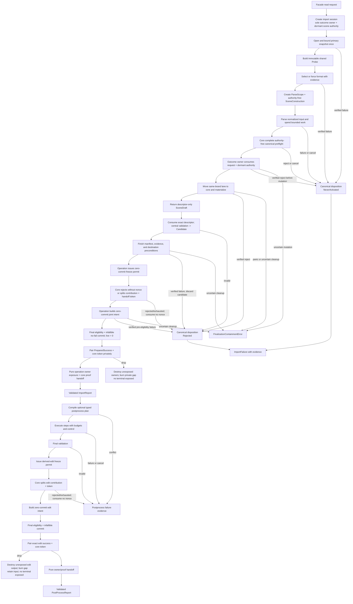
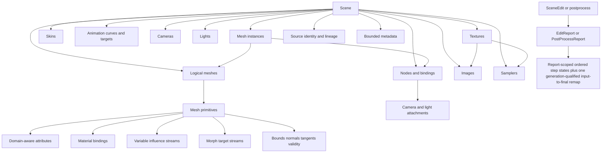
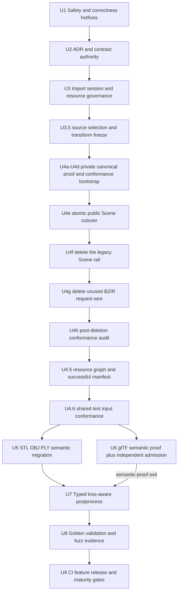

# Baozi Canonical Architecture Fearless Refactor - Plan

## Goal Capsule

| Field | Value |
| --- | --- |
| Objective | Replace Baozi's prototype import, Scene IR, validation, postprocess, and engineering contracts with a source-preserving, bounded, evidence-producing architecture before more complex formats or stable releases land. |
| Planning inputs | The user's explicit authorization for breaking changes and deletion, the 2026-07-10 Baozi-versus-Assimp audit, current source and tests, Accepted ADRs, format support documents, and the clean-room licensing boundary. |
| Execution profile | Refactor fearlessly. Do not preserve unpublished APIs through compatibility shims or parallel models. Keep each completed implementation unit buildable and tested, and delete superseded code and tests in the same unit that replaces them. Local verification reuses the workspace target directory, runs one Cargo process at a time with `-j 1`, and leaves CI matrix parallelism to CI. |
| Stop conditions | Stop only for a genuine scope contradiction, an unavoidable native/FFI dependency in the default build, an unresolved licensing issue, or a required external dependency that fails the plan's license/MSRV/WASM gates with no acceptable fallback. |
| Tail ownership | The executor owns implementation, focused and workspace verification, code review, logical Conventional Commits, documentation alignment, and final repository quality gates. |

---

## Product Contract

This section is a non-normative execution summary derived from the stable requirement labels in the
ADR index and their owning Accepted ADRs. R/AE/KTD entries schedule and test implementation work; they
do not own architecture semantics. If wording conflicts, the ADR index identifies the canonical
owner and that Accepted ADR governs. Change the owning ADR before changing the plan's derived rule.

### Summary

This plan hardens the current four-format importer, replaces the public Scene and import lifecycle contracts, migrates every built-in producer and consumer, and turns architecture claims into machine-enforced tests, fuzzing, CI, and release evidence.
It deliberately deletes the current prototype API and makes the replacement Baozi's first canonical public contract, with no compatibility layer or version-suffixed duplicate model.

### Problem Frame

Baozi has the right high-level separation: an owned Rust Scene IR, format crates, virtual IO, explicit postprocessing, typed diagnostics, and a public facade.
The current implementation nevertheless contains directly triggerable failures and several accepted decisions that the code contradicts.
The OBJ detector can abort registry detection at the probe limit, binary PLY can loop without consuming input, glTF node construction is recursively unbounded, sidecar policy is format-local, and a third-party importer can return an invalid Scene that is labeled validated.

The deeper risk is architectural lock-in.
The current `Mesh` is a single primitive with one material, attributes are effectively vertex-only, skinning is fixed to four influences, animation time is `f32`, image/texture/sampler identities are conflated, derived data has no invalidation contract, and postprocess requests are unconfigured enum flags that cannot report remaps or losses.
Assimp demonstrates the maintenance cost of those constraints; Baozi should borrow its coverage dimensions while rejecting its public C layout, name-based identity, stateful importer, string property bag, process-global logger, and implicit lossy transformations.

### Requirements

**Bounded import and security**

- R1. Format detection must use a shared bounded probe whose exhaustion is an inconclusive result rather than a global IO failure, and detection order must not change the selected result.
- R2. Every input-controlled parser or validator loop must either consume input or spend a bounded operation budget. Individual graph traversals are iterative and bounded; online dependency admission may revisit existing reachability under the explicit `O(E * (N + E))` worst-case contract in ADR 0041, while whole-graph validation and class construction remain linear before their separately bounded digest ordering. Separate node, edge, depth, and work limits are mandatory.
- R3. External dependency access by first-party parsers must flow through one central required/optional resource API that binds authorization to the opened object and enforces path, scope, policy, byte, open, depth, and cancellation rules before backend IO.
- R4. The facade must accept success only after one `ImportSession` outcome owner activates the exact sealed core plan, core consumes the matching importer-returned descriptor into a centrally validated candidate, operation jointly commits canonical ownership with outcome evidence, and the paired core handoff constructs `ValidatedScene`; a detached draft cannot be independently validated, and in-process extension code is not treated as a sandboxed adversary.

**Import lifecycle and resource evidence**

- R5. One import session must use one stable primary-resource snapshot and an authority-qualified dependency table. Every logical reference is role-checked and authorized before lookup; the first physical resolution stores a bounded immutable snapshot or terminal structured failure reused only for `(authority domain, normalized resource identity)`, so reopen behavior cannot change selected or parsed bytes and one scope/resolver cannot reuse another's authority.
- R6. Successful and failed imports must preserve source identity, source-scope selection evidence once recorded, candidate/selected format evidence, last completed stage, diagnostics, and resource statistics; callers must not be able to forge stage transitions or replace sealed report evidence, and terminal public errors must retain only Baozi-owned inert facts rather than executable backend/plugin objects.
- R7. Resource accounting must distinguish five evidence classes: monotonic `Attempted`, monotonic `Consumed`, releasable live attribution with peak-live, `CommittedCanonicalOutput`, and `PublishedOutcomeEvidence`. Failure-capable caller work limits are truthful hard totals: a finite operation-qualified terminal allowance is checked-subtracted from each total, remains an owner-defined dimension inside Attempted/Consumed evidence, and is spendable only through one linear single-use terminal authority. The operation provider checked-sums every non-protected dimension and requires the attempted and consumed aggregates to equal the corresponding ordinary remainders exactly; extra capacity, aggregate overflow, and protected-policy drift fail before startup acceptance. Ordinary checkpoint/writer/reservation/share/commitment/progress capabilities cannot consume the protected dimension. The first trusted `Requested`, `Ledger`, `Control`, or `ProductGraph` terminal cause is sticky; pure preflight/verified rollback returns `Retry`, consumed authority with verified cleanup returns `FallbackOnly`, and uncertain ownership/charge/poison/cleanup is `FailClosed` with no prepared terminal. Hard prebudgeting covers Baozi-owned/requested capacity and cells plus every first-party parser collection through one `baozi-import` ParseScope-bound metered-storage implementation before the corresponding Baozi allocation or loop. A declared opaque-backend allowance is admission/evidence, not proof of the dependency's actual heap, stack, hidden copies, or transient RSS; hostile or opaque decode may claim a hard runtime memory bound only inside an admitted subprocess/process-isolation domain with an OS-enforced limit.
- R8. Typed per-format options, source-scene selection, conformance/recovery/loss profiles, and runtime-only cancellation/progress/tracing controls must have separate ownership and precedence; source-semantic and provenance-evidence loss require independent caller authorities; U4g deletes the unused pre-release BZIR request wire after the canonical cutover, while any later stable wire requires a new Accepted architecture update plus a real consumer and compatibility evidence.

**Canonical Scene IR**

- R9. A logical Mesh must own one or more primitives; topology, indices, material binding, face/corner data, and primitive bounds must not be conflated with logical mesh identity.
- R10. Attributes must declare semantic, storage format, normalization, and domain (`Vertex`, `Corner`, `Face`, or `Instance`) with deterministic cardinality validation and remapping.
- R11. Canonical skinning must preserve variable influence counts and explicit matrix spaces; fixed-four renderer data is produced only by an explicit lossy postprocess request.
- R12. Morphs and animation must preserve source time as `f64`, interpolation/extrapolation, default and per-instance morph weights, sparse/dense representation, authored matrix-or-TRS node base poses, TRS and morph targets, and bounded source metadata; ADR 0031 keeps target identity extensible without producerless concrete variants.
- R13. Image, Texture, and Sampler must be separate identities; Scene space must include handedness, axes, unit, front-face winding, UV origin, tangent-basis conventions, and a derived local-matrix view that does not erase the authored transform form.
- R14. Scene-local dense IDs, persistent source identity/provenance, editable collections, validation proofs, remaps, and derived-data invalidation must be distinct concepts with explicit APIs.

**Format and postprocess behavior**

- R15. STL, OBJ/MTL, PLY, and glTF must migrate to the canonical IR without silently dropping known source semantics, required extensions, corner/smoothing data, typed scalar ranges, multiple primitives, variable influences, source-scene selection/closure, or resource failures.
- R16. Postprocess requests must compile into a typed plan with parameters, dependencies, conflicts, loss policy, cancellation and budget checks before consuming a Scene.
- R17. Postprocess must distinguish not requested, requested-but-unchanged, and changed success; every requested run returns postprocess-owned diagnostics, per-step statistics, losses, explicit outcomes, and a validated result. Only a committed change reserves and publishes exactly one final Scene generation; ordered per-step remaps use owning-report typed step-state paths, only the composed input-to-final remap is generation-qualified, and geometry changes invalidate or recompute affected derived data.
- R18. Triangulation must handle supported concave simple polygons robustly, preserve winding and domain data, and reject unsupported self-intersecting or materially non-planar polygons instead of emitting plausible but wrong geometry.

**Governance and executable evidence**

- R19. ADR lifecycle, authority, supersession, public compatibility, target support, archive/export future contracts, and current implementation evidence must be unambiguous and machine checked where practical.
- R20. Real golden files, stable full-data digests, facade-path integration tests, adversarial fuzz targets, feature/platform matrices, dependency audits, issuer-qualified maturity evidence, and isolated package verification must make the above contracts non-bypassable; only Baozi-managed exact-identity evidence may issue a Baozi maturity claim.
- R21. The breaking public API must keep the common import-inspect-process workflow progressive: a downstream consumer constructs one long-lived facade runtime from a finite documented ordinary resource profile, imports bytes through private per-import accounts, inspects logical meshes/primitives and typed positions, applies an optional preset, and handles structured failure evidence without manipulating validation-proof, physical-account, budget-ledger, or backend-internal types. Advanced hosts may explicitly supply a bounded account for one aggregate retention domain; account equality never grants lineage, and cross-account composition requires a complete independently admitted materialization copy.
- R22. Each import session must own one bounded origin-qualified resource graph that separates logical dependency edges from authority-qualified physical acquisition, rejects cycles and node/edge/depth/work exhaustion before partial publication, and publishes a structurally complete successful semantic quotient manifest. Every mediated resource and logical request has one terminal outcome, and environment-dependent omissions without immutable negative proof remain explicitly `ObservedOnly`; structural graph/finalization failures are terminal. Private authority partitions and physical counts never enter the manifest identity. Producer attestation, closed-input qualification, and import build identity remain outside this Accepted requirement until ADR 0043 or a replacement is promoted.

### Acceptance Examples

- AE1. With OBJ enabled, a valid STL, PLY, or glTF larger than the probe budget is still detected and imported; exact-budget exhaustion does not become an IO error.
- AE2. A binary PLY file declaring a huge unknown element with no properties fails before row iteration, allocation, or per-row diagnostics.
- AE3. A glTF self-cycle, multi-node cycle, shared child, duplicate root, layered diamond, over-depth graph, or over-budget graph fails deterministically in O(nodes + edges) work without recursion overflow or duplicate Scene nodes.
- AE4. A trusted custom importer that returns an invalid root, reference, index, non-finite value, or over-budget Scene, or raises an unwindable panic, never produces a validated success report.
- AE5. Optional MTL denial, absence, or acquisition-budget exhaustion preserves OBJ geometry with a structured diagnostic, while a required glTF buffer failure remains fatal. Environment-dependent absence qualifies only with immutable negative proof; acquisition-budget omission remains `ObservedOnly`; structural graph-limit failure is fatal regardless of optionality.
- AE6. A mutable `AssetIo` that would return different bytes on a second open is opened once for the primary resource and cannot create a detect/parse mismatch.
- AE7. A logical glTF mesh with two primitives and materials remains one Mesh with two primitives, while node bindings and default morph weights retain their source identity.
- AE8. OBJ corners sharing a position but using different UVs, normals, or smoothing boundaries remain distinguishable without unnecessary position duplication in canonical data.
- AE9. A vertex with more than four valid skin influences round-trips through import, validation, snapshot, and raw facade output without loss; explicit compaction reports discarded weight mass.
- AE10. Animation with long-duration `f64` time, node TRS/morph targets, cubic interpolation, and extrapolation metadata remains observable in validation and golden output.
- AE11. Concave clockwise and counter-clockwise polygons triangulate with matching area, winding, material, face/corner attributes, and source-face remap; self-intersection fails explicitly.
- AE12. Editing positions invalidates stale bounds, normals, and tangents, and a successful postprocess output always passes the final validation profile.
- AE13. Default, every single public format feature, all-formats, and all-features facade tests execute real tests rather than compile-only checks.
- AE14. A release dry run builds an isolated downstream consumer from packaged artifacts in dependency order, and a format cannot claim maturity without its machine-readable evidence set.
- AE15. Repeated oversized, truncated, denied, or failing optional sidecars cannot refund consumed IO or work, exceed the aggregate budget, or exploit an authorize/open path replacement; repeated authorized references to one authority-qualified identity reuse its first snapshot or terminal failure even when the backend later changes, different scopes/resolver namespaces remain isolated, an allowed cache entry cannot satisfy a denied alias, and skipped resources remain visible in diagnostics and statistics.
- AE16. Deeply nested or object-dense glTF/GLB input is rejected by pre-decode admission before the in-process backend is entered. Baozi-owned snapshots, normalized/canonical/scratch storage, and all first-party metered collections remain within their configured peak-live budget. An opaque backend allowance alone does not prove actual decode memory; a hard hostile-input runtime-memory claim requires the decode to run under an admitted OS-enforced subprocess limit.
- AE17. An isolated packaged consumer constructs one bounded long-lived facade runtime, reuses its private factory across imports while each import receives a private account, and completes the common import-inspect-process workflow with ergonomic views/errors and no physical-account, validation-proof, or ledger types; a separate advanced fixture supplies an explicit account for one bounded editor/cache retention domain, proves same-account independent Scenes have no lineage authority, and requires a complete independently admitted copy for cross-account composition.
- AE18. Typed format options compile through a versioned envelope and the object-safe registry; unknown, disabled, duplicate, version-mismatched, or wrong-format options fail before primary IO, while each parser receives only its checked concrete type. U4g removes the unused BZIR wire without weakening the typed option path, and U9 verifies that no packaged surface reintroduces it.
- AE19. A glTF document with multiple scenes and no default requires explicit selection; selected roots retain one checked reference closure, unselected scope produces bounded evidence, and cross-selection skins or unauthorized animation-channel omission cannot publish a Scene.
- AE20. A near-affine glTF bottom row fails before canonical construction; exact affine rows preserve authored bits, while tolerance applies only to the frozen decomposition/no-shear predicate.
- AE21. A format/backend error is synchronously packed into bounded descriptor/code/details, then remains printable and droppable after every registry/session/plugin object is gone without calling foreign code or exposing a concrete-source downcast.
- AE22. Injected parser-storage growth, transfer, and rollback failures leave allocation and reservation ownership aligned; all first-party format crates share the one import-owned implementation and release backing capacity before its budget token.
- AE23. An external descriptor is visibly `Unverified` or issuer-scoped `SelfAttested`; only an exact passing `docs/formats/evidence.toml` entry can produce `BaoziVerified`, and changing implementation/profile/target/gate identity removes that authority until review.
- AE24. An OBJ -> MTL -> texture chain resolves the texture from the MTL origin, records every logical alias and optional terminal outcome while physically acquiring each authorized identity once, rejects cycles/depth/work excess without half-published graph state, and produces one order-independent complete manifest whose digest changes when any mediated dependency bytes, resource identity, role/requirement, reference evidence, terminal outcome, multiplicity, or replay proof changes. A session-cached missing/open/read failure cannot become cross-session replay evidence without an immutable resolver-snapshot or per-reference negative proof.

### Scope Boundaries

- The plan includes breaking all current public Rust APIs and deleting superseded types, methods, enum variants, tests, fixtures, and documents.
- The plan includes complete migration of the existing STL, OBJ/MTL, PLY, and glTF slices; it does not add FBX, Collada, MMD, 3MF, USDZ, or another new format.
- The plan defines archive/container and exporter contracts in ADRs but does not implement archive extraction or exporters.
- The plan does not add a C ABI, dynamic plugin ABI, native parser backend, network IO backend, persistent cache, image pixel decoder, or `no_std` support.
- The plan keeps `gltf-rs` private while the current bootstrap backend remains useful; replacement is evidence-driven, not required solely for architectural purity.
- In-process custom importers, `AssetIo` implementations, resolvers, and opaque decode backends are trusted extension code that may be buggy but cannot be sandboxed by Baozi; hosts must isolate genuinely untrusted plugins, and any opaque decode requiring a hard runtime memory bound, in an OS-limited process.
- The plan may add pure-Rust development or algorithm dependencies only after license, MSRV, WASM, maintenance, and failure-semantics validation.
- Assimp code and fixtures remain read-only reference material and must not be copied into Baozi.

---

## Planning Contract

### Key Technical Decisions

- KTD1. Fix triggerable safety and correctness defects before schema work, with regression evidence that survives later refactors.
- KTD2. Make ADR 0006 the single public compatibility authority, supersede ADR 0024, keep decision ownership and traceability in the ADR index, and keep lifecycle and evidence rules in the contribution policy.
- KTD3. Replace per-importer stream probing with one immutable shared Probe produced by the import session; detectors never own rewind or cursor restoration.
- KTD4. Separate stable input snapshot, dependency resolver, operation budget, diagnostic sink, runtime control, and outcome/report responsibilities instead of extending the current monolithic `ImportContext`.
- KTD5. Treat failure evidence as a first-class outcome and a validated stage as an internal proof, not an enum value callers can assign.
- KTD6. Keep canonical IR source-oriented. Runtime/GPU lowering, coordinate normalization, influence compaction, topology conversion, and graph optimization are explicit loss-aware postprocess operations.
- KTD7. Use Logical Mesh to Primitive composition and domain-aware attributes as the central geometry model; importers must not recover logical identity by matching names.
- KTD8. Keep IDs dense and scene-local for traversal efficiency, and use a separate provenance side table for source IDs, aliases, source spans, synthetic objects, and split/merge lineage.
- KTD9. Make validation iterative, bounded, deterministic, and multi-issue. Structural errors, recoverable quality issues, and repair actions use stable codes and object paths.
- KTD10. Compile postprocess plans before mutation. Ordinary requests do not silently add prerequisites; presets may expand to complete inspectable plans.
- KTD11. Default loss policy is preserve-or-error. Lossy lowering requires explicit caller authority and records the exact loss in the report.
- KTD12. Prefer a maintained pure-Rust tessellator for supported simple polygons, but keep Baozi responsible for 3D projection, planarity/self-intersection policy, output validation, winding, and remap.
- KTD13. Keep parser-local tests for grammar details and add facade/session contract tests for validation, policy, statistics, stage, and failure evidence.
- KTD14. Use checked-in golden snapshots with bounded previews plus a stable digest of complete canonical values; counts or key names alone are insufficient evidence.
- KTD15. Make format maturity, evidence authority/issuer, public feature membership, platform support, fuzz status, and package publishability structured data checked by an internal xtask and CI. `baozi-xtask` consumes explicit conformance and evidence inventories only; it does not scan ADR text, ADR indexes, or repository history for routine CI or stage transitions. (session-settled: user-directed — chosen over ADR-scanning xtask gates: they are slow and do not prove implementation conformance.)
- KTD16. Create `ImportSession` before any open or detection work. Bootstrap one outcome owner containing the sole session ledger/coordinator, bound physical-account capability, minimal terminal/evidence baseline, outcome-evidence and joint-preparation authority, and one dormant single-use scene authority with zero canonical tables. After selection, core creates an authority-free `SceneConstruction`; complete preflight returns a sealed plan containing exactly one non-authority activation request. Only the outcome owner may consume that request with the dormant authority and move the resulting same-brand canonical lane into core. `ParseScope` exposes only bounded authoring operations; parsers cannot access raw `AssetIo`, any operation owner, retained authority, report/stage construction, validation, or publication.
- KTD17. Treat asset bytes, reference strings, and returned Scene data as untrusted. Treat in-process importer, AssetIo, resolver, and opaque decode implementations as trusted extension code. Only a caught single non-builder unwind may publish minimal fallback after complete cleanup and zero live attribution are verified. A retained canonical/evidence/report builder panic before startup acceptance returns the owner-specific start error; the same panic after startup returns typed fatal containment with coupled ownership and no fallback. Uncertain release keeps payload/lease/attribution coupled and poisoned and returns typed fatal containment, while abort/double panic/exit/OOM, hostile plugins, and hard-bounded opaque decode require process isolation.
- KTD18. Split resource evidence into exactly five classes: non-refundable `Attempted`, non-refundable `Consumed`, releasable live attribution with peak-live, `CommittedCanonicalOutput`, and `PublishedOutcomeEvidence`. Track Baozi-owned phase storage and declared opaque allowances separately so snapshots, normalized models, canonical output, outcome evidence, and scratch storage cannot silently multiply memory or conflate failure evidence with Scene output. An opaque allowance remains accounting evidence rather than proof of actual backend memory.
- KTD19. Use one opaque core-owned, authority-free `SceneConstruction` as the sole pre-validation API. The import outcome owner and dormant scene authority never enter core; only the sealed activation request crosses core to import, and only the resulting brand-coupled canonical lane crosses import to core for materialization. These intermediate values remain hidden from parsers and public callers. `SceneDraft` carries only its construction brand and canonical directory-slot descriptor, and `ValidatedScene` is the public invariant-bearing result. No legacy `SceneBuilder` adapter or legacy-to-canonical copy path survives the public cutover. Structural edits use a derived `SceneEdit` lane over the input account/lineage and reuse only the joint-commit/pure-handoff primitive; they do not obtain a dormant source-construction authority. (session-settled: user-directed — chosen over a compatibility adapter: fearless refactoring requires one production Scene lifecycle.)
- KTD20. Keep validation and post-discovery graph/class construction linear in their declared inputs, but state hostile online dependency admission honestly: the portable bounded reachability algorithm has worst-case `O(E * (N + E))` total work before final `O(N + E + B)` DAG/class construction and `O(E log E + N log N)` fixed-digest ordering. Explicit work limits, not timeouts, are the primary bound.
- KTD21. Make postprocess steps transactional at the affected-buffer level: preflight and reserve first, construct replacements off to the side, validate, then atomically swap. Failure or cancellation discards staging without cloning or partially publishing the whole Scene.
- KTD22. Preserve an acyclic crate graph: `baozi-operation` is a runtime-neutral dependency leaf that owns `OperationControl`, reservation/ledger state machines, and their coordinator; core owns IR, validation proof, remap, and domain errors; io owns paths, backends, handles, and IO-local hard caps; import owns sessions, request limits/effective budgets, conformance/loss policy, and outcomes; postprocess owns plans and reports; facade constructs or re-exports common policy and alone composes public errors.
- KTD23. Keep FormatImporter object-safe while format crates own typed options. A versioned envelope keyed by stable FormatId compiles through importer-provided object-safe codecs into a type-erased FormatOptionStore before session start; ParseScope permits only the selected importer to checked-downcast its concrete option type, and the public API never exposes a string property bag.
- KTD24. Freeze source-scene selection before U4. For glTF, `DocumentDefault` resolves a declared default or the sole declared scene, an explicit selector resolves a stable source identity, and a zero-scene document projects validated parentless roots; two or more scenes without a default never fall back to source order. The selected projection then validates one structural and typed reference closure.
- KTD25. Preserve a node's authored matrix-or-TRS base pose. A local matrix is derived, component animation overlays only TRS base values, and any representation lowering is explicit, provenance-bearing, and loss-authorized.
- KTD26. Require an exact canonical affine bottom row and validate glTF authored matrices with one Baozi-owned, backend-independent f64 decomposition/no-shear predicate over the frozen orthogonality threshold. Preserve valid matrix bits, accept zero/negative scale representations, reject near-affine glTF instead of recovering it, and never use backend decomposition as conformance authority.
- KTD27. Seal native format failures at the selected ParseScope into Baozi-owned inert descriptor/code/detail evidence; native errors are synchronous adapter inputs, never terminal trait objects, downcast targets, or plugin-lifetime anchors.
- KTD28. Put parser collection reservation, capacity, transfer, rollback, and destructor ordering in one `baozi-import` metered-storage module; format crates retain semantic models but delete their private accounting state machines.
- KTD29. Keep postprocess loss policy, diagnostics, and outcomes in `baozi-postprocess`; preserve the input generation for not-requested/unchanged outcomes. Each changed `SceneEdit` reserves/publishes exactly one final generation; ordered per-step remaps use owning-report typed step-state paths with no Scene lookup or persistent identity, and only the composed input-to-final remap is generation-qualified.
- KTD30. Separate format maturity level from evidence authority (`Unverified`, `SelfAttested`, `BaoziVerified`) and reserve Baozi claims for exact identities admitted by the managed evidence inventory.
- KTD31. Separate per-generation logical Scene footprint, per-operation allocation/work attribution, and host physical storage accounting. Bind every retained canonical backing allocation to one non-rebrandable account for its full lifetime, but require an exact-input `CanonicalInheritanceSource` in addition to same-account physical membership. Derived tables issue fresh target-local inherited slots; they never reuse source slots. Never recharge an authorized shared payload merely because its reference is cloned, and still precharge clone/branch work plus handle/container/fan-out limits. Cross-account composition or migration always materializes a complete independently admitted copy.
- KTD32. Make `ImportSession` the only resource-graph, terminal-edge, replay-evidence, and successful-manifest authority. Parsers request dependencies with non-comparable session-issued origin handles and frozen ADR 0021 role IDs; authorization and atomic failure-plus-proof caching remain below the graph; ADR 0041 exclusively owns the canonical public semantic quotient transcript. Environment-dependent omissions require immutable negative proof, session-dependent omissions remain `ObservedOnly`, and structural graph failures are terminal. Producer attestation, closed-input qualification, and import build identity remain the separate Proposed ADR 0043 boundary. Private authority counts, maturity tokens, registry declarations, and conformance evidence revisions never become manifest inputs.
- KTD33. Keep the raw generic retained-allocation rail private to `baozi-operation`; the operation-owned concrete store retains separate typed canonical and outcome-evidence `RetainedBlockTable` aggregates, each structurally owning every admitted child allocation. Domain code
  receives only the concrete metered store for sealed `ScalarSequenceBlock`,
  `BytesBlock`, `Utf8Block`, and bounded allocation-free `RecordBlock` values. Only the three leaf
  kinds may inherit physical backing; geometry index scalar payload may share only as a sealed scalar
  sequence, while every record/directory/reference/header/generation-local lookup-index structure is
  rebuilt. A future pure-record share requires static reference-free proof plus independent
  implementation/conformance review; it changes ADR 0044 only if the lineage proof boundary or
  another durable ownership invariant changes.
  Core's `CanonicalBlockRef<Schema>` is a non-owning typed projection over a sealed, unstable in-
  memory schema, never an allocation owner or stable wire. Operation validates physical typed
  variants/membership/account/destination/ownership closure; core validates semantic kinds/
  reachability/references/cardinality/orphans. Each runtime `CapacityPlan` is governed by the exact
  capacity-policy revision, charges the full Baozi-requested envelope before entry, requests only
  desired additional capacity, and accepts observed `desired..=envelope`. U4c repository evidence,
  not a runtime token, binds a separate concrete-store/policy source anchor to rustc/libstd/target/
  profile/allocator identity for strict
  conformance; unknown/custom paths remain `Unverified`. This bounds hostile Baozi requests, not
  exact/transient RSS; hard process memory requires an OS/subprocess limit. Physical zero-length
  blocks are forbidden; core headers preserve `Absent` versus `PresentEmpty`. Physical layout, slot
  order, capacities, qualification evidence, and padding never enter the semantic Scene digest.
- KTD34. After core has produced a centrally validated canonical `Candidate` and the outcome owner has completed evidence and destination preconditions, operation issues one zero-commit `SceneFreezePermit`. Core alone consumes it for the final fallible identity acquisition: rejection or exhaustion consumes no nonce and returns `Rejected` for ordinary rich-failure preparation with zero canonical output; success splits an operation-understandable freeze contribution from one core-owned `SceneHandoffToken` containing the reserved never-reused generation and proof. Operation combines only the contribution and exact outcome evidence into a closed zero-commit `JointCommitIntent`. Every fallible allocation, validation, account/control observation, callback, and cleanup decision precedes final account eligibility; eligibility success immediately enters one non-returning allocation-, lock-, callback-, and panic-free suffix that applies both destination commitments, reaches zero operation live, freezes the sole ledger snapshot, and constructs exact `PreparedSuccess`, `PreparedRichFailure`, or `PreparedMinimalFallback`. No post-eligibility error, unwind, containment branch, or stored qualification token exists. Operation wrappers own no core generation value; only an import-private exact-success aggregate pairs `PreparedSuccess` with the matching `SceneHandoffToken`, and dropping that aggregate may burn one invisible gap. Its two pure consuming handoffs expose the committed owners and then let core construct `SceneGenerationId`/`ValidatedScene` without allocation, validation, accounting, control polling, callback, or failure. A finite protected terminal allowance remains inside the caller's total work cap, unavailable to ordinary capabilities, retained until exact success is irreversible or a no-more-work failure path is complete, and reported through the existing Attempted/Consumed classes. The first trusted typed cause is sticky. Pure preflight precedes capability consumption; safe recovery is exactly `Retry` or `FallbackOnly`. A retained canonical/evidence/report builder panic before startup acceptance returns the owner-specific start error; after startup, or whenever in-process cleanup is uncertain, ownership and charge remain coupled and poisoned and the API returns `FinalizationContainmentError` with no fallback, prepared wrapper, generation/proof/remap, recovery owner, or handoff.
- KTD35. Keep low-level account APIs explicit while making the common facade progressive: one long-lived runtime/importer object owns a bounded factory derived from a finite documented resource profile and creates one private account per import. No global or per-request factory exists; an advanced explicit account represents one aggregate retention domain but never grants canonical lineage.
- KTD36. Keep operation attribution and physical retention as separate accounting planes. After complete pure preflight, admit the complete attribution aggregate under the ledger lock. Ledger control/bookkeeping allocation may follow only that complete first-plane capacity admission, remains structurally owned by the provisional graph, and appears in no physical manifest or charge. Before physical entry, each typed bookkeeping backing-allocation failure destroys every partial backing and rolls back the complete ledger aggregate under one lock. After complete bookkeeping materialization, admit the complete physical aggregate under the account lock. From physical transition entry onward, only typed no-mutation second-plane rejection is rollback-eligible; panic, poison observed after mutation, or uncertain disposition preserves coupled attribution/physical owners and fails closed without refund. The private guard exposes no accepted operation/session or retained payload/evidence allocator entry before both planes succeed. The locks are never nested and the internal snapshots have no common linearization point; only external acceptance is atomic. Treat `StoreKeyDomain` as a process-local minting/anti-confusion authority: the Baozi-owned result/evidence owner retains the host domain anchor and immutable normalized mapping through query lifetime, plugins receive only host-minted accepted keys while foreign-domain keys reject, and runtime brands never enter semantic transcripts, digests, wire, cache, or build identity.

### Assumptions

- A1. Baozi has not shipped a stable consumer contract. Delete the prototype API, tests, and documentation in the same cutover; do not add compatibility shims, migration APIs, `V2` suffixes, or a v1-to-v2 guide. The replacement is canonical v1 behavior.
- A2. `default-formats` remains a curated maturity set, while `all-formats` literally includes every first-party format regardless of maturity.
- A3. A primary asset may be buffered into one bounded immutable snapshot because every current importer already reads the primary asset fully; a future true-streaming API is a separate contract.
- A4. Optional resources may be skipped only when the format contract classifies them optional and the resulting loss is diagnosed; strict fail-on-loss can promote that diagnostic.
- A5. U2 admitted GeoRust `earcut` 0.4.10 behind Baozi's backend-neutral triangulation adapter after verifying its API, `f64`, license and bundled notices, MSRV, WASM build, maintenance, unsafe surface, and invalid-input behavior. `lyon_tessellation` is a replacement candidate, never an automatic runtime fallback. U7 must resolve and verify the exact admitted package identity and closure before use; version, feature, source, fork, checksum, or reviewed-commit drift reopens full admission, while transitive drift reruns policy, portability, notice, and adapter-conformance gates.
- A6. Archive and exporter ADRs are included because their contracts reveal constraints on current IO, provenance, and loss design, but they remain Proposed and non-authoritative until a future implementation tracer exists.
- A7. Capability-relative or handle-verified filesystem opening is implementable on declared native target tiers; a platform that cannot bind authorization to the opened object must reject symlink/reparse traversal by default rather than claim a scope guarantee.

### High-Level Technical Design

#### Import lifecycle

#### Canonical Scene IR relationships

#### Scene ownership and cardinality constraints

| Concept | Owner and identity | Cardinality/remap rule |
| --- | --- | --- |
| Logical Mesh | Scene-local MeshId; source identity lives in provenance | Owns one or more primitives but no primitive-local topology or material state. |
| Primitive | Exactly one logical Mesh; stable only within the current validated Scene | Owns topology, indices, material binding, primitive bounds, morph streams, and Vertex/Corner/Face attribute streams. |
| Mesh instance | Scene-owned, generation-qualified `MeshInstanceId`; stores exactly one owner `NodeId` and one `LogicalMeshId` | Owns Instance-domain data, optional skin binding, and per-instance morph-weight overrides; it never changes primitive cardinality. Node-to-instance lookup is derived and no reciprocal node binding is canonical. |
| Attribute stream | One primitive or instance binding | Cardinality is derived from its declared domain; typed views borrow canonical storage and never duplicate it. |
| Skin influences | Primitive vertices plus a Scene-local SkinId binding | Offset/value storage preserves every source influence; remap follows vertex lineage and validates joint ranges. |
| Morph targets | Primitive-local streams with logical-mesh defaults and instance overrides | Sparse/dense semantics and delta/absolute meaning are explicit; cross-primitive sharing is not inferred by name. |
| Provenance | Scene-owned arena and bounded entity references | `SourceIdentity` persists across generations and repeated imports while its resolver identity, format, and object locator retain meaning. Private `ProvenanceNodeId` values are addresses in one Scene-owned arena, never persistent identities or remap endpoints; lineage follows published remaps. |
| Remap | `EditReport` or `PostProcessReport`, never the Scene | Ordered per-step maps name exact same-report typed step states and complete owner-local endpoints; only the composed input-to-final map names exact source/destination generations. Both forms cover affected entity/domain IDs, and composition requires matching report-state paths before the final generation-qualified relation is emitted. |

#### Implementation dependency graph

#### Crate ownership and dependency direction

| Crate layer | Owns | Must not own or expose |
| --- | --- | --- |
| `baozi-operation` | Runtime-neutral operation control, reservation/ledger state machines, phase-neutral accounting coordinator, host physical-storage accounts, the private generic final-owner foundation, and the sole concrete retained `ScalarSequenceBlock`/`BytesBlock`/`Utf8Block`/`RecordBlock` store | IO, import policy, Scene types or semantic schema, format models, facade errors, executors or worker pools |
| `baozi-core` | Scene IR, opaque `SceneConstruction`, descriptor-only drafts, sealed unstable canonical schema, non-owning `CanonicalBlockRef<Schema>` projections and views, validation proofs, domain errors, remaps, and canonical lineage policy | Generic retained/final-owner foundation, owning storage wrapper/guard, physical lease/drop protocol, raw physical reservation/account authority, IO, import policy, format backends, facade errors, postprocess plans |
| `baozi-io` | Logical paths, scoped/capability handles, backends, IO errors, IO-local hard caps | Scene, import stages, request policy or effective budgets |
| `baozi-import` | Session, Probe, ParseScope, origin-qualified resource graph, successful input manifest/replay status, dependency policy, request limits/effective budgets, conformance/loss policy, diagnostics, outcomes | Format-specific models, producer/build identity, public facade composition, duplicate IO authorization/cache or ledger/control machinery |
| `baozi-format-*` | Private decode and normalized format models plus semantic lowering through the borrowed ParseScope/core authoring capability | Raw AssetIo access, `SceneConstruction` ownership or finalization, report/stage construction, public backend types |
| `baozi-postprocess` | Typed plans, transactional steps, losses, statistics, reports | Import lifecycle and format-specific types |
| `baozi` | Public composition and error mapping | New domain state duplicated from lower crates |

### System-Wide Impact

- Every workspace crate consumes either the import lifecycle or Scene IR and therefore participates in the U3/U4 contract cutovers.
- Public users see renamed or removed fields, types, helpers, error handling, postprocess configuration, and feature semantics.
- Format maintainers gain shared probe, dependency, budget, diagnostic, provenance, validation, and evidence helpers but must meet stricter parser manifests and maturity gates.
- Security claims apply to untrusted asset data and first-party parser boundaries, not arbitrary hostile code already executing in-process; the public extension contract states this explicitly.
- Filesystem scope moves from string validation to authorization bound to an opened handle or a conservative no-follow policy, which changes native backend implementation and platform tests.
- CI and release maintainers gain more jobs and a package-graph validation tool; fuzzing remains Linux sanitizer-authoritative with platform builds separated from sanitizer evidence.

### Risks and Mitigations

| Risk | Impact | Mitigation |
| --- | --- | --- |
| U4 leaves the workspace red for too long | Blocks all parallel work and obscures regressions | Prepare tests and the new core model first, migrate all consumers in one unit, and commit only when the full workspace is green. |
| A new generic attribute model becomes harder to use | Format and engine code becomes verbose | Keep ergonomic typed accessors/views over one canonical domain/storage model; do not maintain duplicate storage. |
| Budget accounting becomes inconsistent | False safety or rejected valid files | Centralize reservation names and semantics, use rollback tests, and prohibit parser-owned counters for shared dimensions. |
| Format-local storage wrappers diverge or release tokens before capacity | A parser undercounts live memory during failure/unwind | Make `baozi-import` the single metered-storage owner, delete duplicate state machines, and test drop/rollback order under injected failures. |
| Rollback refunds real attacker-controlled work | Repeated optional failures bypass aggregate IO/CPU limits | Keep attempted opens, bytes, decode work, and diagnostic bytes monotonic; roll back only unused live reservations. |
| Stable snapshots and staged transforms multiply memory | Valid inputs exhaust the process before any nominal limit trips | Define phase ownership, checked allocation reservations, prompt intermediate release, and a max peak-live gate covering simultaneous buffers. |
| Path authorization races path opening | Symlink, junction, or reparse replacement escapes the declared scope | Open relative to an authorized capability or verify the opened handle; reject unsupported traversal rather than relying on pre-open canonicalization. |
| glTF backend allocates before Baozi preflight | Deep or object-dense JSON causes OOM, abort, or long uncancellable decode | Keep the slice disabled and unregistered until GLB/JSON admission plus Linux sanitizer and subprocess RSS/timeout gates pass; Experimental cannot waive baseline safety. |
| Callers mistake facade validation for plugin sandboxing | Hostile in-process code can allocate, loop, abort, or read files outside Baozi | Publish the trust model and require host-managed process isolation for untrusted plugins. |
| A terminal error outlives unloaded extension code | Formatting, source traversal, or destruction dispatches through an unmapped vtable | Pack only inert Baozi-owned evidence synchronously and forbid native objects/callbacks/downcasts in outcomes. |
| The admitted triangulation dependency identity or closure drifts before U7 | Unreviewed source, unsafe, license, or portability behavior enters postprocess | Match the exact version, features, source, checksum, and reviewed commit and rerun full admission on identity drift; rerun lockfile, policy, portability, notice, and adapter-conformance gates on transitive drift. |
| Golden files become noisy | Reviewers ignore semantic diffs | Normalize ordering/floats, bound previews, include complete digests, and keep raw and processed goldens separate. |
| Platform CI becomes too slow | Slow feedback encourages bypasses | Split fast PR gates from scheduled fuzz/powerset jobs while keeping all promotion and release gates mandatory. |
| Self-attested third-party maturity appears first-party verified | Users rely on a support promise Baozi did not test | Store level and issuer authority separately; only managed exact-identity evidence may construct `BaoziVerified`. |
| glTF backend still aborts under sanitizer | Cannot enter first-party inventory or public reachability | Keep the slice disabled and unregistered; harden, replace, or process-isolate it and rerun baseline admission before restoring the public facade feature. |
| Shared Scene payload is charged once per generation, loses its charge, or crosses an unauthorized lineage | Host limits either reject valid edits or undercount retained memory; independent Scenes can smuggle storage | Give every allocation one lifetime-bound physical account, keep logical/operation/physical metrics typed separately, require exact-input lineage plus fresh target-local slots, and require a complete independently admitted copy across accounts. |
| Generation exhaustion occurs after destination commitment, rejection consumes a nonce, or a post-eligibility failure branch exists | Handoff becomes fallible, a half-published terminal escapes, or failed operations create avoidable identity gaps | Issue a zero-commit freeze permit before core reservation; rejection/exhaustion consumes no nonce. After a successful reservation, a later pre-eligibility preparation failure, cancellation, caught unwind, or private exact-success aggregate drop may burn one invisible never-reused gap. Eligibility success has no error, unwind, containment, or stored-token branch. |
| Allocator capacity exceeds the admitted retained footprint | A valid API path silently undercharges live physical storage | Govern `CapacityPlan` by the pinned capacity policy, match strict evidence through the separate store/policy source anchor, charge the full envelope before allocation, retain that conservative charge, and destroy over-envelope storage before owner release. |
| Facade construction creates a global, unbounded, or per-request account factory | Common workflows bypass aggregate host limits or multiply control storage | Require one long-lived facade runtime from a finite documented profile, one bounded retained factory, and private per-import accounts; keep advanced explicit accounts as deliberate retention domains only. |
| A format omits or order-dependently hashes one dependency | Cooker artifacts are falsely reproducible | Centralize graph/manifest finalization in `ImportSession`, require one terminal edge outcome, and use permutation plus one-field mutation vectors. |
| A future cache invents a partial dependency key | A stale dependency closure returns a false hit | ADR 0017 authorizes no persistent-cache owner, key, schema, or API; any future cache requires a separate consumer-backed Accepted decision and must prove complete input equality before success. |

### Deferred to Implementation

- Exact internal module and helper names may change as U3 and U4 deepen domain-owned modules; file
  size alone does not justify a new interface or seam.
- U7 consumes the triangulation backend decision recorded by U2, verifies the exact package/source/feature/checksum/reviewed-commit identity and closure before use, reopens full admission on identity drift, and reruns policy/portability/notice/conformance gates on transitive drift; the public postprocess contract remains backend-neutral.
- Exact progress work units are format-specific, but stage ordering, monotonicity, cancellation bounds, and callback safety are fixed by U2/U3.

---

## Implementation Units

### U1. Harden Triggerable Input and Boundary Failures

- **Goal:** Eliminate the current registry poisoning, parser non-progress, unbounded graph traversal, validation bypass, sidecar bypass, and obvious facade inconsistencies before broader refactoring.
- **Requirements:** R1-R4, R7, R15, AE1-AE5.
- **Dependencies:** None.
- **Files:** `crates/baozi-import/src/registry.rs`, `crates/baozi-import/src/context.rs`, `crates/baozi-io/src/limits.rs`, `crates/baozi/src/lib.rs`, `crates/baozi-format-obj/src/detect.rs`, `crates/baozi-format-obj/src/mtl.rs`, `crates/baozi-format-obj/src/obj.rs`, `crates/baozi-format-ply/src/parser.rs`, `crates/baozi-format-gltf/src/parser.rs`, `crates/baozi/tests/importer_api.rs`, `crates/baozi/tests/detection_facade.rs`, `crates/baozi-format-obj/tests/materials.rs`, `crates/baozi-format-ply/tests/malformed.rs`, `crates/baozi-format-gltf/tests/node_graph.rs`, `fuzz/corpus/ply_import/`, `fuzz/corpus/gltf_import/`.
- **Approach:** Replace the detector error-string convention with typed Match/NoMatch/Inconclusive(ProbeExhausted)/Fault evidence. Primary snapshot faults are fatal; importer-local faults remain structured candidate evidence; the strongest deterministic valid match wins despite local faults; and no-match plus faults returns an aggregate detection failure. Reject zero-width repeated binary PLY records; preflight glTF graphs iteratively with dense color/parent state and O(nodes + edges) work; force facade validation; add the smallest central sidecar Deny guard; make optional MTL budget failures diagnostic; make `Default` equivalent to `new`; remove or rename diagnostics-dropping helpers; intern or segment-build repeated OBJ state instead of cloning large names per face.
- **Execution note:** Add or rewrite the regression tests first and observe the expected failures before changing production behavior. The temporary current-context sidecar guard is deliberately deleted when U3 replaces that context; it must not become a second policy path.
- **Patterns to follow:** Checked arithmetic and preflight validation in `crates/baozi-format-gltf/src/parser.rs`; malformed and limits test organization in each format crate; facade contract tests in `crates/baozi/tests/importer_api.rs`.
- **Test scenarios:** Probe limits at zero, one below, exact, and above budget; large valid STL/PLY/glTF with OBJ registered; every registration-order permutation with greedy, faulting, and valid detectors; out-of-range probe reads; PLY nonzero count with zero properties and huge count; glTF self-cycle, mutual cycle, many roots sharing a subtree, layered diamond, wide fan-out, duplicate root, and exact/excess node/edge/depth/work budgets; trusted importer invalid Scene or unwindable panic; sidecar Deny before IO; optional MTL missing/denied/over-budget; required glTF buffer control case; `Default` and `empty` registry behavior.
- **Verification:** Focused import, facade, OBJ, PLY, and glTF tests pass; new corpus cases terminate within the configured test timeout; the full workspace remains green.

### U2. Establish ADR Authority and Canonical Architecture Contracts

- **Goal:** Make the decisions governing the breaking implementation unambiguous before new public types land.
- **Requirements:** R8-R22.
- **Dependencies:** U1.
- **Files:** `Cargo.toml`, `Cargo.lock`, `README.md`, new `crates/baozi-xtask/`, `CONTEXT.md`, `crates/baozi-format-gltf/src/lib.rs`, `crates/baozi/Cargo.toml`, `crates/baozi/src/lib.rs`, `crates/baozi/tests/detection_facade.rs`, removal of `crates/baozi/tests/gltf_facade.rs`, `crates/baozi/tests/importer_boundary.rs`, `docs/adr/README.md`, every existing numbered ADR under `docs/adr/`, `docs/contributing/ci.md`, `docs/contributing/fuzzing.md`, `docs/contributing/release-policy.md`, `docs/formats/gltf.md`, `docs/formats/support-matrix.md`, `docs/research/assimp-replication-study.md`, `docs/research/native-filesystem-bound-handle-admission.md`, `docs/research/triangulation-backend-admission.md`, `docs/security/parser-threat-model.md`.
- **Approach:** Define lifecycle states, acyclic crate ownership, schema ownership/cardinality, validation-proof/edit transactions, trust boundaries, and authority order; accept or supersede implemented proposed ADRs; merge 0024 into 0006; resolve the direct-mutation conflict between 0003 and 0025; update ADR 0016 with the KTD23 versioned-envelope/object-safe-codec/compiled-store transport for format-owned typed options, including bounded pre-session compilation and runtime type-key checks; keep 0037/0038/0043 Proposed and non-authoritative until future implementation tracers exist; assign concurrent-session admission to the host in ADR 0002 and the threat model; run two blocking admission studies: select and record the `cap-std` native-filesystem strategy using reviewed source, license/MSRV/target analysis, and a limited Windows smoke spike while explicitly deferring complete executable platform conformance to U3, and admit a pure-Rust triangulation backend against the complete dependency and failure-semantics gates; move transient implementation status out of durable decisions; add an R1-R22 requirement-to-authority table and a direct-review checklist for ADR index, lifecycle, dependency, supersession, link, and tracer invariants. ADR review remains a human architecture responsibility rather than an xtask repository-history scan.
- **Execution note:** Treat this as contract work, not a narrative rewrite. Every normative claim must map to a planned implementation unit or a clearly deferred boundary.
- **Patterns to follow:** Existing ADR context/decision/consequence format and repo-relative evidence links; durable decision logs under `docs/knowledge/engineering/decisions/` as historical input only.
- **Test scenarios:** ADR index contains every numbered ADR exactly once; accepted ADRs do not normatively depend on unresolved proposed ADRs; 0037/0038/0043 cannot become Accepted without tracer evidence; superseded ADRs point to their authority; links resolve; every IR collection has an owner/cardinality rule; every crate boundary has one error and capability owner; the threat model distinguishes untrusted data from trusted extension code; native-filesystem selection evidence and the limited spike pass their declared dependency/design checks without claiming platform conformance; triangulation passes its complete dependency-admission matrix; all R1-R22 implementation contracts are traceable.
- **Verification:** Direct review against the ADR governance checklist and lightweight documentation link checks pass at the U2 boundary. No duplicate authority remains for public compatibility, import stages, Scene identity, or postprocess semantics; U3 does not start until both dependency selections and admission records exist, and `native-fs` remains non-conforming until U3 completes its platform-local executable gates.

### U3. Rebuild Import Session, Failure Evidence, and Resource Governance

- **Goal:** Replace the monolithic context and reopen-based facade with one non-bypassable import session contract.
- **Requirements:** R1-R8, R19, AE1, AE4-AE6, AE15, AE18, AE21-AE22.
- **Dependencies:** U2.
- **Files:** `Cargo.toml`, `Cargo.lock`, new `crates/baozi-operation/`, `crates/baozi-core/Cargo.toml`, `crates/baozi-core/src/error.rs`, `crates/baozi-core/src/lib.rs`, `crates/baozi-core/src/scene.rs`, `crates/baozi-core/src/validation.rs`, focused core state-boundary tests, `crates/baozi-io/Cargo.toml`, `crates/baozi-io/src/lib.rs`, `crates/baozi-io/src/path.rs`, `crates/baozi-io/src/limits.rs`, `crates/baozi-io/src/fs.rs`, new IO-owned error modules and native/path contract tests, `crates/baozi-import/Cargo.toml`, `crates/baozi-import/src/lib.rs`, `crates/baozi-import/src/context.rs`, `crates/baozi-import/src/error.rs`, `crates/baozi-import/src/format.rs`, `crates/baozi-import/src/registry.rs`, new focused modules under `crates/baozi-import/src/`, `crates/baozi-postprocess/Cargo.toml`, `crates/baozi-postprocess/src/lib.rs`, postprocess-owned error modules, `crates/baozi-format-stl/src/`, `crates/baozi-format-obj/src/`, `crates/baozi-format-ply/src/`, `crates/baozi-format-gltf/src/`, their format causes and session-boundary tests, `crates/baozi-test-support/src/`, `crates/baozi/src/lib.rs`, facade-owned error composition, facade/examples/benchmark tests, `crates/baozi-import/tests/detection_contract.rs`, `crates/baozi-import/tests/sidecar_policy.rs`, `crates/baozi/tests/importer_boundary.rs`, `crates/baozi/tests/thread_safety.rs`, `crates/baozi-xtask/`, new structured native dependency-admission evidence, `fuzz/Cargo.toml`, `fuzz/fuzz_targets/`.
- **Approach:** Introduce `baozi-operation` first as a runtime-neutral dependency leaf, move the single reservation/ledger/control state machine there, and make import/core/postprocess consume it without any executor, worker pool, or duplicated accounting path; split the legacy core aggregate `BaoziError` so core retains only Scene/domain/validation causes, IO/import/registry/postprocess/format crates own their causes, and only the facade composes public errors; introduce the durable `SceneDraft`/central-validator/`ValidatedScene` state boundary in core during U3, initially with the current Scene payload fully private behind it, so format traits stop returning publishable Scene and U4 can replace the payload schema without another authority model or public adapter; precompile and type-check every codec default when freezing `RegistrySnapshot`, then compile only caller-submitted format envelopes under a bounded `OptionCompileScope` before creating `ImportSession`, so request work is O(submitted envelopes) and an unselected codec cannot poison requests; compare every compiled output key with the descriptor's private stable runtime type key and map request codec panic to bounded failure with zero session and zero IO; create the session and its single-finalize outcome builder before opening input; open the primary resource once and share one immutable backing store between Probe and ParseScope; cache the first immutable snapshot or terminal failure for each normalized dependency identity while charging physical IO once and logical reference/work per use; expose only capability-limited dependency access and the selected concrete option downcast to every built-in parser; separate runtime `OperationControl` from frozen options; return an import-owned sealed `ParseFailure` transport that distinguishes capability-produced, session-latched scope aborts from format-owned causes while synchronously packing only stable codes and bounded structured details into Baozi-owned inert evidence, with no retained concrete source/downcast/backend chain; keep pre-session `RequestError` distinct from post-session `ImportFailure`; meter backend reads and work incrementally; define peak-live as the maximum sum of live-attribution reservations for Baozi-owned storage, require checked reservations before capacity growth, centralize parser collection capacity/transfer/rollback/destructor behavior in one ParseScope-bound `baozi-import` metered-storage module, and reserve a documented conservative allowance for opaque backend decode without treating it as execution proof; heap/RSS profiles remain maturity evidence only, while any hard hostile-input memory claim runs that decode under an admitted OS-enforced subprocess limit; track exactly five evidence classes across sealed import, ledger, and progress mappings: non-refundable `Attempted`, non-refundable `Consumed`, releasable live attribution with peak-live, `CommittedCanonicalOutput`, and `PublishedOutcomeEvidence`; apply the U2-selected bound-handle filesystem strategy through Baozi-created opaque directory capabilities, reject unverified raw/std root handles on Windows, require a directory root opened without `FILE_SHARE_DELETE`, and reject Win32/NT device namespaces plus reserved device basenames, extensions, and trailing-dot/space aliases before IO; on Unix perform the capability-relative open once with `O_RDONLY | O_NONBLOCK`, validate regular-file type from that same returned handle, and reject directories/FIFOs/sockets/devices without path metadata, pathname reopen, blocking, or fallback; pin exact `cap-std 4.0.2`, `cap-primitives 4.0.2`, direct `rustix 1.1.4`, features, sources, checksums, and target closures in machine evidence so any path-resolution dependency change reopens admission; cap and escape diagnostic bytes without exposing host roots; keep report/stage constructors private, let only the exact matching `SceneConstruction` or `SceneEdit` transaction drive the core validator and mint a proof, and prohibit detached draft validation or downstream proof minting; add a fully ordered forced/preferred/extension detection contract; remove payload-free policies, the core aggregate error, direct parser returns of public `Scene`, public `map_scene*` transitions, retained backend failure objects, and format-local accounting state machines; migrate all existing examples, benchmarks, tests, and fuzz clients in the same cutover.
- **Security refinement:** Authorize every dependency role/reference before consulting the physical cache, key that cache by `(authority domain, normalized resource identity)`, and keep requiredness/loss disposition outside the key. Require shared importers/detectors/codecs to be semantically reentrant with immutable selected options. A request-codec, detector, or parser unwind atomically poisons the exact published registration generation and every later entry through that generation returns stable `ExtensionPoisoned` evidence without reinvocation. The poisoned generation is never reset; a host may recover availability only through an explicit management action that installs a new independently identified registration generation or replaces an isolated worker. A shared multi-tenant host that chooses process-lifetime quarantine must document the denial-of-service consequence and place the extension behind a replaceable worker process.
- **Execution note:** Characterize current read/open, stats, strict diagnostics, and failure behavior first; then replace the contract without keeping the old context API as a compatibility layer.
- **Patterns to follow:** Domain-owned typed causes and facade-only error composition; `Send + Sync` assertions in `crates/baozi/tests/thread_safety.rs`; current ledger checked arithmetic, upgraded to reservation semantics.
- **Test scenarios:** Registry freeze default-codec success/panic/type/budget gates; typed request envelope round-trip/default/precedence plus unknown, disabled, duplicate, version-mismatched, wrong-format, codec-panic, runtime-key mismatch, compile-budget rejection, unrelated bad codec isolation, and O(submitted envelopes) work before session/IO while `FormatImporter` stays object-safe; API-shape checks require exactly `FormatImporter::parse(&mut ParseScope) -> ParseResult<SceneDraft>` and forbid parser-supplied proof or outcome paths; primary open once with a mutable backend and no snapshot duplication; repeated normalized dependency identity reuses the first snapshot/failure even when the backend later changes; shared probe cursor isolation; open/detection failures finalize once; forced format success and contradiction; preferred-versus-extension conflicts at every confidence tier; optional and required dependency classification; repeated oversized/truncated/erroring optional sidecars consume aggregate IO/work even when skipped; Deny before backend IO; scoped/custom resolver handles and identities; path NUL/control/absolute/drive/UNC/ADS/length, Win32/NT device namespaces, reserved basename aliases, 8.3 aliases, and unverified external root handles, plus authorize/open symlink, junction, reparse, and root-rename replacement; Unix directory/FIFO/socket/device inputs fail from the same nonblocking opened handle under a deterministic deadline; complete platform-local Linux, Windows, and macOS capability-root, symlink/reparse, rename/replacement, object-type, retry/work, and fail-closed matrices, with `native-fs` disabled or unregistered on an affected target until its matrix passes; exact `cap-std 4.0.2`/`cap-primitives 4.0.2`/`rustix 1.1.4` target closure, feature, source, checksum, unsafe-boundary, license, advisory, and version-drift gates; independent `Attempted`, `Consumed`, live-attribution/peak, `CommittedCanonicalOutput`, and `PublishedOutcomeEvidence` snapshots and phase release; checked count-times-element-size allocation plus shared metered Vec/String growth/transfer/rollback/drop-order fault injection and source scans rejecting first-party format-local accounting copies; conservative opaque-backend allowance and separate RSS failure; compile-fail/runtime rejection of reservation clone, forgery, cross-ledger transfer, and commit under the wrong operation owner; overlong/control-character/path-bearing diagnostics; dependency, IO, budget, cancellation, diagnostic, builder, and core `ScopeAbort` causes retain their owner/phase and remain terminal even when a trusted importer catches the opaque `ParseFailure` and returns `Ok(SceneDraft)`; format-owned native causes synchronously pack stable owner/code/detail into inert `FormatFailureEnvelope` evidence and are gone before return, with no native downcast/source chain and outcomes remaining safe after registry/session/plugin teardown; final central validation failures bypass parser transport and retain core cause ownership; pre-session request errors remain distinct from post-session import failures; failure retains bounded diagnostics/stats/stage/detection evidence; cancel before and during parsing; monotonic progress; callback panic containment policy; an injected host gate bounds concurrent sessions, dependency/symbol checks find no global semaphore/queue/pool, and no worker thread is created without a host executor; external code cannot directly construct proof but can obtain it only through core validation; every existing fuzz target compiles against the new session/options API.
- **Additional blocking scenarios:** Dual scopes with the same logical path, different resolver namespaces, and allowed-then-denied aliases prove cache authority isolation. Barrier tests compare concurrent and serial results for one snapshot with distinct inputs/options. Request-codec, detector, and parser panic fixtures prove one-way poisoning and no reinvocation. Cancellation covers primary/dependency reads, detector boundaries and scans, parsing, Scene construction, validation, final progress delivery, and the last pre-publication checkpoint; an observer may start a nested operation without any Baozi-owned registry, ledger, cache, resolver, IO-wrapper, allocator, or outcome lock being held.
- **Trusted-callback failure matrix:** For request codecs, detectors, importers, AssetIo open/read, resolvers, diagnostic/progress/tracing observers, nested operations, and destructors, freeze whether unwind may be caught, the failure owner and sticky cause, poison scope, `Retry`/`FallbackOnly`/`FailClosed` disposition, reinvocation rule, and locks forbidden across the callback. Fault injection must prove cache, resource-graph, ledger, account, and retained ownership consistency; any path that cannot prove them enters typed containment.
- **Verification:** Import/IO/facade contract tests pass, all format crates compile against the exact `ParseResult<SceneDraft>` session boundary, scope-abort latching and inert format-evidence ownership tests pass, snapshots independently close `Attempted`, `Consumed`, live-attribution/peak, `CommittedCanonicalOutput`, and `PublishedOutcomeEvidence`, linear reservation misuse is rejected, no importer trait returns public `Scene` or proof, no public outcome retains a backend/plugin object, one import-owned metered-storage protocol replaces format-local copies, no core aggregate error or IO-to-core dependency remains, production parser code has no direct policy-bypassing IO access, and no target claims conforming `native-fs` before its exact dependency and platform-adversarial gates pass.

### U3.5. Freeze Source Selection and Authored Transform Semantics

- **Goal:** Resolve the remaining source-scene and node base-pose decisions before the canonical aggregate becomes public.
- **Requirements:** R6, R8, R12-R13, R15, R19, AE10, AE18-AE20.
- **Dependencies:** U3.
- **Files:** `crates/baozi-import/src/config.rs`, `crates/baozi-import/src/lib.rs`, `crates/baozi-import/src/request_wire.rs`, `crates/baozi-import/tests/config_wire.rs`, `docs/adr/0003-core-scene-ir-and-material-model.md`, `docs/adr/0008-math-coordinate-units-and-numeric-policy.md`, `docs/adr/0016-import-options-presets-and-configuration-precedence.md`, `docs/adr/0020-import-lifecycle-and-report-contract.md`, `docs/adr/0021-extension-registry-and-format-descriptor-governance.md`, `docs/adr/0027-gltf-backend-ownership-and-replacement-policy.md`, `docs/adr/0031-animation-skin-morph-and-deformer-contract.md`, `docs/adr/0036-source-identity-provenance-and-metadata.md`, new `docs/adr/0039-source-document-scene-selection-and-import-closure.md`, `docs/adr/README.md`, `docs/model/scene-ir.md`, superseded `docs/plans/2026-07-09-007-feat-gltf-resource-and-skin-plan.md`, and this plan.
- **Approach:** Make source-scene selection a format-owned typed option; reject ambiguous multi-scene fallback; define structural and typed reference closure plus bounded source-scope/loss/provenance evidence; assign the concrete ledger-bound authoring authority, typed loss subject, atomic sealed outcome transport, and independent `ProvenanceEvidenceLoss` authority to ADRs 0016/0020/0036, and the selection/closure semantics to ADR 0039; preserve a node's authored matrix-or-TRS base pose; define derived local-matrix, target-specific `SourceDefault`, and component-channel overlay behavior; require the canonical Matrix bottom row to be exactly affine, freeze glTF matrix/TRS mutual exclusion and the Baozi-owned f64 decomposition/no-shear predicate with tolerance only for orthogonality, and preserve valid authored bits plus zero/negative scale behavior; keep registry-owned codec/detector/parser health under ADR 0021 and host-owned IO/resolver/observer failures operation-local under ADRs 0020/0033 rather than adding a duplicate health owner; seal format failure objects into inert host evidence under ADRs 0020/0021 and assign ParseScope-bound metered-storage ownership under ADRs 0018/0022; keep BZIR explicitly experimental only until U4g deletes it; bootstrap minimal implementation conformance in U4d, audit it in U4h, and defer full maturity/release-authority inventory coverage to U9 without weakening typed option authority.
- **Test scenarios:** ADR ownership/index/links and generic-to-format dependency direction remain coherent; glTF default, sole, explicit, ambiguous, and zero-declared-scene cases have one normative outcome; shared roots are not cloned; cross-selection skin/animation behavior is explicit; accessor/buffer, image-payload, and animation-sampler storage closure is complete; whole-clip scope omission differs from filtered-channel semantic loss while filtered clips retain identity, duration, time domain, and channel order/identity; exact-budget source-scope detail succeeds, preserve-or-fail excess aborts, authorized `ProvenanceEvidenceLoss` collapse retains exact counts/digest, and loss-evidence/diagnostic budget failure submits no record; matrix/TRS mutual exclusion, exact affine bottom-row acceptance including signed zero, every next-representable near-affine rejection, orthogonality boundaries at 0.5x, exactly 1x inclusive, next-above, and 2x, one/two/three zero scales, nonzero near-zero scales, odd/even negative scales, valid authored-bit preservation, rejected shear, partial TRS animation, duplicate targets, and target-specific `SourceDefault` have one backend-independent validator/evaluator contract; inert failure and unique metered-storage ownership have one canonical ADR owner; typed option vectors remain deterministic independently of the temporary BZIR representation.
- **Verification:** Focused `baozi-import` config-wire tests and direct documentation link/index
  review pass, the updated authority table names ADR 0039 exactly once, and U4 contains no unresolved
  source-selection, source-scope loss classification/transport, matrix/TRS representation, numeric
  matrix predicate, or base-pose evaluation choice. ADR structure and semantic authority are reviewed
  with the architecture change and are not an xtask stage-transition gate.

### U4. Cut Over the Entire Workspace to the Canonical Scene IR

- **Goal:** Atomically replace the old geometry, material/texture, skin/morph/animation, identity, validation, and derived-data model and restore a green workspace before semantic format work continues.
- **Requirements:** R2, R4, R6-R7, R9-R14, R19, R21, AE7-AE10, AE12, AE17.
- **Dependencies:** U3, U3.5.
- **Files:** `Cargo.toml`, `crates/baozi-operation/Cargo.toml`, `crates/baozi-operation/src/`, `crates/baozi-core/Cargo.toml`, `crates/baozi-core/src/scene.rs`, `crates/baozi-core/src/identity.rs`, `crates/baozi-core/src/shared_storage.rs`, `crates/baozi-core/src/material.rs`, `crates/baozi-core/src/validation.rs`, `crates/baozi-core/src/lib.rs`, `crates/baozi-core/src/canonical_scene/store/api.rs`, focused modules under `crates/baozi-core/src/canonical_scene/store/api/` and `crates/baozi-core/src/`, `crates/baozi-core/tests/scene_validation.rs`, new tests under `crates/baozi-core/tests/`, `crates/baozi-test-support/src/snapshot.rs`, `crates/baozi-import/src/`, `crates/baozi-postprocess/src/`, `crates/baozi-format-stl/src/`, `crates/baozi-format-obj/src/`, `crates/baozi-format-ply/src/`, `crates/baozi-format-gltf/src/`, `crates/baozi/src/`, affected `fuzz/fuzz_targets/`, `crates/baozi-xtask/src/`, new `docs/conformance/u4c-metrics.toml`, `docs/adr/0003-core-scene-ir-and-material-model.md`, `docs/adr/0020-import-lifecycle-and-report-contract.md`, `docs/adr/0022-per-import-resource-ledger-and-budget-accounting.md`, `docs/adr/0032-postprocess-remap-and-derived-data-contract.md`, historical `docs/adr/0042-shared-canonical-storage-accounts-and-generation-lineage.md`, `docs/adr/0044-retained-physical-storage-ownership-and-account-lineage.md`, `docs/research/fallible-shared-storage-admission.md`.
- **Approach:** Bootstrap one import outcome owner with the sole ledger/coordinator, bound account,
  terminal/evidence baseline, joint-preparation authority, and dormant single-use scene authority;
  allocate no canonical table at startup. Core first runs complete authority-free preflight and returns
  one sealed plan containing exactly one non-authority activation request. The outcome owner consumes
  that request with the dormant authority, then moves only the resulting same-brand canonical lane
  into the opaque core-owned `SceneConstruction` for materialization. `SceneDraft` carries only a
  construction brand and canonical directory-slot descriptor, and `ValidatedScene` is the invariant-bearing result. Model logical Mesh and MeshPrimitive under the ownership/cardinality
  table above; provide domain-aware zero-copy typed views; preserve exactly affine authored matrix-
  or-TRS base poses, variable influences, explicit skin spaces, sparse/dense morphs and weights,
  `f64` animation, separate Image/Texture/Sampler, complete SceneSpace, and bounded metadata/
  provenance. `SceneDraft` is only a construction brand plus canonical directory-slot descriptor.
  Core consumes the exact descriptor and validates a generation-free aggregate into `Candidate`.
  After outcome evidence and destination preconditions are complete, operation issues a zero-commit
  freeze permit. Core consumes it to reject without a nonce or to split an operation-understandable
  freeze contribution from one core-owned generation/proof handoff token. Reservation rejection or
  exhaustion consumes no nonce, destroys the canonical candidate, and enters ordinary rich-failure preparation with preserved evidence and zero canonical
  output; only failure to append/validate/prepare that downgraded evidence, an invalid root or
  equivalent non-unwind integrity fault, or a caught single non-builder unwind whose complete cleanup
  and zero operation-live attribution are verified uses minimal fallback. A retained canonical,
  evidence, or report builder panic returns its owner-specific start error before startup acceptance
  and `FinalizationContainmentError` after startup; it never produces fallback or handoff. If the process survives
  but dependency/storage release cannot be proved, payload/lease/operation attribution remain
  coupled and poisoned and finalization returns `FinalizationContainmentError` without fallback,
  refund, or zero-leak claim; double panic, `panic = "abort"`, process exit, and OOM require process
  isolation. Operation combines only the freeze contribution and exact outcome evidence into a
  zero-commit joint intent. All fallible work and uncertainty resolution precede final account
  eligibility; eligibility success immediately enters one non-returning, allocation-/lock-/callback-/
  panic-free suffix that applies canonical/outcome commitments, reaches operation live zero, freezes
  the sole snapshot, and returns exact `PreparedSuccess`, `PreparedRichFailure`, or
  `PreparedMinimalFallback`. Operation wrappers own no generation token. Only an import-private exact-
  success aggregate pairs operation success with the matching core token; dropping it may burn the
  private gap, while its two pure handoffs expose `CommittedCanonicalOutput`/
  `PublishedOutcomeEvidence` and let core construct `SceneGenerationId`/`ValidatedScene` without
  allocation, validation, accounting, control polling, callback, or failure. Standalone core
  construction uses the same dormant-plan-activation seam through its own real operation owner;
  `SceneEdit` uses a derived lane over the input account and lineage and never obtains a dormant source
  authority. Keep the generic
  `RetainedAllocation<T>`-shaped rail, physical lease, and final-owner `Drop` private inside
  `baozi-operation`; expose one operation-owned concrete store for sealed `ScalarSequenceBlock`,
  `BytesBlock`, `Utf8Block`, and bounded allocation-free `RecordBlock` values; let core own only
  the private operation mechanism, a sealed unstable schema, non-owning `CanonicalBlockRef<Schema>`
  projections, and semantic views. Only the three sealed leaf kinds may inherit physical backing.
  Geometry index scalar payload may inherit only as a sealed `ScalarSequenceBlock`; every
  `RecordBlock`, directory, reference, header, and generation-local lookup/index structure is rebuilt;
  a future pure-record share needs a static reference-free marker
  and independent implementation/conformance review. It changes ADR 0044 only if the lineage proof
  boundary or another durable ownership invariant changes. Operation validates physical typed
  variant/table/account/destination/fresh-slot/structural ownership closure; core validates
  schema-allowed kinds, roots, reachability, references,
  cardinality, and orphans. Use separate canonical/evidence tables; preflight count/width/record-
  fields/overflow/table/max-new/root-plus-actual-new attribution before set-id/work/account/refcount/
  allocator effects. Every backing allocation uses a `CapacityPlan` governed by the exact capacity-
  policy revision: fully charge its Baozi-requested envelope before entry, request only desired
  additional capacity, accept observed `desired..=envelope`, conservatively retain the envelope
  charge, and immediately destroy over-envelope storage before releasing owners with
  `CapacityEnvelopeViolated`. This guarantees hostile input cannot make Baozi request beyond
  admission. A separate source anchor pairs concrete-store and policy revisions; repository-managed
  U4c evidence binds that anchor to exact rustc/libstd/target/profile/allocator identity for strict
  conformance. Custom/unknown paths remain `Unverified`. The plan makes
  no transient/exact-RSS claim and requires an OS/subprocess limit for hard process memory. Forbid
  physical zero-length blocks; preserve `Absent` versus `PresentEmpty` in record presence/count.
  Derived operations require the exact input's private `CanonicalInheritanceSource`; same account
  alone grants nothing. Authorized inherited shareable leaves keep their physical lease but receive
  fresh target-set-local slots, while every target record/directory/reference/header/generation-local
  lookup-index structure and changed leaf is rebuilt and charged; cross-account composition
  materializes a complete independently admitted copy. The common facade owns one long-lived bounded
  factory from a finite documented profile and creates private per-import accounts without exposing
  physical/ledger types; advanced explicit accounts represent one retention domain, never lineage.
  Keep layout/capacity/padding outside semantic digest/wire; requalify `triomphe`; implement SceneEdit
  so each `Changed` edit reserves exactly one final generation, ordered per-step remaps use owning-
  report typed step-state paths with no Scene lookup/persistent identity, and only the composed input-
  to-final remap is generation-qualified. Retain the sealed `SourceScopeRecord` transport without
  changing `FormatImporter::parse(&mut ParseScope) -> ParseResult<SceneDraft>`; keep validation inside
  its declared linear cell/reference work envelope. Mechanically migrate every consumer and delete
  legacy Scene/storage/accounting paths rather than preserving parallel public models.
- **Storage cutover gate:** Implement ADR 0044's allocation-bound physical owner and operation-owned
  concrete metered construction protocol, then atomically migrate import, postprocess, snapshot/golden adapters,
  fuzz targets, facade workflows, and every format to account-bound canonical/evidence typed tables.
  Source/rustdoc/compile-fail gates find exactly one physical `Drop` protocol and no public generic
  retained constructor, arbitrary owning payload/backing, declared footprint, visitor/attach path,
  owning core wrapper, raw handle, reservation, or lease escape. They reject inherited `RecordBlock`/
  directory/reference/header/generation-local lookup-index structures, accept geometry index scalar
  payload only as a sealed scalar sequence, and otherwise accept only sealed scalar-sequence/bytes/
  UTF-8 leaves. Runtime gates prove policy-governed capacity envelopes and their request-versus-RSS
  threat boundary, root plus actual-new attribution, storage-before-owner drop, fresh inherited target
  slots, exact-input lineage authorization in addition to account equality, and exact success/rich-
  failure/minimal-fallback classification before handoff. Only a validated candidate can obtain a
  zero-commit freeze permit. Core reservation rejection/exhaustion is ordinary rich failure with no
  nonce consumption; success splits an operation contribution from a core-owned handoff token.
  Operation constructs a zero-commit joint intent, completes every fallible check and uncertainty
  decision before final eligibility, and follows eligibility with one non-returning no-fail commitment
  suffix that reaches operation live zero and freezes the snapshot. Operation wrappers own no
  generation value; only the private exact-success aggregate pairs success with the core token, and
  dropping that aggregate may burn the gap. A retained canonical,
  evidence, or report builder panic instead follows the owner-specific start-error/containment rule.
  Verified cleanup gates single non-builder unwind
  fallback, uncertain release keeps ownership coupled with account/operation/extension poison and
  typed fatal containment, and abort/double-panic/exit/OOM are process-isolated. Preparation leaves no
  attribution token and returns wrappers owning already qualified but domain-unexposed owners;
  prepared drop destroys those owners in storage-before-account order without reopening the ledger,
  and pure handoff exposes/moves them with no attribution or counter mutation.
  Failure-terminal gates prove the caller's attempted/consumed totals include the finite protected
  allowance, ordinary work receives only the checked remainder, and the operation-owned plan is the
  sole authority for its work requirement and ledger policy. Ordinary checkpoint, writer,
  reservation, transition, share, commitment, transcript, and progress capabilities reject the
  protected dimension. Owner-validation/admission failure latches `Ledger`; semantic, control, and
  safely contained product-graph paths latch their matching typed class, and later requested codes do
  not overwrite them. Pure preflight/verified rollback returns cause-preserving `Retry`; consumed
  authority with verified cleanup returns cause-preserving `FallbackOnly`; uncertain disposition
  returns no recovery owner. Success reports zero protected use, failure reports the actual prefix,
  one failed protected action seals the rail, and late primary rejection or final control downgrade
  remains publishable after ordinary work exhaustion.
  Account-poison gates place one monotonic latch, exact event count, and fixed inert first evidence in `PhysicalStorageAccount` shared state under the same linearization lock as counter admission. Every clone shares it; snapshots expose it; source/API gates find no reset, unpoison, reuse, ignore, epoch-rebrand, or per-clone override. Deterministic barriers force poison-first and retain/share/start-admission-first orderings plus final-publication-eligibility ordering. Poison-first retain/share/start returns `AccountPoisoned` before work, operation/account counters, set/slot, range/refcount, and allocator effects; poison-first final eligibility returns `FinalizationContainmentError`. Retain/share/start-admission-first storage remains fully charged, all later admissions reject, and final preparation returns `FinalizationContainmentError` without an exact prepared wrapper or handoff; only publication-eligibility-first may reach pure handoff. Advanced explicit accounts cannot start another operation after poison.
  Fallback gates normalize every extension/plugin phase and dimension key into a sealed fixed-size
  Baozi-domain key before the first ledger entry, then checked-convert both counts and build complete
  `FallbackDimensionCell<D>`/`FallbackPhaseCell
` semantic arrays. The Baozi-owned result/evidence
  owner retains the process-local `StoreKeyDomain` anchor and immutable normalized mapping through
  query lifetime; plugins receive only host-minted keys, foreign-domain keys reject before ledger
  mutation, post-unload query invokes no plugin code, and runtime brands enter no semantic transcript,
  digest, wire, cache, or build identity. The fixed header stores schema revision, terminal cause,
  last completed phase, counts, operation-wide current/peak live bytes, active reservations, and
  current/peak evidence-storage bytes; prepared fallback verifies all current values are zero and
  preserves peaks. Ordered `Layout::extend` plus `pad_to_align` is semantic aggregate shape/overflow
  preflight only. Header and keyed-evidence backings may be separate allocations, each with its own
  fixed policy-governed `CapacityPlan`, logical-minimum `desired`, and full layout/capacity charge. A
  separate source evidence anchor pairs the concrete-store and capacity-policy revisions. Every base
  plan requests only its own `desired` while precharging its full envelope. Growable and replacement
  wrappers preserve the caller's logical requirement and put the geometric target in the allocator
  or candidate plan's `desired`; a replacement admits that candidate envelope while the source stays
  live and charged. U4c's explicit
  allocator probe supplies separate strict qualification evidence, and custom/unknown paths are
  `Unverified`. Before any retained payload/evidence allocator entry, bootstrap checked-sums every
  requested envelope/block and admits one complete ledger aggregate under the ledger lock. Before
  physical entry, each typed bookkeeping backing-allocation failure destroys every partial backing
  and rolls back that complete ledger aggregate under one lock. After complete bookkeeping
  materialization, bootstrap admits one complete physical aggregate under the account lock. From
  physical transition entry onward, only typed no-mutation second-plane rejection is rollback-
  eligible; panic, poison observed after mutation, or uncertain disposition preserves coupled owners
  and fails closed without refund. The locks never nest, have no common internal linearization point,
  and expose no accepted session or retained payload/evidence allocator entry until both planes
  succeed. Gates reject every key-shape/normalization, count conversion, arithmetic, cell/header
  layout, actual-backing plan, aggregate-envelope/block, admission, rollback/containment, mapping-
  lifetime, and brand-exclusion fault; `SessionStartError` remains by value, and no ABI byte count,
  dimension-only formula, aggregate-layout-as-single-backing assumption, or cross-plane snapshot is
  hardcoded. Facade gates prove one long-lived bounded factory and private per-import accounts. Only
  after the full workspace uses one canonical Scene lifecycle and account/lineage model may U4 delete
  legacy `Scene`, `SharedStorage`, reservation transfer, full-output recharge, accountless
  construction, and duplicate publication paths; no compatibility adapter or dual rail survives.
  Startup allocation terminology is normative across U4a. A `ledger control/bookkeeping allocation` is operation-temporary backing used only by the provisional attribution/commitment graph; it may occur only after complete ledger-side capacity admission, remains structurally owned by that graph, never enters the physical manifest or physical charge, and cannot become retained payload. A `retained payload/evidence allocator entry` may produce canonical, fallback, terminal-evidence, or other retained backing and is unreachable before the ready pair. Before physical entry, each typed bookkeeping backing-allocation failure must destroy every partial backing and roll back the complete ledger aggregate under one lock. After physical transition entry, only typed no-mutation second-plane rejection is rollback-eligible; it must observe zero physical charge and zero retained payload/evidence allocator entries, destroy every graph-owned bookkeeping backing, and then perform the same one-lock full-ledger rollback, while uncertain completion enters containment. The Ready-only consuming split into side-attribution owners and assembly batches performs zero allocation, lock acquisition, refcount operation, or counter mutation. Independent probes count the two allocation classes; a nonzero pre-ready bookkeeping count is conforming only when exact deterministic release precedes the single rollback lock.
- **Execution note:** U4 is one release/publication boundary executed through the green substages below. Every substage ends in a green workspace and independent reviewable commit; only explicitly named private seams may survive to the next substage, and U4f owns their deletion. No substage authorizes a second public Scene/storage model.

| Substage | Deliverable | Allowed temporary private seam | Gate | Commit and deletion owner |
| --- | --- | --- | --- | --- |
| U4a | Private generic final-owner foundation plus concrete sealed scalar-sequence/bytes/UTF-8/record store, policy-governed runtime `CapacityPlan` plus a separate concrete-store/policy evidence anchor, dual tables, exact terminal variants, account-bound fallback, and structural fault probes | Crate-private raw rail and store tracer; legacy public Scene remains unchanged | Operation tests; rustdoc/source/compile-fail authority and shareable-kind closure; fixed logical-minimum desired, growable/replacement logical-requirement preservation, allocator/candidate geometric desired, per-plan desired/actual/envelope request semantics, source-plus-candidate envelope admission, and logarithmic replacement/linear moved-element gates. U4a names the concrete-store/capacity-policy subject and exposes a stable source anchor that U4c can qualify; custom or unknown allocator/toolchain/target paths remain `Unverified` until that later evidence is captured. The gate also covers the request-versus-RSS boundary; prepare-time destination commitments, exact domain-unexposed owners, no prepared-attribution token, pure handoff, and drop order; complete sealed keyed dimension/phase cells, non-derivable global header evidence, Baozi-owned `StoreKeyDomain`/mapping lifetime, foreign-key rejection, post-plugin-unload query and brand-exclusion vectors; semantic aggregate versus per-actual-backing plans; ledger-first and physical-second complete aggregate admissions under non-nested locks, exact typed no-mutation rollback, uncertain-completion coupled containment, no common internal linearization point, no pre-ready retained payload/evidence allocator entry, and positive ledger control/bookkeeping allocation gates requiring complete first-plane capacity admission, independent allocation-class probes, graph ownership, every partial/full backing release before one-lock ledger rollback, zero physical entry/charge, and a fixed start error at every backing-allocation fault; phase/global evidence; shared-state monotonic poison latch/count/fixed evidence, clone snapshot/reuse/no-bypass, retain/share/start/publication two-order barriers, poison-first zero side effects, retain/share/start-admission-first charge plus fatal/no-handoff, publication-eligibility-first pure handoff; WASM/MSRV | Serial `baozi-operation` commits at independently green internal completion points; U4f deletes tracer/scaffolding |
| U4b | Core two-node root/child tracer with authored transform, rebuilt record/directory/reference slots, a freeze-permit/core-token generation seam, `CanonicalInheritanceSource`, fresh inherited leaf slots, empty semantics, validation, and pure handoff | Private core-to-store construction adapter; legacy public Scene remains authoritative | After U4a and residual U3 inert-format-evidence gates: permit rejection/exhaustion consumes no nonce and prepares ordinary rich failure; a non-builder rich-preparation fault reaches fallback; the reservation remains only in the core-owned handoff token, operation wrappers contain none, and only dropping the privately paired exact-success aggregate burns one invisible gap; retained builder panic is start-error/containment; source-slot/non-shareable-kind/same-account-independent-Scene rejection; parent/sibling positive cases; explicit expected semantic transcript | `baozi-core` reviewable commit; U4f deletes bridge/test-only constructors |
| U4c | Harden and then freeze one retained measurement contract for complex-schema fixtures. Before recapture, operation owns the typed protected-terminal requirement, every trusted ledger rejection including owner mismatch latches the first `Ledger` cause, recovery carries its typed cause and exact authority together, and the report schema distinguishes ordinary from protected terminal work. The V2 lifecycle probe remains a serial diagnostic only; no alternate typed-arena design, LOC comparison, token ratio, or fixed implementation-shape contest is a U4 release condition. | Private instrumentation and fixtures only; no second Scene schema, producer adapter, or public facade reachability | First finish source-layout-only extraction of operation ledger, retained-publication, and concrete-store code without changing runtime behavior, public API, drop order, or probe semantics. Then freeze fixture/expected-digest values, semantic mutation vectors, allocation/copy/decode/lookup observation taxonomy, allocator/account procedure, and the complete measurement closure. The evidence schema identifies ordinary and protected dimensions by stable semantic role and freezes each role's identity, attempted, consumed, live/peak, pending, and commitment values. Success proves zero protected use; rich and minimal failure prove the exact protected prefix; rejection of the protected role through ordinary authority changes neither dimension. U4c exits when the collector, schema, fixtures, closure, and independent mutation vectors are qualified; production-entry qualification belongs to U4d. | Core/storage joint reviewable commit; U4f deletes instrumentation scaffolding |
| U4d | Private producer/consumer proof: canonical OBJ corner/smoothing, backend-free glTF multi-primitive/skin/morph/animation shape, a profile-complete canonical authoring scenario, facade-equivalent inspection, bounded snapshot digest/preview, unchanged typed view, and one changed `SceneEdit` path | Private adapters into the replacement while legacy public Scene/facade remains the only public path | Every tracer uses only store-owned construction and the frozen U4c collector; U4d does not change the frozen terminal or measurement vocabulary. The profile-closure slice directly covers `SceneSpace`, camera/light identity and attachment, bounded metadata/provenance, external resource identity/reference, their validation/view/snapshot surfaces, and negative budget/reference cases. Each real construction or view entry point maps to one measured scenario, and the production comparator reports only the declared private-tracer evidence it actually validates. Before production-scale consumers enter, record construction and semantic preflight use bounded completed-prefix batching with exact error/panic/cancel flush; central bytes/UTF-8 validation covers checkpoint boundaries and partial failure; ownership-discard fault injection preserves fail-closed evidence. U4d local readiness requires the production comparator to validate OBJ, backend-free glTF, profile closure, edit, current Draft snapshot vectors, segment-partition invariance, unchanged-view, and real facade-equivalent observations, while the focused repository checker validates only the structured inventory and declared identities. U4d stage exit is the conjunction of that local result and the declared required CI job succeeding for the exact repository revision. Contract records remain `partial`; U4d does not claim trusted `conforming` promotion. U4d bootstraps the minimal `contracts.toml`/`gates.toml` schema, checker, required lifecycle/cutover contract IDs, exact commands, and CI gate without scanning ADR prose, ADR indexes, source prose, or Git history. | Serial format/core/test-support commits; U4e owns adapter replacement, U4f deletion |
| U4e | Atomic workspace-wide public switch of every reachable format, import/postprocess/snapshot/fuzz/facade consumer and the bounded facade runtime/account profile after the dormant-plan-activation seam, profile-complete canonical authoring, `ValidatedScene` typed views/snapshot, and joint-commit/pure-handoff path exist | Temporary private call-site shims only inside the atomic switch; no committed public dual rail | Full workspace compile/tests, an isolated source-tree downstream common-workflow consumer, exact dormant/activation/disposition/terminal/generation/report-step-state/account/lineage/capacity gates, and measured production-path equivalents for every canonical entry point. Every currently reachable first-party format must use the canonical path in this commit or be disabled/removed; no format may remain on the legacy rail. glTF remains unregistered until U6 admission. Only source semantics outside the format's declared admitted profile may reach policy-authorized structured loss/rejection; loss cannot substitute for core canonical fields. `ImportSession` retains the sole outcome owner and dormant authority, core returns a sealed plan with one activation request, the outcome owner activates and moves only the canonical lane into core, `ParseScope` borrows only bounded authoring authority, and finalization consumes exactly one `NeverActivated`, `Rejected`, or `Candidate` disposition with outcome evidence. Candidate success follows the operation freeze-permit/core-token split, no-fail joint commit pivot, private exact-success aggregate, and pure core proof handoff. `SceneDraft` stays descriptor-only; public APIs expose neither physical store/ledger types nor raw mutable collections. Lifecycle-cutover contract IDs become `conforming` in the same atomic switch; legacy-deletion contracts remain `partial` until U4f. | Cross-workspace reviewable cutover commit; U4f owns all remaining deletion |
| U4f | Delete legacy `Scene`, `SharedStorage`, recharge/transfer paths, private bridges, rejected candidates, and all migration scaffolding; run full U4 gates | None | Legacy/source/API searches empty, independent digest oracle plus supplemental layout permutations pass, workspace/fuzz/docs/package gates green | Core/operation integration cleanup commit owns final deletion |

#### U4d Vertical-Slice Sequencing

U4d reduces private-rail duration by closing complete private capability slices, not by adding
isolated schema or accounting mechanisms. After the node-graph construction slice, work proceeds in
this dependency order: canonical complete digest plus bounded preview; an OBJ capability closure;
the backend-free glTF capability closure; a profile-closure scenario covering `SceneSpace`, camera and
light attachment, metadata/provenance, and external-resource identity/reference; one changed
`SceneEdit` path with real remap relations; and the facade-equivalent common workflow with its bounded
public outcome/error projection. Each slice includes source-shaped producer input, store-owned
construction, central validation, inspection, semantic mutation vectors, failure/resource cases, and
the applicable digest/preview evidence. The profile-closure slice owns the schema, authoring,
validation, typed-view, and snapshot work needed by U4e; U4e may consume that seam but may not add a
new operation capability.

`baozi-operation` is feature-frozen during these slices. It may receive correctness fixes, API
contraction, or a capability proven necessary by a failing current slice, but no speculative ledger
dimension, terminal family, storage primitive, or conformance mechanism. A new operation mechanism
must name the consuming slice and land with that slice's production-path test; a disconnected tracer
does not justify extending the private rail.

U4a is an umbrella over serial internal completion points, not one oversized implementation commit:
first close final-owner storage and capacity admission, then startup rollback/poison behavior, then
terminal evidence and target qualification. Each point ends green and names its consuming U4b/U4d
slice. Mechanisms without a current consumer remain deferred even when they would fit the generic
store vocabulary.

Before U4e, a minimum independent characterization baseline covers every currently reachable source
profile: STL triangle/normal behavior, OBJ/MTL topology/corner/smoothing and sidecar outcomes, PLY
mesh/point-property range behavior, and backend-free normalized glTF scene/primitive/skin/morph/
animation semantics. These vectors freeze expected success, typed loss, rejection, and digest-visible
meaning across the cutover. U5/U6 and U8 later deepen the profiles, corpus, cross-platform goldens,
and fuzz history; they do not serve as the first evidence that U4e preserved existing source meaning.

The rejected alternative is a public geometry-then-appearance-then-deform migration. Canonical
references, validation, edits, and publication span those domains, so that sequence would require a
mixed legacy/canonical `Scene` or a durable compatibility adapter. U4e therefore remains the one
atomic public Scene-lifecycle switch, followed immediately by U4f deletion. Canonical cutover
digest/preview and a real changed-remap consumer are U4 blockers; broad legacy-format golden coverage
and the first SemVer baseline remain later U5/U8 and U9 work respectively.

#### U4 Re-entry Constraints

Progress belongs to git history and test evidence, not this plan. Private diagnostic seams and their
lifecycle probes may inform U4c, but none is a public construction path, a producer adapter, a
current conformance result, or evidence that the legacy/canonical dual rail has closed.
U4c begins only after source-layout-only extraction of the operation ledger, retained-publication,
and concrete-store modules that will enter exact source allowlists. That extraction must not change
runtime behavior, public API, drop order, or probe semantics.

#### U4 Source/AST Gate Retirement Contract

Every migration-only source or AST gate must record its owner, the concrete semantic risk it
protects, the replacement proof (type boundary, compile-fail test, compiler lint, runtime probe, or
fault-injection scenario), and the stage at which it is deleted. U4f removes gates that depend on
private function names, field names, call order, file paths, or equivalent Rust spellings once the
legacy rail and its bridges are gone. U4h may retain only the narrowest authority-bypass check that
the compiler or a runtime probe cannot establish. Retired migration checks are recorded in
`docs/conformance/gate-retirements.md`; every still-executable migration-only source/AST check
must be listed there with an owner, concrete risk, replacement proof, deletion stage, and status.
`docs/conformance/gates.toml` is reserved for gates promoted to long-lived, stable, executable
conformance obligations. The `baozi-xtask` checker consumes only those structured gate
declarations and must not grow into an incomplete Rust frontend through additional `syn` or
substring heuristics; it does not parse the retirement record.

#### U4c Metric Contract

U4c exit requires a checked-in collector-qualification specification using ADR 0044's
physical-account invariants and the U4c implementation vocabulary defined by this plan and the
conformance specification. Terminal authority, typed recovery, and dual-dimension report semantics
must be stable before this evidence revision is captured. The checked-in comparator accepts the versioned
`docs/conformance/u4c-lifecycle-diagnostic.toml` lifecycle diagnostic and the separate
`docs/conformance/u4c-metrics.toml` production specification. The lifecycle diagnostic checks the
declared Rust/host identity, source-anchor digests, one serial retained-lifecycle probe, and its exact
ledger/account/handoff/release report; its machine-readable result always sets
`qualifies_u4_exit: false`. U4c qualifies the sealed collector, fixtures, schema, and measurement
closure. The production comparator reports
`coverage.declared_private_tracer_mapping_complete: true` only for the frozen mapped scenarios it
actually validates and must always keep `qualifies_u4d_exit: false`. The production comparator may
separately report `u4d_local_evidence_complete: true` only after every declared U4d behavior receipt
passes. The focused conformance checker combines that local result with the structured contract/gate
inventory and exact command identities. U4d stage exit additionally requires the declared required CI
job to succeed for the exact repository revision. This stage record does not promote any contract to
`conforming`; contract promotion remains unavailable until a later trusted receipt adapter admits
immutable external receipts under the governance policy. Neither result proves the U4e workspace
cutover. Segment-partition invariance is a subordinate receipt of the bounded canonical snapshot
entry point, not a separate production entry point; its direct and edited receipts remain independently
validated even though they share that coverage mapping.
Both specifications and their captured evidence must match the current dual-dimension ledger
vocabulary before either gate is green. The schema identifies `ordinary` and `failure-terminal` by
stable semantic role rather than table position and separately freezes semantic identity,
`Attempted`, `Consumed`, live/peak,
pending, and commitment values for each role. Success requires zero protected attempted/consumed work;
rich and minimal failure record the actual protected prefix; an ordinary checkpoint's rejected access
to the protected role changes neither role. The production specification must include fixture semantic
digests, mutation vectors, allocation/copy/decode/lookup observations, and the complete measurement
closure: observer sources, schema and generator inputs, `build.rs`, procedural macros,
generated-output hashes, and local path dependencies. An undeclared input or generated output fails
closed. This guards the evidence implementation itself, not an arbitrary LOC or token ceiling.

One `semantic_cell` is one non-reference scalar unit in the frozen semantic transcript: each scalar-
sequence element and each bytes/UTF-8 byte counts once, as does each stored non-reference record
field, presence discriminator, and semantic count; capacity, padding, metadata, digests, references,
and test labels do not count. One `reference` is one target-qualified slot-edge occurrence in the
final root/directory, record, or reference-table graph; aliases count by occurrence and transient
validation does not. One `block` is one `New` or `Inherited` target-table member reachable from the
root; the table aggregate is excluded.

The sealed collector records canonical construction, physical allocation and copy, typed-view decode,
and random-access lookup events. For each frozen `N`, `2N`, and `4N` scenario it proves the declared
physical charge, no full-payload copy or per-element decode for unchanged typed views, and the
fixture-specific bounded lookup budget. This closes U4c's collector qualification without claiming
that not-yet-existing production entries are covered. U4d then applies the same frozen collector to
actual canonical producer, profile-closure, facade-equivalent inspection, snapshot, and
unchanged/changed edit paths and owns the first production-path qualification. U4e reruns the mapping
gate and rejects every unmapped production construction or view entry point. Candidate-layout
experiments may inform later architecture review but never block this single canonical cutover.

Backend-only glTF safety research may run in parallel, but it is not a U4 dependency and creates no parser-reachable or public tracer. U4/U4.5 remain before U6 public admission; glTF stays unregistered until U6's baseline gate passes.
- **Patterns to follow:** Operation-owned fallible concrete storage, sealed schemas, non-owning typed projections, typed IDs, deterministic semantic ordering, boundary validation, and existing snapshot normalization; deepen modules only at proven domain seams. Do not expose a generic storage framework, freeze an internal wire, or split `ParseScope`, canonical validation, or provenance merely because a file is large; let the canonical OBJ and glTF producer paths expose the smallest useful authoring interface first.
- **Risks and controls:** Critical risks are hidden ownership behind a safe generic value, inheriting a
  `RecordBlock` that can contain source-set slots, presenting a Baozi request envelope as exact RSS,
  operation/core authority overlap, dormant-authority escape, plan/request/lane brand substitution,
  same-account cross-Scene smuggling, source-slot reuse, an opaque success-capable prepared wrapper,
  generation exhaustion after destination commitment, a post-eligibility failure boundary, an
  operation wrapper retaining the core generation token, or token/wrapper mismatch,
  storage/account destructor inversion, uncertain unwind cleanup being mislabeled as leak-free
  fallback, prepared drop exposing a terminal, an unbounded facade factory, a concrete production
  path with unmeasured copy/decode/lookup behavior, digest tests generated from the implementation
  itself, and a prolonged dual rail. Seal the generic foundation and shareable-leaf allowlist; allow
  geometry index scalar payload only as a sealed scalar sequence and rebuild every record/directory/
  reference/header/generation-local lookup-index structure. Managed-qualify and fully charge requested
  capacity envelopes while using OS/subprocess limits for hard RSS; split physical structure from
  semantic validation; require exact-input lineage plus fresh target slots. Keep dormant authority in
  the sole outcome owner, bind the remaining sealed plan to the activated lane, and classify exact
  `NeverActivated`/`Rejected`/`Candidate` dispositions. Treat reservation rejection/exhaustion as rich
  failure; let core retain the generation only in its handoff token; require a closed zero-commit joint
  intent and put every fallible step before final eligibility; permit fallback after a caught non-builder unwind only after verified
  cleanup; keep uncertain payload/lease/attribution coupled and poisoned behind typed fatal
  containment; use process isolation for abort/double-panic/exit/OOM. Operation wrappers retain only
  already qualified but domain-unexposed owners and no generation value; only the private exact-success
  aggregate pairs the matching core token and can burn its gap on drop. Prepared drop destroys storage before account owners without
  reopening the ledger, and type-specific pure handoff only exposes/moves owners. Keep one long-lived
  bounded facade factory; run the frozen repository U4c spec with the pinned xtask and revise that
  implementation/conformance specification under independent review on any tool/fixture/digest drift
  or exact threshold violation; require independent transcript/per-
  field vectors before layout permutations; and block U4 exit until all legacy/scaffolding symbols
  are absent.
- **Test scenarios:** Multi-primitive logical mesh; OBJ Corner through the facade and backend-free core fixtures for glTF multi-primitive/morph/skin/animation shape; mixed topology/material; valid and invalid domain cardinality; one/two/three component UV storage; over-four influences and invalid offsets/joints/weights; skin matrix-space invariants; sparse/dense morph and defaults; Image/Texture/Sampler sharing; all SceneSpace conventions; authored matrix versus TRS base pose, component-channel overlay, target-specific `SourceDefault`, and no implicit matrix decomposition; long `f64` times, node TRS/morph targets, interpolation/extrapolation; no source-scope record, one valid record, duplicate-record rejection, exact-budget detail, preserve-or-fail excess, authorized charged detail collapse with typed loss subject, loss-evidence/diagnostic-budget rollback before submission, and failure-after-record retention; provenance aliases and lineage; `SourceIdentity` continuity across generations while private `ProvenanceNodeId` values never escape their arena; stale/foreign-generation and foreign-owner handle rejection before range lookup; every changed edit reserves exactly one output generation and sibling edits from one input receive different final tokens; ordered per-step entity and Vertex/Corner/Face/Instance remaps use owning-report typed step-state paths/ordinals with complete owner-local identities and cannot perform Scene lookup, persist, convert, or compare across reports; only the composed input-to-final envelope names `from_generation`/`to_generation`, with Vertex/Corner/Face endpoints `(PrimitiveId, domain_index)` and Instance endpoints `MeshInstanceId`; per-step relations compose deterministically across matching report states for deletion, split, merge, generated, and explicitly unchanged cases; failure may name the preserved input generation but no candidate output generation; shared payloads report complete logical footprint in each generation but one physical account charge until final drop; changed edits attribute new wrappers/replacements without recharging inherited payloads; foreign-account clone/rebrand, account-limit, allocation, validation, and publication failures leave the input account unchanged and publish no generation; concurrent final-owner extraction has exactly one winner, allocator barriers keep charged headroom unavailable through outer-control and nested-backing deallocation, caught non-builder unwind cleanup proves fallback with zero leak, uncertain dependency/storage release keeps payload/lease/attribution coupled and poisoned and returns typed fatal containment rather than refunding early, process-isolated abort/double-panic/exit/OOM are distinguished, account-control bytes/live accounts remain independently bounded, and retained inline payloads cannot exceed the declared extraction ceiling; provenance lineage agrees with the composed relation; multiple ValidationIssues in stable order; deep, wide, shared-subtree, and diamond graphs with deterministic linear work counts; large aggregate attribute/influence/morph/animation cell budgets; public API compile-fail coverage for detached draft validation, direct proof construction, and direct structural mutation plus positive downstream tests that obtain proof only by consuming a matching `SceneConstruction` or completing a `SceneEdit` transaction, and a common-workflow facade test that never handles proof or ledger internals; derived-data invalidation and generation rebinding; all affected fuzz targets compile after the public cutover.
- **Storage-specific test scenarios:**
  Exact/excess scalar, bytes/UTF-8, bounded-record, table/max-new/root/count-width/aggregate/field
  preflight has zero side effects. Runtime policy-governed `CapacityPlan`
  cases cover fixed `desired` equal to the logical minimum and actual equal to desired, below
  envelope, at envelope, and above envelope. `GrowableCapacityPlan` retains the logical requirement
  and writes its geometric target into the allocator plan's `desired`;
  `ReplacementCapacityPlan` does the same for the empty candidate while the original source remains
  live and charged. Every base plan requests only its own desired additional capacity, and admission
  charges the complete allocator/candidate envelope before entry. Monotonic one-element non-ZST
  replacement fixtures ending at `N`, `2N`, and `4N` count every successful candidate and moved
  source element/byte: from empty, replacements are at most `ceil(log2(N)) + 1` and moved source
  elements are below `2 * N` for `N > 0`. Source gates reject repeated fixed
  `desired = len + 1` growth. Tests also prove conservative lifetime charge, original-owner
  preservation on candidate failure, and storage-before-owner failure without an exact/transient-RSS
  claim. U4c's explicit allocator probe binds strict evidence to rustc/libstd/target/profile/allocator
  identity; subject drift and custom/unknown paths are `Unverified`, while hard-memory fixtures use
  subprocess limits.

  Snapshot-open, selection, parser, and complete authority-free preflight failures consume the dormant
  authority exactly once into `NeverActivated`. Each case preserves its real Attempted/Consumed work
  and released transient-scratch evidence while proving zero canonical table, allocation, reservation,
  or commitment. Foreign, missing, duplicate, early, and repeated activation requests fail closed;
  verified activation failure remains `NeverActivated`, while uncertain mutation enters containment.

  Compile-fail gates reject arbitrary `T`/`Vec`/`String`/`Arc`/`Mutex`/`Cell`/`Atomic*`, external
  schemas, raw retained authority, visitors, and attach attempts. Physical-store tests own typed
  variant/table/account/destination/fresh-slot/ownership closure; core tests own semantic kinds/root/
  reachability/references/cardinality/orphans. Physical zero-length slots are absent, while record
  presence distinguishes `Absent` from `PresentEmpty`. Canonical/evidence roots remain separate and
  every `New` block is covered by exact attribution.

  Parent/child/sibling sharing accepts only sealed scalar-sequence/bytes/UTF-8 leaves, including
  geometry index scalar payload, through fresh target slots. Every `RecordBlock`, directory,
  reference, header, and generation-local lookup-index structure is rebuilt. Non-shareable kinds,
  source-slot reuse, unauthorized reachability, independent same-account Scenes, foreign accounts,
  and refcount/range access before authorization all reject.

  Exact `PreparedSuccess`/`PreparedRichFailure`/`PreparedMinimalFallback` API-shape tests prove no
  operation wrapper owns a generation reservation. A matching `SceneFreezePermit` lets core reject
  without consuming a nonce or split one operation contribution from one core handoff token. Generation exhaustion returns ordinary rich
  failure with zero canonical output; failure to prepare that downgrade, invalid root/equivalent
  integrity faults, and a caught single non-builder unwind with verified deallocation use the assembly-
  independent fallback. A retained canonical, evidence, or report builder panic returns its
  owner-specific start error before startup acceptance or `FinalizationContainmentError` after it,
  never fallback. Uncertain extraction/deallocation keeps payload/lease/attribution coupled,
  latches fixed shared-account poison evidence/count, and returns `FinalizationContainmentError`
  without fallback/refund/zero-leak claims. Poison barriers cover poison-first, retain/share/start-
  admission-first, and final-publication-eligibility-first orderings across clones; source/API gates
  reject reset/unpoison/ignore/rebrand paths. Abort/double-panic/exit/OOM stay process-isolated.

  Every destination/account/control/product-graph failure, cancellation, caught non-builder unwind,
  and uncertainty decision occurs before final eligibility. Eligibility success has no error/unwind/
  containment branch and infallibly freezes the exact wrapper. Dropping the private aggregate that
  pairs operation success with the core token may burn one invisible gap; dropping an operation
  wrapper alone cannot. A retained builder panic never takes this path. Preparation leaves no
  attribution token. Exact wrappers own already qualified but domain-unexposed owners;
  prepared drop destroys their storage before account owners without reopening the ledger or exposing
  a terminal, and type-specific handoff only exposes/moves owners with no attribution/counter
  mutation.

  Fallback tests normalize sealed inert domain keys before the first ledger entry, construct complete
  `FallbackDimensionCell<D>`/`FallbackPhaseCell
` arrays and the global header, prove current live/
  reservation/evidence storage are zero while peaks survive, and query after producer unload. Ordered
  `Layout::extend`/`pad_to_align` is semantic aggregate preflight only; every actual header/evidence
  backing has an independent qualified `CapacityPlan`. Checked aggregate envelope/block admission
  precedes retained allocator entry. Independent probes count ledger bookkeeping and real retained
  payload/evidence allocator entries; typed physical no-mutation rejection has zero retained entries
  and zero physical charge, releases every graph backing before one ledger rollback lock, and returns
  the fixed start error. The Ready consuming split has zero allocation, lock, refcount, and counter
  deltas. Fault injection covers key shape/normalization, arithmetic/layout, plan, aggregate,
  admission, bookkeeping allocation, and payload/evidence allocation before session acceptance.

  SceneEdit uses report-branded step-state IDs, reserves exactly one final generation, and generation-
  qualifies only the composed remap. The frozen U4c collector measures hot-leaf/view,
  allocation/copy/decode, lookup-scale, physical charge, and producer-path closure against
  independently frozen fixtures/digests/mutation vectors and a complete measurement closure.
  Source allowlists establish collector integrity only; source size and candidate-layout comparisons
  are non-blocking architecture-review evidence. Facade profiles, retained factory lifetime,
  private per-import accounts, advanced explicit retention domains, no global/per-request factory,
  independently admitted cross-account copies, and independently authored semantic mutation vectors
  complete the storage cutover evidence; layout permutations remain supplemental.
- **Admission wording:** In the preceding storage scenarios, “atomically admit all” is per accounting plane: one complete ledger aggregate first and one complete physical aggregate second under non-nested locks. Before physical entry, each typed bookkeeping backing-allocation failure destroys every partial backing and rolls back the complete ledger aggregate under one lock. After bookkeeping materialization completes and the physical transition begins, only typed no-mutation second-plane rejection is rollback-eligible; panic, post-mutation poison, or uncertain disposition preserves coupled owners and fails closed. External acceptance, not the two internal snapshots, is atomic.
- **Startup allocation probes:** Ledger control/bookkeeping allocation belongs only to the provisional ledger graph and is not part of the physical manifest. No retained payload/evidence allocation is reachable until both admissions form the ready pair. Tests count the classes independently, inject failure at every typed bookkeeping backing allocation before physical entry, and prove partial-storage destruction precedes one full-ledger rollback lock. After physical transition entry, they prove that typed physical no-mutation rejection has zero physical charge and zero retained payload/evidence allocator entries and releases every admitted bookkeeping backing before the same one-lock full-ledger rollback. The Ready consuming split changes no allocation, lock, refcount, or counter probe.
- **Verification:** U4a-U4f each end green and reviewable, while U4 remains one public release
  boundary. U4b has a machine-enforced dependency on U4a's single production ledger-first/physical-
  second startup seam, complete sealed fallback cells, global/phase evidence, per-backing plus
  aggregate admission, independent allocator-class probes, policy/anchor matching, post-unload query,
  and executable shared account-poison contract. The poison gate requires latch/count/fixed-evidence
  snapshots across clones, no reset/reuse/bypass surface, retain/share/start/publication two-order
  barriers, poison-first zero effects, retain/share/start-admission-first charge plus fatal/no-handoff
  evidence, and publication-eligibility-first control evidence; a disconnected tracer or foundation-
  only commit cannot satisfy that edge.

  Core store/validator/generation/lineage, operation account/capacity, import outcome, facade runtime,
  and snapshot tests pass; `FormatImporter::parse(&mut ParseScope) -> ParseResult<SceneDraft>` remains
  exact; rustdoc/compile-fail/source gates prove no public generic authority, stable internal wire, or
  non-leaf inheritance. Snapshots prove final control classification and destination commitments
  occur during the no-fail joint commit pivot; operation wrappers own no generation, the core token is
  pairable only with matching exact success, and exhaustion consumes no nonce and yields ordinary rich failure evidence; only rich-preparation/non-unwind integrity failure
  or a caught single non-builder unwind with verified cleanup yields minimal fallback. A retained
  builder panic follows the owner-specific start-error/containment rule instead. Uncertain cleanup instead
  produces coupled poisoned ownership and typed fatal containment, and abort/double-panic/exit/OOM are
  process-isolated. Every exact wrapper has operation live zero, no prepared-attribution token or core
  generation value, and only already qualified but domain-unexposed owners. Private exact-success
  aggregate drop burns the paired gap; prepared-wrapper drop destroys those owners in storage-
  before-account order without reopening the ledger or exposing a terminal; handoff is pure consuming
  owner exposure with no attribution/counter mutation.

  The repository-owned U4c specification, sealed collector, complete measurement closure,
  independently frozen fixture digests/mutation vectors, allocator/account tracer, `N/2N/4N`
  lookup scenarios, and production entry-point mapping all pass without behavioral, resource, or
  closure drift or the implementation/conformance specification is independently revised.
  Independent semantic transcript/per-field vectors pass before supplemental layout permutations;
  all workspace crates
  compile; legacy `Scene`, `SharedStorage`, reservation-transfer, full-output-recharge, owning core
  wrapper, public raw retained, migration bridge/candidate, fixed-four/single-primitive/conflated-
  texture, and direct-mutation searches are empty. No allocation can be inherited without a shareable
  leaf kind, account plus exact-input lineage, and fresh target slot; policy-governed capacity plus a
  matching repository store/policy anchor, allocator/toolchain/target evidence, and request-versus-RSS threat-boundary gates pass;
  per-step report-state/composed-generation remap and
  validation scale counters stay within qualified envelopes; and the full workspace suite is green at
  U4 exit. Large-corpus and cross-platform digest expansion remains U8, and glTF remains unregistered
  until the independent U6 admission gate.

### U4g. Delete the Unused BZIR Request Wire

- **Goal:** Remove the pre-release request protocol before it becomes a de facto compatibility surface.
- **Requirements:** R8, AE18.
- **Dependencies:** U4f.
- **Files:** `crates/baozi-import/src/request_wire.rs`, `crates/baozi-import/src/lib.rs`, internal request-wire tests, and documentation that describes the experimental envelope.
- **Approach:** Delete the wire implementation, its hidden package export, and wire-only vectors while preserving format-owned typed options, presets, precedence, and object-safe registry dispatch. Do not retain a compatibility shim, version registry, or reserved public namespace for a protocol with no production consumer.
- **Test scenarios:** Typed option and preset tests remain green; source and rustdoc searches find no request-wire type, encoder, decoder, or public reachability; packaged consumers cannot name the removed protocol.
- **Verification:** `baozi-import` and facade behavior remain green without the wire module, and any future request protocol requires a new Accepted architecture update backed by a real producer and consumer.

### U4h. Audit and Extend Repository Conformance Inventory

- **Goal:** Audit the minimal cutover inventory after legacy deletion, promote deletion contracts only when their gates pass, and extend the same bounded schema toward later repository conformance work.
- **Requirements:** R1, R20-R22, AE24.
- **Dependencies:** U4g.
- **Files:** focused modules under `crates/baozi-xtask/src/`, `docs/conformance/contracts.toml`, `docs/conformance/gates.toml`, and `.github/workflows/ci.yml`.
- **Approach:** U4d already owns the minimal stable IDs, lowercase status vocabulary `unassessed`, `partial`, `conforming`, or `nonconforming`, checker, exact commands, and CI gate needed before U4e. U4h performs only the post-deletion audit: it verifies that lifecycle-cutover contracts remain conforming, promotes legacy-deletion contracts after U4f/U4g gates pass, records every remaining partial/nonconforming contract, and establishes the bounded schema U9 expands into the full release inventory. The checker reads only the two structured authorities and the repository-relative paths they explicitly reference; it never scans ADR text, ADR indexes, source prose, or repository history, and it never recursively invokes Cargo.
- **Test scenarios:** Missing, duplicate, unknown, stale, or contradictory contract/gate references fail closed; direct ADR prose changes do not trigger a scan; the CI job invokes the focused xtask test/command explicitly and does not exclude its own negative tests.
- **Verification:** The U4 contract resolves to its actual production and CI gates, known implementation debt is represented without being mislabeled conforming, and the bootstrap remains bounded by inventory size rather than repository size.

#### Post-U4 Authority Reset

After U4f, U4g, and U4h have completed and before U4.5 starts, perform one documentation-only
authority reset against the stable production seams. Write separate short successor ADRs for
0003, 0020, and 0022, mark their predecessors `Superseded`, and retain only durable invariants,
owners, seams, and guarantees. Move private typestate names, command sequences, failure matrices,
byte transcripts, and source digests into versioned implementation specifications or test vectors.
Amend ADR 0041 before its implementation begins, clean stale open questions from ADR 0009, and
keep ADR 0043 `Proposed` until it has a real producer/build-identity consumer. ADR 0042 is already
superseded and receives no semantic amendment; only dependency-path hygiene may redirect it to the
new Accepted authorities.

### U4.5. Centralize the Resource Graph and Successful Input Manifest

- **Goal:** Make every parser-visible external resource part of one bounded, origin-correct, non-bypassable graph and complete successful manifest before format-specific semantic migration grows new dependency behavior.
- **Requirements:** R2-R8, R15, R20, R22, AE5-AE6, AE15, AE18-AE19, AE24.
- **Dependencies:** U4h.
- **Files:** `crates/baozi-import/src/`, new focused graph/manifest modules and tests under `crates/baozi-import/`, `crates/baozi-io/src/`, `crates/baozi-test-support/src/`, mechanical ParseScope call-site updates under `crates/baozi-format-*/src/`, facade/session tests under `crates/baozi/tests/`, affected `fuzz/fuzz_targets/`, `docs/adr/README.md`, `docs/adr/0010-asset-io-virtual-filesystem-uri-archive-and-path-security.md`, `docs/adr/0021-extension-registry-and-format-descriptor-governance.md`, `docs/adr/0036-source-identity-provenance-and-metadata.md`, `docs/adr/0041-resource-dependency-graph-and-successful-input-manifest.md`, `docs/adr/0046-import-session-lifecycle-and-outcome-ownership.md`, and `docs/adr/0047-operation-ledger-evidence-and-resource-accounting.md`.
- **Approach:** Create one session-owned graph rooted at the immutable primary snapshot; return opaque, non-comparable session-bound origin handles with every independently acquired dependency; require the frozen ADR 0021 `DependencyRoleId` and hostile reference for every logical request, with requiredness derived from that role and never supplied by parser code; authorize each edge through ADR 0010 before authority-qualified physical-cache lookup; retain one physical node per authorized cache identity and one terminal edge outcome per logical request; make ADR 0010 atomically freeze the first failure with admitted negative proof or none, with no post-cache upgrade; classify optional outcomes as deterministic, environment-dependent, or session-dependent, accept environment-dependent outcomes for cross-session `Replayable` status only with an admitted immutable namespace/per-reference proof, force acquisition-budget outcomes to `ObservedOnly`, and make every structural graph/work/evidence/canonicalization failure plus cancellation/deadline session-terminal; prove every physical node/request maps to a public semantic quotient graph, hash only semantic node classes and logical edge multiplicity, and keep private authority partition/count evidence outside the manifest digest; precharge iterative cycle, depth, node, edge, retained-manifest, canonical-ordering, and graph-work admission before exposing snapshots or retaining evidence; keep embedded/intra-document slices out of the external resource graph; freeze the exact v1 SHA-256 transcript with a sealed typed value algebra, exact ASCII labels/schema versions, u64 big-endian framing, exact UTF-8 bytes, reverse-topological node classes, semantic folding, deterministic digest-key sorting, collision failure, and declared `O(N + E + B)` construction plus `O(E log E + N log N)` ordering bounds; finalize a complete bounded `SuccessfulInputManifest` only on success and bounded partial evidence only on failure. Producer attestation, closed-input qualification, and import build identity remain outside this unit and ADR 0041 while ADR 0043 is Proposed. Formats receive no raw cache, caller-constructed base path, comparable graph IDs, manifest builder, identity hasher, producer-manifest constructor, closure-token constructor, or failure-relabeling authority.
- **Execution note:** Land the resource graph and manifest machinery behind fake/import-session fixtures first, then mechanically require origin handles and frozen role IDs at every current dependency call site. U5/U6 own source-format semantic mappings and broad fixtures; U4.5 owns the one central graph, limits, terminal outcomes, canonical ordering, and manifest implementation they must use.
- **Patterns to follow:** ADR 0010 object-bound authorization and immutable cache; ADR 0046 single session outcome owner; ADR 0047 action-scoped work and verified live-storage ownership; ADR 0029 stable primary binding; ADR 0036 sanitized identity/digest types; no format-local graph or hashing helpers.
- **Test scenarios:** Primary root and foreign/stale/unavailable/non-comparable origin handles; nested fake primary -> sidecar -> texture resolution and public target identity; allowed and denied aliases; equal names in separate authority domains; physical success/failure reuse with role-derived requiredness; optional structural cycle/depth/node/edge/work/manifest failures always abort under every request/task permutation; optional acquisition-budget exhaustion returns session-dependent `ObservedOnly`; cancellation/deadline and injected allocation/finalization failures abort; frozen policy/normalization deterministic omissions; two fresh sessions over mutable namespace missing/open/read with no proof, equal immutable namespace proof, per-reference proof, changed namespace/proof, stale/forged/wrong-target/wrong-class/cross-namespace/unadmitted proof, cache-only failure, and attempted post-cache proof upgrade; parser traversal, registry insertion, cache-hit, hash-map, and task-order permutations; exact UTF-8/no-normalization including NFC/NFD, invalid UTF-8, every bool/integer/float-bits/bytes/enum/optional/sequence/set/record branch, reverse-topological semantic class folding, equivalent-instance incidence swaps, logical edge multiplicity, private authority/account/session/count invariance, digest-collision rejection, primary-only transcript hex, and framing/domain/SHA-256 vectors; deterministic work counters for graph/class/hash and bounded `E log E`/`N log N` ordering; one-field mutations across bytes, resource identity, role/requirement, canonical origin/target, multiplicity, terminal outcome, and replay proof; role-table duplicate/foreign/requirement-relabel attempts; and reproducible manifest permutation/collision fixtures.
- **Verification:** Focused import/IO/facade tests and affected fuzz targets pass; every parser-visible external snapshot maps to one semantic node class and every logical request to one terminal quotient edge/multiplicity; no format crate can resolve relative to an arbitrary primary/base path, compare/hash/render origins, access the physical cache, construct a manifest or identity authority, or publish partial graph state; equal public semantics produce equal manifest digests across traversal/authority/task permutations; environment-dependent absence without immutable proof and every session-dependent omission remain explicitly non-replayable; structural graph failures are order-independent terminal outcomes; canonicalization matches the declared complexity; and ADR/index checks name ADR 0041 as the single graph/manifest/replay owner while registry declaration, maturity, and the Proposed ADR 0043 authority remain separate.
- **Current U4.5 execution checklist:** Keep this as the small working queue for the remaining graph/manifest closeout, not a second plan. Completed slices may be marked here only after a green focused test and an isolated commit.
  - [x] Dependency byte-budget exhaustion: optional dependency acquisition over `max_dependency_asset_bytes` remains a successful, cached `SessionDependentUnavailable(AcquisitionBudget)` omission and makes the `SuccessfulInputManifest` `ObservedOnly`.
  - [x] Dependency work-budget exhaustion: prove the same session-dependent replay classification for optional acquisition-work exhaustion, with per-logical-reference multiplicity and one physical failure attempt.
  - [x] Cache-capacity and acquisition-preallocation boundary: prove exhausted acquisition/cache bookkeeping cannot be relabeled as a structural graph failure, and prove true node/edge/depth/graph-work exhaustion remains session-terminal under optional roles.
  - [x] Immutable negative-proof permutations: finish exact, one-short, stale, forged, wrong-target/class, cross-namespace, unadmitted-scheme, cache-hit, and post-cache-upgrade replay cases without allowing late proof attachment.
  - [x] Manifest permutation and digest stability: cover traversal, registry insertion, cache-hit, hash-map, and task-order permutations, then mutate bytes, identity, role, origin, target, multiplicity, terminal outcome, and replay proof one field at a time.

### U4.6. Centralize Text Input Conformance

- **Goal:** Give every text importer one budgeted decode/newline/span implementation while leaving grammar and recovery semantics format-owned.
- **Requirements:** R4, R7-R8, R15, R20, AE2-AE3, AE8, AE24.
- **Dependencies:** U4.5.
- **Files:** focused text-input modules and tests under `crates/baozi-import/src/`, mechanical call-site migrations under text-based `crates/baozi-format-*/src/`, and `docs/adr/0018-parser-tooling-and-format-owned-parser-policy.md`, `docs/adr/0035-text-decoding-conformance-and-recovery.md` only if implementation reveals a durable ownership ambiguity.
- **Approach:** Centralize BOM classification, UTF-8 validation/recovery primitives, newline accounting, source-byte to decoded-span mapping, and their metered storage/work limits in `baozi-import`. Keep tokenization, grammar, semantic recovery choices, diagnostics, and normalized format models in each format crate. Bounded allocation-free detector heuristics may retain incomplete-probe framing, but they must not create decoded parser storage, recovery state, or a second formal parsing path. Do not introduce a generic parser framework or move format grammar into import.
- **Test scenarios:** BOM/no-BOM, LF/CRLF/CR, malformed and truncated UTF-8, multibyte span boundaries, recovery-disabled failure, recovery-enabled exact loss evidence, byte/work budget edges, cancellation, and allocation failure; OBJ/MTL and other text formats produce identical spans and line accounting for the same byte sequences without sharing grammar code.
- **Verification:** No first-party text parser owns a duplicate decode/newline/span state machine, all text storage is covered by the import-owned metered construction protocol, and format-local grammar/recovery tests remain authoritative.
- **Current U4.6 execution checklist:**
  - [x] Establish the source-bound `ConformedTextInput` line/span and format-owned recovery protocol, then migrate OBJ and MTL without changing comment-sensitive recovery or dependency diagnostic ownership.
  - [x] Seal line/column diagnostics behind conformed-line location capabilities, remove arbitrary diagnostic source rescans, and make the record cursor validate declarations and complete raw limits before bounded boundary work.
  - [x] Migrate STL ASCII decoding, text-profile detection, and line iteration while preserving exact binary-first dispatch, stable STL diagnostics, content-only CRLF line limits, and zero text storage on the binary path.
  - [x] Migrate PLY ASCII header/body text handling and remove its duplicate UTF-8, line, and decoded-copy state machines without changing binary PLY dispatch or typed property parsing.
  - [x] Complete the repository-wide text-parser audit. The admitted first-party text surfaces are OBJ/MTL, ASCII STL, and the PLY header/ASCII body, and all now use import-owned conformance. `baozi-format-gltf` remains an unpublished, unregistered U6 development candidate: its borrowed JSON-surface UTF-8/BOM scan, heuristic text detector, and minimal GLB JSON-surface locator are temporary U6 bounded JSON/GLB pre-decode admission work, not a U4.6 line-record migration. See the [U4.6 text-input conformance audit](../knowledge/engineering/verification/2026-08-20T155741Z-u46-text-input-conformance-audit.md).

### U5. Deepen STL, OBJ, and PLY Source Semantics

- **Goal:** Deepen the already canonical U4e baseline for the simple formats, preserve their complete admitted source profiles, and eliminate parser-local lossy workarounds.
- **Requirements:** R2, R7, R8, R10, R15, R20, R22, AE2, AE5, AE8, AE24.
- **Dependencies:** U4.6.
- **Files:** `crates/baozi-format-stl/src/`, `crates/baozi-format-stl/tests/`, `crates/baozi-format-obj/src/`, `crates/baozi-format-obj/tests/`, `crates/baozi-format-ply/src/`, `crates/baozi-format-ply/tests/`, `crates/baozi/tests/stl_facade.rs`, `crates/baozi/tests/obj_facade.rs`, `crates/baozi/tests/ply_facade.rs`, `fuzz/fuzz_targets/stl_import.rs`, `fuzz/fuzz_targets/obj_import.rs`, `fuzz/fuzz_targets/ply_import.rs`, their corpora, `docs/formats/stl.md`, `docs/formats/obj.md`, `docs/formats/ply.md`.
- **Approach:** Preserve U4e's minimum characterization baseline while deepening STL to logical meshes and triangle primitives with invalid normals represented as missing/repairable evidence; deepen OBJ objects, material/topology segments, Corner-domain tuple attributes, Face-domain smoothing, names/groups provenance, and optional MTL; resolve MTL-owned texture references from the MTL origin handle so aliases, physical reuse, and optional outcomes enter ADR 0041's central graph/manifest; deepen typed PLY vertex/face properties with declared integer range checks and bounded unknown retention; introduce typed format options and conformance/recovery profiles; split parser, normalized format model, and canonical authoring adapter where files currently mix all three; migrate STL/OBJ/PLY collection growth to the shared `baozi-import` metered-storage module and delete their format-local reservation/rollback implementations.
- **Execution note:** Preserve parser-local characterization tests while rewriting production-path facade and golden expectations for the new model. After U4f, the first real U5 geometry, appearance, or spatial semantic change serves as a locality pilot: that domain owns its authored input, planning, schema, materialization, validation, semantic view, and snapshot contribution while cross-domain modules retain orchestration only. Promote the pattern to additional domains only after a deletion test and a measured change-surface review show that it reduces cross-domain coupling; do not start a directory-only rewrite before U4f.
- **Patterns to follow:** OBJ's existing parser/MTL/mesh-builder separation, promoted into backend/normalized-model/borrowed-authoring boundaries without format-owned construction authority; current checked binary endian parsing in PLY and STL.
- **Test scenarios:** Hand-authored or specification-derived independent expected outputs and explicit tolerated-difference records for each format; STL ASCII/binary and zero normal; OBJ multiple objects/materials/groups, `s off` and smoothing groups, shared positions with different corner UV/normal, homogeneous vertex `w`, vertex colors, typed options, optional MTL paths and limits, nested OBJ -> MTL -> texture origin resolution, allowed/denied aliases, shared texture acquisition, optional terminal outcomes, manifest sensitivity and permutation stability, encoding and recovery profiles; PLY ASCII/big/little endian, declared scalar range overflow, Vertex/Corner/Face properties, typed options, CRLF detection, unknown property/element retention and budgets; facade/session evidence and parser-reachable fuzz coverage for each format.
- **Verification:** All three format crates, facade feature tests, and affected fuzz targets pass or compile at their declared gate; raw goldens agree with independent source expectations and preserve source distinctions; OBJ/MTL nested dependencies produce the complete origin-correct manifest through the central session; no format bypasses session IO/graph, shared metered storage, budgets, diagnostics, or final validation, and no first-party format-local accounting or dependency-graph state machine remains.
- **Current U5 execution checklist:**
  - [x] Use OBJ smoothing as the first locality pilot: parse only `off`, `0`, and positive `u32` groups; preserve explicit state as a dense Face-domain attribute; keep absent smoothing distinct from explicit `off`; stop smoothing-only mesh splits and remove the duplicate metadata authority; enforce cell/stream limits before allocation; and cover late declarations, segment-state persistence, strict recovery, exact limits, snapshots, facade behavior, and core capability integration.
  - [x] Preserve OBJ UV and normal tuples as Corner-domain attributes without duplicating shared positions, then delete the tuple-expanded vertex projection and its algorithm-specific cancellation tests.

### U6. Harden and Admit glTF as the Complex IR Proof Format

- **Goal:** Demonstrate the full Scene IR and import-session contracts with glTF/GLB without exposing the bootstrap backend, then restore glTF to the first-party inventory and public facade feature only after every baseline admission gate passes.
- **Requirements:** R2, R6-R15, R20, R22, AE3, AE5-AE10, AE16, AE19.
- **Dependencies:** U4.6.
- **Files:** `crates/baozi-format-gltf/src/`, `crates/baozi-format-gltf/tests/static_mesh.rs`, `crates/baozi-format-gltf/tests/skinning.rs`, new glTF tests under `crates/baozi-format-gltf/tests/`, `crates/baozi/Cargo.toml`, `crates/baozi/src/lib.rs`, restored `crates/baozi/tests/gltf_facade.rs`, `crates/baozi/tests/detection_facade.rs`, `crates/baozi/tests/importer_boundary.rs`, `fuzz/fuzz_targets/gltf_import.rs`, `fuzz/corpus/gltf_import/`, `docs/formats/gltf.md`, `docs/formats/support-matrix.md`, `docs/research/gltf-rs-backend-notes.md`.
- **Approach:** Keep the current glTF crate as an unpublished internal candidate with check-only fuzz reachability while it is absent from first-party inventory, `all-formats`, and the public facade. Require a bounded streaming pre-decode admission gate using the backend's JSON grammar family that validates GLB structure, rejects duplicate keys and ambiguous constructs, and caps JSON bytes, nesting, tokens, objects, arrays, and declared expansion before invoking `gltf-rs`; any admission/backend disagreement fails closed, then supplementary post-decode checks and an opaque allowance account for observed backend copies/uncancellable work without claiming a hard in-process memory bound; any such hard hostile-input claim moves decode into an admitted OS-limited subprocess; acquire every external buffer/image through U4.5's origin-qualified session graph while embedded GLB chunks/data payloads remain covered by their enclosing resource digest, and require the complete successful manifest before any downstream workflow can inspect mediated inputs; reproducible producer/build qualification remains deferred to ADR 0043; fully convert accepted backend state into a Baozi-owned format-private `NormalizedGltf`, reconstruct stable raw ranges when the backend does not expose source spans, retain the document default plus every declared scene/root/source identity, release backend reservations before canonical authoring begins, and keep core's authoring capability independent of backend modules; compile the format-owned source-scene selector before IO, reject ambiguous no-default multi-scene input, build only the selected structural/resource closure including accessor/buffer-view/buffer, image-payload, and animation-channel/sampler/data chains, populate U4's sealed `SourceScopeRecord` channel, and enforce the ADR 0039 scope/loss/provenance and filtered-clip identity/duration/order rules; reject raw matrix/TRS combinations and any non-exact affine bottom row before backend access, validate authored matrices with ADR 0027's fixed Baozi-owned f64 orthogonality predicate without decomposition, reject component animation targeting a matrix-authored node, and preserve every valid authored Matrix or Trs form bit-for-bit; migrate glTF collection growth to the shared import-owned metered-storage module and delete its format-local accounting state machine; preserve one logical mesh with its primitives; share indexed Image/Texture/Sampler identities; merge every paired JOINTS/WEIGHTS set; preserve skins, sparse/dense morphs, mesh defaults and node overrides; map step/linear/cubic animation to `f64` curves; preflight graph/accessor/buffer budgets; reject unsupported required extensions and diagnose or bounded-retain optional extensions/extras. Re-add the facade feature, built-in registration, `all-formats` membership, facade tests, and support-matrix row atomically only after all baseline admission gates pass.
- **Execution note:** Use fixtures that exercise the target IR before broadening implementation. U6 has two independent exits: backend-free normalized glTF semantic proof and bootstrap-backend public admission. U7 depends only on the first. A bounded-memory/work, panic/abort, required-semantics, source-mapping, or strict-decoding admission failure keeps glTF disabled and unregistered until the backend is hardened, replaced, or moved behind an admitted process boundary; it does not block backend-neutral postprocess work. Any process-isolated path uses a private length-prefixed bounded protocol, a pinned executable identity, minimal read-only input and sanitized environment/handle inheritance, bounded stdout/stderr and temporary storage, process-tree termination/reaping, stable timeout/signal/OOM/abort/malformed-output outcomes, and a target-specific Linux/Windows/macOS capability matrix. A target without the declared containment keeps that importer unregistered. Only after baseline safety passes may missing semantic breadth, sustained campaign history, independent-oracle, or packaging evidence retain Experimental maturity.
- **Text-boundary note:** U4.6's shared record cursor is not the glTF admission parser. U6 first validates the complete GLB container and establishes the exact borrowed JSON surface, including a surface-relative BOM origin and container-relative raw base. It then performs one bounded strict UTF-8/profile scan without decoded-copy or line-index allocation and combines that scan with the JSON grammar-family syntax map that owns duplicate-key, nesting, token/object/array/string/number, chunk/padding, and stable raw-range budgets. The temporary `preflight_json_utf8`, `glb_json_surface`, and heuristic UTF-8 detector must be deleted or reduced to adapters over the admitted path before facade registration.
- **Current U6 execution checklist:**
  - [x] Establish the first borrowed JSON/GLB admission slice: validate the complete GLB header and chunk ranges before backend allowance or decode; keep JSON first and BIN second while range-checking and ignoring admitted unknown extension chunks; account every chunk header with `WorkUnits`; expose the exact borrowed JSON bytes and container-relative raw base; reject BOM and malformed UTF-8 with bounded `DecodeWork`; exclude BIN bytes from JSON text limits; allocate no decoded text or line index; delete the parser-local preflight and locator; and keep the crate unpublished and unregistered.
  - [x] Add the borrowed JSON grammar-family syntax map before `gltf-rs`: use one iterative strict-JSON pass with metered frame/key-span scratch and no decoded-text or line-index allocation; preserve container-relative `byte_offset` plus `byte_length`; reject malformed strings, escapes, surrogate pairs, literals, numbers, separators, trailing content, and non-whitespace GLB JSON padding; compare decoded object-key identities after a bounded digest sort so escaped/literal duplicates fail before backend allowance; enforce a 256-level format hard cap, publish all syntax tokens through `Tokens`, publish total object/array containers through `Records`, and bound string/number/literal bytes per token; retain exact 4 KiB decode/cancellation prefixes, release every temporary reservation on failure, cover backend-accepted duplicate keys plus syntax-accepted/backend-rejected fail-closed cases, and keep glTF unpublished and absent from facade registration.
  - [x] Preserve node translation, rotation, and scale animation as Baozi-owned `AnimationAuthoringBatch` data: preflight selected-node targets, matrix-authored rejection, duplicate targets, interpolation, accessor shape/count, cubic key cardinality, and total `AnimationCells`; materialize exact `f64` times and finite payloads with Step/Linear/CubicSpline and source-default extrapolation; retain source clip/channel order; warn once and explicitly omit morph-weight channels; and verify canonical snapshots, pre-admission limits, partial cell prefixes, cancellation, and temporary-storage cleanup while keeping glTF unpublished and unregistered.
  - [x] Close the first ADR 0039 scene/animation projection slice: reject ambiguous multiple-scene documents without a declared default; publish one bounded `SourceScopeRecord` for scenes, nodes, animations, and animation channels; treat a wholly outside clip as scope omission without loss; reject mixed-target filtering by default and require explicit `SourceSemanticLoss` authority per omitted channel; preserve source clip identity, duration, time domain, retained channel order, and non-contiguous source channel identities through core authoring, canonical storage, validation, semantic traversal, and snapshots; retain completed loss/scope evidence across later cancellation or budget failure; and keep glTF unpublished and unregistered.
  - [x] Compile the selected core resource closure before dependency IO: retain only forward-reachable meshes/primitives, materials, textures/images/samplers, skins, accessors/buffer views/buffers, and animation data; publish selected/omitted source-scope rows in stable source order; materialize selected data-URI and buffer-view image payloads; skip omitted external buffers/images; reject selected skin-without-mesh, cross-scope skin joints, overlong selected image URIs, morph targets/default weights, and unsupported influence sets before SourceScope publication; charge closure traversal and selected-count scans to `WorkUnits`; and preserve the unpublished boundary while ADR 0039 typed outcomes, extension closure, dependency provenance, and GLB backend BIN isolation remain follow-up admission work.
  - [x] Add closure-backed Camera and AnimationSampler source-scope rows: keep camera selection source-indexed, retain one sampler row per animation-local sampler including shared and duration-only references, mark whole-clip omissions without semantic loss, preserve stable `c{camera}`/`a{animation}s{sampler}` identities, and cover selected/omitted evidence before dependency IO while keeping glTF unpublished and unregistered.
- **Patterns to follow:** Existing safe backend panic boundary and accessor preflight; format-private dependency policy in ADR 0027; the normalized-model ownership and borrowed-authoring invariants frozen in U4. U5 and U6 do not share a generic format-model framework.
- **Test scenarios:** Specification-derived independent expected outputs and tolerated-difference records; pure normalized fixtures write through only the bounded core authoring capability without linking/importing the backend module; stable raw-range reconstruction when backend spans are absent; backend reservation release before canonical allocation and peak-live evidence that catches overlap; document default, sole scene, explicit selection, ambiguous no-default scenes, no declared scene, shared roots, cross-selection skins, whole-clip scope omission, mixed-target animation loss, shared animation samplers, retained filtered-clip identity/duration/time-domain/channel order, and bounded source-scope evidence retained on success and later failure; complete accessor/sparse-accessor/buffer-view/buffer and image-payload closure; valid authored Matrix and Trs preservation, omitted TRS defaults, matrix/TRS mutual-exclusion failure before backend access, exact affine bottom row including signed zero, next-representable near-affine rejection, orthogonality boundaries at 0.5x, exactly 1x inclusive, next-above, and 2x, one/two/three zero scales, nonzero near-zero scales, odd/even negative scales, NaN/infinity, generated `T * R * S` properties, above-threshold injected shear, matrix-bit preservation, matrix-target animation failure, partial TRS channel base pose, duplicate target rejection, and target-specific `SourceDefault`; shared metered-storage growth/rollback/drop-order cases; multi-primitive/material logical mesh; shared images/samplers; GLB/data/external buffers and images; typed options; malformed chunk lengths; deeply nested and object-dense JSON under subprocess RSS/timeout limits; admission/backend differential and property cases for escapes, Unicode, numbers, duplicate keys, malformed UTF-8, GLB padding/chunks, and budget-relevant fields; required versus optional extensions; all JOINTS/WEIGHTS sets; multiple skins and matrix spaces; sparse morph, defaults and instance overrides; step/linear/cubic animation with long times; graph safety matrix including shared and diamond graphs; invalid accessor/buffer/stride/count; aggregate cell/byte/work/peak-live budgets and cancellation; injected baseline admission failures prove the affected importer is absent from first-party registration and `all-formats`, while fixtures missing only non-safety promotion evidence remain eligible for Experimental; facade failure evidence, raw golden, and parser-reachable fuzz coverage after baseline admission.
- **Verification:** The internal glTF crate, normalized-model tests, and check-only fuzz target pass before registration; the dependency gate proves canonical authoring consumes only Baozi-owned normalized fixtures; backend reservations are released before canonical authoring; parser collections use the one import-owned metered-storage protocol; and Linux sanitizer plus subprocess RSS/timeout admission executes successfully before first-party reachability. U6 restores the facade feature, built-in registration, `all-formats` membership, facade tests, and truthful support-matrix entry only after that baseline passes. Any baseline-unsafe slice stays disabled/unregistered or is replaced/process-isolated rather than retained as Experimental; no `gltf` crate type appears in public rustdoc.

### U7. Replace Postprocess Flags with Typed Loss-Aware Plans

- **Goal:** Build a configurable, prevalidated postprocess system that preserves domain data, reports transformations, and refuses unsafe geometry or silent loss.
- **Requirements:** R2, R7, R10-R11, R14, R16-R18, R20, AE9, AE11-AE12.
- **Dependencies:** U5 and U6's backend-free normalized semantic-proof exit. glTF public registration and maturity remain gated by U6's independent backend-admission exit.
- **Files:** `Cargo.toml`, `Cargo.lock`, `deny.toml`, new `THIRD_PARTY_NOTICES.md`, `docs/research/triangulation-backend-admission.md`, `crates/baozi-postprocess/Cargo.toml`, `crates/baozi-postprocess/src/lib.rs`, `crates/baozi-postprocess/src/pipeline.rs`, `crates/baozi-postprocess/src/preset.rs`, new focused modules under `crates/baozi-postprocess/src/`, `crates/baozi-postprocess/tests/`, `crates/baozi/src/lib.rs`, `crates/baozi/tests/obj_facade.rs`, `crates/baozi/tests/gltf_facade.rs`, `fuzz/fuzz_targets/obj_postprocess.rs`, new generic postprocess target if introduced in this unit.
- **Approach:** Replace unit enum flags and unimplemented variants with parameterized implemented operations; give `baozi-postprocess` its own loss policy, diagnostics, step outcomes, report, and failures; compile dependency/conflict/loss/budget rules first and classify the result as `NotRequested`, `Unchanged`, or `Changed`; preserve the input proof/digest/generation and publish no remaps for the first two states, and open/commit `SceneEdit` only for `Changed`; return a structured report; enforce per-polygon vertex/corner and tessellation-work caps before projection or scratch allocation; add backend-neutral 3D polygon validation/projection/triangulation; before backend entry prove finite/simple/planar input and source-corner mapping, then postflight exact `n - 2` cardinality, index/distinctness/finite-area validity, retained-corner coverage, directed boundary/interior edge incidence, disk Euler characteristic, no improper crossing/outside/overlap, source winding, area agreement, and determinism inside the declared cap; remap every affected domain in a single pass; implement hard/smooth normal modes, coordinate-space conversion, bounds modes, and explicit influence compaction; invalidate derived data from operation read/write sets; transactionally build only affected replacement buffers, validate, and atomically swap so failure/cancellation preserves the input proof and digest without cloning or publishing a partial Scene. Each postprocess run uses a distinct operation/ledger instance and publication primitives supplied by `baozi-operation`; `baozi-postprocess` owns only policy, reports, and orchestration over the operation handle. It links to the immutable imported generation and import outcome evidence by typed identity rather than absorbing import accounting or reusing its live reservations.
- **Execution note:** Before implementation, resolve the lockfile and verify the exact admitted `earcut` 0.4.10 package version, features, source, checksum, reviewed upstream commit, transitive closure, unsafe surface, license and bundled `LICENSE-ISC`, MSRV/WASM portability, advisory/source policy, and complete adapter conformance. Version, feature, source, fork, checksum, or reviewed-commit drift reopens the full backend selection and admission matrix; transitive drift reruns lockfile, policy, portability, notice, and adapter-conformance gates. Begin with failing concave/remap and faulty-backend postflight tests, and do not retain the old pipeline or an automatic fallback backend.
- **Patterns to follow:** Core remap and validation types from U4; current explicit raw-versus-postprocess facade boundary; mature algorithm backend only behind Baozi-owned checks and reports.
- **Test scenarios:** Plan compile dependencies/conflicts/duplicates; presets expand visibly; no request produces no postprocess report and preserves generation; explicit empty/effect-free/already-satisfied plans produce coded `Unchanged` outcomes with a report but no edit, remap, committed output, digest change, or new generation; a value-only or structural write produces `Changed` and exactly one final generation; postprocess report/loss/diagnostic types have no import dependency; concave CW/CCW area and winding; repeated points, long collinear chains, near-degenerate concavity, self-intersecting/non-planar/non-finite failure across 1x/10x/100x/1000x bounded scales; per-polygon and tessellation-work exhaustion before allocation; an injectable faulty adapter returns too few/many triangles, out-of-range or repeated indices, zero/non-finite area, omitted retained corners, wrong boundary/interior edge incidence, invalid Euler count, crossing/outside/overlapping triangles, reversed winding, wrong area, and nondeterministic indices, and every case fails transactionally; Face/Corner/Vertex remaps with ordered per-step same-report typed state endpoints plus one generation-qualified composed input-to-final report; step-state lookup/persistence/conversion/cross-report rejection; failure preserves the input generation but exposes no candidate output generation; flat/smooth/crease normals; coordinate conversion across geometry/nodes/skins/animation/cameras/lights; influence compaction ordering/tie/normalization/dropped mass; fill/validate/recompute bounds; idempotence and determinism; injected step failure, backend panic, cancellation, budget exhaustion, and final validation failure preserve the input proof/digest; peak-live scratch and affected-cell work counters; exact package/source/checksum/commit/feature/closure drift fixtures plus `LICENSE-ISC`, unsafe/source audit, repository deny, MSRV/WASM, notice-preservation, and adapter-conformance gates; final validation of every success.
- **Verification:** Postprocess and facade integration tests pass, no public unimplemented operation remains, every requested operation produces a validated postprocess-owned report, unchanged plans preserve the input generation without fabricated remaps, changed plans publish exactly one fresh final generation, complete report-state-qualified ordered remaps, and one generation-qualified composed input-to-final remap; intermediate states and failures expose no candidate generation. Every malformed backend output is rejected before publication, and the resolved triangulation closure matches the admitted package/source/checksum/reviewed commit and passes unsafe/source, license/`LICENSE-ISC`, advisory, MSRV/WASM, notice-preservation, and complete adapter-conformance gates.

### U8. Build Real Golden, Validation, and Fuzz Evidence

- **Goal:** Make semantically wrong but shape-compatible output observable and exercise every adversarial boundary through production paths.
- **Requirements:** R2, R4, R7, R9-R22, AE1-AE12, AE15-AE17, AE24.
- **Dependencies:** U1-U7, including U3.5, U4g-U4h, U4.5, and U4.6.
- **Files:** `crates/baozi-test-support/src/snapshot.rs`, `crates/baozi-test-support/tests/`, format and facade tests under `crates/*/tests/`, checked-in goldens under format test directories, `fuzz/Cargo.toml`, `fuzz/fuzz_targets/`, `fuzz/corpus/`, `docs/security/parser-threat-model.md`, `docs/testing/snapshot-and-fixture-policy.md`, `docs/contributing/fuzzing.md`.
- **Approach:** Keep `SceneSnapshot` as a test-only human projection rather than an exchange or cache format, and replace its substring/count-only evidence with canonical snapshot schema v1; keep each snapshot domain Draft while this unpublished refactor shapes that sole v1 encoding, deleting superseded encodings and recapturing all vectors atomically, then freeze the first compatibility baseline explicitly and require monotonic revisions thereafter under ADR 0026; prove that equal canonical meaning produces the same digest across different retained profile segment partitioning; traverse canonical values once into a versioned/domain-separated digest sink and bounded preview sink without materializing full normalized text; render bounded human input-closure previews while retaining complete machine manifests; add a versioned fixture manifest with source provenance, expected outcome/diagnostic/loss/ledger assertions, and reviewed update rules; add known vectors and permutation/mutation goldens for Scene and input-manifest framing, and keep partial failure evidence distinct from successful closure claims; use checked-in raw and processed goldens; consolidate U5/U6 source expectations into a Baozi-owned normalized differential harness and explicit tolerated-difference records so importer-generated snapshots are not their own only oracle; keep optional Assimp comparison non-authoritative and run it only as an opt-in external subprocess over explicitly trusted fixtures with no network, minimal read-only input scope, bounded output/time/memory, and validation of untrusted results; never link it in-process or feed it fuzz/arbitrary user corpora; delete old substring/count assertions instead of supporting both schemas; add shared facade contract harnesses; add one cross-format fuzz target that depends only on the final `baozi` facade and exercises the common import/inspect/process/error contract, alongside registry detection, origin-qualified dependency graphs/sidecars, Scene validation, and generic postprocess fuzzing; make successful fuzz outputs validate and finalize a complete graph or remain explicit non-success; make facade contraction eligible only after a source-tree consumer, an unpacked packaged consumer, and the facade-only fuzz target all exist; add small-budget and injected IO failure modes; document corpus provenance and crash-to-regression policy.
- **Execution note:** Each behavior-bearing field must gain validator, snapshot, direct test, and parser-reachable fuzz evidence in the same unit that exposes it; U8 closes systemic gaps rather than postponing all tests.
- **Patterns to follow:** Existing deterministic snapshot ordering and float normalization; existing per-format fuzz target layout; Linux sanitizer as execution authority.
- **Test scenarios:** Mutation beyond preview changes digest; million-scale indices/attributes keep snapshot text and auxiliary memory bounded; Scene and input-manifest digest schema/domain separation have known vectors; exact UTF-8/NFC/NFD, typed framing, enum/optional/sequence/set/record, semantic node-class folding/logical multiplicity, private authority/count invariance, and collision vectors agree across targets; manifest discovery/cache/registry/task permutations are equal while every node/edge/optional-outcome/resource-role/proof mutation changes the manifest digest; no-proof versus immutable-negative-proof versus session-dependent optional omissions remain distinct; transform, metadata value, material property, embedded image, inverse bind matrices, influences, morph and animation values are visible; golden equality across platforms; detection fuzz does not poison candidates; repeated sidecar, non-comparable origin-handle, alias, cycle/depth/work, negative-proof/post-cache-upgrade, and PLY/glTF admission/graph corpora; arbitrary invalid Scene terminates under bounds; postprocess success validates; duplicate/minimized corpus handling.
- **Verification:** Test-support and all format/facade suites pass, all fuzz targets compile, public parser and generic targets complete short sanitizer smoke runs, and no checked-in source fixture lacks provenance.

### U9. Enforce Feature, Target, Maturity, and Release Contracts

- **Goal:** Turn the completed architecture into CI and release gates that cannot be bypassed by editing one feature, maturity value, or document row.
- **Requirements:** R8, R19-R22, AE13-AE14, AE17-AE18, AE23-AE24.
- **Dependencies:** U8.
- **Files:** `Cargo.toml`, `Cargo.lock`, `rust-toolchain.toml`, `LICENSE-MIT`, `LICENSE-APACHE`, `crates/baozi/Cargo.toml`, all publishable crate manifests, `crates/baozi-import/src/lib.rs`, `crates/baozi-xtask/`, `.github/workflows/ci.yml`, `.github/workflows/fuzz.yml`, new `.github/workflows/release.yml`, `deny.toml`, `fuzz/Cargo.toml`, `fuzz/Cargo.lock`, `docs/adr/0006-public-api-versioning-and-crate-stability-policy.md`, `docs/adr/0011-format-support-tiers-and-compatibility-charter.md`, `docs/adr/0016-import-options-presets-and-configuration-precedence.md`, `docs/adr/0021-extension-registry-and-format-descriptor-governance.md`, `docs/adr/0041-resource-dependency-graph-and-successful-input-manifest.md`, `docs/adr/0043-producer-attestation-closed-input-qualification-and-import-build-identity.md`, `docs/contributing/adr-governance.md`, the U4h conformance inventory, `docs/formats/evidence.toml`, `docs/formats/support-matrix.md`, `docs/contributing/ci.md`, `docs/contributing/release-policy.md`, `docs/research/crates-io-baozi-0.0.1-registry-evidence.md`, `docs/architecture/public-api.md`, `README.md`, `docs/roadmap.md`, `CHANGELOG.md`.
- **Approach:** Make all-formats complete and default-formats curated; run default, per-feature, all-formats, and all-features tests; add bounded cargo-hack powerset coverage; define target tiers and run Linux/MSRV/stable, Windows, macOS, browser-WASM, and WASI jobs, using pinned executable runners for representative byte/custom-IO facade imports and canonical digest goldens rather than treating compile-only checks as target promotion; pin the repository toolchain and every installed cargo tool, use `--locked` for deterministic root/fuzz CI commands, inherit workspace lints, and ship the declared MIT/Apache-2.0 texts; audit root and fuzz workspaces; build a separate release workflow that runs only from a clean tagged checkout, pins every release/publish/signing/attestation action to a full commit SHA, requires a protected release environment, and grants per-job least privilege with `id-token: write` only in the exact Trusted Publishing or adopted release-artifact attestation job; commit a normalized `baozi 0.0.1` capture manifest that separates the documentary mutable-response fingerprint from immutable version/archive identity, compare only the immutable tuple to live registry data, and require live yank state independently; before the first upload run one fail-closed preflight over every release-unit package name and owner, then repeat the exact-name/owner check immediately before each upload because crates.io does not reserve names; stop on unexpected occupation, owner drift, timeout, or partial results and route any already-published leaves through the partial-train recovery policy; route absent names only through short-lived exact-crate `publish-new` tokens, use separate exact-crate `publish-update`/`yank` credentials, and permit the existing `baozi` name to select its exact repository/workflow/owner/environment Trusted Publishing binding only after live configuration/token-exchange verification, otherwise retaining the scoped API-token path; require `cargo publish --locked --registry crates-io`, treat `--dry-run` as packaging rather than authentication evidence, record each local `.crate` SHA-256, and after every real publication use bounded registry retries to stop the train unless owner, exact version, and registry checksum match before publishing a dependent package; make PLY/glTF publishable or remove them from release surface, with this plan choosing publishable topological packaging; extend U4h into release-focused feature/format, maturity-authority, support-matrix, corpus-manifest, implementation-conformance, and isolated packaged-consumer tooling that consumes explicit inventories rather than ADR documents or repository history; make each conformance entry carry a stable contract ID, one human-reviewed Accepted authority reference, one conformance status, separate implementation/test/CI tracers, and inventory-resolved gate IDs, including an ADR 0041 contract whose implementation/test/CI evidence proves complete input closure, origin correctness, replay classification, and manifest determinism; evaluate ADR 0043 promotion separately only if a real cooker/attestation consumer exists; make each format evidence entry bind exact declaration/profile/implementation/target identities and managed maturity evidence and issue `BaoziVerified` only after managed gates pass, while external descriptors default to `Unverified` and self-attestation remains issuer-scoped; keep ADR acceptance, implementation conformance, format maturity/authority, and release publication as separate axes, with only the latter three machine-checked by release-focused inventory tooling; require independent conformance/differential evidence and tolerated-difference records for maturity promotion; keep release-artifact provenance attestation, SBOM, signing, and reproducible-build policy as separate U9 release decisions, each naming its exact subject/digest, issuer, verifier, schema/tool pin, and `Required` or `Deferred` status, without granting ADR 0043 import-producer authority; retain typed options, verify that U4g's deleted BZIR protocol remains absent from package API and canonical regression vectors remain format-owned, and require a later Accepted architecture update before any stable request wire is introduced; verify the packaged common-workflow consumer from AE17; document only the canonical v1 public workflow and record the pre-release reset in the changelog; create the first canonical API/SemVer baseline from `0.1.0` and prohibit tools or workflows from selecting placeholder `0.0.1` as that baseline; remove empty or misleading features, migration language, and stale docs.
- **Credential boundary:** An uncredentialed package/verify job produces the exact `.crate` archives, SBOM, provenance subjects, release manifest, and digests. The credentialed publish job does not check out the repository or execute tests, `build.rs`, package code, dependency code, or mutable repository helpers; it consumes only digest-pinned immutable artifacts through a pinned audited uploader and exchanges OIDC immediately before one upload. The tag commit must be a verified descendant of the protected release branch and the trusted workflow/release-manifest identity must match. If crates.io tooling cannot upload a prebuilt archive under these constraints, U9 must freeze and audit the exact alternative before release rather than weakening the credential boundary.
- **Minimum artifact security:** The first public release requires source/package provenance, a complete SBOM, and a verifiable signature or keyless attestation over the release manifest and package digests. Reproducible-build coverage may be deferred only with a named risk owner, reason, affected subjects, expiry or re-review condition, and truthful user-facing limitation; a mandatory axis marked missing blocks release.
- **Release-authority protection:** `docs/release/registry-state.toml` is secret-free and may contain only public owner/repository/workflow/environment identities, credential-route enums, maximum TTLs, and configuration digests. Tokens, assertions, private keys, secret locators/values, or redeemable credentials fail schema and secret-pattern tests. Release workflow, registry state, conformance/evidence authorities, and their validators require independent ownership/review so one unreviewed change cannot rewrite both the authority and its expected result.
- **Conformance entry order:** Before adding a new inventory gate, expose the existing format-ownership validation through one explicit xtask or conformance command and invoke it fail-closed in CI. The command consumes structured format/conformance inputs only; ADR and history review remain direct architecture-review work.
- **Evidence subject:** Every `BaoziVerified` record binds one exact distributable subject: package name/version, local and published `.crate` SHA-256 where publication exists, enabled feature set, target triple, toolchain identity, generator-input closure hash, and the complete resolved dependency graph including package name/version/source/checksum/features/target selection. Packaged-consumer verification re-resolves the graph and checks the same subject before it may retain the authority. A missing, mismatched, or partially known field is `Unverified`; source-tree-only evidence never upgrades a published package claim.
- **CI strata:** Pull requests fail closed on deterministic conformance inventories, feature/target/package reachability, focused behavior, and representative supported-target checks. Scheduled or manually promoted sanitizer, fuzz, powerset, scale, and cross-platform campaigns produce dated evidence for maturity or release promotion; they are never reported as equivalent to a pull-request gate and expire when their exact evidence subject drifts.
- **External release activation boundary:** U9 implementation delivers the offline validators, package simulation, workflow lint/rehearsal, inventory schema, and fail-closed release workflow. Live registry enumeration, owner checks, OIDC exchange, placeholder yank, credentials, and `cargo publish` are external activation actions that require explicit release authority, protected-environment credentials, and named human approval after those local gates pass. Their results are recorded against the same tagged inventory; lack of that authority blocks a real release but does not authorize this refactor to mutate external registry state or make local evidence impersonate it.
- **Execution note:** Treat CI configuration as behavior. Prove negative cases locally in the focused repository-tool tests before relying on workflow YAML.
- **Release-state refinement:** U9 creates a tag/commit-bound `docs/release/registry-state.toml` as the only expected-state authority for package presence, stable owner IDs, credential route, token TTL, and the complete Trusted Publisher configuration set. Initial and per-upload checks exhaust pagination; OIDC additionally requires a positive exchange. API tokens have at most a 24-hour TTL, `always()` cleanup is verified but cannot claim success after runner/cancellation/network loss, and unverified cleanup blocks later publication until confirmed revocation or expiry. Post-publish admission bounded-retries the exact archive download and requires `download SHA-256 == registry checksum == local package SHA-256`.
- **Release-state scenarios:** missing/stale/tag-mismatched inventory, unknown/extra owner, incomplete pagination, display-name substitution, missing/extra Trusted Publisher config, crate-owner/repository-owner confusion, positive exchange with an extra stale publisher, cancellation before cleanup, failed revocation verification, expired token, archive 404/propagation delay, and wrong downloaded bytes all fail closed at their declared boundary.
- **ADR review boundary:** ADR numbering, retired-ID allocation, index ownership, dependency closure,
  reciprocal supersession, local links, and tracer claims are reviewed directly as part of the
  architecture change that edits them. They are deliberately outside `baozi-xtask`: routine CI and
  stage transitions must not spend resources parsing repository history or treating structural
  document checks as semantic proof. ID 0028 remains unassigned rather than gaining a placeholder
  decision. U9's release-focused conformance tooling must still validate every declared tracer as
  an exact tracked/staged regular file and resolve promotion gates without ADR-number special cases.
- **Patterns to follow:** Existing pinned workflow tool versions, actionlint validation, feature-specific WASM checks, and conservative support matrix; keep long sanitizer/powerset campaigns scheduled while PR gates retain representative smoke coverage.
- **Test scenarios:** all-formats equals every first-party format feature; each public feature executes tests; no-default and single-feature builds; critical powersets; supported target compilation, pinned browser-WASM/WASI runtime imports, and digest-golden consistency; both deny checks; missing license text, unlocked dependency drift, unpinned tool, or non-inherited workspace lint fails; unpacked `.crate` consumer builds in dependency order and exercises AE17; canonical public-API snippets compile against packaged artifacts; the normalized `baozi 0.0.1` capture manifest has the exact immutable version/archive tuple while its raw response fingerprint is never compared to mutable live bytes, and a live non-yanked placeholder blocks the canonical train; every release-unit name/owner is checked before the first upload, so an unexpectedly occupied supporting name, wrong owner, timeout, or partial registry result visible then publishes nothing; each name/owner is rechecked immediately before its upload, and an injected late occupation stops that upload while exercising partial-train recovery for earlier immutable leaves; an absent supporting name can reach only a short-lived exact-crate `publish-new` token path, updates and yanks require separate exact-crate scopes, and existing `baozi` may select exact-bound OIDC only after live configuration/token-exchange verification; wildcard/no-expiry/excess-scope tokens, wrong repository/workflow/environment, tag drift, non-SHA action pin, unprotected environment, or missing credential route fail before publication, and dry-run success cannot satisfy authentication evidence; every upload uses `cargo publish --locked --registry crates-io`, and registry timeout, owner/version mismatch, or checksum mismatch against the local `.crate` SHA-256 stops before the next package; no API/SemVer tool selects `0.0.1` as the canonical baseline; missing implementation-conformance, maturity, evidence-authority/issuer, exact declaration/profile/target identity, managed tested implementation/build evidence, independent-oracle evidence, complete input-manifest/negative-proof evidence, or ADR 0041 graph/manifest CI tracer fails on its own axis; maturity evidence rejects stale subject matches, external constructors, and descriptor-only claims; ordinary runtime `ObservedOnly` success remains typed and non-publishable rather than globally rejected; ADR 0043 producer/closure/build-identity checks remain unreachable unless its promotion gates pass; external construction of `BaoziVerified`, changed identity reusing stale verification, and self-attested Beta/Stable rendered as a Baozi claim all fail; an unproven environment-dependent omission, session-dependent omission, or incomplete manifest cannot be presented as reproducible input evidence; each release-artifact provenance/SBOM/signing/reproducibility axis either has an exact independently verifiable subject and passing gate or is explicitly `Deferred`; direct architecture review rejects ADR lifecycle/link drift and any future-ADR promotion without matching tracer evidence; packaged public-API inspection rejects BZIR request-wire reachability while internal vectors remain deterministic; unpublished dependency in facade fails; corpus without provenance fails; no public symbol or document contains a `V2` compatibility model.
- **Evidence-subject scenarios:** A changed package archive, feature selection, target, toolchain, generated-input hash, package source/checksum, dependency feature, target-specific dependency selection, or packaged-consumer resolution invalidates `BaoziVerified`. A missing published archive checksum remains `Unverified`; a matching source checkout cannot substitute for the archive; a current archive with a stale evidence record cannot promote maturity; and an issuer-scoped external assertion cannot become a Baozi claim through descriptor metadata alone.
- **Verification:** The full Verification Contract passes locally where platform-appropriate, workflow lint and package simulation succeed, and the release workflow proves clean-tag/SHA-pin/least-privilege/protected-environment and credential-routing invariants without treating dry-run as authentication. Each first-party maturity claim is backed by an exact complete `BaoziVerified` evidence subject, external attestations remain issuer-scoped, and CI definitions contain every declared target and evidence gate. A separately authorized activation must confirm live registry state, owner/version/checksum, and any required placeholder yank before real publication advances; it is not silently satisfied by local simulation.

---

## Verification Contract

| Gate | Applies to | Done signal |
| --- | --- | --- |
| `cargo fmt --all -- --check` | Every code unit | No formatting drift. |
| `cargo check --locked --workspace --all-targets` | U1-U9 | Every crate, test, example, and bench compiles without lockfile drift. |
| `cargo clippy --locked --workspace --all-targets --all-features -- -D warnings` | U1-U9 | No warnings under the complete feature surface. |
| `cargo nextest run --locked --workspace --exclude baozi-xtask` | Every production behavior unit | Curated default behavior passes without repeating repository-wide xtask scans. |
| `cargo nextest run --locked --workspace --all-features --exclude baozi-xtask` | U3-U9 | Optional facade paths and internal non-admitted format crates execute without repeating repository-wide xtask scans; glTF facade reachability and facade tests return only after U6 baseline admission. |
| `cargo nextest run --locked -p baozi-xtask` | U4c-U9 | The focused checker and its negative cases run explicitly; excluding xtask from production tests does not exclude its own tests from CI. |
| Focused package and test-target nextest gates derived from each unit's files and scenarios | U1, U3-U8 | Unit scenarios pass before broader workspace gates. |
| `cargo test --locked --doc --workspace --all-features` | U2-U9 | Public examples and docs compile. |
| `cargo doc --locked --workspace --all-features --no-deps` with rustdoc warnings denied | U2-U9 | Public API documentation is complete and warning-free. |
| `cargo check --locked -p baozi --target wasm32-unknown-unknown --no-default-features --features all-formats` plus the U9 pinned browser runner | U3-U9 | Compilation remains green; Portable Byte promotion additionally requires representative byte/custom-IO facade imports and canonical digest goldens to execute in browser-WASM. |
| `cargo check --locked -p baozi --target wasm32-wasip1 --no-default-features --features all-formats` plus the U9 pinned WASI runner | U3-U9 | The byte/custom-IO feature graph compiles without the desktop-only `native-fs-candidate`; target promotion additionally requires the same representative runtime imports and digest goldens under WASI. |
| Exact native-fs resolved-closure checker and platform-local Linux/Windows/macOS adversarial suites | U3-U9 | The admitted dependency identity and object-bound path contract pass before registration; an affected target fails closed and keeps `native-fs` disabled or unregistered otherwise. |
| `cargo deny --locked check` and `cargo deny --locked --manifest-path fuzz/Cargo.toml check` | U3-U9 | Both lockfiles satisfy license, source, ban, and advisory policy without dependency drift from the first security-sensitive dependency cutover. |
| `cargo +nightly-2026-05-27 fuzz check` for every target | U1, U3-U9 | All fuzz harnesses remain compatible with each breaking cutover. |
| Linux sanitizer smoke for every public parser plus registry/Scene/postprocess | U1, U3-U9 | Each target executes bounded runs without crash, abort, timeout, or invalid success. |
| Deterministic operation, allocation, and peak-live scale gates | U1, U3-U8 | ADR 0041 online dependency admission remains within its explicit `O(E * (N + E))` portable worst-case work bound; final DAG/class construction, validation, remap, Scene digest, and transcript hashing remain linear in their declared inputs; canonical ordering stays within `O(E log E + N log N)`; tessellation stays inside its declared capped envelope; monotonic single-element replacement growth has logarithmic successful-candidate count and linear total moved elements/bytes under the capacity-policy thresholds; simultaneous Baozi-owned/requested storage never exceeds the configured phase budget. Opaque allowance is not execution proof, and hard hostile decode uses an OS-limited subprocess. |
| `cargo run -j 1 --locked -p baozi-xtask -- u4c-metrics --spec docs/conformance/u4c-lifecycle-diagnostic.toml` | U4b-U4c | The versioned V2 retained-lifecycle diagnostic checks the declared toolchain, source anchors, and one serial typed ordinary/protected report. It proves only ledger/account/handoff/release lifecycle facts and emits `qualifies_u4_exit: false`. |
| `cargo run -j 1 --locked -p baozi-xtask --features repository-input-candidate -- u4c-metrics --spec docs/conformance/u4c-metrics.toml` | U4c-U4f | The isolated repository-input candidate is deliberately enabled for evidence capture. U4c qualifies the fixture/schema/collector/closure at `N/2N/4N`; later runs produce bounded private production evidence and may report U4d local readiness, but never own U4d stage exit or trusted contract promotion. U4d exit also requires the declared required CI job on the exact revision; U4e reruns the zero-unmapped-entry gate. Behavioral, resource, report-schema, or closure drift blocks U4. |
| Scheduled Criterion and heap-profile scale runs | U3-U8 | 1x/10x/100x and selected 1000x fixtures expose time or memory-slope regressions without making wall-clock timing the PR correctness oracle. |
| Direct ADR architecture review | Every ADR change | Reviewers apply the governance checklist to lifecycle, dependency, supersession, links, tracers, and semantic authority without a repository-history scan in xtask or routine CI. |
| Focused repository conformance inventory | U4d-U9 | U4d bootstraps cutover-critical contracts and exact gates before U4e; U4h audits deletion and known debt. Both resolve implementation, test, and CI tracers without parsing ADR documents or repository history and without recursively invoking Cargo from xtask. |
| Release-focused conformance/evidence/package checks | U9 | The U4h inventory expands to implementation conformance, support, feature, corpus, maturity, publication, and packaged-consumer contracts before release promotion. |
| Toolchain, lint, lockfile, license, and public-API publication checks with negative fixtures | U9 | Missing license text, an unpinned tool, unlocked dependency drift, non-inherited workspace lint, or experimental request-wire reachability fails independently. |
| Registry, authentication, and release-workflow gates | U9 | Offline validators and rehearsal prove the tag/commit-bound inventory, expected names, stable owners, credential routes, TTLs, complete publisher sets, immutable `baozi 0.0.1` tuple, and fail-closed workflow logic. A separately authorized activation then requires live yank, name/owner preflight and recheck, locked publication, and bounded owner/version plus local/registry/download archive equality; any drift stops the train. |
| Windows and macOS full target-tier jobs | U8-U9 | Golden and all-feature behavior extend the U3 platform-local native-filesystem admission evidence. |

---

## Definition of Done

- Every requirement R1-R22 is implemented and covered by at least one acceptance example, implementation-unit scenario, or explicit machine gate.
- U1-U9, including U3.5, U4g-U4h, U4.5, and U4.6, are complete in dependency order. U4d bootstraps cutover-critical conformance before U4e; U4g-U4h follow the U4e/U4f cutover and deletion; U4.5-U4.6 precede U5/U6; U7 depends on U5 plus U6's backend-free semantic proof rather than glTF public admission. Each unit ends with a green workspace and reviewable commit boundary. U4a-U4f each end green under their substage gate while U4 remains one atomic public release boundary.
- U4a is incomplete until sealed key-bearing dimension/phase fallback cells, the complete non-
  derivable global header snapshot, Baozi-owned `StoreKeyDomain`/mapping lifetime plus foreign-key and
  brand-exclusion gates, pre-entry key normalization and post-producer-unload query, and per-actual-
  backing `CapacityPlan`s all pass. The one production startup seam must perform complete ledger-first/
  physical-second aggregate admission with typed no-mutation rollback and uncertain-completion
  containment; only its Ready authority may consume the graph, and that split must have zero
  allocation, lock, refcount, and counter deltas. Independent probes distinguish ledger bookkeeping
  from real retained payload/evidence allocator entries and prove pre-Ready retained entry is zero.
  Runtime qualification names the accepted concrete-store/capacity-policy subject and physical
  variant; custom/unknown paths are `Unverified` until U4c's repository-managed probe binds the
  subject to allocator/toolchain/target evidence. Request-envelope evidence is not an exact/
  transient-RSS claim. Phase/global evidence and the full shared account-
  poison contract also pass. Poison closure requires one monotonic latch/count/fixed evidence across
  clones, no reset/reuse/bypass, retain/share/fresh-and-derived-start/final-publication two-order
  barriers, poison-first zero effects, retain/share/start-admission-first charge retention plus fatal
  containment with no exact wrapper/handoff, and publication-eligibility-first pure-handoff control.
  U4b has an explicit blocking edge on that complete gate; a disconnected tracer or concrete-store
  foundation commit alone cannot start it.
- The old probe-limit error-string protocol, public stage mutation, payload-free external policies, fixed-four canonical influences, single-primitive Mesh, conflated Image/Texture/Sampler, `f32` animation time, unimplemented postprocess variants, triangle-fan triangulation, substring-only snapshots, incomplete all-formats feature, and non-publishable public format features are absent.
- All successful import and changed-postprocess paths perform bounded central validation and return structured evidence; every `Changed` postprocess publishes exactly one final generation, report-state-qualified ordered remaps, and one generation-qualified composed input-to-final remap. Not-requested/unchanged postprocess preserves the validated input generation, while all safely finalizable failure and cancellation paths preserve diagnostics and resource statistics without exposing a candidate output generation or returning an unvalidated partial Scene as success. Uncertain cleanup returns typed fatal containment with coupled poisoned ownership and no fabricated fallback/snapshot; abort/double-panic/exit/OOM are contained only by the parent process.
- The parser threat model distinguishes hostile data from trusted in-process extension code, terminal outcomes retain no executable backend/plugin object, filesystem authorization is bound to the opened object on supported native tiers, and attempted work cannot be refunded through optional-resource failures.
- Baozi-owned stable input, normalized models, canonical output, transactional replacements, snapshot
  generation, and every first-party metered collection obey checked allocation and peak-live budgets;
  graph/remap/Scene-digest work proves its declared linear bounds, while input-manifest ordering
  proves its explicit bounded `O(E log E + N log N)` contract. An opaque-backend allowance is
  admission/evidence rather than proof of actual decode memory. Physical-account envelopes bound
  Baozi requests rather than exact/transient RSS; strict claims require U4c repository evidence bound
  to the source-defined store/policy evidence anchor plus exact allocator/toolchain/target probe identity, and hard
  hostile/opaque process memory uses an admitted OS-enforced subprocess limit.
- Every retained canonical allocation has one physical-account charge; unchanged sealed scalar-
  sequence/bytes/UTF-8 leaves, including geometry index scalar payload, retain that one charge across
  authorized reachable generations while each generation rebuilds and charges every `RecordBlock`,
  directory, reference, header, and generation-local lookup/index structure. The raw generic retained
  rail is private, all domain construction uses the operation-owned concrete store, and core owns only
  non-owning `CanonicalBlockRef<Schema>` projections. Operation validates physical structure, core
  validates canonical semantics, complete structural preflight precedes side effects, and every
  policy-governed base `CapacityPlan` charges its full Baozi-requested envelope before allocation and
  requests only its own `desired`. Fixed plans use the logical minimum; growable/replacement wrappers
  preserve that requirement and assign the geometric target to the allocator/candidate plan's
  `desired`. Replacement count is logarithmic and total source movement linear under the exact
  `N`/`2N`/`4N` gates. Physical zero-length blocks are absent while
  record presence/count preserves `Absent` versus `PresentEmpty`; non-shareable-kind gates prevent
  record/structural inheritance.
- Retained inheritance requires a shareable leaf kind, account membership, and the exact input's
  `CanonicalInheritanceSource`; each target table issues fresh target-local slots, independent same-
  account Scenes cannot share, and cross-account composition requires a complete independently
  admitted materialization copy. Preparation freezes monotonic `Attempted`/`Consumed` values and the
  live-attribution snapshot with peak retained and current already zero, applies independent canonical
  and outcome-evidence destination commitments, and leaves no pending or prepared-attribution token.
  The exact operation wrappers privately own only already qualified but domain-unexposed publication owners and no core generation value.
  The final snapshot exposes exactly five public evidence classes: `Attempted`, `Consumed`, live
  attribution with peak/current, `CommittedCanonicalOutput`, and `PublishedOutcomeEvidence`. Only a
  core-owned handoff token contains the reserved generation, and only the private exact-success
  aggregate may pair that token with matching operation success. Handoff only exposes/moves the owners applicable
  to its exact terminal and mutates no attribution or counter. Prepared-wrapper drop destroys unexposed owners
  in storage-before-account order without reopening the ledger or exposing a terminal. No account,
  slot, capacity, padding, or sharing fact enters a semantic digest or stable wire.
- The workspace contains one canonical Scene lifecycle: the import outcome owner retains one dormant
  scene authority while core produces a sealed plan with one activation request; exact activation
  binds the remaining plan to the resulting lane; and `SceneDraft` is a brand plus directory-slot
  descriptor. After exact descriptor consumption and central validation produce `Candidate`, operation
  issues a zero-commit freeze permit and core performs the final fallible generation acquisition.
  Rejection/exhaustion consumes no nonce and produces ordinary rich failure with
  zero canonical output; rich-preparation/non-unwind integrity failure or a caught single non-builder unwind with
  verified cleanup uses minimal fallback. A retained builder panic never enters fallback. Uncertain cleanup keeps ownership/charge coupled and
  poisoned and returns `FinalizationContainmentError` without a fallback or zero-leak claim. Core
  success splits the operation contribution from its handoff token; operation forms a zero-commit
  joint intent, resolves every fallible step before final eligibility, and follows eligibility with a
  non-returning infallible commit. Only dropping the private exact-success aggregate after reservation
  may burn one invisible never-reused gap; an operation wrapper never owns that gap. A retained builder panic
  enters typed containment rather than fallback; abort/double-panic/exit/OOM
  have only process-isolation containment; failure wrappers structurally contain no reservation; and
  the paired type-specific pure handoff consumes the operation wrapper plus core token, exposes/moves its owners, and constructs
  `ValidatedScene` only for success. Legacy `Scene`, `SharedStorage`, reservation-transfer, full-
  output-recharge, owning core allocation wrappers, compatibility adapters, and the canonical/legacy
  dual rail are deleted.
- The common facade exposes one long-lived runtime created from a finite documented profile, retains one bounded factory, and creates private per-import accounts without exposing proof, physical-account, ledger, reservation, or lease types. Advanced explicit accounts are deliberate aggregate retention domains and never imply lineage; there is no global or per-request factory.
- Checked-in independently authored semantic transcript expected values and per-field mutation vectors cover node/transform, geometry, material/texture/image, skin/morph/animation, metadata, and provenance before layout permutations are accepted. Block/slot/capacity/padding/sharing permutations are supplemental only; U8 extends the same oracle through provenance-qualified corpus and cross-platform digest evidence.
- U4c exit requires a separate repository-owned `docs/conformance/u4c-metrics.toml` and the pinned feature-qualified comparator command; the current `u4c-lifecycle-diagnostic.toml` V2 report is not a substitute. Terminal authority, cause-preserving recovery, and the ordinary/protected dual-dimension report schema are stable before capture. An independent reviewer then freezes semantically equivalent fixtures, expected digests, semantic mutation vectors, the allocation/copy/decode/lookup taxonomy, allocator/account procedure, and the full measurement closure. Each semantic dimension is identified by stable role and freezes its identity, attempted, consumed, live/peak, pending, and commitment fields; success shows zero protected use, and rich/minimal failure shows the actual protected prefix. U4c qualifies the collector, fixture, schema, closure, and mutation vectors only. U4d separately requires every mapped producer/view/edit/snapshot/facade-equivalent scenario to prove its declared canonical/evidence blocks and physical charge, no full-payload copy or per-element decode for unchanged typed view, bounded lookup at `N`, `2N`, and `4N`, and no collector bypass. The production comparator owns local U4d evidence completeness. The focused repository checker owns only the structured inventory and exact declared identities. The required CI aggregation job combines those process outcomes for the exact workflow revision and records stage exit. Contracts remain `partial` until a later trusted receipt adapter authorizes promotion. U4e reruns a zero-unmapped-production-entry gate. LOC, tokenizer output, and alternate-layout comparisons are not release gates. Only a change to durable physical ownership, release order, containment, lineage, or semantic exclusion requires ADR 0044 amendment or supersession.
- Every successful import publishes one complete origin-correct input manifest with explicit replay status; producer attestation, closed-input qualification, and build identity remain unavailable until a separate Accepted decision and consumer exist.
- STL, OBJ/MTL, PLY, and glTF pass parser-local, facade/session, golden, malformed, limit, and fuzz gates on their declared support tiers; glTF also proves source-scene selection/closure and authored matrix/TRS behavior.
- ADR 0006 is the public compatibility authority, ADR 0024 is superseded, the new canonical-architecture ADRs are indexed and internally consistent, and transient verification status lives outside durable decisions.
- Default, per-format, all-formats, all-features, MSRV, supported native targets, WASM/WASI, root/fuzz dependency audits, sanitizer smoke, implementation-conformance, issuer-qualified maturity evidence, and isolated package-consumer gates pass with locked dependencies, pinned tools, inherited workspace lints, and packaged dual-license texts.
- README, roadmap, canonical public-API guide, format pages, security/threat model, testing/fuzzing, CI, release policy, and changelog describe the implemented behavior without versioned compatibility language, stale parser-shell, or milestone claims.
- A final full code review has no unresolved P0/P1 findings, and accepted lower-severity residuals are recorded explicitly rather than hidden.

---

## Appendix

### Deepening Record

Historical notes below preserve rationale only. They are non-normative and do not report current
completion or unlock any stage; the current Git state and executable evidence are the only authority
for progress.

#### 2026-07-21: Separate logical capacity from geometric growth

The capacity review found that “request desired, admit envelope” was necessary but incomplete. A
base `CapacityPlan` now has one meaning: it governs one allocator call and requests only its own
`desired`. Fixed storage sets that value to the logical minimum. Incremental growth instead uses a
`GrowableCapacityPlan` or `ReplacementCapacityPlan` that preserves the logical requirement and puts
the deterministic geometric target in the allocator or empty-candidate plan's `desired`. The full
allocator-facing envelope is admitted before entry; replacement admission overlaps the still-live
source.

This separation closes the `desired = len + 1` loophole. U4a does not pass on request/envelope probes
alone: empty monotonic one-element non-ZST fixtures at `N`, `2N`, and `4N` must count every successful
replacement and every moved source element/byte. For final `N > 0`, the reference bound is at most
`ceil(log2(N)) + 1` replacements and fewer than `2 * N` moved source elements. Candidate failures
must leave the original storage and its accounting owner unchanged and destroy candidate storage
before releasing its admission. These are Baozi movement/accounting gates, not claims about hidden
allocator-internal copying or transient RSS.

#### 2026-07-20: Make startup production-owned and handoff an exposure boundary

The operation review invalidated two optimistic U4a assumptions. First, the cross-plane startup
implementation is still a disconnected tracer: production startup uses an older segmented
account/coordinator/share/physical path, and the tracer intentionally lacks the Ready-only consuming
split required to feed the retained runtime. U4a now requires one production seam whose complete
ledger graph is admitted first, whose complete physical manifest is admitted second under a non-
nested lock, and whose Ready split only moves already admitted batches/owners. The split must have
zero allocation, lock, refcount, and counter deltas. Source gates that previously forbade extraction
must instead prove that only the unforgeable Ready authority can consume the graph, and end-to-end
`RetainedStoreOperation::try_start` fault/order probes replace tracer-only evidence.

Second, U4a needs two independently observed allocation classes. Ledger bookkeeping allocations may
occur only after complete first-plane capacity admission and must drop before the one-lock rollback;
real retained payload/evidence allocator entries must remain zero until Ready. Physical-account
admission counters are not allocator-entry evidence. `CapacityPlan` also requires executable per-plan
desired/envelope semantics under a pinned policy, while growable/replacement wrappers carry the
separate geometric target and the scale gates defined by the 2026-07-21 refinement above. A separate
source anchor identifies the concrete-store/policy pair for later U4c evidence. Custom or unknown allocator paths cannot claim strict
conformance, and no in-process plan is presented as exact/transient RSS evidence.

The same review removes phantom prepared-attribution states from the plan. ADR 0022 applies canonical
and outcome-evidence destination commitments during preparation and reaches zero operation live. The
exact wrapper privately owns already qualified but domain-unexposed publication owners; handoff only
exposes/moves them, while prepared drop destroys them in storage-before-account order without
reopening the ledger or exposing a terminal. Historical 2026-07-18/19 wording about
`PreparedCanonicalAttribution`, `PreparedOutcomeEvidenceAttribution`, or handoff-time
reclassification is superseded wherever it describes the current target.

Finally, ADR-history and lifecycle consistency receive on-demand direct maintainer review. They are
excluded from xtask, routine CI, workspace test runs, and U-stage transitions; focused behavior,
lightweight documentation link checks, and release conformance gates remain executable where they own
actual product/release risk.

#### 2026-07-20: Separate retained accounting-plane admission

U4a now treats operation attribution and physical retention as independently linearized accounting
planes. Complete preflight precedes one ledger aggregate admission. Ledger control/bookkeeping
allocation may then occur, remains owned by the provisional graph, and appears in no physical
manifest or charge. Before physical entry, each typed bookkeeping backing-allocation failure destroys
every partial backing and rolls back the complete ledger aggregate under one lock. Only after complete
bookkeeping materialization does one physical aggregate admission begin under its non-nested account
lock. From physical transition entry onward, only typed second-plane rejection that proves no
physical mutation is rollback-eligible; panic, post-mutation poison, or uncertain disposition
preserves coupled owners and fails closed without refund. No accepted operation/session or retained
payload/evidence allocator entry is reachable before the ready pair. The ready pair's consuming split
is allocation-, lock-, refcount-, and counter-free. This is external acceptance atomicity, not a
cross-plane snapshot or common linearization point.

The same gate makes `StoreKeyDomain` explicitly process-local. The Baozi-owned result/evidence owner
must retain the host domain anchor and immutable normalized mapping for the full query lifetime;
plugins receive only host-minted accepted keys, foreign-domain keys reject, and runtime brands are
excluded from semantic transcripts, digests, wire, cache, and build identity. Existing branded-key
groundwork alone did not satisfy the mapping-lifetime, complete fallback evidence, two-plane
admission, or containment gates. The production startup seam is eligible for the next stage only
when current Git and executable fault evidence prove those gates. Inert format evidence remains a
separately tracked U4b prerequisite rather than a claim made by this historical record.

#### 2026-07-19: Freeze publication, containment, memory, and metric evidence

This deepening removes the obsolete multi-generation-set interpretation: every `Changed` edit
reserves one final Scene generation, burns at most one invisible gap, keeps ordered intermediate
remaps report-scoped, and generation-qualifies only the composed input-to-final relation. At that
amendment point it also described two private prepared attributions and handoff-time reclassification.
The 2026-07-20 production-seam refinement above supersedes that vocabulary with prepare-time
destination commitments, domain-unexposed prepared owners, and pure handoff exposure.

The same pass replaces the dimension-only fallback sketch with sealed key-bearing dimension/phase
cells, a complete operation-wide global-evidence header, and checked semantic aggregate `Layout`
preflight distinct from each actual backing's `CapacityPlan` and the atomic pre-allocator aggregate
admission. Keys are normalized before ledger entry and remain queryable after plugin unload. At that
review, the concrete-store foundation had not closed phase/global evidence or the account-poison
contract. The target contract was already explicit: poison/counters share one linearization state;
clones expose one monotonic latch, exact event count, and fixed first evidence; poison-first admission
has zero side effects; retain/share/start-admission-first charge remains coupled and later preparation
is fatal with no handoff; publication-eligibility-first is the sole pure-handoff control; and no
reset/reuse/bypass exists. U4b remains blocked until current fault and snapshot evidence proves those
barriers; inert format evidence is an independent prerequisite. This record also separates verified
non-builder-unwind fallback from conservative fatal containment and process-loss isolation, limits hard prebudget claims to Baozi-owned/requested and
first-party metered storage unless an OS-limited subprocess contains opaque decode, distinguishes
shareable geometry index scalar payload from rebuilt generation-local lookup/index structures, and
makes U4c reproducible through a repository-owned specification, sealed collector, complete
measurement closure, allocator/account tracing, independently frozen production scenarios, and
behavior/resource observations rather than candidate-layout comparisons.

### Sources and Research

- `docs/research/assimp-replication-study.md` is a durable, non-normative audit summary whose source map uses fixed upstream permalinks at Assimp commit `bcc62230fc0471475528d732f4ad108a59bb7f6c`. The gitignored `repo-ref/assimp/` checkout is optional local navigation only, never evidence authority, an implementation source, or a repository tracer.
- `docs/knowledge/engineering/decisions/2026-07-08T151044Z-adopt-assimp-style-rust-owned-import-architecture.md` confirms the owned Rust layering and clean-room boundary.
- `docs/knowledge/engineering/progress/2026-07-09T141026Z-gltf-resource-skin-and-fuzz-hardening.md` supplies the existing successful preflight, panic-boundary, and budget patterns.
- `docs/knowledge/engineering/logs/2026-07/2026-07-09T185649Z-progress-import-governance-foundation-code-and-docs.md` demonstrates why green gates alone did not prove the lifecycle invariants non-bypassable.
- The 2026-07-10 seven-agent audit covered ADR governance, Scene IR, import lifecycle, IO/security, formats, postprocess, and engineering quality; this plan deduplicates those findings by root cause.
- `docs/research/triangulation-backend-admission.md` records the completed U2 admission of GeoRust `earcut` 0.4.10, including fixed package/source identity, license notices, MSRV/WASM, unsafe/dependency review, invalid-input observations, and the exact U7 revalidation rules. `lyon_tessellation` remains a reviewed replacement candidate, not a linked or runtime fallback.

### Execution-Time Unknowns

- If U6 admission exposes a remaining glTF sanitizer abort, unbounded path, required-semantic loss, or strict-decoding failure, whether the disabled slice is hardened by Baozi preflight, a narrow private fork, backend replacement, or an admitted process boundary remains an execution-time choice; baseline-unsafe first-party registration is not an option.
- Exact CI matrix partitioning may change to control runtime, but every declared target/evidence tier remains mandatory before maturity or release promotion.

### 2026-07-19: Correct U4 retained-builder containment

This append-only execution correction supersedes only the derived builder-unwind wording in KTD34,
the U4 storage scenarios, and their verification prose. It does not change ADR authority; ADR 0044
governs the retained physical-ownership protocol.

- A retained fallback/evidence builder panic during operation startup returns the owner-specific start
  error, accepts no operation, and produces no terminal publication.
- A retained canonical, evidence, or report builder panic after startup returns
  `FinalizationContainmentError`; it produces no fallback, prepared wrapper, generation, proof, remap,
  or handoff.
- Only a non-builder unwind may continue to fallback after candidate cleanup is verified, operation
  live attribution is zero, and the exact startup baseline remains intact.
- Abort, double panic, process exit, OOM, or any unverified cleanup remains outside an in-process clean
  fallback claim and requires the containment specified by ADR 0044 or an admitted process boundary.
