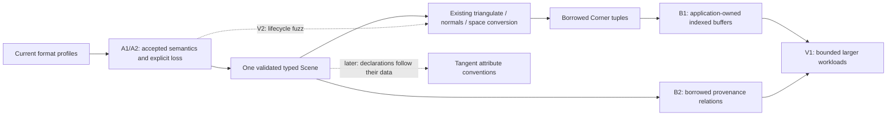

# Baozi Asset Fidelity and Consumer Workflow Expansion

## Decision and starting point

Improve successful-import fidelity in current profiles, make retained data useful to applications,
and validate the resulting workflow at realistic sizes. The
[current Assimp comparison](../research/2026-11-01-baozi-assimp-gap-analysis.md) supplies the source
evidence and exact baselines. The completed [A–H plan](2026-10-29-001-refactor-library-delivery-plan.md)
stays completed; July checkboxes and older intake findings do not become new requirements.

The user adopted the initial tranche and started its execution goal on 2026-11-01. Executed units
and exact verification are recorded in the [progress review](../reviews/2026-11-01-asset-workflow-expansion.md).
Plan adoption does not assign format maturity, register native targets or authorize publication.
Existing user authorization permits necessary breaking refactors and deletion of replaced code;
unpublished compatibility is not a constraint. Change the relevant ADR and behavior documents with
the implementation that changes their boundary, rather than retaining a rejected design because
an old ADR describes it.

The initial tranche completed on 2026-11-01: A1, A2, B1, B2, V1 and V2 are implemented and locally
verified. The progress review records implementation commits, 2,482 passing workspace tests,
complete release scale workflows, separate repeated measurements, and the executed Linux ASan
smoke / 1,803-second campaign / saved-corpus resume. Completion applies to this initial tranche;
follow-on candidates 1 and 2 are now adopted by the separate
[attribute-owned tangent execution plan](2026-11-01-002-feat-attribute-owned-tangents-plan.md).
The remaining candidates stay future work.

The initial tranche is A1, A2, B1, B2, V1 and V2 below. Complete and review these bounded units
before promoting follow-on candidates into required execution. Each unit should be independently
buildable and committable; do not batch several storage, format and release cutovers into one diff.

## Product outcomes

1. A successful import preserves the accepted color and texture semantics it claims; recognized
   omissions are rejected or explicitly authorized and reported.
2. The standalone application produces deterministic indexed buffers without losing seams,
   variable influences, morph deltas or ownership after Scene destruction.
3. A caller can trace a published canonical owner through retained provenance to its original
   source objects and exact descriptive extras, including after supported edits.
4. Larger workloads and edit-lifecycle fuzzing supply revision-qualified evidence without another
   governance framework or a second Scene model.

Keep typed immutable storage, generation-checked borrowed readers, central validation, logical
mesh/primitive/instance separation, attribute domains, separate texture identities, variable
influences, authored Matrix/TRS, f64 time, scoped IO and transactional edits.

The arrows describe data and validation surfaces, not a generic scheduler. A1 and A2 are independent
format fixes; execute them serially before adding format breadth. B1 and B2 are independent
consumer improvements. V2 can start from existing operations; V1 should include the final B1/B2
workflow. Rust builds remain serial in this workspace.

## A1 — Define and correctly decode PLY colors

**Problem:** `to_color_component` normalizes U8/U16 but saturates other scalar values to `[0,1]`.
U32 intermediate colors and alpha become full intensity; signed and out-of-range float behavior
is not stated by the advertised profile.

**Scope:** `baozi-format-ply` scalar/color conversion, directly related typed-value tests and
`docs/formats/ply.md`. Use a named Baozi profile, not a claim that PLY universally specifies one
color convention. Recommended policy: full-range unsigned normalized U8/U16/U32; finite floating
colors within `[0,1]`; reject signed colors without a defined dialect. Check floating range before
narrowing so an out-of-range F64 value cannot round into acceptance. Define F64-to-F32 precision
loss handling under the existing numeric/loss contract; do not silently clamp or infer color space.

Use F64 division for U32 before the documented final F32 rounding. Reuse format failure and loss
types; a new numeric-policy framework or automatic repair mode is unnecessary. Preserve unrelated
custom F64 attribute behavior and all three encodings.

**Acceptance:**

- Independently authored three-point RGBA fixtures in ASCII, little-endian and big-endian contain
  zero, quarter, half, three-quarter and maximum unsigned values. Typed reads match independently
  calculated outputs and the documented rounding; include alpha and both property-name aliases.
- U8/U16 midpoint cases prevent a denominator regression. Signed types, nonfinite floats and
  values just outside the float range produce the documented typed failure. In-range F64 narrowing
  follows the declared loss policy and has a direct assertion.
- No success path silently saturates source color values. Existing custom scalar precision,
  point-cloud, malformed and limit tests continue to pass.

**Done:** profile documentation, source conversion, bounded semantic regressions and the public
facade path agree. This is the recommended first implementation unit.

## A2 — Preserve accepted MTL semantics and close recognized omissions

**Problem:** recognized `map_Kd -o/-s/-clamp` arguments are skipped while the output declares identity
texture transform and a default sampler. Other recognized source semantics can be preserved only
as metadata or warned away without the source-semantic loss contract.

**Scope:** OBJ/MTL parsing and normalized material authoring, a bounded audit of recognized OBJ/PLY
omission branches, associated tests and support documents. Replace path-only map parsing with a
small typed record for the supported texture options and path. Reuse existing `TextureTransform`,
sampler and material-factor types. Preserve the existing last-complete-definition policy for
duplicate MTL materials. Do not reproduce Assimp's field-merging behavior.

Consult primary MTL references for option arities, defaults and clamp coverage. The original
manual does not uniquely specify an offset/scale sampling equation or composition order; the
adopted Baozi OBJ/MTL UV Sampling Profile therefore states `q = offset + scale*p` explicitly.
Retain authored U/V directly, with no reciprocal, V flip or pivot. Primary ecosystem implementation
evidence and the ambiguity are documented in `docs/formats/obj.md`. Clamp-on uses a typed `Decal`
coverage rule: skip the binding outside the closed unit interval, preserving the underlying
material; sample covered coordinates with edge clamping.
Keep metadata as source evidence, not as a substitute for known behavioral fields. The finite
initial-tranche branch list is:

| Source branch | Required disposition |
| --- | --- |
| MTL `map_Kd -o/-s/-clamp` and representable `Ka/Ks` | Map to typed UV transform, sampler addressing and legacy factors. Define argument defaults and neutral/nonneutral third-component behavior from the source contract. |
| Recognized but unimplemented map options `-t/-mm/-bm/-boost/-type/-texres`, or nonrepresentable supported-option components | Reject by default; omit only when explicit `SourceSemanticLoss` authority applies, with attributable evidence. Malformed syntax follows the existing format/conformance contract; loss permission does not authorize malformed input. |
| OBJ `p` and `l` | Preserve through existing typed geometry if the unit implements that slice, otherwise reject/authorize the known omission. Parsing all point/line variants is not required to close the loss contract. |
| PLY partial Normal, Texcoord and Color component groups | Treat each of the three current ignored-group branches as recognized omission: reject under preserve-or-fail; authorized omission records the group/source location. |
| Other OBJ unsupported syntax; PLY arbitrary face properties, vertex list properties, nongeometry elements, duplicate semantic aliases and face-corner UV interpretation | Explicitly deferred. Retain their documented restrictions and avoid claiming this unit closes every unknown/property case. No generic semantic classifier. |

Conformance and loss are independent controls. A syntactically valid recognized omission is
governed by `LossPolicy`, not by switching `ConformancePolicy` to recovery mode. Update support
documents to name the completed branch list and the deferred restrictions.

**Acceptance:**

- Nonidentity `map_Kd` offset/scale and clamp-on/off fixtures directly assert typed UV transform
  and sampler addressing, including argument defaults, malformed arguments and paths with spaces.
- A numeric UV example checks the named sampling profile's operation order/origin interpretation,
  with primary references and their limits documented. Tests must inspect more than the retained
  texture URI.
- Accepted `Ka/Ks` produce expected typed factors; source metadata survives. Redefinition behavior
  remains explicit and tested.
- Every unimplemented recognized branch in the list fails with
  `LossPolicy::preserve_or_fail()`. Where omission is supported, explicit `SourceSemanticLoss`
  authority permits it even under `ConformancePolicy::Strict` and records `Applied`; authority for
  `FormatRecovery` alone must not substitute for semantic-loss permission. Cover each listed MTL
  option branch, mixed face/line/point OBJ, and each of the three PLY partial-channel groups.

## B1 — Build deterministic indexed application buffers

**Scope:** initially the existing `tools/consumers/assets` application and its integration tests.
Keep `triangle_vertices` a zero-allocation borrowed tuple reader. Within each draw, reuse a vertex
only when its source Vertex identity and every selected application field's explicit bit pattern
agree. Assign output indices in first-Corner encounter order; randomized map iteration must not
determine output order. Do not weld distinct source vertices, compare with an epsilon or merge
across draw/material boundaries.

Copy each representative exported joint/weight row and every exported morph stream once, preserving
all influences and their sequence. The current application omits the core's separate source-order
ordinals; indexing must not be presented as expanding that selected output profile. Source identity
makes those Vertex-domain values equivalent within the initial key; if future selected fields vary
by Corner or Face, extend the key or keep the tuples separate. Preserve the current explicit rejection of
ambiguous simultaneous attribute domains. Use fallible allocation and checked index/count
conversions; application allocations remain distinct from the library's operation ledger.

**Acceptance:**

- An unseamed two-triangle quad produces 4 vertices / 6 indices. UV and Normal seams split exactly
  the necessary vertices; coincident but distinct source vertices stay distinct.
- Reconstructing each draw Corner through the output index exactly matches the former expanded
  Position, selected Normal/Tangent/UV, every exported joint/weight lane and every morph delta. Triangle
  order and winding remain unchanged; cover five-influence and empty rows. Compare numeric lanes
  with `to_bits()` in the selected F64 application fields and exported F32 deformation values,
  not `Vertex::PartialEq`. Include same-source signed-zero UV and Tangent/W-only seams.
- `BoxTextured` and `BoxInterleaved` each produce 24 application vertices / 36 indices, with source
  expectations retained independently of the packing implementation.
- Repeated runs have identical ordering. Scene destruction leaves all output usable. Count
  overflow/allocation failure is a structured application failure, not truncation or panic.

Promote a reusable library packing helper only after a second actual consumer demonstrates the
same policy; no artifact runtime, format-independent vertex-welding pass or layout DSL is needed.

## B2 — Expose retained provenance relationships

**Scope:** `baozi-core` borrowed readers, facade exports where needed, `reading-scenes` documentation
and one external-consumer example. Read existing owner attachments, Source/Operation node kinds,
parent edges, source identity and operation/evidence summaries directly from retained tables.
Expose exact-generation handles and empty relations explicitly; do not reconstruct relationships
from numeric index coincidence, display names, snapshot preview or detached reports.

Keep source identity and canonical owner identity distinct. Borrowed parent/attachment iterators
must have documented lookup/traversal cost and bounded caller-visible traversal. Do not allocate
another graph, recursive JSON system or generic query language. Do not promise per-face lineage
that the current source path never retained. Existing source-scope and remap evidence remains
separate from this Scene reader.

**Acceptance:**

- External public-API code selects an entity, walks its retained ancestry, resolves source objects
  and reads their exact extras. It handles source-index reorder, same names and one source feeding
  multiple canonical entities without guessed joins.
- The same lookup remains meaningful after triangulation, coordinate conversion and deletion of
  an invalidated Tangent; source-object metadata survives while removed canonical owners do not.
- Cross-Scene and stale-generation tokens are rejected. Iterating retained relations does not
  allocate or copy their payloads. Counts/order and Source/Operation distinctions have direct
  behavioral assertions.

## V1 — Validate larger complete workflows

Reuse `tools/consumers/assets`, `run_asset_profile.py`, existing growth tests and independent
semantic expectations. Add at most three workload families: a larger static asset, many
primitive/instance references sharing resources, and a medium animated or morph asset. Seek an
unchanged upstream asset with explicit source/license and byte identity; generated growth inputs
are useful complements and must be labeled separately from real assets.

**Acceptance:**

- Exercise approximately 100,000 and 400,000 draw Corners for the static growth family, plus at
  least two reference-count scales with fixed geometry. Admit explicit budgets before execution;
  stop increasing size when local memory/load makes the next scale inappropriate and record the
  limitation instead of changing global limits silently.
- Verify source-derived geometry/identity/seam and animation/bind/morph facts, successful edits,
  indexed extraction and data surviving Scene drop. Record meaningful operation/work growth and
  resource reuse rather than only a process exit code.
- Retain Git SHA/dirty state, compiler/host, argv and exit result. Record normal release stage time,
  separately instrumented allocation requests/bytes, operation ledger peaks and independent-process
  RSS. Use at least three fresh-process normal observations per final workload/size; do not infer
  a performance regression threshold from tiny fixtures or mix instrumented timing into them.
- Reuse relevant hosted results at the same implementation revision. Query existing runs first;
  supplement missing execution rather than rerunning every historical matrix. Browser compile,
  WASI runtime, local WSL and Apple native execution remain distinct claims.

The executed [V1 observations](../reviews/2026-11-01-asset-workflow-expansion.md#v1--larger-complete-workflows)
show 4.095x postprocess work for 4x grid quads. Increasing shared primitive definitions from eight
to 32 keeps resource opens at three, while the separate normal edits use 9.201x work. Use this
evidence to select a real many-primitive consumer and isolate repeated validation/publication costs
before choosing a batch-edit API. That study remains a future candidate outside the initial
tranche; the small absolute timings establish no optimization threshold.

A pinned Assimp subprocess comparison for a few trusted fixtures is optional. Classify any
difference as source semantics, selected profile, explicit loss, representation or probable bug;
keep handwritten expectations authoritative. No broad differential runner is required.

## V2 — Fuzz the delivered edit lifecycle

Add one bounded public-workflow target, with a small operation choice surface, to the existing
`fuzz/` package. After successful import, exercise applicable triangulation, normal generation,
coordinate conversion and final borrowed reads. Reacquire handles after publication. Check failed
or cancelled edits return the original validated Scene and successful output remains readable.
Use strict limits and seeds that actually reach successful edit paths.

**Acceptance:** fixed seed regressions separately assert a real `Changed` result for triangulation,
normal generation and coordinate conversion; merely invoking an operation or returning `Unchanged`
does not satisfy this coverage. Include a deterministic rejected edit and cancellation through the
existing token/control path. Assert returned input generation, bounded semantic digest and public
readability are unchanged on failure/cancellation; state whether cancellation was before execution
or at an existing execution checkpoint. Do not add a public control interface just for the harness.

Run a Linux ASan smoke over those seeds, followed by one recorded 30-minute local/scheduled
campaign with saved corpus/logs and an exact implementation/toolchain identity. Resume that corpus
in a subsequent bounded run and retain any minimized regression as a deterministic test. The
campaign complements the deterministic outcome assertions. Keep the existing successful-corpus
upload; add only a simple resume path, not a corpus service, generic Scene generator or arbitrary
pass scheduler. A short campaign is exploration evidence, not proof that all edits are safe.

## Ordered follow-on candidates

These items are documented gaps, not additional completion requirements for the initial tranche.
Select the next slice using its concrete asset/consumer need and the V1 observations.

| Order | Candidate and prerequisite | Required boundary and acceptance when selected |
| --- | --- | --- |
| 1 | Tangent convention ownership, before tangent generation | Move construction and encoding from `SceneSpace` to each Tangent attribute descriptor. Thread authoring → retained table → borrowed reader → validation → snapshot → conversion; delete replaced global fields and schema authority. Same primitive may have Vertex and Corner Tangent, so primitive-wide ownership is insufficient. Mixed authored-unknown and generated-known conventions coexist; removing one/last Tangent leaves no orphan declaration. Reflection checks each stream and fails atomically on unsupported encoding. No default/override compatibility chain. |
| 2 | Single-primitive tangent generation, after ownership cutover | Explicit TriangleList, Normal and UV domain selection; Corner F32x4 output; preserve existing stream by default, explicit replacement. Choose and verify a maintained/private algorithm before naming its basis; do not label a generic tangent accumulator MikkTSpace. Cover ordinary/mirrored UV, seams, normalization/orthogonality, W sign, reflection, degenerate UV, limits/cancellation and unsupported morph-tangent behavior. Reuse SceneEdit and current-generation publication. |
| 3 | Read-only static world transforms/bounds | Accumulate `parent_world * local` over the existing forest; transform actual base vertices per instance. Name the coordinate and pose scope. Initially reject skin, nonzero morph and animated evaluation requests. Check shared instances, ancestors, nonuniform/negative scale and empty geometry using hand-calculated bounds. No flattening/baking, global pose runtime or hidden full-Scene scan in each getter. |
| 4 | glTF primitive modes | Preserve all seven authored modes using existing core topology authoring/validation. Cover indexed/nonindexed streams, topology/count semantics, minimum lengths, source identity and resources. Triangle-list consumer lowering is a separate explicit operation; when selected, test strip parity, winding, line-loop closure, degenerates and checked expansion. No silent primitive discard or general scheduler. |
| 5 | Shared glTF sparse accessor decoding | Support base bufferView or zero base, indices/values references in selected closure, normalized values and admitted morph/geometry uses. Replace format storage's single-base accessor-provenance assumption with bounded source aggregation, including capacity/work admission. Test no base and base/indices/values in three external buffers; assert dense/sparse typed equivalence and B2-readable source relations. Reject duplicate/unordered/out-of-range indices and invalid layout; check decoded size before construction. Reuse existing source collectors; no second JSON/accessor model or core sparse rewrite. |
| 6 | Additional glTF influence sets and explicit scene selection | Variable rows already exist. Append paired JOINTS_n/WEIGHTS_n deterministically with source order; preserve all admitted weights. For scene selection, expose caller choice while retaining honest closure/omission evidence. No fixed-four core replacement or implicit scene-zero fallback. |
| 7 | One typed glTF extension slice | Prefer unlit or punctual lights before compression, or a concrete IOR/volume material asset if demanded. Complete typed semantics, public reads, selected-reference closure, global declarations, payload handling and exact support claims. Resolve unsupported optional fallback/loss policy first. Broad extension admission from a whitelist change is insufficient. |
| Separate release track | Package/native distribution | Choose first release format set and maintained decoder dependency chain; make every production dependency normally resolvable, including optional ones. If native ships, remove the consumer-root patch requirement with a normal dependency solution and qualify exact targets. An independent consumer must resolve/build without a root patch; patched local archives alone do not meet this gate. Reuse package checks and add missing Linux unpacked-consumer cases. Repository capture is independent. No registry push or native promotion is part of this plan. |

Device draw chunking follows B1 when a consumer specifies a vertex/index limit; it must reconstruct
the same triangle tuples including skin/morph streams. Cache optimization follows reusable indices
and measured benefit. Do not bundle cross-mesh merging, influence truncation, retargeting, arbitrary
material animation or independent skeleton assets into either operation.

## Alternatives considered

| Option | Benefit | Cost/risk | Decision |
| --- | --- | --- | --- |
| A: Fix current-profile fidelity, then deliver concrete consumer slices | Resolves source-derived correctness gaps, reuses completed architecture and yields independent application evidence. | Less immediate format breadth; requires rejecting formerly misleading success paths. | Recommended. |
| B: Add FBX/VRM/USD or broad Assimp-style postprocess flags first | More recognizable feature names and more accepted files. | Existing semantic losses persist; new formats stress untested tangent, animation and closure assumptions. | Defer until a named product need selects a bounded profile. |
| C: Rewrite the Scene into an Assimp-compatible common model | Simplifies superficial field comparison. | Loses explicit logical identity/domains and repeats a completed ownership cutover without evidence. | Reject. Perform the narrower tangent ownership cutover when needed. |
| D: Prioritize a registry/native release before workflow expansion | Enables ordinary dependency installation sooner. | Requires package-set, fork distribution and target decisions; can defer admitted-value correctness. | Keep as a separate delivery track after fidelity fixes if early distribution becomes the product priority. |

## Completion and validation

| Outcome | Current baseline | Initial-tranche success evidence |
| --- | --- | --- |
| Color fidelity | U32 intermediate PLY colors saturate; signed/float policy unstated. | Three encodings, typed midpoint/alpha expectations, explicit unsupported/recovery behavior, documented precision. |
| Texture/omission fidelity | Accepted MTL options disappear; selected recognized semantics can be warned away. | Nonidentity typed transform/sampler values and strict/authorized loss cases. |
| Indexed output | One application vertex per draw Corner. | Quad 4/6; textured sample boxes 24/36; exact reconstruction of every selected tuple/deformation stream. |
| Source tracing | Source metadata and private DAG exist separately. | External caller navigates canonical owner → provenance → source/extras across supported edits with generation checks. |
| Workload evidence | Six small successes, largest source mesh 160 vertices / 564 indices. | Bounded larger static/reference/animated workloads with semantic expectations and separated cost observations. |
| Edit exploration | Parser/snapshot fuzz plus deterministic edit tests. | One seeded lifecycle target, ASan smoke, recorded campaign and successful corpus resume. |

Run focused semantic tests after each unit, then affected facade/consumer cases. Use Rust 1.95.0,
`--locked`, `cargo fmt`, serial nextest and the existing target directory. Run the broad workspace,
strict Clippy and package/target checks when the integrated changes affect their contracts, reusing
valid evidence rather than repeatedly rerunning unchanged suites. Documentation-only planning
needs local link/diff review, not a fresh Cargo or Assimp build.

## Risks and safeguards

| Risk | Severity | Mitigation |
| --- | --- | --- |
| Ambiguous format conventions are guessed | High | Name the accepted profile, consult primary source semantics, distinguish explicit loss/recovery from preserved input; keep disagreement fixtures. |
| Packing merges deformation or seams | High | Same source Vertex plus every selected varying field; reconstruct all original draw tuples through indices. |
| Tangent claims affect unrelated geometry | High | Attribute-owned typed declarations, no global override chain; mixed-stream and deletion tests before generation. |
| Provenance API becomes a second graph/query engine | Medium | Thin borrowed readers over retained relations, generation checks, documented costs and no invented fine-grained lineage. |
| Planning expands into another infrastructure project | High | Initial-tranche boundary; reuse consumer, scripts, loss vocabulary and fuzz package; follow-on candidates require a real input/output need. |
| Performance claims mix incompatible measurements | Medium | Separate normal/instrumented runs, ledger/allocator/RSS scopes, revision/host identity and repeated fresh processes. |
| Qualification drifts across revisions | High | Attach each executed result to its implementation/profile; no inherited latest-metadata Apple or browser-runtime claim. |

## Decisions deliberately left to their implementation unit

PLY's exact color profile and narrowing evidence must be finalized with A1; the recommendations
above are concrete starting choices. A2 must establish MTL transform order and nonrepresentable
option policy from source references. Keep `SimpleSkin` as the current typed rejection until a
separate numeric-admission decision justifies preserving or recovering those source rotations;
passing the sample is not an automatic completion criterion. Do not add automatic normalization.

Tangent backend/algorithm selection precedes its generation implementation. Optional glTF
fallback, additional material/light semantics, animation segment models and release/native package
choices are separate decisions at their respective slices. None blocks A1, A2, B1, B2, V1 or V2.
