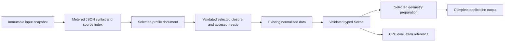
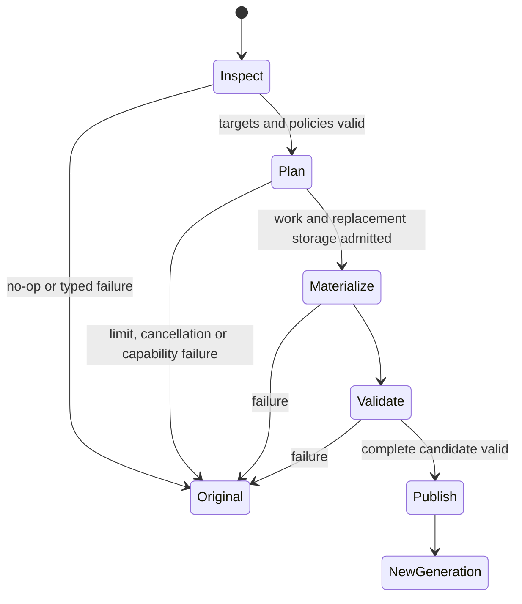

# First-Release Maturation Through Owned Data and Deep Modules - Plan

## Goal Capsule

**Objective:** Rust applications can import Baozi's documented formats without silent data loss, prepare their geometry efficiently, and consume complete static or animated asset data through ordinary public interfaces.

**Means:** Replace uncontrolled decoding and repeated whole-Scene edits with owned, budgeted decoding, precision-preserving attributes and selected-primitive transactions (KTD1–KTD4).

**Authority:** The user's 2026-11-02 instruction authorizes reviewed fearless refactoring and implementation, including breaking interfaces and deletion of replaced code.
This plan supersedes the implementation choices in `docs/plans/2026-11-01-011-feat-first-release-usability-plan.md`; its audit remains the problem evidence.
ADRs continue to own domain semantics and must be amended alongside changed decisions.

**Execution:** One existing development branch, reviewable local commits and independently reviewed milestones.
The main thread owns integration and serialized Cargo execution; native Codex agents may implement disjoint files.
There is no upload, push, PR, native registration or placeholder retirement in this execution.

**Stop conditions:** Ask only for an unavailable essential product choice or external authority that cannot be obtained locally.
A failed architectural hypothesis triggers redesign of that module and fresh review; it does not justify weakening a requirement or hiding loss.
Missing hosted target evidence is recorded as missing and does not prevent local implementation.

---

## Product Contract

### Summary

Mature the existing four-profile library through a coherent ownership and interface refactor.
Preserve its immutable Scene lifecycle while making decoding, numerical precision, derived-data dependencies and complete application consumption explicit.
Deliver ordinary byte/memory/custom-IO workflows and truthful package/target evidence before any future publication.

### Problem Frame

The `881d105` audit reproduces insufficient glTF allocation admission, silent PLY precision loss, orphaned Tangent morph deltas, stale MTL opacity state and quadratic metadata admission.
Single-primitive processing also reconstructs unrelated geometry repeatedly and exposes generation bookkeeping to applications.
The application consumer retains only part of the sampling/UV contract, so a passing copy-out demonstration does not yet establish a complete usable output profile.

### Requirements

#### Correctness and ownership

- R1. Every production decoder allocation controlled by input is admitted before allocation and remains coupled to its owner until release; limits, malformed input and cancellation produce typed failures.
- R2. PLY built-in floating geometry preserves the admitted source precision, including adjacent F64 coordinates, finite underflow-scale values and signed zero; no implicit inexact F32 projection is successful preservation.
- R3. A derived geometry edit preserves dependent deformation meaning or rejects before publication; deleting a base attribute cannot retain an unusable delta referencing it.
- R4. Host IO faults are attributed to IO, including reader cleanup; a host reader fault must not poison an otherwise healthy format registration or replace a prior cancellation/read failure.
- R5. Material opacity, descriptive source ownership and metadata construction have one correct authority and bounded work rather than stale derived caches or redundant scans.

#### Application workflows

- R6. An operation on selected primitives plans once, reconstructs affected geometry once and publishes at most one generation; any failure returns the exact original immutable Scene.
- R7. Legal strip/fan inputs can enter the supported triangle preparation workflow, preserving assembly order, attribute domains, morphs, influences and source relations.
- R8. Hosts can set postprocess work/storage limits and explicit winding/normal/tangent policies without reproducing hidden operation ordering.
- R9. The application output profile closes every retained material binding over its UV streams, image, sampler, interpretation, channels, strength and media type, or explicitly rejects that output request.
- R10. Effective material defaults, parent/node-instance navigation and common format options are usable without private storage access, source-format guessing or repeated full-scene scans.
  A runnable portable host-file/sidecar recipe makes the application's filesystem authority and input limits explicit.
- R11. A small CPU consumer demonstrates correct curve, morph and skin evaluation from public reads, including equivalent results after space conversion.

#### Distribution and scope

- R12. The final portable package graph is normally resolvable from its unchanged archives, including optional production edges, and documentation describes the actual supported profiles and precision.
- R13. Verification names its source, target, toolchain, profile and scope; unavailable execution cannot become a target or maturity claim.
- R14. Replaced production paths, compatibility aliases, obsolete forks and abandoned experiments are removed at their cutover; no second Scene model or universal pass scheduler is introduced.

### Key Decisions

- **Correctness takes priority over preserving current interface shape.** Governs R1–R14. (session-settled: user-directed — chosen over compatibility patches: the first release has no historical API burden.)
- **STL/OBJ defaults and opt-in PLY/selected glTF remain the first format scope.** Governs R12–R13; expanding format names does not close the audited workflows.
- **Retire 0.0.1 after a verified usable replacement.** Governs R12; actual publication and retirement remain outside this execution, following ADR 0006.

### Scope Boundaries

Native runtime/repository IO stays in the existing unpublished candidate; it is not promoted or silently moved into the portable facade.
Encoded image retention remains distinct from pixel decoding.
The CPU evaluation example is application reference code, not a playback engine added to core.

### Deferred to Follow-Up Work

New format families, compression backends, MikkTSpace compatibility, device partitioning, cross-source welding, cache optimization, exporters and a general mutable Scene authoring facade require concrete consumers.
Punctual lights and emissive strength remain bounded extension candidates after the existing profile passes this plan.
Registry authentication/workflow automation is separate publication work; no generalized receipt or source-proof framework is part of this refactor.

---

## Planning Contract

### Key Technical Decisions

- KTD1. Replace the owning `gltf`/`gltf-json` production decoder with a private Baozi selected-profile document whose collections and escaped strings use existing metered storage and whose raw payloads borrow the immutable input.
  Reuse and extend the iterative JSON admission scanner and source map instead of parsing an unbounded `serde_json::Value` tree.
  Preserve the accessor decoding, selected closure, normalized model and canonical submission seams.
  Delete the byte-expansion allowance and both maintained glTF forks after the complete importer cutover; the final portable train then has ten packages.
- KTD2. Preserve scalar width per built-in PLY attribute stream: source float and up-to-16-bit integers use F32, source double and I32/U32 use F64, and mixed components select the wider declared representation before allocation.
  Extend the existing AttributeData/storage path and affected validation/read/numeric operations rather than adding another Scene or automatically narrowing at a later stage.
  Extend Tangent and sparse F64 storage in the same family; generated Normal/Tangent output uses the widest dependency or replaced-field width.
  Spatial query matrices use F64 and the existing Aabb changes to F64 min/max arrays; authored transforms and unrelated material/animation types retain their current contracts.
  Application F32 packing is an explicit output conversion with loss/error evidence.
- KTD3. Treat normal/tangent replacement as an edit of a dependency closure, not just an attribute row.
  Initially reject affected Normal/Tangent morph combinations at the common transaction seam, while preserving genuine no-ops and Position-only morph cases.
- KTD4. Replace operation-local full-Scene rebuild loops with selected-primitive plans and a shared typed geometry reconstruction pass.
  Topology lowering and field generation feed that transaction; a finite triangle-preparation request owns order and selection without a general dependency-graph scheduler.
- KTD5. IO owns reader teardown, including unwind containment and preservation of the first terminal cause.
  Reuse the existing callback/fault vocabulary; cleanup cannot be misclassified as a parser fault or require a process-wide allocator/panic hook.
- KTD6. Preserve authored material binding absence separately from effective defaults.
  The glTF adapter publishes one generated default PBR material when required, with generated provenance and authored-count evidence unchanged.
  One canonical assignment distinguishes `Unspecified`, `Authored(MaterialId)` and `ImplicitDefault(MaterialId)`; authored and effective accessors derive from it, replacing the ambiguous material accessor without a compatibility alias.
  Source object names belong independently to Image, Texture and Sampler; display fallback belongs to applications.
- KTD7. Build explicit scene relations once at the owning scene/query seam, then expose generation-checked parent and node-to-instance reads with documented bounded construction and allocation-free lookup.
- KTD8. Keep application buffer layouts outside core but make their chosen output profile complete and checked; reuse one independent consumer for static/material output and a separate small evaluation module for animation reference behavior.

### Alternatives Considered

| Approach | Benefit | Reason not selected |
| --- | --- | --- |
| Increase the glTF JSON multiplier or enumerate opaque allocator estimates | Smaller immediate change | Container layout, nested values and validation scratch remain outside the owning allocation interface; the next schema change can invalidate the claim. |
| Instrument global allocations or a thread-local decode budget around upstream serde | Reuses derived schema types | Introduces global context, reentrancy and unwind assumptions into an otherwise scoped library. |
| Own only the documented glTF document profile | Allocation and semantics share one owner; removes fork distribution | Selected by KTD1; higher migration work is bounded by the existing explicit profile and regression suite. |
| Add F64-to-F32 rejection while retaining F32-only geometry forever | Closes one silent-loss bug cheaply | Does not serve the scanning/precision workflow already admitted by PLY double fields. |
| Copy Assimp's scene graph and postprocess flag scheduler | Familiar surface | Loses useful Rust ownership/domain distinctions and adds unrelated implicit scheduling behavior. |

### High-Level Technical Design

The document owns typed tables and metered nested containers.
Borrowed ranges and views never outlive the primary snapshot; canonical values and reports retain their existing independent ownership.
Syntax indexes supply bounded lookup rather than rescanning full JSON for every getter.
Unsupported selected payloads remain explicit failures; omitted source payloads remain observable through source-scope evidence.

### Migration and Sequencing

U1 closes independent ownership defects while the new document and precision work are designed.
U2 and U3 may have disjoint implementation lanes, but the main thread integrates shared scalar/model contracts before U4.
New decoder code can be exercised in focused tests during construction; production switches atomically when all existing selected-profile behavior is represented.
The old decoder is then deleted in the same cutover, not retained behind a legacy feature.
Commit intermediate milestones only with an honest execution record; an intermediate commit does not close the whole plan.

### Execution-Time Details

Exact private helper names and file splits may follow implementation locality.
The owned decoder may use stateful Serde seeds only where they preserve pre-allocation metering and borrowed lifetimes; arbitrary owning derived containers are not an escape hatch from R1.
Kernel numerical conditioning and actual measured work ratios must be established during implementation, not inferred from a chosen scalar type.

---

## Implementation Units

### U1. Restore ownership and dependent-data integrity

**Status:** Completed. Component source is `55b31c1ed1ee3e8b80d4d631e583e7974338c866`; U8
qualifies the integrated immutable source on the executed targets. See the
[execution record](../reviews/2026-11-02-first-release-maturation.md#u1-ownership-and-dependent-data-integrity).

**Goal:** Close the independent opacity, IO cleanup, morph dependency, metadata-work and animation extrapolation defects.
**Requirements:** R3–R5, R14; KTD3 and KTD5.
**Dependencies:** None.
**Files:** `crates/baozi-format-obj/src/mtl.rs`, `mesh_builder.rs`, `tests/materials.rs`; `crates/baozi-import/src/asset_open.rs`, `session.rs`, `scope.rs`, `tests/open_work_contract.rs`, `tests/session_contract.rs`; `crates/baozi-core/src/canonical_scene/store/construction/node_scene/edit/transaction.rs`, `typed_storage/deformation/validation.rs`; `crates/baozi-postprocess/tests/normals_boundary.rs`; `crates/baozi-format-ply/src/parser.rs`, `tests/limits.rs`; `crates/baozi-format-gltf/src/parser/animation.rs` and public animation tests.

**Approach:** Remove the sticky opacity-derived cache, classify reader release at IO ownership, add morph-dependent transaction checks and append structurally unique metadata before one metered ordering step.
Central deformation validation also requires each Normal/Tangent delta descriptor to have its corresponding base attribute; operation guards preserve the stronger meaning of replacement.
Map glTF pre/post animation extrapolation to endpoint clamping (`Constant`), not immutable base-value fallback (`SourceDefault`).
These are separate disjoint implementation lanes with main-thread integration.

**Test scenarios:**

- Repeated and interleaved `d`/`Tr` finish Opaque when final opacity is one, including complete material redefinitions.
- Reader Drop panics at EOF, error, cancellation and early identity rejection preserve the correct terminal cause; the same format subsequently imports through healthy IO.
- Dense/sparse Normal or Tangent delta combinations reject affected replacement/removal with unchanged input generation and payload; preserve-existing no-op and Position-only cases remain valid.
- Authoring without a required base field rejects at central validation, independently of the edit entry point.
- 1,000/5,000/20,000 short comments retain deterministic metadata with bounded growth and cancellation; exact resource limits remain meaningful.
- glTF TRS and morph channels retain endpoint clamping before the first and after the last key, even when their endpoints differ from the base pose/default weights.

**Verification:** Public regressions reproduce the audit first, pass after correction and retain existing source/operation contracts.

### U2. Establish precision-preserving geometry

**Status:** Completed. Component source is `c9182a6d3a2c3608f45707f12b759edc2a4ea569`;
independent precision reviews, integrated Windows/Linux tests, public consumers and U8 archive/
WASI snapshot checks pass. See the
[execution record](../reviews/2026-11-02-first-release-maturation.md#u2-precision-preserving-geometry).

**Goal:** Preserve F64 geometry without forcing unrelated material, animation or transform domains into a universal scalar abstraction.
**Requirements:** R2, R6–R9, R14; KTD2.
**Dependencies:** U1's shared dependency-invalidation policy.
**Files:** `crates/baozi-format-ply/src/parser.rs`, `tests/attributes.rs`; `crates/baozi-core/src/canonical_scene/store/production/plan/geometry.rs`, `typed_storage.rs`, `api/read/geometry.rs`, `crates/baozi-core/src/base_pose.rs`; `crates/baozi-postprocess/src/vertices.rs`, numerical kernels and space conversion; `crates/baozi/tests/ply_colors.rs` and new precision integration cases.

**Approach:** Replace F32-only built-in attribute assumptions in the existing typed storage path, dispatch numerical reads by retained width and make down-conversion a named caller choice.
Compose base-pose matrices in F64 and calculate bounds from F64 points through the existing query owner, without parallel `Aabb64` or `Scene64` interfaces.
Use power-of-two-scaled F64 numerical kernels with explicit uncertainty/underflow rejection; the F32 exact-product specialization remains a declared-width path rather than a fallback heuristic.

**Test scenarios:**

- Three PLY encodings retain adjacent large doubles, finite tiny values, signed zero, integer boundaries and mixed component widths.
- Borrowed list output, snapshots and application copy-out preserve the retained scalar type and bits.
- Ordinary F64 meshes complete normal/triangulation/tangent/space/bounds operations at the declared precision; ill-conditioned, nonfinite or unrepresentable arithmetic rejects before mutation with a documented numeric issue.
- An explicitly requested F32 output rejects or records inexact conversion, never reports preservation.

**Verification:** No production built-in PLY cast silently narrows; core validation and consumer tests agree on each supported width.

### U3. Own selected-profile glTF decoding

**Status:** Completed at `6fb9112cb75e1dc942f6d7e605aa9e7b23ec1559`. Importer package tests
(332/332), independent ownership/semantics reviews, integrated host tests, current-source ASan
and unchanged-archive qualification pass; U8 records their exact scopes.

**Goal:** Replace the uncontrolled owning backend and its release dependencies.
**Requirements:** R1, R5, R12–R14; KTD1 and KTD6.
**Dependencies:** U1 independent fixes; schema construction may overlap U2 without editing core scalar files.
**Files:** `crates/baozi-format-gltf/src/admission.rs`, `json_syntax.rs`, `source_map.rs`, new private document/schema modules, `parser.rs`, `parser/*`, `tests/json_admission.rs`, `backend_malformed.rs`, source mapping and profile integration tests; root/fuzz/consumer manifests and lockfiles; `vendor/gltf*`; notices and backend ADR/docs.

**Approach:** Extend existing syntax admission into an owned metered structural index, decode typed selected-profile tables and borrowed raw payloads, validate references/defaults and reuse downstream selected closure and normalized submission.
Remove generic backend reader calls, panic shims specific to it and the opaque expansion allowance at the production cutover.
Delete both glTF forks and their dependency edges after complete migration; preserve historical evidence as history.

**Test scenarios:**

- Dense empty Node/Material objects, nested arrays, escaped strings and raw extras use admitted allocations and refuse tight budgets before growth.
- Existing malformed reference/camera reproducers return typed errors without a backend catch; duplicate keys, trailing bytes, GLB padding and depth/token limits retain their contract.
- All seven modes, sparse/multi-buffer accessors, complete influences, scene selection, PBR/unlit, cameras, skin/morph/TRS curves and exact extras remain equivalent through public typed reads.
- Selected unsupported extensions reject; omitted invalid payloads retain the documented scope behavior and cannot authorize sidecars.
- Image/Texture/Sampler names remain independent, including shared-image fixtures and edits.

**Verification:** Relevant importer/facade/consumer suites and Linux sanitizer smoke pass; production graphs contain no `baozi-gltf`, `baozi-gltf-json`, upstream `gltf` or `gltf-json` path.

### U4. Publish one selected-geometry transaction

**Status:** Completed and independently reviewed at the same integrated source. Windows and
Linux MSRV workspace runs each pass 2,855/2,855 with four existing manual skips. U8 adds
immutable-source archive execution and bounded edit-lifecycle ASan.
Shared mutable plan mappings were replaced by an exclusively initialized metered owner and
immutable sealed views. Mixed selections retain every target's final identity and disposition.

**Goal:** Replace repeated full-Scene rebuilds with bounded batch reconstruction.
**Requirements:** R3, R6–R8, R14; KTD3–KTD4.
**Dependencies:** U1–U2; integrate final document-independent primitive semantics.
**Files:** `crates/baozi-postprocess/src/scene_edit.rs`, `normals*`, `triangulate*`, `tangents*`, `operation*`, `vertices.rs`; core edit transaction/planning/typed-storage edit modules; new batch/lowering integration tests; asset consumer processing loop.

**Approach:** Represent selected targets and typed local edits in one transaction, share untouched owners, reconstruct geometry once and return per-target origin/evidence mappings.
Add explicit strip/fan list lowering and a finite triangle-preparation recipe with configurable existing budgets and winding/field policies.
The request has one Tangent policy, replacing the duplicated normal-option TangentHandling choice, and terminal evidence sizes derive from the actual selected plan rather than a polygon-only constant ratio.
Delete the old consumer loop and any operation implementation duplicated by the batch path.

**Test scenarios:**

- Indexed/nonindexed strip/fan outputs match borrowed assembly, including parity, degenerates, attributes, influences, morphs and metadata.
- Batch semantic output matches equivalent single-target reference; 32/128/512 fixed-size primitives show bounded near-linear charged reconstruction work and one generation.
- A later target's failure, cancellation or tight storage/work limit returns the original Scene without partial application.
- CW/CCW source/target and reflection produce expected normals/tangents without caller-created intermediate spaces.

**Verification:** Existing single-target public behavior is implemented through the same transaction, and the independent consumer completes the combined workflow.

### U5. Complete public relations and effective semantics

**Status:** Completed. Public material, reverse-relations and format-option regressions pass in
the complete workspace, independent source/archive cases and WASI snapshot module. The bounded
nested host-bundle example executes successfully; U8 records target limits.

**Goal:** Make common scene navigation and effective materials format-neutral.
**Requirements:** R5, R9–R10, R14; KTD6–KTD7.
**Dependencies:** U3's document/source identity cutover; U2 precision contracts.
**Files:** core appearance/profile/relations storage and readers; `crates/baozi-format-gltf/src/parser/normalized.rs`; `crates/baozi/src/lib.rs`, facade examples; public material, source mapping and scene relation tests; quick start and reading guides.

**Approach:** Publish generated default PBR material with provenance, retain authored absence/counts, and expose bounded parent and placement relations from one owning view.
Export common OBJ/glTF options consistently without exposing decoder machinery.
Add a runnable application-owned file-to-memory example: explicitly enumerate and bound primary/sidecar reads, insert immutable snapshots under relative paths into `MemoryAssetIo`, then import through the facade with configured limits.
The example owns filesystem selection and authority; it does not require or promote the native candidate or introduce a general filesystem adapter.

**Test scenarios:**

- Missing glTF material and explicit `{}` yield equivalent effective factors but distinguishable authored provenance.
- Multiple roots, empty nodes, several placements per node and shared meshes have correct parent/placement reads and stale-generation errors.
- Common format options compile and operate from the facade alone; getters allocate nothing and document cost.
- The linked quick-start example runs on a local OBJ/MTL/image bundle with nested relative sidecars, bounded reads and correct material/image relations.

**Verification:** A public-only consumer navigates and shades the fixtures without format-ID conditionals or private integration namespaces.

### U6. Close the static application output profile

**Status:** Completed. Independent static-output review has no remaining findings. The independent
asset consumer passes 74/74 on both Windows and Linux MSRV, including U7. Strict Windows Clippy,
formatting and U8 representative immutable archive cases pass.

**Goal:** Application-owned output retains every meaning its chosen profile promises.
**Requirements:** R2, R9–R10; KTD8.
**Dependencies:** U2, U4–U5.
**Files:** `tools/consumers/assets/src/buffers.rs`, `lib.rs`, output tests and README; focused scene artifact consumer fixtures.

**Approach:** Keep field selection application-owned, preserve all referenced UV/sampling/material data and make scalar conversion/output exclusions explicit.
Avoid adding a renderer or a universal vertex-layout abstraction to core.

**Test scenarios:**

- Two textures share an image but use different samplers; UV1, normal scale, occlusion strength, channels, color interpretation and media type remain distinguishable after Scene drop.
- An unavailable requested stream or unsupported output conversion fails explicitly with its binding/field identity.
- Seams, complete influences, morph tuples and F64 geometry survive tuple indexing according to the selected output policy.

**Verification:** Real-asset and hand-calculated fixtures complete import, preparation and complete copy-out through public interfaces.

### U7. Prove animation consumption

**Status:** Completed. All 21 focused evaluator tests pass and independent inverse review has no
remaining findings. The complete consumer passes 74/74 on both executed MSRV hosts; U8 binds
those runs to the immutable integrated source.

**Goal:** Demonstrate how an ordinary application combines retained deformation and curves.
**Requirements:** R11; KTD8.
**Dependencies:** U2–U3 and U5; independent of the complete static buffer layout.
**Files:** a small evaluation module and tests in `tools/consumers/assets`, animation/skin reading guides and existing public fixture helpers.

**Approach:** Use public reads for a CPU reference evaluator with explicit time domain, interpolation, instance morph override and skin-space composition.
Keep it outside core and exclude blending, retargeting, a playback scheduler and GPU output.

**Test scenarios:** Hand-calculated Step/Linear/CubicSpline and quaternion points, including pre/post endpoint clamping and distinct source-default behavior; shared mesh/different instance morph weights; two-joint skin positions; equivalent evaluation after basis/unit conversion.
Quaternion linear evaluation uses shortest-path normalized slerp; cubic evaluation applies component Hermite then normalization without normalizing derivatives or independently flipping key signs.

**Verification:** Numeric expected values are independent of importer-generated snapshots and application data remains usable after Scene teardown where copied.

### U8. Qualify the actual portable release candidate

**Status:** Completed. All applicable local gates pass on `6fb9112cb75e1dc942f6d7e605aa9e7b23ec1559`:
Windows/Linux MSRV tests, unchanged ten-package archive matrices, WASI runtime plus 57 canonical
snapshot tests, browser compilation and bounded Linux ASan. Final review/evidence closure is
recorded in the [execution record](../reviews/2026-11-02-first-release-maturation.md#u8-immutable-source-portable-qualification).
Current Apple/other-host runs, sustained fuzzing, registry operations and target/maturity
promotion retain their explicit unqualified scope.

**Goal:** Rehearse distribution and document exactly what the corrected implementation proves.
**Requirements:** R12–R14.
**Dependencies:** U1–U7.
**Files:** manifests/locks, `scripts/check_packages.py` and existing tests only as needed, scene consumer cases, fuzz targets, support/profile/readme/changelog/release docs, CI target configuration.

**Approach:** Reuse the existing small artifact verifier for the ten-package post-cutover closure, add representative new semantics and run the final target/profile checks.
Define finite PLY/glTF publication eligibility records without asserting Stable maturity.
Use actual host evidence where available and leave current unavailable hosts explicitly unqualified.

**Test scenarios:** Required/optional closure resolves from unchanged archives; no root patch/path substitution; MSRV/debug and stable/release consumers; current WASI runtime and browser compile scope; deterministic canonical vectors across executed targets; known malformed and edit-lifecycle sanitizer smoke.

**Verification:** No unresolved audited correctness finding, all applicable local gates pass and any external release prerequisite is explicitly recorded.
This unit enables review of a future publication; it does not perform it.

---

## Verification Contract

Use Rust 1.95.0 for MSRV, current installed stable for the separate release profile, nextest for integration tests and `cargo fmt` for formatting.
The main thread runs Cargo serially with one build job, at most two ordinary test threads and the existing target directory.
Unit-specific public reproducers precede each implementation change; broad matrices follow integrated milestones rather than every edit.

Relevant gates are focused nextest targets, affected facade/consumer tests, strict all-target/all-feature Clippy, formatting, doctests, required public-interface compile checks and actual artifact consumers.
Run Linux ASan for changed hostile-input/edit paths using the existing environment and fuzz infrastructure.
No test/source hashing or custom compiler-like analysis is added to xtask.

Each milestone records exact source/patch identity, resolved inputs, command, result and scope in `docs/reviews/` with local raw evidence outside disposable build caches when practical.
Historical counters stay historical; feature enablement alone is not execution of its semantics.

## Definition of Done

- All R1–R14 behaviors hold through public-interface and independent-consumer evidence for the declared profiles.
- Each U unit passes its specified regressions, independent review and the applicable integration gates.
- The old owning glTF decoder/forks, sticky state, repeated consumer rebuild loop and any superseded implementation are deleted.
- The final ten-package candidate archives normally resolve without consumer patches; actual public registry availability remains a future publication result.
- Docs, ADRs, examples, tests and notices describe the same ownership, precision, capabilities and release scope.
- Unavailable target runs, sustained fuzzing and actual registry operations remain explicitly distinct from completed local work.
- No unrelated user modification is discarded or committed, and no abandoned prototype remains in the production diff.

## Sources

- `docs/reviews/2026-11-01-first-release-usability-audit.md`, baseline `881d105` and its retained public reproductions.
- `docs/roadmap.md` for fidelity-preserving engine-neutral ingestion and explicit scope.
- `crates/baozi-format-gltf/src/json_syntax.rs`, `source_map.rs`, `parser/normalized.rs` for reusable admission and submission seams.
- `crates/baozi-core/src/canonical_scene/store/typed_storage/` and concrete edit transactions for existing ownership and failure publication.
- [Pinned Khronos glTF 2.0 specification](https://github.com/KhronosGroup/glTF/blob/59ecbdba704206bb656965ab4e202881806066f1/specification/2.0/Specification.adoc), source-semantic authority for the selected profile.
- [Serde borrowed lifetimes](https://serde.rs/lifetimes.html) and [stateful seeds](https://docs.rs/serde/1.0.228/serde/de/trait.DeserializeSeed.html), implementation guidance rather than proof that arbitrary owning derived types are metered.
