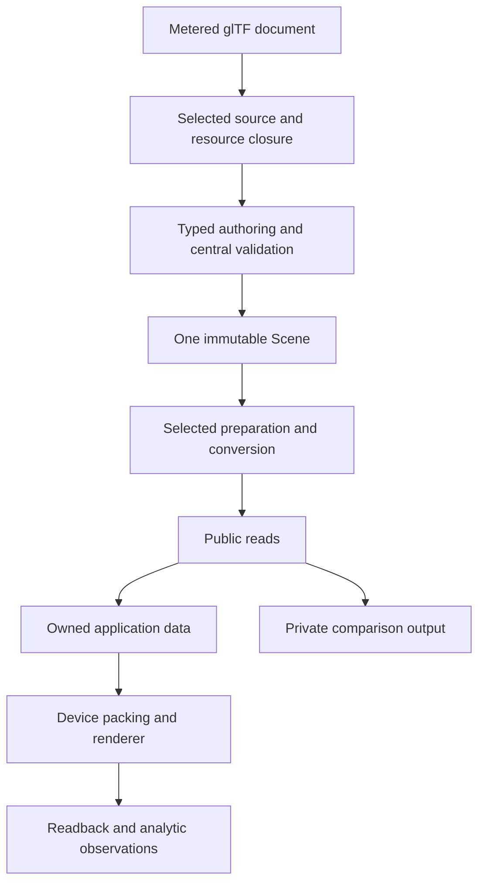
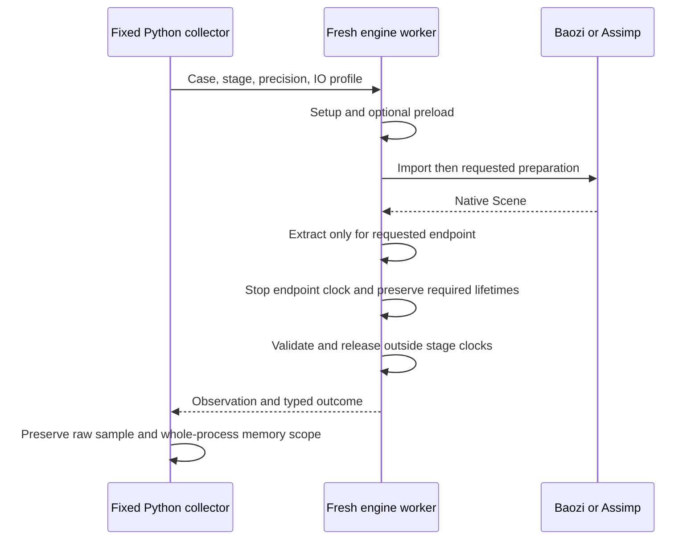
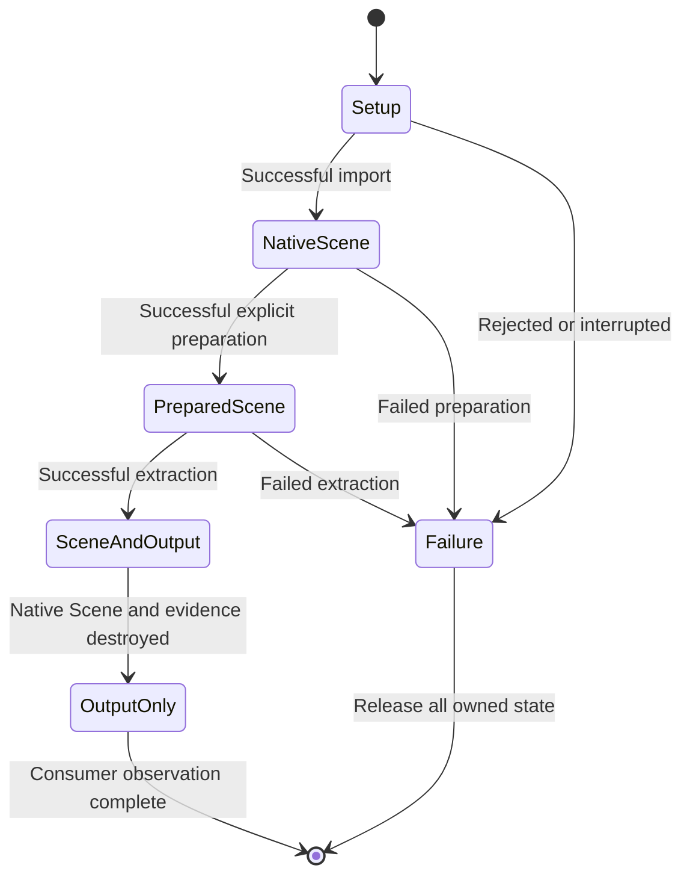
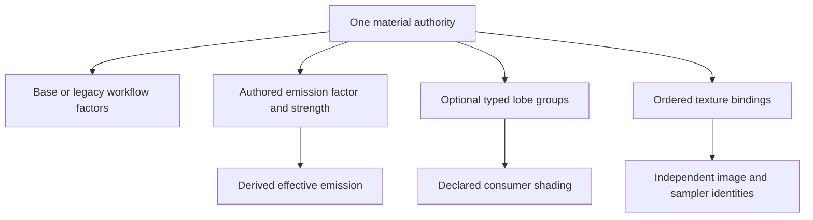
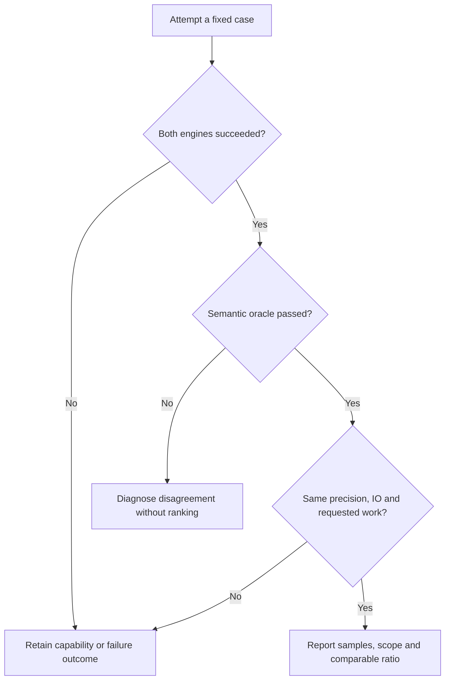

# Pre-release Evolution, Cleanup and Assimp Benchmarks - Plan

## Goal Capsule

**Objective:** Rust applications can use Baozi for a documented static and animated asset workflow, with useful lighting, material and device output, and can assess its time and memory costs against Assimp on reproducible equivalent tasks.

**Means:** Extend the existing typed Scene through bounded feature slices, replace the growing material constructor, remove obsolete paths, and measure before and after the changes (KTD1–KTD9).

**Authority:** The user chose further development before publication on 2026-11-02 and permits breaking interfaces, replacing defective implementations and resetting Baozi-owned unpublished revisions.
This plan replaces the release-first sequencing recommendation in `docs/research/2026-11-02-baozi-assimp-comparison-and-roadmap.md`; it does not reopen the completed maturation U1–U8.
The implementation baseline is `21ed79a39b9a719d6a955bc0e53732c41f86aa59`, with earlier qualification limited to its recorded source in `docs/reviews/2026-11-02-first-release-maturation.md`.

**Execution:** Deliver the fifteen units below as reviewable local commits on the development branch.
The main thread owns integration, serial Cargo/CMake execution and final evidence; native Codex agents can own disjoint edits and independent review.
This artifact authorizes development sequencing, not registry publication, yanking, push, PR creation or native target promotion.

**Stop conditions:** Obtain user input only for essential product information or external authority unavailable from the repository and primary sources.
An invalid design is revised and reviewed within the established requirements.
Unavailable GPU, profiler or target execution is recorded as missing; it cannot be replaced with a claim of passing evidence.

---

## Product Contract

### Summary

Develop a finite, useful pre-release profile before returning to distribution.
The required tranche is equivalent-task benchmarking, numeric-policy adjudication, typed material groups with emissive strength, clearcoat/sheen mapping, punctual lights, one concrete renderer/device consumer, quantized glTF attributes, a coherent v1 cutover and final qualification.
The follow-up map below preserves the broader Assimp gaps without making every format, material model and codec a first-release obligation.

### Problem Frame

Baozi already preserves F32/F64 geometry, owns its metered glTF document, publishes selected edits once, exposes detached relations, and supplies complete chosen material output and a position animation evaluator.
Those are foundations to use, rather than missing features to reimplement.
Remaining immediate gaps are producer mappings, real rendered feedback, concrete device constraints and comparable performance evidence.
`SupplementalPbrFactors` combines unrelated factors in a growing positional constructor; adding emission and later lobes to that shape would compound the problem.
Existing asset and scale probes measure different lifetimes, and some include snapshot construction, so their numbers cannot establish an Assimp performance comparison.

### Requirements

**Canonical semantics and cleanup**

- R1. Keep one immutable, centrally validated Scene and one production implementation per completed semantic path; replace unsuitable interfaces atomically and delete their obsolete implementations and aliases.
- R2. Reset the owned unpublished revision families in KTD3 to canonical v1 with their current encoders, callers, independent vectors and active documentation; preserve the exclusions in that decision.
- R3. Preserve admitted precision, source identity, attribute domains, material assignment presence, complete influence rows, exact selected closure and explicit loss through every new slice.
- R4. New input-controlled work and storage obey existing admission, cancellation and ownership contracts; ordinary failure publishes no partial successful Scene or application output.

**Useful feature scope**

- R5. Materials retain independently authored emission factor and strength, with effective emission derived explicitly; typed groups replace the combined supplemental constructor without dropping current authoring capabilities.
- R6. `KHR_lights_punctual` maps selected definitions and placements through source scope, authoring, public reads, conversion and detached consumer output, including units, axes, range and cone semantics.
- R7. A documented PNG/JPEG renderer profile demonstrates static textured metallic-roughness and Unlit, clearcoat/sheen, cameras, emission, lights, instances and selected animation after Scene/importer/IO destruction.
- R8. Concrete device output defines scalar conversion, stream selection, index/draw/palette limits and allocation/expansion limits; complete remaps preserve the selected semantics or produce a named failure.
- R9. Claimed lit deformation has an explicit normal/tangent-frame policy with analytic evidence; position-only evaluation or bind-pose shading cannot establish it.
- R10. `KHR_mesh_quantization` covers its admitted base and morph accessor encodings without double-applying authored node, skin or UV dequantization transforms.
- R11. Resolve the named `SimpleSkin` quaternion-policy disagreement against source values and independent normative evidence; neither silent repair nor an unsupported assertion that the official sample is invalid is acceptable.
- R17. `KHR_materials_clearcoat` and `KHR_materials_sheen` retain their typed factors and complete binding/resource interpretation through the same material authority and concrete renderer.

**Measurement and qualification**

- R12. Capture an immutable B0 before production changes and B1 after them; compare Baozi and pinned Assimp on matching successful semantic tasks, precision, IO and output contracts.
- R13. Report stage time, complete-pipeline time, process peak resident memory, comparable heap observations and Baozi-specific diagnostics with separate methods and scopes; preserve failures and raw samples.
- R14. Use measured hotspots to choose performance changes; define regression budgets from B0 variability before optimization and report justified semantic-cost tradeoffs instead of inventing a requirement to beat Assimp.
- R15. The complete public facade/IO feature union remains portable; renderer, pixel codecs, C++ comparison tools and host adapters remain outside that dependency closure.
- R16. Final documentation and unchanged-package consumer evidence name the actual source, profile, target and toolchain; missing execution, local source replacement and comparison successes do not imply registry availability or maturity promotion.
- R18. The owned glTF decoder receives a revision-qualified comparison against Khronos normative rules, the official Validator and published gltf-rs behavior. Original regressions cover relevant upstream issue classes; a direct public single-format consumer demonstrates independent use. Disagreements distinguish conformance defects, deliberate policy and unsupported capabilities.
- R19. Describe the actual boundary between a Baozi Scene importer, a standalone glTF document library and gltf-rs API compatibility. A private selected-profile document is not advertised as a complete replacement. Any extraction must share one production parser and receive a concrete public-API design review and independent consumer acceptance first.

### Key Decisions

- **Continue development before publishing.** Governs R5–R14 and R16. (session-settled: user-directed — chosen over publishing the current finite candidate first: the user wants a more useful and measured first canonical release.)
- **Correctness takes priority over historical interface shape.** Governs R1–R4. (session-settled: user-directed — chosen over compatibility patches: unpublished interfaces may be replaced and obsolete paths removed.)

### Scope Boundaries

The required tranche does not add a second Scene, general property/codec/pass framework, engine runtime in core, speculative storage rewrite, automatic source repair or a universal benchmark system.
The renderer is a concrete application example, not a commitment to implement every retained material model or physically accurate transmission/volume rendering.
It rejects unsupported requested shading explicitly; retaining a factor in canonical data does not claim the renderer uses it.

### Deferred to Follow-Up Work

These are deliberate next milestones, not omissions or hidden requirements of the fifteen units.
Each implementation needs its own bounded, reviewed slice before work begins.

| Follow-up | Entry condition | Design and acceptance direction |
| --- | --- | --- |
| More glTF PBR mappings | A named asset or consumer needs specular, transmission, IOR or volume | Reuse R5 groups; deliver factors, texture bindings/resource closure, validation, reads, edits and consumer interpretation together. Volume needs attenuation as well as thickness, with unit conversion. |
| MikkTSpace | A normal-map corpus demonstrates the need and an exact backend can meet the resource/portability contract | Add a separately selected algorithm through existing preparation/transaction seams. Verify reference vectors, mirrored seams, degenerate cases and tangent sign. A float-only backend cannot claim precision-preserving F64 generation; unsupported morph replacement remains rejected. |
| Geometry or texture compression | A licensed corpus identifies one actual blocked codec | Distinguish meshopt buffer decoding, Draco primitive reconstruction, encoded-image routing and pixel transcoding. Admit decoded size, input/output/scratch overlap and work; an unmetered native backend cannot enter portable facade features. |
| One new producer profile | A concrete caller chooses DCC exchange or avatars | Investigate binary FBX 7.x game semantics for DCC, or VRM 1.0 for avatars; choose one first. Reuse authoring and change precise canonical types only for demonstrated source semantics. |
| GLB export | A converter/editor caller needs interchange output | Start with buffered representability/loss preflight under proposed ADR 0038. ApplicationAsset and snapshots are not export formats; atomic host replacement is a separate capability. |
| Native IO distribution | Ordinary host onboarding needs a released adapter on an exact target | Use the existing candidate dependency/admission gates; current consumer use does not register a release target. Repository capture stays independently qualified. |
| Large-scene storage or cache | Measured representative workloads exceed the current design after simpler lifetime/copy improvements | Design against the measured limit; preserve one canonical lifecycle and require durable closure identity for persistent caches. |

---

## Planning Contract

### Key Technical Decisions

- KTD1. **Extend proven ownership seams.** Keep the owned glTF document, typed retained Scene, selected edit transaction and public borrowed readers. Refactor the material authority and application output boundaries where current code exposes a concrete problem (R1–R4).
- KTD2. **Bound the first tranche.** Emission, clearcoat/sheen, punctual lights, a concrete consumer and quantization close usable workflows before further breadth. Clearcoat/sheen already have core factor/texture roles, unlike complete IOR/volume; use those seams. Preserve the follow-up map rather than scheduling a complete Assimp replacement (R5–R11, R17).
- KTD3. **Rebase owned draft revisions once at the final semantic cutover.** Cargo packages stay at `0.1.0`; canonical v1 does not mean SemVer `1.0.0`. Reset Scene directory 8, Scene snapshot 7, edit root 4, source-scope domain v3, projection instruction v2, normal-options domain v2, capacity policy 2 and the owned glTF test-vector v2 to 1. Keep already-v1 families distinct. Do not change external standards/dependencies, Rust/edition/Cargo versions, field/tag IDs, arbitrary extension versions, generation/freshness counters, the immutable registry `0.0.1` placeholder or historical evidence. Source-qualified transcripts/digests distinguish different draft-v1 encodings (R2).
- KTD4. **Use typed optional factor groups with one authority.** Separate emission, clearcoat, transmission/thickness and sheen values where currently represented. Keep authored absence distinct from an explicit default where promised. Do not add IOR/attenuation or extension-combination enum variants before their producing slice. Preserve legacy/base workflow factors and shared image/text payloads (R3, R5).
- KTD5. **Keep graphics and device policy in an excluded consumer.** An initial `tools/consumers/render-wgpu/` workspace reuses the owned asset consumer and evaluator. Its native dependency makes this a native example; it establishes no browser rendering claim. Use one concrete packing profile before extracting a reusable crate (R7–R9, R15).
- KTD6. **Make benchmark equivalence finite and observable.** A private geometry comparison output contains expanded F64 triangle tuples, optional selected normals/UV0, mesh-local draws and separate F64 instance transforms/references. Preserve sharing, without introducing another Scene or pretending this is the full indexed ApplicationAsset. Start with source-space/no-conversion tasks, then add target-space tasks only after independent equivalence tests (R12).
- KTD7. **Pin a released external comparator.** Primary Assimp is v6.0.5 at `392a658f9c271be965271f45e7521a1b80ea4392`. The existing `repo-ref/assimp` development pin `a2a586d9370a493651256ec5d03524710ce37a5f` is a separately labelled optional diagnostic. Do not mutate or replace the existing reference checkout to obtain the release pin. Build a small direct C++ probe, without Rust FFI or Assimp CLI overhead (R12–R13).
- KTD8. **Measure each metric at its real lifetime.** Stage clocks use uninstrumented optimized binaries. Linux process peak RSS is mandatory for B0/B1; Windows peak working set and private commit are distinct supplementary fields. Use heaptrack on both Linux executables in a separate campaign after verifying interception coverage. Never compare Baozi ledgers/Rust-only allocation requests or Assimp's Scene estimate as cross-engine physical memory (R13).
- KTD9. **Reuse small existing tools.** Extend `scripts/run_asset_profile.py` for fixed probe commands, timeout/failure collection and reports; keep deterministic resource assertions in Rust and existing scale tools. Do not add a registry, generalized metric schema language, source resolver or proof compiler (R1, R12–R16).

### Assumptions

The required renderer target is one available Windows or Linux adapter/backend, not browser or Apple coverage.
Its initial material profile is metallic-roughness/Unlit plus the new emission, clearcoat/sheen and lights; other lobes remain the explicit follow-up above.
CPU evaluation of complete influence rows is the initial deformation path; GPU four/eight-weight truncation is not required.
The required comparative memory result is Linux process peak RSS; heaptrack failure must be investigated and reported, but an unavailable allocation metric cannot be fabricated to close it.
Performance claims remain advisory; correctness and deterministic resource limits remain hard gates.
These scope choices are planning assumptions, not additional user-settled decisions.

### High-Level Technical Design

The sketches show ownership and measurement boundaries; module spelling and local function signatures may change without changing these contracts.

The benchmark protocol below owns which state each mode times; process peaks cover the worker's complete lifetime.
Failure and non-equivalence always bypass ratio calculation, while successful observations retain their case and policy identity.

### Benchmark Protocol

| Measurement | Timer boundary | Surviving objects at the endpoint |
| --- | --- | --- |
| Native-scene import | Input/IO and importer/request/properties prepared before start; stop at public import return | Native Scene and required evidence, no preparation, snapshot or copied output |
| Geometry preparation | Fresh import outside clock; time target collection, requested normals/topology/UV/space work and release of replaced intermediates | Final native Scene and import evidence, no copied output |
| Extraction | Import/preparation outside clock; time owned comparison-output construction | Native Scene and output overlap |
| Complete pipeline | After argument parsing and optional memory preload; include importer/IO/request setup, import, preparation, extraction and native cleanup | Only owned comparison output and symmetric preloaded input remain |
| Process startup wall time | Parent launch to exit | Includes startup, validation and serialization; separate from pipeline clocks |
| Memory | Whole child startup to exit, collected separately by the named method | Includes setup, prerequisite stages, input storage, checking and serialization; not isolated stage memory |

Assimp's public import includes built-in ScenePreprocessor work even with zero optional flags; call this native-scene import, not parser-only time.
Do not sum stage clocks and label the sum complete-pipeline time.
The complete-pipeline run must finish native destruction before its endpoint, so any later validation needs the detached output; validate native-only facts before destruction outside stage clocks, or in a separate semantic run.

The first comparable corpus includes generated OBJ repeated-face and increasing-unique-vertex/grid families, image-free shared-primitive glTF, STL triangles and F32/F64 PLY cases where both engines succeed.
PLY point-cloud cases use import/extraction tasks suitable for points, not invented triangle preparation.
Licensed textured, skin/morph, quantized and rejection assets also appear in the capability table; promote them to timing ratios only after matching their complete requested work.
In particular, Assimp glTF image references and Baozi's encoded external-image reads are not automatically equivalent IO.

Case records bind files/dependencies and hashes, expected source facts, scene selection, precision, IO, operation order, output fields and resource limits.
Use independent small-case tuples, coverage/area/winding, transforms and ownership checks; matching counts or output hashes alone do not prove equivalence after valid reindexing/triangulation.
Record source, retained, computation and extraction scalar widths separately.
Assimp F32 is the F32 geometry lane; F64 PLY uses a separately built double-precision Assimp library and matching headers.

Avoid Assimp postprocess presets and implicit welding, bone limiting, cache optimization or instance baking.
Start with authored normals or planar missing-normal cases because the smoothing algorithms differ.
Restore glTF UV conventions in charged preparation work when needed; source-space import-only results retain native conventions.
Only add coordinate-conversion comparisons after verifying the exact axes, winding, units and operation order on both sides.

Use fresh serial workers with warm filesystem caches, three untimed warm-up observations and twenty retained observations per successful timing case, alternating AB/BA engine order.
Record all samples, median, interquartile range, min/max and sample count; label timer-resolution limitations.
Builds, fixture generation and downloads stay outside measured workers.
Record compiler/stdlib/CRT, Rust version, optimization/CPU flags, enabled formats, link mode, allocator, binary identities, CPU/OS, case order and machine load.
Assimp builds enable only the required importers; the Baozi comparison binary uses the corresponding needed features, and both manifests are retained.

Linux `/usr/bin/time` peak RSS covers the full worker.
Windows uses the documented process memory API: peak working set, current private commit and peak private commit remain differently named values.
Do not subtract idle RSS, subtract high-water marks to invent stage peaks, compare cross-OS numbers as one series or treat a new process as a cold filesystem cache.
Heaptrack runs are separate from timing and RSS runs, with symbols and the same allocator interception method on both executables; verify malloc/realloc/alignment/C++ new/Rust System/thread/dependency coverage before interpreting heap totals.
Keep Rust `allocation-counter` as a Baozi-only diagnostic; unsupported metrics use null with a reason.

Workers classify success, policy rejection, unsupported behavior, semantic mismatch, timeout and crash.
The collector preserves every attempted case and continues other cases after failure.
Only two successful semantically equivalent observations in the same lane can supply a time or memory ratio.
No aggregate winner score or assumed speed/safety advantage is a completion criterion.

### Version and Deletion Inventory

| Owner | Current cutover or removal | Keep |
| --- | --- | --- |
| `crates/baozi-core/src/appearance.rs` | Replace `SupplementalPbrFactors` and `try_new_with_supplemental_pbr`, reexports and duplicate material lowering bodies | Current factor capabilities, explicit defaults/presence, base/legacy workflows |
| `crates/baozi-core/src/canonical_scene/store/schema.rs` and `construction/node_scene/snapshot.rs` | Rebase directory and current snapshot to v1; update coupled writers/readers/vectors | Current typed semantics and one core-owned encoder |
| `crates/baozi-core/src/canonical_scene/store/construction/node_scene/edit/transaction/schema.rs` | Rebase edit root to v1 with validation/publication | Current failed/changed outcome semantics and operation identity |
| `crates/baozi-import/src/source_scope.rs` | Add Light deliberately, then rebase current framing/domain to v1 | Ordered observations, bounded detail and independent hashes |
| `crates/baozi-format-gltf/src/parser/normalized.rs` | Replace owned `projection-root-v2` with the current v1 instruction | Current selection resolution frame and source parents |
| `crates/baozi-postprocess/src/normals/options.rs` | Rebase current options domain to v1 | Both mode/replacement bytes and composed preparation meaning |
| `crates/baozi-operation/src/capacity.rs` | Rebase capacity policy; delete unused `CONCRETE_STORE_CAPACITY_REVISION`, `CapacityQualificationSubject` and its self-only tuple test | Real preallocation, postallocation, lifetime and drop-order behavior |
| Core node-scene `tests/obj_capability.rs` and `tests/gltf_capability.rs` | Delete revision-4 OBJ byte-splice migration oracle; rebase owned glTF test vector; author current independent vectors | Mutation, field completeness, bounded preview, release and generation independence |
| Benchmark and application output | Replace ambiguous timing aliases and superseded packers at each cutover | Existing F64 reference output, evaluator, scale/resource contracts and meaningful Criterion microbenchmarks |

Historical plans/reviews/receipts, external source versions and arbitrary test schema IDs are not cleanup targets.
Do not mass-replace numeric literals or remove a helper solely because its name contains `probe` or an old-looking suffix; verify its live callers.

---

## Implementation Units

Paths marked **new** are planned additions; other paths exist at the baseline.
Every unit follows R1–R4 and R15–R16 without repeating their full contracts.
The dependency column is a start gate, not permission to run Cargo concurrently.

| Unit | Deliverable | Depends on |
| --- | --- | --- |
| U1 | Finite case and metric contract | None |
| U2 | Explicit Baozi comparison endpoints | U1 |
| U3 | Pinned direct Assimp probe | U1 |
| U4 | Collector, profiler qualification and immutable B0 | U2, U3 |
| U5 | Numeric compatibility adjudication | U4 |
| U6 | Typed material authority and emissive strength | U4 |
| U7 | Punctual lights and spatial output | U4 |
| U15 | Clearcoat and sheen mappings | U6 |
| U8 | Concrete static renderer | U6, U7, U15 |
| U9 | Complete device-limit output | U8 |
| U10 | Explicit deformed shading | U9 |
| U11 | Quantized glTF profile | U10 |
| U12 | Canonical v1 and obsolete-path removal | U5–U11, U15 |
| U13 | Measured performance refinement and B1 | U12 |
| U14 | Final independent review and qualification | U13 |

### U1. Define finite comparison cases and semantic oracles

- **Goal / requirements:** Establish R12–R14 before changing production behavior; use KTD6–KTD9.
- **Files:** `scripts/generate_asset_workloads.py`; `tools/consumers/assets/fixtures/{expectations.json,workload-expectations.json,SHA256SUMS}`; **new** `tools/consumers/assets/fixtures/comparison-cases.json`; **new** `docs/testing/assimp-comparison.md`.
- **Approach:** Add deterministic image-free/shared-primitive and unique-vertex families beside existing workloads. Specify the fixed output, endpoint lifetimes, case limits and precision/IO lanes. Keep full ApplicationAsset, scalar microbenchmarks and canonical resource-scale fixtures distinct.
- **Test scenarios:** Independently derive a triangle and small grid's tuples/area/winding, shared instances and F64 PLY neighbors. Repeated generation has identical bytes/hashes. Missing sidecars, unsupported semantics and oversized cases retain a capability outcome rather than a ratio.
- **Verification:** Review generated source formulas and fixed case assertions before probe implementation; corpus provenance/licenses are complete. No performance numbers are claimed in this unit.

### U2. Give Baozi comparison endpoints exact lifetimes

- **Goal / requirements:** Implement the Baozi side of R12–R13 through public interfaces (KTD6, KTD8–KTD9).
- **Files:** `tools/consumers/assets/src/{lib.rs,main.rs,buffers.rs}`; **new** `src/comparison.rs` and `tests/comparison.rs` under that consumer; `crates/baozi/benches/import_baseline.rs`; `docs/testing/scale-profile-policy.md`.
- **Approach:** Add explicit CLI modes and versioned observations. Reuse borrowed numeric/tuple readers and existing preparation; keep the comparison payload private. Stage clocks exclude validation/serialization, while complete-pipeline clocks include native destruction. Label Criterion's request construction and output-drop costs truthfully; retain the snapshot-bearing scale probe for its actual contract.
- **Test scenarios:** Each mode stops in its defined ownership state and performs no unrequested preparation/extraction. Output remains readable after importer, Scene, reports and IO drop. Rejection identifies the correct stage. UV seams, shared geometry and adjacent F64 values survive the comparison copy.
- **Verification:** Focused nextest comparison plus existing workflow/indexing/primitive/scale tests pass. Inspection and a small observation demonstrate no hidden snapshot in the comparison path.

### U3. Build the small released-Assimp comparison probe

- **Goal / requirements:** Implement the external side of R12–R13 without changing Baozi production code (KTD7–KTD8).
- **Files:** **new** `tools/consumers/assimp/{CMakeLists.txt,README.md,src/main.cpp,tests/semantic.cpp}`; retain source/build manifests under `target/assimp-comparison/`.
- **Approach:** Link the release pin directly, enable the fixed needed readers and disable unused exporters/tools/tests. Build F32 first and a separately identified F64 PLY variant. Use explicit properties/flags and the same private output contract; no generic exporter, C++ animation engine or custom allocator-interception layer.
- **Test scenarios:** CTest covers analytic geometry, shared meshes/placements, UV convention, planar normals, header/runtime scalar agreement and detached output after `FreeScene`/Importer destruction. A deliberately unmatched conversion or image task is rejected as non-equivalent.
- **Verification:** `cmake -S tools/consumers/assimp -B target/assimp-comparison/build` with recorded source/precision arguments, `cmake --build ... --parallel 1`, and `ctest --test-dir ... --output-on-failure` pass for each admitted build. Exact configure commands and binary hashes are retained.

### U4. Collect the immutable baseline before production changes

- **Goal / requirements:** Close B0 for R12–R14 (KTD8–KTD9); this blocks U5–U11.
- **Files:** `scripts/run_asset_profile.py`; `docs/testing/{assimp-comparison.md,scale-profile-policy.md}`; `tools/consumers/assets/README.md`; **new** focused `scripts/tests/test_asset_profile.py`; B0 artifacts under `target/assimp-comparison/B0/` and **new** `docs/reviews/2026-11-02-pre-release-evolution.md` for source-qualified observations.
- **Approach:** Extend the existing collector with fixed engine executable paths, sequential balanced runs, child timeout, failure continuation and raw artifact preservation. Separate normal timing/RSS and heaptrack campaigns. Verify Windows memory API behavior if collected. Record protocol/corpus/probe/binary identities, production baseline and dirty state. Freeze statistical/regression policy after observing B0 noise and before later optimization; keep unsuitable tiny cases descriptive.
- **Test scenarios:** Missing executable, malformed summary, timeout, crash and semantic mismatch all preserve partial reports and do not prevent unrelated cases. A deliberately allocated/touched buffer exercises RSS; small Rust/C++ allocation exercises verify heap interception coverage before heap totals are comparable.
- **Verification:** Focused Python behavior checks and probe semantic tests pass; actual Linux B0 has successful time/RSS pairs for the bounded comparable families. Retain optional Windows and heap results with their precise scope or unavailable reason. Baseline commit contains no production semantic refactor.

### U5. Adjudicate source quaternion compatibility

- **Goal / requirements:** Resolve R11 without automatic source repair (KTD1–KTD2).
- **Files:** `crates/baozi-core/src/{math.rs,entity.rs,animation.rs}` and their affected validation tests; `tools/consumers/assets/fixtures/{expectations.json,SHA256SUMS}`; `tools/consumers/assets/tests/evaluation.rs`; **new** `docs/research/2026-11-02-quaternion-compatibility.md`.
- **Approach:** Pin the unchanged SimpleSkin bytes, calculate source quaternion norms independently, run a pinned glTF validator and inspect the normative tolerance/interpretation. Keep a justified explicit rejection, or revise the precise authored/effective representation and its validation/conversion/evaluation together if evidence invalidates the current invariant. Do not adjust a global epsilon merely to make the fixture green.
- **Test scenarios:** Boundary values around the justified rule, zero/nonfinite samples, equivalent rotations and signed components have documented outcomes. Accepted source bits survive import/snapshot/conversion; evaluation normalization, where mathematically required, is explicit and does not rewrite stored source.
- **Verification:** The research decision, minimized regressions and capability table agree. A retained rejection is a valid result only with its concrete evidence and documented caller consequence.

### U6. Replace combined material factors and map emissive strength

- **Goal / requirements:** Deliver R5 with KTD1, KTD4; delete the old authority in this cutover.
- **Files:** `crates/baozi-core/src/{appearance.rs,lib.rs}`; **new** `crates/baozi-core/src/appearance/factors.rs`; core `canonical_scene/store/{production/input/appearance.rs,production/plan/appearance.rs,typed_storage/appearance.rs,typed_storage/appearance/validation.rs,api/read/appearance.rs,typed_storage/edit/space_appearance.rs}`; node-scene `semantic/appearance{.rs,/payload.rs,/read.rs}` and `snapshot/appearance.rs`; glTF `document/{schema,decode,validate,mod}.rs`, `json_syntax.rs`, `source_map.rs`, `parser.rs` and **new** `parser/materials.rs`; facade reexports; consumer `src/buffers.rs` and `tests/material_output.rs`; **new** glTF `tests/emissive_strength.rs`.
- **Approach:** Introduce the small typed groups in KTD4, separate factor/strength/presence and derived effective emission, and move existing material lowering into its one owner. Cover metered scalar/presence framing, reads, snapshots and conversion. Enforce emissive-strength/Unlit exclusion in the glTF producer; do not forbid legitimate retained Unlit fallback globally.
- **Test scenarios:** Absent versus explicit strength one, zero/HDR values, texture multiplication, negative/nonfinite/unrepresentable values, escaped keys, wrong payload sites and selected/omitted resources. Rejection occurs before unauthorized sidecar IO. All old authoring capabilities survive; length-valued thickness scales and dimensionless values keep their bits.
- **Verification:** Public material reads, independent transcript vectors, edit sharing and detached output assertions pass. `SupplementalPbrFactors`, its old constructor and duplicated lowering bodies have no remaining production callers or compatibility aliases.

### U7. Map selected punctual lights and detached spatial output

- **Goal / requirements:** Deliver R6 with existing core spatial types (KTD1–KTD2).
- **Files:** `crates/baozi-format-gltf/src/{source_map.rs,json_syntax.rs,parser.rs}`; `document/{schema,decode,validate,mod}.rs`; `parser/{model,source,source_profile,extras,normalized}.rs`; **new** `parser/lights.rs`; `crates/baozi-import/src/source_scope.rs` and `tests/source_scope_outcome.rs`; consumer `src/buffers.rs`; **new** glTF `tests/{punctual_lights,light_scope}.rs` and consumer `tests/spatial_output.rs`; `crates/baozi-postprocess/tests/space_camera_light.rs`.
- **Approach:** Add Light to source inventories deliberately, preserve root-definition versus node-placement identity, and reuse checked `LightDefinition` construction and current conversion. Carry exact source ranges, extras, names and selected closure. ADR 0040 owns the canonical cutoff curve; do not promise pixel identity with another renderer's smoothing.
- **Test scenarios:** Directional/point/spot defaults, nonwhite intensity, black/zero light, strict glTF inner-angle ordering, range and units, local -Z, shared definitions, omitted lights and light-only scenes. Reflection/unit conversion preserves meaning; node scale does not rescale photometry/range/cones. Malformed references, limits and cancellation release all state.
- **Verification:** Public reads, source-scope hashes/counts and detached camera/light placements pass; selected definitions reach U8 shading. Imported light evidence does not depend on metadata conventions alone.

### U15. Map clearcoat and sheen through typed material groups

- **Goal / requirements:** Deliver R17 using R5's single material authority (KTD2, KTD4).
- **Files:** glTF `src/document/{schema,decode,validate,mod}.rs`, `src/{json_syntax,source_map}.rs`, `src/parser/materials.rs` from U6 and `src/parser/{source,source_profile}.rs`; **new** `crates/baozi-format-gltf/tests/{clearcoat_materials,sheen_materials}.rs`; consumer `src/buffers.rs` and `tests/material_output.rs`; material ADR/format documentation.
- **Approach:** Add the two bounded producer mappings, complete texture closure and exact source sites, including nested texture transforms. Existing core factor/texture roles supply the semantics; fix any demonstrated mismatch in their owner rather than retaining a second representation. Respect producer exclusions without globally deleting cross-format fallback data. U8 must evaluate the lobes, not merely retain their values.
- **Test scenarios:** Defaults/presence, prescribed texture channels and sRGB/data interpretation, normal scale, UV selection/transform, shared resources and malformed/omitted payloads. Clearcoat-normal-only primitives satisfy the extension's tangent-space prerequisites; valid authored frames and mirrored seams have independent expectations. Reject forbidden Unlit/specular-glossiness combinations before dependency IO. Clearcoat/sheen layering and emission attenuation have explicit downstream analytic observations.
- **Verification:** Public reads, snapshots, conversion and detached outputs preserve factors/bindings; U8 shading/readback later closes concrete use. No broader IOR/transmission/volume support is inferred.

### U8. Exercise the asset API through a concrete static renderer

- **Goal / requirements:** Establish the static portion of R7 through KTD5.
- **Files:** Root `Cargo.toml` exclusion; **new** `tools/consumers/render-wgpu/{Cargo.toml,Cargo.lock,README.md,src/main.rs,src/device.rs,src/renderer.rs,src/shaders/material.wgsl,tests/render_readback.rs}`; reuse `tools/consumers/assets/src/{buffers,evaluation}.rs`.
- **Approach:** Use the owned asset output rather than extracting a second Scene model. Declare a fixed coordinate/projection, image decode dimension/byte limits, PNG/JPEG, mip/filter, output transfer and tone-map policy. Render MR/Unlit, clearcoat/sheen, selected UVs/transforms, normal maps, alpha/sidedness, instances, imported cameras, emission and lights. Name the chosen BRDF approximations and reference tolerances. Unsupported sample shading is a named error.
- **Test scenarios:** UV1-only material, shared image/different samplers, base/clearcoat mirror seams, clearcoat over sheen, emission under clearcoat, Mask/Blend, front/back faces, fixed camera/light geometry and shared instances. Named-adapter readback compares linear samples/regions against analytic tolerances after Scene/importer/IO drop; save images and adapter/driver identity. Corrupt or excessive images fail before upload.
- **Verification:** CPU assertions and at least one actual backend readback pass. Compile-only, screenshots alone or a missing-adapter skip cannot close rendered acceptance. This unit does not claim deformed shading yet.

### U9. Make device output limits explicit and complete

- **Goal / requirements:** Deliver R8 at the concrete application boundary (KTD5).
- **Files:** Renderer `src/device.rs`; **new** renderer `tests/device_output.rs`; consumer `src/buffers.rs` only where shared public output needs a real addition; renderer README.
- **Approach:** Plan selected streams, F32 conversion/error policy, index width, deterministic draw splitting, per-instance joint palettes and work/byte/expansion limits. Preserve full reference influences; initial CPU skinning avoids forced four/eight-weight output. A primitive element whose joint union exceeds a requested palette cap must fail or use a separately named full-row/CPU path, never truncate silently.
- **Test scenarios:** 65,535/65,536/65,537 unique vertices under the declared primitive-restart policy; reconstruct every selected tuple after split. Cover UV/color/tangent/morph seams, signed zero, material boundaries, shared meshes with different skins, palette boundaries and indivisible oversize elements. Narrowing overflow/underflow/error, cancellation and expansion limits return no partial successful result. Transparent triangle order is stable.
- **Verification:** CPU output correspondence and device readback agree. Remove any superseded packing path while keeping the independent F64 ApplicationAsset as a distinct reference contract.

### U10. Define deformed shading rather than reusing bind-pose frames

- **Goal / requirements:** Complete R7 and R9 (KTD5).
- **Files:** `tools/consumers/assets/src/evaluation.rs` and `tests/evaluation.rs`; **new** renderer `src/deformation.rs`, `tests/deformation.rs`; renderer shader/readback tests and README.
- **Approach:** Keep the existing F64 position evaluator. Add a narrowly documented normal/tangent policy for supported morph/skin/instance combinations, with explicit handling of singular/reflected/nonuniform transforms and tangent handedness. Preserve input influence weights rather than renormalizing source data. Return named failures for cases outside this finite shading profile.
- **Test scenarios:** Independently calculate a rigid transform, nonuniform scale, reflection, one-joint skin and morph-before-skin samples. Include non-unit influence sums, degenerate frames and singular transforms. RiggedSimple and AnimatedMorphCube run at fixed independently computed times; source data stays unchanged after evaluation.
- **Verification:** Analytic frame/position assertions and actual animated readback pass. Position-only success does not waive a frame failure; SimpleSkin remains governed by U5.

### U11. Admit quantized glTF attributes through the same pipeline

- **Goal / requirements:** Deliver R10 (KTD1–KTD2).
- **Files:** `crates/baozi-format-gltf/src/{parser.rs,document/read.rs,document/validate.rs,document/mod.rs}`; `parser/{accessor,morph,source}.rs`; **new** glTF `tests/mesh_quantization.rs`; **new** consumer `tests/quantized_output.rs`; comparison cases, renderer readback fixtures and `docs/formats/gltf.md`.
- **Approach:** Implement the finite Khronos encoding matrix for base/morph attributes, declaration requirements and selected closure. Reuse existing normalization and node/skin/UV transforms; retain decoded source meaning without inventing quantized Scene storage. Quantized normals/tangents need not be exactly unit length; normalization belongs to explicit shading policy rather than global import repair.
- **Test scenarios:** Signed extrema, normalized/unnormalized allowed encodings, sparse/interleaved storage, alignment, min/max and missing-required declaration. Independently equivalent uncompressed static/skin/morph/UV assets match logical values and rendering without double dequantization. Invalid layouts, limits and cancellation fail at the correct preflight stage.
- **Verification:** Public data, source/provenance, conversion, detached evaluation and renderer tests agree. Add comparative ratios only when Assimp release-pin semantics also pass the same case contract.

### U12. Rebase canonical v1 and remove proven obsolete paths

- **Goal / requirements:** Complete R1–R2 at one coherent semantic cutover (KTD3).
- **Files:** Owners in the Version and Deletion Inventory; node-scene `snapshot/tests{.rs,/public_read.rs,/public_deformation.rs,/tangent_attributes.rs}` and `tests/{obj_capability,gltf_capability,profile_closure,spatial_validation}.rs`; `crates/baozi-import/tests/source_scope_outcome.rs`; `crates/baozi-format-gltf/tests/scene_selection.rs`; normal-option vectors; `docs/adr/{0006-public-api-versioning-and-crate-stability-policy,0012-material-texture-image-and-color-space-policy,0017-serialization-snapshot-and-cache-boundary,0026-validation-snapshot-and-fuzz-gates,0032-postprocess-remap-and-derived-data-contract,0039-source-document-scene-selection-and-import-closure,0045-canonical-scene-ownership-construction-and-generation}.md`; current testing/format docs.
- **Approach:** Reset the allowlisted owned families together, delete the OBJ migration oracle and unused capacity qualification anchor, and replace current goldens with independently reviewed transcripts. Correct active snapshot ownership to core. Add dated ADR amendments where old numeric claims are historical; do not rewrite past evidence. Schema framing changes may change costs; number-only substitutions do not justify relaxing accounting.
- **Test scenarios:** Current v1 success and wrong-revision rejection, authored presence/precision/signed bits, tail mutation, bounded/zero preview, generation independence, failure-before-publication and exact release. Normal mode/replacement vectors and composed preparation digest are independent. Already-v1 manifests/identity vectors and arbitrary caller-schema version tests remain unchanged where semantics did not change.
- **Verification:** Focused behavior tests plus review show one current implementation per family, no legacy migration readers/aliases and no unintended resets. New evidence binds the exact source closure rather than relabelling old v1 artifacts.

### U13. Refine measured hotspots and publish B1 comparisons

- **Goal / requirements:** Complete R12–R14 after the semantic cutover.
- **Files:** Existing module owners identified by actual profiles; `scripts/run_asset_profile.py` only for demonstrated collector defects; `docs/testing/assimp-comparison.md`; `docs/reviews/2026-11-02-pre-release-evolution.md`; raw B1 under `target/assimp-comparison/B1/`.
- **Approach:** Rerun the unchanged B0 corpus/protocol on the same host/build policy. Attribute material costs with separate CPU/heap profiles, then simplify the responsible copying, capacity or lifetime path. Record the hypothesis and expected affected measurements before each change. Change storage architecture only when measurements show the current owner cannot meet the requirement. If no verified avoidable hotspot exists, deliver the evidence rather than a speculative rewrite.
- **Test scenarios:** A candidate optimization preserves independent semantic vectors, precision, output ownership, cancellation and admission. Large-case scaling and teardown do not regress while a small case improves. Changing the comparison contract creates a new named series; it cannot replace inconvenient B0 data.
- **Verification:** Publish per-case B0/B1/Baozi/Assimp times, RSS, optional verified heap observations and capability outcomes with raw sample paths and dispersion. Explain regressions against the B0 policy and measured new behavior; retain unresolved breaches as release blockers. No unmeasured speed or memory superiority claim is allowed.

### U14. Qualify the integrated source and update the first-release route

- **Goal / requirements:** Close R15–R16 and the full tranche with independent review.
- **Files:** `docs/testing/behavior-gates.md`; `docs/formats/{gltf,support-matrix}.md`; `docs/reviews/2026-11-02-pre-release-evolution.md`; `docs/release/portable-0.1.0-candidate.md`; root/facade/consumer READMEs; `.github/workflows/{ci,scale}.yml` only for the bounded new tests and manual/scheduled comparison lane; existing package/feature scripts.
- **Approach:** Review public contracts, ownership, failures, resource accounting and benchmark equivalence independently at a fixed source. Run focused gates during development, then final host/portable package/target checks once for the integrated source. Keep heavy comparison/profile runs manual or scheduled and publish raw artifacts on failure. Refresh the local candidate; publication returns to its separate existing release policy after this work.
- **Test scenarios:** Unchanged archives run independent consumers without root patches, including optional production edges. Public feature union excludes graphics/C++/native dependencies. New source-scope/material/quantization malformed and limit cases enter bounded fuzz regressions. Renderer/profiler unavailable outcomes and target compile/runtime evidence remain distinguishable.
- **Verification:** Verification Contract and Definition of Done below are met; exact unresolved environment gaps are named. No passing historical run is attributed to the new source and no format/native target is promoted implicitly.

---

## Verification Contract

Execute commands sequentially with shared `target` and one build job; use `--locked --offline` when dependencies are available.
Acquire missing pinned dependencies before verification, outside measured workers, then preserve the actual lockfiles/configuration.
Proposed CLI arguments below are contracts to implement in U1–U4, not commands claimed to exist at this baseline.

| Scope | Command or evidence | Completion signal |
| --- | --- | --- |
| Focused Rust semantics | `cargo +1.95.0 nextest run --locked --offline -j 1 -p <affected-package> --test <target> --test-threads 2` | Unit-specific happy, malformed, precision, ownership, budget and cancellation cases pass |
| Portable integration | `cargo +1.95.0 nextest run --locked --offline --workspace --all-features --build-jobs 1 --test-threads 2` | Full integrated source passes; manual exclusions named |
| Owned asset consumer | `cargo +1.95.0 nextest run --locked --offline --manifest-path tools/consumers/assets/Cargo.toml --target-dir target --all-features --build-jobs 1 --test-threads 1` | Existing and new detached workflow tests pass |
| Direct glTF conformance consumer | Explicit nextest/Clippy/fmt on the excluded `tools/consumers/gltf-conformance/Cargo.toml`; separate pinned Validator invocation; package rehearsal with direct version-only format/import/IO roots | Literal semantic/issue regressions execute through public single-format APIs outside facade unification; pinned references are test-only; unchanged archives run without root patches |
| Renderer CPU and GPU | Focused nextest on the new manifest, plus named-backend readback invocation defined in its README | CPU remaps and actual static/animated observations pass; missing adapter does not count |
| Assimp probe | Recorded CMake build and `ctest --test-dir target/assimp-comparison/build --output-on-failure` per precision variant | Equivalent small cases and lifetime checks pass before ratios |
| Collector | `python -m unittest discover -s scripts/tests -p test_asset_profile.py` | Timeout/failure/partial-report behavior is correct |
| B0/B1 | `python scripts/run_asset_profile.py --comparison-cases <manifest> --assimp-probe <binary> --repetitions 20 --artifact-root <B0-or-B1>`; separate memory-profile invocation defined by U4 | Actual Linux time/RSS pairs, samples/capability table, source/build identities and stated optional metrics |
| Lint and format | `cargo +1.95.0 clippy --locked --offline --workspace --all-targets --all-features --jobs 1 -- -D warnings`; corresponding asset/renderer manifests; `cargo +1.95.0 fmt --all --check` and standalone-manifest checks | No warnings or format drift |
| Public documentation | `cargo +1.95.0 test --locked --offline --workspace --all-features --doc -j 1` | Public examples match the new interfaces |
| Normal package closure | `python scripts/check_packages.py --offline --toolchain 1.95.0` with all twelve existing feature cases; unchanged archives also executed on Linux | Normal version-only rehearsal passes without root patches; explicitly not live registry proof |
| Portable targets and malformed input | Existing WASI runtime/snapshot, browser compile and bounded Linux ASan/fuzz gates extended for changed owners | Fresh scoped evidence for the final source; no unexecuted-target claim |

Do not broaden or repeat passing expensive checks without a new change, failure or unresolved concern.
Maintain direct behavior tests; do not revive retired receipts, AST/source-shape analysis or arbitrary test-count release gates.

### Owned glTF assurance amendment (2026-11-02)

The user explicitly requested deeper tests after confirming that the former gltf-rs decoder had
been replaced. This strengthens U7/U10/U14 and the existing follow-up map; it does not replace the
fifteen units or treat every optional extension as a first-release requirement.

| Existing unit | Bounded addition and observable acceptance |
| --- | --- |
| U3/U14 comparison evidence | Use literal failure-status names and otherwise complete negative CLI requests. Keep an explicit missing-option test and valid maximum-u64 control. Demonstrate that removing either numeric/duplicate guard or mislabelling the status makes the corresponding test fail; preserve frozen B0. |
| U7 spatial output | Independently assert imported asymmetric camera parameters, optional planes/aspect, shared definitions and unit conversion as well as the planned light semantics. |
| U10 application evaluation | Calculate RiggedSimple and AnimatedMorphCube positions directly from pinned source bytes at a key and an interval midpoint. Add bound skin/morph plus seam-edit composition and Corner/Face color extraction observations using original small fixtures. These supplement, rather than waive, deformed-frame and device-readback acceptance. |
| U14 ordinary formats | Test unequal OBJ position/UV/normal negative-index tables at record time, mixed material absence/reuse, every scalar in distinct STL facets, and reordered binary PLY fields after nonempty skipped lists. Use independent authored expectations and typed negative outcomes. |
| U14 owned document | Add compact raw-syntax/Unicode-key and core-field-type/default matrices, asymmetric sparse MAT4 values and GLB logical-buffer/padding boundaries. Extend the existing glTF fuzz lane with small feature-reaching seeds and bounded failure observations, without a new fuzz framework. |
| U14 core compatibility | Fix the demonstrated implicit-zero accessor rejection in global schema, selected layout and bound reads; retain logical resource admission and forbid authored `byteOffset` without a view. Represent an optional animation target node, ignore core-only untargeted channels, preserve retained source ordinals and keep malformed global references and unsupported required extensions rejected. Compare original fixtures with pinned normative rules and Validator outcomes before changing acceptance. |
| U14 independent references | Pin current Khronos specification/registry and Validator sources plus the published gltf-rs comparator; inspect its newer source and relevant issues separately. Compare a finite shared semantic profile against independent facts, not majority acceptance. Record validator limitations and unsupported extensions. |
| U14 direct package use | Prefer a small excluded single-format conformance consumer using public `baozi-format-gltf` registration, `baozi-import` and IO APIs outside facade feature unification. Keep gltf-rs/reference tools outside the production dependency closure. This proves the documented importer use case; it does not establish low-level document API parity. |
| Reviewed follow-up | Assess a separately usable glTF document/accessor crate against actual raw-document consumer needs, metering, precision, lifetimes, IO and error contracts. If extraction is justified, replace the private owner atomically under its own reviewed plan; do not retain a competing decoder or expose private internals as a shortcut. |

The audit uses Assimp development pin `a2a586d9370a493651256ec5d03524710ce37a5f` only as a
scenario source. Assimp release pin and B0/B1 protocol remain unchanged. Fixtures are original or
already license-audited Khronos samples; no Assimp model files are copied. The current-source
research and execution records distinguish proposed cases from actual passing tests. Independent
literal/analytic expectations and valid negative controls follow the updated fixture policy.

---

## Definition of Done

| Area | Required observable result |
| --- | --- |
| Product | R5–R11 and R17 have their finite documented success/reject profiles through public APIs and actual consumer use |
| Architecture | One authority per material/Scene path; replaced constructors, migration bridge and unused capacity anchor are removed |
| Versioning | KTD3 allowlist is coherently v1; its exclusions and historical evidence remain accurate |
| Performance | Immutable B0 and B1 include actual semantically matched Assimp comparisons for time and Linux peak RSS, raw samples, dispersion and failure outcomes |
| Optimization | Measured changes preserve semantics/resource contracts; regression policy breaches are resolved or remain explicit blockers |
| Rendering | Named-backend static and supported animated readback follows analytic expectations after native library state is destroyed |
| Distribution | Final source has scoped host/package/portable evidence and truthful documentation; actual publication remains separately authorized |
| Owned glTF assurance | R18/R19 have current revision-qualified standards/issues/reference evidence, actual independent single-format and unchanged-package consumer execution, and an explicit importer/document-library/API-compatibility boundary |
| Review and handoff | Independent milestone/final findings are resolved or explicitly retained with consequence; local commits and the execution record identify tested source and artifacts |

This plan is complete only for its required tranche; the follow-up map remains future work.
Its planning deliverable contains no new benchmark results, runtime qualification or implementation completion claim.

---

## Appendix

### Grounding and Primary Sources

- Existing source and exact qualification: [maturation review](../reviews/2026-11-02-first-release-maturation.md), [current comparison](../research/2026-11-02-baozi-assimp-comparison-and-roadmap.md), [scale policy](../testing/scale-profile-policy.md), [asset consumer](../../tools/consumers/assets/README.md).
- Architectural owners: ADRs 0007, 0012, 0023, 0026, 0032, 0036, 0039, 0040, 0045–0047 and proposed 0038. Their current semantics govern each slice; amend the owner when changing a decision rather than creating a parallel contract.
- [Assimp v6.0.5 release](https://github.com/assimp/assimp/releases/tag/v6.0.5); [pinned scalar/build configuration](https://github.com/assimp/assimp/blob/392a658f9c271be965271f45e7521a1b80ea4392/CMakeLists.txt). Local tag resolution confirms the full KTD7 commit; release-pin behavior is verified by U3 rather than assumed from the later reference checkout.
- Khronos [punctual lights](https://github.com/KhronosGroup/glTF/blob/main/extensions/2.0/Khronos/KHR_lights_punctual/README.md), [emissive strength](https://github.com/KhronosGroup/glTF/blob/main/extensions/2.0/Khronos/KHR_materials_emissive_strength/README.md), [clearcoat](https://github.com/KhronosGroup/glTF/blob/main/extensions/2.0/Khronos/KHR_materials_clearcoat/README.md), [sheen](https://github.com/KhronosGroup/glTF/blob/main/extensions/2.0/Khronos/KHR_materials_sheen/README.md), [mesh quantization](https://github.com/KhronosGroup/glTF/blob/main/extensions/2.0/Khronos/KHR_mesh_quantization/README.md) and [validator](https://github.com/KhronosGroup/glTF-Validator). U1 records the exact specification/tool revisions used for implemented tests.
- Linux [getrusage](https://man7.org/linux/man-pages/man2/getrusage.2.html), Microsoft [PROCESS_MEMORY_COUNTERS_EX](https://learn.microsoft.com/en-us/windows/win32/api/psapi/ns-psapi-process_memory_counters_ex), [heaptrack including Rust support](https://github.com/KDE/heaptrack/blob/master/README.md), [Criterion timing-loop contracts](https://docs.rs/criterion/0.8.2/criterion/struct.Bencher.html). Metric availability and profiler interception are execution checks, not facts established by documentation alone.

### Considered and Not Built

A wholesale Scene/storage replacement has no demonstrated need at this baseline; material grouping and application output have concrete owners to improve first.
A shared cross-language Scene/exporter or general benchmark plugin framework would obscure the matched task and duplicate production semantics.
Global allocator replacement, idle-RSS subtraction and synthetic stage-memory peaks would create misleading comparisons.
A native-only dependency hidden behind a default-off facade feature would still violate complete-feature portability.
Arbitrary performance-win targets, automatic weight truncation and blanket numeric normalization would sacrifice the contracts the comparison is supposed to measure.
