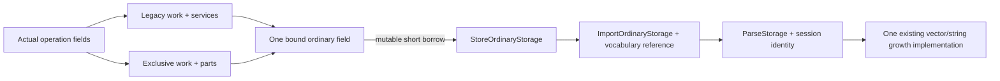

# Bound Storage Services

This is the next bounded owner replacement in the
[exclusive invocation plan](2026-11-03-1120-refactor-exclusive-invocation-plan.md).
Necessary integration APIs may break. Remove the replaced views and tuple methods;
keep one numeric authority and one vector/string growth implementation.

## Problem and Evidence

The binary STL caller passes Windows and affected Linux correctness gates, but its
[ordinary performance acceptance is HOLD](../reviews/2026-11-03-binary-stl-performance-hold.md).
Repeated OBJ import worsens +7.66/+7.59%; grid import +5.13/+5.08%. Both pipelines
also worsen twice. All preparation, extraction, memory and historical costs remain open.

[Matched Linux call-owner attribution](../research/2026-11-03-ordinary-storage-binding-costs.md)
isolates 147,509/444,732 storage-loan constructions for repeated/grid OBJ. Two
construction functions cost 90 exclusive Ir per entry, without polling. Scope
checkpoint routes separately grow 93 to 104 Ir per entry with unchanged real polls.
These observations locate work; they do not establish Windows causation or predict
a removable speedup. Preserve the original comparison and explicit Smooth task.

## Representation

Create one bound ordinary storage/poll field at each legacy or exclusive region
entry from the actual operation's external fields. It owns the existing storage
descriptor and actual poll borrow by value. A short loan borrows that field mutably;
it does not reconstruct its catalogue/poll/debt/state descriptors on each push.

Replace the three-part work/storage/control tuple with work plus one services owner.
The services owner contains ordinary storage, the genuine retained-storage role and
progress metadata. Ordinary loans expose neither numeric work nor progress/Ledger
authority. No self reference, dynamic backend, additional account, reference-count
clone, counter, mode flag, heap box or numeric implementation is introduced.

Split progress metadata from its actual control/terminal borrow. Retained producer
reporting and the new services owner delegate to one reporting implementation.
Preserve both existing execution/reporting poll frontiers, observer behavior, limits
and evidence admission. Exclusive numeric work and storage become disjoint owner
fields; the compound host borrows them directly and keeps its existing completion,
error materialization and destructor ordering.

Keep existing execution-state checks in this slice. State-check hoisting, numeric
kernel changes, roots, administrative metrics, consuming attachment, indexed
unchanged preparation, payload adoption and format algorithms are separate work.

## Execution and Verification

1. Freeze and independently review concrete fields, lifetimes and actual caller
   signatures before Rust. The design must show legacy entry, exclusive entry,
   progress reporting, the cold retained helper and real import/postprocess uses.
2. Implement the owner representation and necessary caller migration. Delete old
   public storage/control views, arbitrary-sibling joins and unused reborrow helpers.
   Foreign keys and tokens remain real runtime rejection cases; replace obsolete
   arbitrary-sibling tests with valid new API tests and compiler boundary probes.
3. Main alone compiles and runs Cargo with one job. Verify meaningful fit/growth,
   cancellation, exact work prefix, allocation overlap, qualification, first cause,
   panic/Drop, progress and same-session lifetime contracts. Compile-fail cases must
   fail for their intended borrow/lifetime boundary, with nearby valid positives.
4. Independently review actual production/test changes. Run affected integrated
   nextest, four formats, public control/asset consumers, doctests and strict
   all-target/all-feature Clippy/fmt. Qualify affected Linux source separately.
   Bind commands to exact source bytes and actual artifact origins.
5. Commit qualified source before ordinary measurement. Use fresh immutable workers
   for unchanged C,N,N,C Windows cases, three warmups and twenty retained AB/BA pairs.
   Review every affected lane, dispersion, tails and whole-child memory. Attribute
   residual changes separately; instruction results cannot clear native regressions.

Structural acceptance requires one bound ordinary field per entry, a short reference
per loan, no per-push sibling join or inner-view reconstruction, and no lost semantic,
physical, control or failure obligation. It does not claim zero wrapper copies or
removal of every measured constructor instruction. Performance acceptance requires
fresh ordinary evidence and an explicit disposition of every observed cost. The
complete 14-case/110-lane Windows/Linux release target remains open throughout.

## Execution Record

- Independent v1 review accepts the owner direction with one P2: shorten the import
  vocabulary reference to the loan lifetime. Corrected v2 applies exactly that field
  correction, preserving the invariant inner owner lifetime and existing ParseViews.
  Compiler/runtime proof and native performance remain unqualified.


## Concrete Owner Design

The following is the corrected concrete design v2, SHA-256
`03cffb70ee8da5592a9509f9ec7c1eaff2caabc8871d0742a6a767021e2d5401`,
from its actual-seam section onward, with the independent review's vocabulary-lifetime
correction applied. Declarations are uncompiled design signatures. Path abbreviations are
`O=crates/baozi-operation/src`, `I=crates/baozi-import/src`,
`P=crates/baozi-postprocess/src`. No implementation or native gain is claimed.

**Actual seam and alternatives.** Current `I/scope.rs:792-800,3643-3656` constructs `ParseStorage` on every growing operation. `I/store/execution.rs:226-233` joins storage/control; `O/retained/operation/execution.rs:424-438` reconstructs storage and poll views. Merely moving a constructor to entry while `reborrow()` still returns those fields by value leaves most descriptor movement possible. Choose a reference to an entry-owned field instead. The rejected smaller alternative is to keep the three-part tuple and cache only `ExclusiveStorage`: it retains arbitrary-sibling admission and reconstructed poll/debt/state descriptors. No enum, owner trait, mode flag, heap box, or self-referential cache is needed.

**Concrete raw ownership.** Keep the existing `ExecutionOrdinaryStorage` field representation, but own one value at entry, never inside a per-push loan:
```rust
// O/retained/operation/execution.rs; all fields private to implementation.
struct ExecutionOrdinaryStorage<'op, O, P, PP, U, D> {
    storage: ExclusiveStorage<'op, O, P, D>,
    poll: OperationPollCheckpoint<'op, PP, U>,
    failure: &'op Cell<Option<PreparationFailureCode>>,
    debt: &'op Cell<u16>,
    execution_state: &'op Cell<StoreExecutionState>, // keep current gates initially
}
struct ExecutionServices<'op, O, P, PP, U, D> {
    ordinary: ExecutionOrdinaryStorage<'op, O, P, PP, U, D>,
    retained: ExecutionStorage<'op, O, P, D>, // existing genuine retained role
    progress: OperationProgressState<'op, O, P, PP, U, D>,
}
```
`ExecutionStorage` becomes private retained/attribution support; its actual ledger/account/share-plan references are not ordinary authority. No new Ledger, Cell, Arc clone, key array, work row, lease, or numeric backend is created. Existing `ExecutionWork`, groups, permits, parser frames and numeric kernel stay unchanged.

**Required progress split, with a single reporting implementation.** `O/coordinator.rs:174-383` currently puts control/terminal, progress metadata and a shared Ledger in one `OperationProgressCheckpoint`. Extract metadata, not another control owner:
```rust
struct OperationProgressState<'op, O, LP, PP, U, D> {
    ledger: &'op Ledger<O, LP, D>,
    progress: &'op mut Vec<((PP, U), ProgressState)>,
    progress_evidence_bytes: &'op mut u64,
    last_phase_order: &'op mut Option<u32>,
    delivered_events: &'op mut usize,
    delivered_bytes: &'op mut usize,
    next_sequence: &'op mut u64,
}
struct OperationProgressCheckpoint<'op, O, LP, PP, U, D> {
    poll: OperationPollCheckpoint<'op, PP, U>,
    state: OperationProgressState<'op, O, LP, PP, U, D>,
}
// Consumes the wrapper; neither result borrows its former stack slot.
fn into_parts(self) -> (OperationPollCheckpoint<'op, PP, U>,
                       OperationProgressState<'op, O, LP, PP, U, D>);
// On OperationProgressState; move the existing reporting body here once.
fn report_progress(&mut self, poll: &mut OperationPollCheckpoint<'_, PP, U>,
                   phase: PP, unit: U, completed: u64, total: Option<u64>)
    -> Result<(), ControlCause>;
```
`split_progress_checkpoint_and_retained_ledger` constructs the wrapper from coordinator fields. Legacy entry consumes it with `into_parts`, placing its poll in `ordinary` and its state in `services.progress`. Reporting borrows those two fields sequentially through the same service; only `ordinary.poll` owns the actual mutable control/terminal references. Existing retained producer-progress callers still use the wrapper and delegate to this same report body; it is not an alternate ordinary backend. Delete the now-unused `reborrow_poll` helper.

Retain current progress order, storage admission, observer take/restore, panic disposal, limits and terminal selection. In particular current execution `report_progress` does an outer checkpoint and reporting performs another real poll: do not silently merge them. No mutex or numeric RefMut spans observer invocation or allocation.

**Concrete public integration and thin loan.** Existing owner/progress bounds apply; method fragments below belong to the indicated types:
```rust
// O/concrete_store/execution.rs; replace public Storage + Control views.
pub struct StoreExecutionServices<'op, O, PP, U> {
    raw: ExecutionServices<'op, O, StorePhaseKey, PP, U, StoreDimensionKey>,
    domain: &'op StoreKeyDomain,
}
pub struct StoreOrdinaryStorage<'b, 'op: 'b, O, PP, U> {
    raw: &'b mut ExecutionOrdinaryStorage<'op, O, StorePhaseKey, PP, U, StoreDimensionKey>,
    domain: &'op StoreKeyDomain,
}
// RetainedStoreOperation::execution: same qualification and initial poll.
pub fn execution(&mut self) -> Result<(StoreExecutionWork<'_, O>,
    StoreExecutionServices<'_, O, PP, U>), StoreRuntimeError>;
// On StoreExecutionServices<'op,...>; no fallible sibling join, no poll.
pub fn ordinary<'b>(&'b mut self) -> StoreOrdinaryStorage<'b, 'op, O, PP, U>;
// On StoreOrdinaryStorage<'b,'op,...>; only reborrow raw, copy domain reference.
pub fn reborrow<'s>(&'s mut self) -> StoreOrdinaryStorage<'s, 'op, O, PP, U>;
```
`services` also owns existing checkpoint/before_action/completed_action/report_progress and retained reserve/resize/transition/owner-validation methods. Ordinary reserve belongs only to its ordinary loan. Retained reserve takes phase/dimension/bytes/allocations, never a second control argument; it uses the same bound poll, existing physical account and Internal share admission helper. Shared-receiver token reconciliation retains its existing semantics and physical-envelope checks; it does not mint permission to resume body work. Both token resize roles call the existing reconciliation helper, not different arithmetic.

Delete public `StoreExecutionStorage`, `StoreExecutionControl`, their ordinary/retained arbitrary-pair methods, and raw `ExecutionStorage::ordinary`/`shares_invocation`. Do not keep a deprecated tuple adapter. The remaining two outputs separate work from services, not storage from control. Domain errors still precede real polls/admission; phase precedes dimension. Actual foreign token ownership remains checked. There is no longer an expressible ordinary/retained storage-from-A + control-from-B request.

**Entry construction and the exclusive borrower.** Legacy `RetainedOperation::execution` constructs `ExecutionWork` plus `ExecutionServices` directly from external owner fields. Its checked entry must reject stopped execution before emitting services; keep concrete terminal-only precedence and all existing entry polls. The cold `RetainedOperation::reserve_retained_storage` at `O/retained/operation.rs:2284-2293` must stop obtaining/discarding an entire execution tuple: obtain its actual private retained role directly and call the same retained reserve helper, preserving that cold role's existing eligibility.

Exclusive entry must also own the same `ExecutionOrdinaryStorage` once. Move `parts.poll` and `parts.ledger.storage` into it at `exclusive_parts`, not by borrowing fields of a containing struct. Necessary narrow descriptor split in `O/ledger/exclusive.rs`:
```rust
struct ExclusiveWork<'op, D> { catalog: &'op [D], work: WorkView<'op, D> }
// Ledger::exclusive; same existing work quiescence and WorkView construction.
fn exclusive(&mut self) -> Result<(ExclusiveWork<'_, D>,
    ExclusiveStorage<'_, O, P, D>), LedgerCause<D>>;
// StoreInvocation / StoreInvocationParser: borrow existing parts.ordinary.
pub fn ordinary_storage<'b>(&'b mut self) -> StoreOrdinaryStorage<'b, 'op, O, PP, U>;
// Existing compound runner: T/P/E independent of the short loan lifetime.
F: for<'s> FnOnce(StoreOrdinaryStorage<'s, 'op, O, PP, U>) -> Result<T, P>;
```
`ExclusiveWork` is the old `ExclusiveLedger` minus its moved storage descriptor, not another numeric owner. Keep bind/counters/quiescence bodies and kernel order; its cold tighten-policy method accepts `&ordinary.storage` explicitly and retains the existing binding/lock/math/error order. `ExclusiveOperationParts` stores `work: ExclusiveWork`, `ordinary`, and existing account/share/state references. No descriptor duplication, reference to a sibling field, or whole-Ledger alias accompanies exclusive WorkView.

Prefix hosting still splits `&mut parts.work.work`/frame for `ParserActionHost` from `&mut parts.ordinary` for the callback. Only the short two-reference concrete loan is constructed per callback, including numeric-only callbacks. Do not call a whole-context borrower while the guard is live. This is a field-movement/type-lending change, not replacement of the runner, frame, error materializer, cost capture or lexical root.


The two entry paths above are sequential borrowers of one operation, never simultaneous owners. A region owns the bound view by value, borrowing the operation's external fields; its loan references that view. It does not store a reference to its own fields.

**Import signatures and actual call flow.** `ImportStoreExecution` becomes `{ work, services, vocabulary }`; storage acquisition delegates to `services.ordinary()`. These declarations replace the current value-owned raw views:
```rust
struct ImportOrdinaryStorage<'b, 'op: 'b> {
    raw: StoreOrdinaryStorage<'b, 'op, ImportOperationOwner, ImportProgressPhase, ImportProgressUnit>,
    vocabulary: &'b ImportStoreVocabulary,
}
pub struct ParseStorage<'b, 'op: 'b, 'session: 'b> {
    raw: ImportOrdinaryStorage<'b, 'op>,
    identity: StorageIdentity<'session>,
    callback_active: &'b Cell<bool>,
}
// ParseExecution<'region,'session>:
pub fn storage<'b>(&'b mut self) -> ParseResult<ParseStorage<'b, 'region, 'session>>;
// ParseRoot / ParseParser with existing operation lifetime 'op:
pub fn storage<'b>(&'b mut self) -> ParseResult<ParseStorage<'b, 'op, 'session>>;
```
Only `'op: 'b` and `'session: 'b` are needed; do not demand `'session: 'op` or extend a role borrow to the entire operation. Root/parser callbacks retain their existing lifetime/brand. `MeteredVec::try_push` -> `exec.storage()?` -> existing `ParseStorage::push_vec` now moves only the small wrappers; all inner storage/poll/debt/state fields stay in place. Keep the existing acquisition preflight, identity checks, reserved-write checks and one growth body in `I/scope/storage.rs`. No claim of zero wrapper copies or removal of every measured `storage` instruction is made.

**Control, first cause and destruction.** For the primary change keep `check_execution_state`, `poll_execution`, stopped-state projection, true poll counts and debt semantics. The raw checkpoint now runs against stable `ordinary.poll`, rather than reconstructing it. Preserve the original recorded Control on entry/reentry; do not collapse it to FallbackOnly or invent Requested(0). Preserve destination callback/terminal -> issuer -> source-terminal -> initial poll -> required-size/capacity order; the deleted arbitrary-sibling check has no replacement runtime request.

Growth retains original capacity plans, overlap admission, actual allocator reconciliation, allocation/qualification failures, old payload/token liveness, final identity/poll and payload-before-token retirement. Preserve UTF-8 4096-byte copy frontiers and actual partial append. Numeric admission and observed completion remain in the existing host. On denied admission the callback/value stays caller-owned until cold projection; on denied completion projection still precedes returned T Drop. On semantic Err retain existing parser-prefix versus ordinary-action completion distinctions; no completion replay or new work/budget meaning. Existing guard/registry panic classification, KnownError failure-storage exception, prescribed exit poll and final checkpoint stay separate from ordinary body permission.

**State checks stay unchanged in this slice.** Production state writers are exclusive hosts; legacy work/permit drops write failure, and a live legacy mutable operation borrow excludes same-operation exclusive reentry. This supports investigating entry-only legacy state validation separately, including caught panic and forgotten-handle obligations. It does not justify hoisting exclusive host checks across ignored Err or caught unwind. Neither optimization is included here; the common bound owner keeps its current state reference and checkpoint gate.

**Necessary file/caller migration, with no dormant compatibility path.**

- `O/coordinator.rs`: progress metadata split/one report body/consuming split. `O/retained/operation/{execution.rs}` and `O/retained/operation.rs`: bound services, checked construction, exclusive field split and cold retained entry. `O/ledger/{exclusive.rs}` plus `O/ledger.rs` reexport: descriptor split and cold policy borrowing only, no kernel changes.
- `O/concrete_store/{execution.rs,execution/exclusive.rs,activation.rs,activation/preflight.rs}`: two-output entry, thin loan, semantic-session `{work,services}` and scratch delegation. `O/{retained.rs,concrete_store.rs,lib.rs}`: delete retired views/update real reexports/doctest tuples.
- `I/{store/execution.rs,scope.rs,scope/storage.rs,scope/parser_execution.rs}` and only required store/lib reexports: new member/lifetimes and forwarding. Keep all OBJ/text callers and STL algorithms unchanged.
- Genuine other caller `P/operation/runtime.rs:202-380`: `ActiveRuntime` stores work/group + services; migrate scratch retained reserve/resize and control forwarding only. `P/normals/diagnostics.rs:124-146` has one diagnostic tuple binding to adapt, without changing its task/count/clock. No normal kernel/consumer/evaluator/producers/comparison edits.

**Required oracles and acceptance.** Main alone runs compilation/nextest/lint/docs. Adapt existing operation/import/semantic/runtime tests to real new types; retain their literal output, prefix, cause and resource assertions.

1. Positive temporary root/parser storage loan, same-session owned vector/string escape and later-region growth; negative actual-method loan escape, simultaneous root/parser/services reuse, cross-thread authority and invariant layout crossing, each with valid positive pairs. Session-owned containers retain only token/session identity, never the bound view.
2. Replace old arbitrary-sibling tests rather than retaining that interface: runtime foreign phase/dimension keys reject before polling/admission and preserve receiving-owner cause; foreign live token resize/transition rejects without changing coverage. Existing mixed-session container fit/growth rejection remains. Negative probes must not merely call deleted symbols.
3. Existing literal capacity-fit cancellation, overlap admission, ZST/empty/overflow, allocation/qualification failure, payload-before-token retirement, append-prefix and old-copy cancellation oracles remain. State/budget/control counters and F32 bits do not change.
4. Preserve actual compound completion rejection -> import cold projector -> exact destructor-panic sentinel, `(2,1,0)` prefix and denied reuse; retain private guard-disarm Running assertion and admission-denied capture/value tests. No generic catch-any-panic replacement.
5. Progress first/second real polls, observer cancellation/panic, limits/metadata evidence and sequential reporting after a loan ends; no numeric borrow across observer/allocation. Legacy entry after KnownError/IncompleteSuccess/caught exclusive unwind and original Control reentry remain rejected without body work. Any optional state hoist additionally needs caught legacy-panic/permit-Drop failure and valid-method exclusion proofs.

Acceptance is structural first: one ordinary field construction per entry, zero per-push sibling join or inner view reconstruction, one growth/numeric implementation, and all above semantics unchanged. Remaining small identity/vocabulary wrappers, unused-prefix argument, caller memcpy and state checks are explicitly not claimed eliminated. Native performance requires main's separate matched qualification; no gain or keep follows from this design. Principal risk is an accidental long borrow of progress/Ledger or a shifted failure/destructor frontier; the field-specific signatures, paired lifetime probes and retained exact oracles are the review gate before Rust.

Open review/compiler items are the exact short-loan inference at compound callbacks and the mechanical exclusive storage-field extraction/tighten-policy borrow. They must use the stated existing owners and one numeric kernel; they do not authorize a broader root/exclusive redesign. This draft is ready for independent review now.
