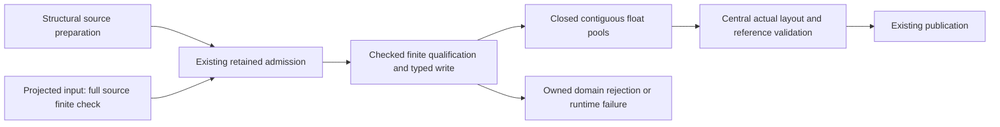

# Finite Geometry Payload Construction

Status: proposed for independent design review. This is the next bounded architecture experiment under the active [Assimp convergence plan](2026-11-03-0900-perf-assimp-convergence-plan.md), not implemented functionality, a speed forecast or release approval. Runtime base is qualified e5; the separate 7900255 text candidate is completing its ordinary disposition. Use whichever exact qualified source is selected there and record that commit before implementation.

## Problem and decision

Initial ordinary geometry currently checks each source float, copies it under a separate controlled action, then checks the retained float again. Immutable source borrowing prevents source mutation, but raw output Vec fields remain mutable across three writer routes. Removing final checks alone would expose a real unqualified-mutation seam. Existing attribution locates separate per-scalar execution costs; the text-policy cleanup's observed whole-worker diagnostic reduction is only 0.01-0.52%. Neither observation predicts this proposal's gain.

Create one closed geometry float-payload Module. Qualify final-width values inside actual writes, expose only immutable float slices afterward, and retire ordinary source-finite loops and retained-finite visits together after all writers migrate. Keep actual output layout, coverage, topology, sparse indices and cross-domain validation central. No new dependency, unsafe code, per-value wrapper representation, generic proof/provenance system, operation-level F32 policy or caller-controlled skip-validation flag.

A successful Scene must reject the same nonfinite value sets as before. Diagnostic scalar coordinates remain meaningful. Resource/work/cancellation denial can occur before a later, not-yet-observed ordinary NaN. This explicitly revises unpublished discovery ordering; it does not permit hiding an already observed cause or inventing an internal invariant error for malformed input. Update the relevant contracts and tests rather than preserving that historical ordering through another preliminary float pass.

## Alternatives

| Choice | Benefit | Cost and decision |
| --- | --- | --- |
| Keep source qualification and use a closed copy owner only to retire final rescans | Smaller error-transport change; source errors retain early ordering | Leaves source per-scalar execution and a separate copy pass. Viable fallback if the chosen error/cleanup Interface cannot remain small. |
| Qualify inside actual writes; close all geometry float construction | Deletes two real passes/control streams for ordinary dense/sparse values | Requires all three writers, domain rejection transport, honest work/cadence and revised error-order tests. Chosen experiment. |
| Hoist scalar callback guards or add an operation F32 scanner | Could reduce repeated callback adaptation | Guard-only benefit is unisolated and the proposed prefix/unwind bridge adds cross-layer complexity. Defer. |
| Single-pass growing text construction | Could delete text planning | Changes storage admission/error ordering and leaves geometry costs. Independent future candidate; not bundled here. |

## Closed payload Interface

One private Vec-backed implementation, sealed to f32/f64, owns geometry scalar storage. Length, capacity and immutable slices preserve contiguous public reads. It provides admitted scalar and bounded tuple writes and exact finish. It exposes no mutable slice, mutable dereference, raw-Vec constructor, unchecked extension or post-build fault escape. Empty allocation is permitted; every initialized floating value must cross a checked write. No new per-cell allocation or extra parallel validity array.

Each actual controlled write checks the available planned capacity, evaluates final-width finite qualification and appends only accepted data. The existing operation action owns admission/completion. A normally returned nonfinite rejection is a completed qualification attempt, with no initialized cell for that rejected value. Do not equate consumed work with vector length on failure. Do not wrap an already controlled tuple conversion in a second accounting callback.

The smallest closed scope covers initial construction, selected replacement Build mode, and space conversion. Selected Count mode is planning; Compare retains exact bit correspondence. Unit-normal/tangent-sign rules and space overflow/underflow checks remain stronger obligations than finiteness. Read-only generated geometry, provenance and layout readers change mechanically. Integer and non-geometry float domains remain outside this Module.

Private preparation becomes structural preparation where ordinary float qualification is deferred; rename the current validated-batch representation accordingly. Keep all schemas, cardinality, projection bounds, sparse metadata and canonical capacity/shape facts. Projected F32 input still scans its entire source, including empty projections and unselected values: an unselected NaN must still reject. Sparse explicit values and default tuples qualify on their actual writes; sparse index validation remains.

## Domain rejection and owned cleanup

The actual blocker is `CanonicalLane::try_retain_storage`: its factory currently transports only `StoreRuntimeError`. Core `retain_geometry` maps build invariant failure to `ConstructionInvariantUnverified`, so malformed float data cannot be passed through that branch.

Widen the existing internal retained-storage failure envelope to distinguish runtime failure from a caller-owned rejection. Operation transports the rejection without knowing float types, attribute identity or semantic validation. Core's geometry writer records attribute/scalar coordinates at the rejecting write and maps the owned facts into the existing `GeometryAuthoringFailure::Semantic(NonFiniteAttributeValue)` route in node-scene materialization. Sparse-default offsets remain relative to the authored values/default convention. The existing `materialize!` route must not indiscriminately classify the domain branch as Materialization.

Keep the rejection payload narrow with a mandatory `R: Copy` bound. Geometry needs only attribute/scalar coordinate facts; construct the full semantic enum after returning to core. Current callbacks require no non-Copy domain rejection. Preparation values and successful output remain unconstrained by Copy and retain their existing destruction rules. Do not generalize an arbitrary error-disposal framework for a hypothetical future caller. Other runtime-only builders use `Infallible` through this same canonical implementation; remove the superseded internal factory path after migration. Preserve the preparation closure used by edited-profile construction to share admitted child owners.

On returned rejection: destroy partial storage while its admission remains live; explicitly resolve the unexecuted work suffix; release physical attribution; bind no shared output. The existing `finish(false)` must call resolve explicitly even after a sticky failure; Drop is only fallback containment. Record a returned callback/runtime error before cleanup, then record later resolution or ownership faults in existing contract history without replacing the first runtime cause. A nonclean physical release retains fail-closed attribution and surfaces the existing unverified-ownership/runtime result; it cannot return a clean semantic rejection. Preserve original domain facts when no higher-priority actually observed runtime/control failure exists. On panic: retain the already completed physical prefix and current fail-closed destruction behavior, without adding normal observer callbacks during panic containment. Do not leak pending work or turn failed construction into incomplete-success. Review error cleanup before pool migration.

A returned domain rejection is terminal for that lane. Set one lane-local pending-rejection bit before returning its Copy facts. Cleanup and terminal `lane.reject` remain available; further admitted work and successful `complete` must fail closed through existing contract-fault history. Correct immediate rejection preserves its semantic cause and must not fabricate a runtime invariant failure for the original NaN. This prevents a caller from ignoring Rejected, building a different root and completing. Do not store a generic E in the lane or introduce typestate/proof tokens. Existing fallback-only state has different outer-containment behavior and cannot substitute for this bit. Qualify both retry and completion after ignored rejection.

## Physical work and cancellation

One actual scalar action now qualifies and copies. Delete authoring/retained work only for loops that disappear. Preserve copy work, storage bytes/cells, metadata visits, projection/index checks and bounded tuple arithmetic. Correct every source-derived formula and sealed aggregate together, including runtime `validation_work`, initial capacity plans, selected output lengths, converted synthesized indices, scratch and materialization rebinding. No hidden benchmark work or success-only batch credit.

`SCENE_VALIDATION_POLL_INTERVAL` publicly bounds validation work between polls at 256; the present typed builder polls every 4096 actions. Fused validation must retain the stronger 256 bound. Tighten the existing typed-build cadence to 256 with its current counter rather than introducing another polling/progress layer. A modulus change alone is insufficient: exact-length construction or rejection after action 256 may return without action 257. Explicitly resolve the work frame and perform the final observation checkpoint on normal success/domain rejection, respecting any earlier sticky runtime cause; `lane.reject` itself does not provide that poll. Keep the before-first-action check. Fixed-width tuple actions retain their documented physical vocabulary; changing a scalar action into an unbounded span is prohibited. Review all boundary-denial/control precedence tests, including the existing 4097-boundary fixture, and document changed discovery ordering explicitly.

For the existing STL1024 shape, source inspection suggests 18,432 ordinary source finite actions and 18,432 retained finite actions can disappear while 18,432 writes become qualified writes. Existing build work is 21,521; retained geometry work would be 3,078. These are hypotheses derived from source, not observed optimized counts or a speed estimate. Validate actual emitted counts before publishing them. The earlier 35.574% source and 5.954% retained inclusive chains cannot be added into predicted savings.

## Implementation and deletion sequence

1. Review actual rejection ownership/cleanup, terminal-lane behavior, 256 cadence and the selected minimum payload. Implement the one canonical runtime/domain envelope and meaningful rejection/panic/prefix/ignored-rejection tests before moving semantic checks. No second ledger or callback completion framework.
2. Introduce the private contiguous finite pools and migrate all three construction/writer routes. Keep central finite validation during this intermediate cut. Replace the old post-build NaN injection with rejection at the checked writer; keep legitimate structural corruption and finite-bit correspondence tests. Verify all mutable escape paths are gone.
3. Atomically remove ordinary source-finite loops and central finite scans; rename structural preparation; update exact work formulas, failure mapping, ADR 0045 finite-by-construction contract and discovery ordering. Keep full-source projected inspection and all actual layout/reference/edit/space checks. Delete replaced append/mutation/factory branches and obsolete tests; retain only useful behavior tests through the new Interface.
4. Run affected nextest/compile-fail docs, strict all-target/all-feature lint/format and external consumers with source-stable receipts. Freeze/commit the exact candidate. Use same-source diagnostics to confirm deleted visits/control streams and separate heap attribution where ownership is affected; then unchanged 14-case/110-lane ordinary Windows/GNU comparison, all positive/negative rows retained.
5. Independently review source and raw measurements. Keep or retire the whole owner cut using the explicit evidence. All original <=3x endpoint/pipeline/comparable-process-memory release targets remain; no confirmed >=10x is hidden. Main merge, release readiness and publication remain separate; no push/PR/publication is authorized here.

## Verification and risks

| Risk | Required evidence |
| --- | --- |
| NaN/Inf bypass through another writer | Dense/sparse/default/projected-empty/unselected, selected and converted-output tests; no mutable pool escape; central structural validation retained. |
| Domain input misclassified as internal failure | Owned attribute/scalar coordinates through rejected retention and public semantic mapping; no published Scene or leaked storage. |
| Rejection/panic loses prefix or cleanup fault | Denial-before-predicate, failure after k returned writes, current unexecuted suffix, runtime/control collision, panic and physical-admission tests. |
| Finite conversion still underflows or changes value | Preserve existing stronger conversion/correspondence and unit-normal/tangent tests; finite pool is not their replacement. |
| Cancellation latency increases | Actual poll-frontier tests around 255/256/257 qualified actions and fixed-width tuples, with existing control history and first-cause rules. |
| Formulas bill deleted work or omit surviving actions | Exact relevant action-boundary tests and actual candidate observations, all four retained-work owners/aggregates aligned. |
| More code with negligible native value | One closed implementation, no redundant old path, unchanged storage shape; report every endpoint/RSS tradeoff and retire if owner benefit is not defensible. |

Success means all initialized geometry floats are qualified at their only write Interface, every relevant writer uses it, the two ordinary duplicate passes and their charges are actually absent, all required behavior/control/resource gates pass, and measured performance/memory tradeoffs are independently reviewed. Neither a new type nor lower isolated instruction count alone completes this plan. Estimated elapsed time is unknown; execution remains serial using existing targets and scoped local commits. No registry or remote action is part of this plan.

## Design review record

The independent bounded review approves beginning the domain-rejection/cleanup slice, with the mandatory Copy payload, explicit failed-suffix resolution, first-runtime history, ownership-failure reporting, exact-final-action checkpoint and terminal-lane rejection corrections incorporated above. Its receipt is `.git/baozi-review/performance-convergence/finite-payload-plan-review-1.md`. Current edit preflights already establish stronger deterministic generated-value constraints; their checked writer rejects unexpected nonfinite results as internal construction failure rather than widening the entire edit transaction without a reachable input case. Initial authoring rejection retains its public semantic mapping. Source execution, final-implementation review and native qualification remain pending; this review does not clear those gates.

## Execution record

Step 1 is source-qualified at `5e3aff55b0dd9ad1113740fac2346ea0a79b5836`.
The [retention receipt](../reviews/2026-11-06-typed-retention-rejection.md) records
one Runtime/Copy-Rejected factory, terminal rejected lanes, explicit failed-work
settlement, runtime-first ownership history and 256/final control observations.
The actual full run passes 3,595 workspace tests, 188 doctests, 138 consumer tests
and both strict lints/formats, with existing skips. A subsequent test-only fault
delta passes 1,080 Operation tests, 128 doctests, strict lint and format; runtime
identity is tied to the earlier full run without claiming another complete
workspace execution. Independent source/fault review closes both requested P2
test gaps. Geometry pools, finite scans, work formulas and public semantic mapping
remain unchanged in this slice. Steps 2-5, native owner benefit and every original
convergence/release gate remain open.
