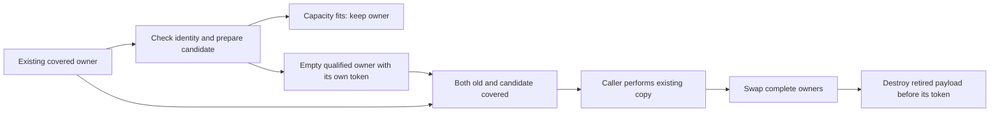

# Prepare Replacement Capacity Without Copying

Status: implemented, independently reviewed and integrated into local main. The
capacity-only source was qualified at `eb82ccf` after separate development on
`refactor/text-capacity-owner` from `80f4364`. This is not performance acceptance. The
[read-sequence experiment](../reviews/2026-11-06-parser-read-sequence.md) remains
isolated because neither platform could start ordinary measurement.

## Problem and decision

Shared text conformance still separates planning and construction. A future fused owner
must grow covered text and metadata without hiding old-content copies inside allocation
services. Current `ParseStorage::reserve_string` and `reserve_vec` combine preparation,
copying and retirement; the fused parser cannot charge those copies at its actual work
owner without duplicating the capacity/admission algorithm.

Extract one crate-private preparation operation for each existing container. Return
`None` when capacity already fits, or an empty, fully covered and qualified replacement
`MeteredString`/`MeteredVec<T>`. Reuse these operations in the existing growth methods,
deleting the extracted duplicate preparation bodies. No new owner or policy is introduced.
This is a source prerequisite, not a measured optimization or approval of a fused parser.

The broader single-pass proposal remains under design review. In particular, converting
decoded live usage into a cumulative session counter and admitting source work per unit
are **unselected**. This slice changes neither contract, counter shape, parser admission,
text pass count nor public API. It does not implement a compatibility wrapper for a new
decoded representation: that representation has not been approved.

## Alternatives

| Alternative | Tradeoff | Decision |
| --- | --- | --- |
| Prepare the same existing owner, then let the actual caller copy | Separates admission/allocation from physical copying; current growth and future conformance share one implementation. | Proposed smallest prerequisite. |
| Duplicate growth inside the fused parser | Avoids a small private interface but forks capacity, identity, qualification and cleanup logic. | Reject. |
| Add a generic allocation/copy transaction framework | Could generalize owner transitions, but introduces another executor and protocol before a demonstrated need. | Reject. |
| Keep combined growth until decoded-budget design is settled | Avoids speculative preparation work but leaves the actual missing operation unresolved. | Valid fallback if extraction needs new ownership machinery. |

## Ownership and Interface

The exact private names may follow existing conventions; expected shape is
`prepare_string_replacement(&MeteredString, additional)` and
`prepare_vec_replacement<T>(&MeteredVec<T>, additional)`, returning the existing
`ParseResult<Option<...>>`. They borrow the actual `ParseStorage`, use the old class,
resource and session identity, and return the same metered container type. No raw Vec,
String, owning work permit, proof token, copied budget or new allocation strategy escapes.

Preserve the current order of identity/preflight and real polls, checked required length,
geometric replacement plans, envelope admission, old/empty-candidate preflight checks,
fallible allocation, observed-capacity qualification, exact token resize and qualification
failure handling. Preparation performs no content copy or source mutation. Candidate
backing is destroyed before its token on every failure or ordinary Drop.

On success, old pointer, contents, length, capacity and token remain intact. The candidate
has length zero and enough actual capacity for the admitted requirement. Both allocations
remain covered until the caller retires one. A prepared candidate is not evidence that
future arbitrary mutations of the old owner still fit it; existing bounded writes and
the immediate private call sequence must retain actual capacity checks.

Existing `reserve_string` uses the returned candidate, its existing bounded UTF-8 copier,
the same post-copy checks/poll and retirement order. Existing `reserve_vec` retains its
non-cloning move into already qualified capacity, with its same pre-copy poll. Neither
acquires an unmetered allocator path. Preserve current behavior for empty values, fit,
overflow and zero-sized vector elements through the existing plans.

## Scope and deletions

Primary write scope is `crates/baozi-import/src/scope/storage.rs` and focused existing
storage/ownership tests. Change the current container module only if necessary to construct
the same private owner safely. Do not edit Operation's ledger/kernel, public exports,
resource dimensions, text conformance, format implementations or benchmark scripts.

Remove the duplicated preparation fragments from both combined growth methods after
they call the new helpers. Retain the real current copy/commit code and checks. Do not
add a second implementation or a temporary feature switch. The eventual fused text cut
must still explicitly delete `TextInputPlan`, `InitialMeteredVecPlan` and `TextEmission`;
this prerequisite alone does not satisfy that structural outcome.

## Verification and stop conditions

| Boundary | Meaningful required observation |
| --- | --- |
| Fit and empty input | No replacement owner/allocation for fit; successful initial preparation returns an empty covered candidate without changing the source. |
| Admission and allocation failure | Old pointer/content/capacity/token remain unchanged; any candidate is cleaned with zero terminal live bytes. |
| Qualification/resize failure | Actual backing remains covered through cleanup; original cause survives; no copy, swap or source mutation occurs. |
| Both-live budget | Exact and one-under limits observe old plus candidate coverage, not only final replacement bytes. |
| Drop and later copy | Dropping an unused candidate preserves the old owner; existing growth preserves content, identity, cancellation frontiers and payload-before-token retirement. |
| Foreign session and sticky failure | Deny before allocation and retain the first actual cause. Reuse existing fault fixtures rather than adding a simulator. |
| Source structure | One preparation implementation per concrete container, both current callers migrated, no new ledger or executor. |

Run focused Import nextest, strict all-target/all-feature Clippy and format checks serially
with existing targets. Broaden qualification when actual changes or failures justify it;
the final integrated fused representation will need its own full workspace/consumer gates.
No native improvement, no-allocation reduction or convergence follows from this extraction.

Stop if returning a covered empty candidate requires a new generic ownership/transaction
framework, changes quota semantics or loses the current failure/control sequence. Report
the exact obstruction and settle the broader design before continuing. This plan grants
no publication, push, PR, source keep or local-main merge.

## Execution record

Implemented both preparers in `crates/baozi-import/src/scope/storage.rs` and migrated
both current growers. The production diff is 55 additions and 21 deletions; it moves
existing preparation code rather than adding another allocator. Copying, polling,
qualification order and explicit payload-before-token retirement remain in their
existing owners. No Operation, parser, quota, policy or public-interface change occurred.
An independent frozen-source review found no blocking issue.

Five focused tests and six added cases in the existing foreign-session matrix observe
the actual ledger and tokens: empty/fit preparation, unused-candidate cleanup,
non-Clone element destruction, allocation/qualification first cause, exact/one-under
old-plus-candidate budgets, foreign denial before allocation, and ZST length overflow.
Existing growth and the four-poll String copy-cancellation oracle remain unchanged.
The existing Vec allocation fault is exercised; String qualification injection is not
described as an allocation or resize failure. No independent resize-denial fault was
injected in this slice.

Serial Rust 1.95.0 qualification completed on 2026-11-06 (+08:00):

| Check | Result |
| --- | --- |
| Import nextest, all features, one build job and one test thread | 485 passed, zero skipped |
| Import doctests, all features | 49 passed: 15 ordinary and 34 compile-fail |
| Import Clippy, all targets/features, `-D warnings` | Passed |
| Workspace `cargo fmt --all -- --check` | Passed |

Receipt: `target/review/convergence/text-capacity-owner-qa-1.json`. All 909 snapshotted
source inputs stayed fixed during qualification. Only the intended three Import inputs
differ from the preceding read-sequence test-delta receipt. This is affected-crate
qualification, not another full workspace/consumer run or an ordinary benchmark result.
Independent test/evidence review found no blocking issue, verified the three source
hashes and four log hashes, and distinguished the two doctest result groups.

The fused text design still needs a concrete source/copy admission schedule and aggregate
decoded-live ownership. The source prerequisite supplies neither a performance keep nor
approval of a session-cumulative decoded counter. Release remains on hold.

## Follow-up: remove closed-owner revalidation

The preparation extraction was committed as `3090dbc`. A separate bounded follow-up
removes checks made redundant by that interface, superseding their preservation in
the initial extraction decision above:

| Removed check | Ownership or retained check that supplies the guarantee |
| --- | --- |
| Recheck the captured source length/capacity before allocation | Preparation retains an immutable borrow of the source; no mutable container interface escapes. |
| Check `(0, 0)` against the empty candidate plan before creating its backing | The private helper constructs that plan with `(0, 0)`, and the caller creates a fresh empty container directly. |
| Qualify candidate capacity a second time against the source growth plan | For allocating storage, the candidate plan already requires the source envelope as its minimum and maximum capacity. Its retained `finish` checks actual length/capacity and byte arithmetic. |

The crate-private planning helpers now return only that candidate plan, with singular
names. All callers migrate together, including the table estimator. No retired tuple
interface or compatibility alias remains. The temporary growth calculation still checks
source shape, geometric arithmetic and allocation size while computing the same envelope.

The checked required length, old-plus-candidate admission, fallible allocation, actual
candidate qualification, exact token resize, identity checks, control polls and cleanup
remain in their current order. General detached `CapacityPlan` preflight/finish methods
retain their checks: their callers can change storage between planning and execution.
This distinction uses ownership to remove impossible states in a closed operation,
without weakening an interface that permits those states. Zero-sized vectors keep their
allocation-free fit path and checked required-length overflow before that fit check.

No new tests or fault framework are added. Existing candidate-policy assertions and
actual-owner failure, overlap, cancellation, foreign-session and ZST tests qualify this
deletion. Independent source/evidence review found no issue in the four-file production
and test delta (19 additions, 38 deletions). The fresh receipt
`target/review/convergence/text-capacity-simplification-qa-1.json` records 485 nextest
tests, 49 doctests, strict Import Clippy and workspace formatting passed on 909 stable
inputs. The reviewer verified all four log hashes and the four changed source hashes.
No runtime speedup is inferred from fewer source checks.

## Local main integration

Selected only the capacity commits onto `6967818`: `3090dbc` became `b0272b1`, and
`89450d1` became `eb82ccf`. The integrated source changes five Import Rust files and
this plan. Four Rust files are byte-identical to the reviewed development candidate;
`text_input.rs` changes only its private helper name and candidate-plan return shape.
Operation and parser execution remain identical to the prior main edition. Neither
read-sequence commit `d02ba6e` nor its evidence commit `80f4364` is an ancestor.

Fresh serial qualification is recorded separately in
`target/review/convergence/text-capacity-main-qa-1.json`: 484 Import nextest tests,
49 doctests (15 ordinary plus 34 compile-fail), strict Import Clippy and workspace
formatting passed with all 909 source inputs unchanged. Independent integration review
verified the actual source, receipt and log hashes and approved this exact local merge.
The one test present only in the earlier 485-test experiment is
`read_sequence_rechecks_import_terminal_after_ignored_metadata_failure`; it belongs to
the excluded reader implementation. All capacity/failure/control tests remain present.

Local main fast-forwarded from `6967818` to the qualified `eb82ccf` source after that
review. All five pre-existing user notes retain their original hashes. This record is
a documentation-only follow-up; no benchmark, broader workspace/consumer rerun or
release acceptance is inferred. The earlier read-sequence experiment remains isolated.
