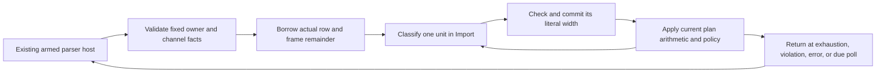

# Close Text Planning Over the Actual Work Row

Status: design GO after independent adversarial review and the concrete field/lifecycle
amendment below. Control source is capacity-only main `3cd9997`, with Rust source
qualified at `eb82ccf`: 484 Import tests, 49 doctests, strict Clippy and formatting passed.
The earlier
read-sequence source (`d02ba6e`) remains a separate experiment with no ordinary timing
acceptance. Implementation and qualification progress are recorded below; performance
acceptance is still pending.

## Problem and decision

The first-party text planner owns classification and policy, but executes each unit
through a general callback runner. That runner repeatedly validates host/channel facts
that cannot change during a closed planning region. Admission does not prove numeric
completion will succeed, so removing all per-unit checks would be incorrect.

Choose a short exclusive loan of the actual work row and actual parser remainder.
Import directly calls its private classifier, commits the returned width through that
loan, and then applies the current plan arithmetic/policy. Operation owns numeric and
control mechanisms; it acquires no text or format dependency.

The retained GNU instruction profile for the earlier read-sequence experiment places
268,677,101 self instructions (10.23%) at `ParserFrame::complete`'s kernel source and
24,185,058 (0.92%) at `classify_text_unit`'s source for `obj-grid-128`. These are split
source-level instruction attributions, not total function costs or wall-time shares.
They locate a hypothesis; the new control/candidate still require fresh measurement.

## Alternatives

| Alternative | Benefit | Cost and decision |
| --- | --- | --- |
| Closed first-party planner with actual row loan | Removes the per-unit callable seam and hoists fixed-state checks; preserves immediate checked numeric completion. | Selected next experiment; borrowing/control integration must be reviewed. |
| Reuse a general read-sequence host in both passes | Amortizes guard construction with smaller edits. | Retains per-unit generic machinery; do not add another temporary reader before replacing it. |
| Construct from planner-owned offset tables | Can remove second-pass newline/replacement discovery. | Adds early allocation/relocation and changes failure order; counts alone cannot drive that emitter. Defer. |
| Fuse planning and construction with one physical String owner | Deletes the count plan and second navigation pass. | Still needs a nonphysical aggregate decoded-live quota and source/copy admission design. Defer rather than silently impose cumulative quotas. |

## Loan and control interface

Add a ledger-private singleton row writer constructed from `ParserFrame<1>`, its bound
`WorkLayout<1>` and the current `WorkView`. Validate active mode, layout/catalog shape,
ordinary role, correct channel, and absence of a conflicting child/producer/protected
channel before lending. The loan excludes admission, policy/channel changes, storage,
progress callbacks and reentry. No copied counter, permit, raw setter or second ledger.

The kernel loan contains only `row: &mut WorkEntry<D>`,
`remaining: &mut u64` referring to `ParserFrame<1>::remaining[0]`, and the registered
`dimension: D`, tied to the short loan lifetime. The Store wrapper contains this loan,
the original failure cell, an optional reference to the original direct-mode debt cell,
and one `stopped` flag. The host retains its actual frame, work reborrow, layout, failure,
execution state, registry boundary and armed scope. Import retains its existing plan,
offset, line length, raw poll frontier and independent error view across handbacks.

`complete_read(width)` checks width against the actual remainder, checked consumed
addition, pending competition, attempted headroom and consumed limit using existing
numeric helpers. Only after every check succeeds does it update the actual row and
remainder together. A zero width retains the existing behavior. Numeric failure must
stop this loan and poison the existing host even if an integration caller ignores its
returned error; no later successful completion or successful outer return may hide it.
Do not call the full `ParserFrame::complete` underneath each unit or duplicate its generic
alias/arity algorithm in the writer.

On failure, latch the existing failure cell immediately and set `stopped`; later
readiness/completion, including width zero, rejects without mutation. Resolve the actual
frame only after releasing the row loan. A stopped body overrides any normal-looking
poll/exhaustion/boundary result before exact-success close, preserving the original
failure rather than manufacturing an incomplete-success error.

The existing armed host lends this writer through one scoped body, with its existing
error projection, owned-error disposal/materialization and frame close order. The host
keeps the actual frame if the borrow is forgotten. Unwind retains completed units and
does not complete the interrupted unit or unread suffix. A closed Import scan contains
no inner catch-and-continue or externally supplied per-unit hook.
Keep that scope guard armed throughout the body: the old guard's `complete` also disarms
it and cannot serve as a per-unit method. A healthy region handback disarms the guard
without another numeric completion or closing the parser frame. The loan and its Drop
perform no settlement.

For direct calls, lend the existing action-debt cell with the numeric row. Before each
classification, `ready_for_read()` uses the existing checked debt calculation at cost
one. If a checkpoint is due, return without reading or completing another unit; release
the loan, checkpoint through the actual host, then reborrow the same admitted frame.
Each successful completion advances the actual debt once. Loan entry/exit never resets
debt. Registry execution keeps its current boundary/control policy. A due raw-byte poll
also ends the loan before invoking control. No callback runs while numeric facts are
being treated as fixed.
Distinguish debt handback from raw-byte-frontier handback. A debt checkpoint preserves
Import's existing `next_poll_at`; only the current raw-frontier rule advances that value.

Import's private `scan_text_plan_region` receives source/facts/options, the current plan,
offset/line state and the narrow writer. Its loop is: width-aware frontier check and
control readiness, classify, immediate `complete_read`, checked unit-end and existing
policy/metadata updates, then advance. Return exhaustion, semantic violation data or
poll handback; scope/numeric failures remain errors. A conformance violation maps to the
existing normal `Boundary(Err(violation))`, preserving record retry and error precedence.

## Scope and deletion

Implement from the capacity-only main source. Retain the real common armed action host;
refactor duplicated guard/error handling only where needed to lend that same owner.
Do not introduce the earlier `ParseReads` / `StoreParserReads` / `with_read_sequence`
interface. If development reuses that experimental branch, delete those adapters,
reexports and read-specific `in_read` machinery before qualification. No parallel reader,
feature switch, generic executor trait, proof object or arity-specialization rail remains.

Keep the count plan, exact decoded/slack allocation, emission pass, public text storage
interface, tables/recovery tracker and format grammars fixed for this experiment.
Successful owner-local work remains `2N + Q`, including existing BOM accounting. PLY
discovery, selected-span limits, retry position and binary handoff remain independent.
Full fusion requires a later explicit ownership/policy decision; this plan does not
approve removing aggregate decoded-live limits or batching away numeric failures.

First implement the kernel row constructor/transaction and its immediate production
host consumer, with the real counterexamples below. Independently review that concrete
borrow/guard/control slice before replacing the private Import loop. Keep the seam used
without dead-code allowances; do not implement the whole text pipeline in the first cut.

## Verification and decision

Reuse real fixtures for pending/consumed-limit competition, an admitted four-byte frame
with consumed limit two, failure after completion before offset update, unwind and ignored
failure. Preserve raw/copy frontiers at 4095/4096/4097, four-byte scalars and CRLF crossings,
cancellation before a later invalid suffix, callback/recovery precedence and PLY binary
prefix cases. Add only missing assertions at actual production boundaries; no simulator.

Run affected Operation/Import nextest and strict Clippy serially with Rust 1.95.0 and the
existing target; use one build job/test thread. Final candidate qualification includes
workspace/consumer tests, doctests and strict lint/format gates before performance keep.
Require independent source and evidence review against fixed actual source inputs.

Structural success means one closed planner, entry-only fixed-state validation, immediate
checked actual-row writes, unchanged accepted output/work, and no generic read seam.
Use fresh matched control/candidate diagnostic binaries and the six existing representative
instruction cases. Continue to ordinary measurement only if either OBJ improves at least
1% and no case worsens more than 1%; retain all results and stop on a failed diagnostic gate.
Instruction counts are not elapsed time, memory or release acceptance.

Ordinary qualification retains the existing 14-case/110-lane Windows/GNU protocol,
three warmup pairs and twenty retained AB/BA pairs, quiet gates, individual regressions,
failures and source/binary identities. The parent plan's <=3x pipeline/memory targets and
no confirmed >=10x endpoint still govern release. No push, PR, publication or automatic
main merge follows from a diagnostic improvement.

Independent adversarial design review found no P0/P1 blocker and one P2 omission in the
original implementation map: actual borrowed fields, the whole-region armed lifetime
and stopped-result precedence. Those details are now explicit above. Design GO permits
the bounded first slice; compilation, source review and performance evidence remain due.

## Execution record

The kernel now lends a `ParserReadRow` containing the actual row and frame remainder.
`StoreParserReadRow` adds the original failure/debt cells and one stopped flag. The same
armed host spans a whole region; its common owned-error materializer serves the existing
prefix runner and the new loan. An independent frozen-source review found no defect in
this first slice and approved the later Import wiring.

The first-slice receipt `target/review/convergence/closed-text-row-focused-1.json` records
seven focused tests, strict Operation Clippy and formatting passed on 909 stable inputs;
1,080 tests were filtered, not executed by that focused run. A separate actual run in
`closed-text-row-operation-tests-1.json` passed all 1,087 Operation tests with no skips.
Those receipts predate the following cancellation test and Import integration.

The review requested one additional actual cancellation oracle. The extended existing
fixture now carries a real `CancellationToken`: after debt 255 -> 256, the row ends and
the actual checkpoint observes cancellation. The new assertion requires exactly one
classification, counters `(2, 1, 0)`, remainder `[1]`, debt 256, preserved Control cause
and no entry into a later row body. Two paired doctests cover an owned readiness result
and a row reference that cannot escape. All three passed in the integrated run below.

Import now uses the private `scan_text_plan_region`, with its existing offset/line/poll
state held in one `TextPlanCursor`. It calls classification directly, completes that
literal width into the actual row, then performs the original policy/count arithmetic.
Raw-frontier handbacks advance `next_poll_at` only after the actual checkpoint; debt
handbacks leave it unchanged. The private Import adapter only projects failures, with
terminal checks at region entry/exit. The old per-unit planning `run_returned` body is
removed; its BOM read and the separate emission pass remain. No per-unit callable reader,
secondary work counter, cumulative decoded quota or compatibility rail was introduced.

The integrated Import library check passed. Independent final Import source review found
no issue in the twelve-file candidate and retained the earlier kernel/host proof. Fresh
serial qualification then completed in
`target/review/convergence/closed-text-final-qa-1.json`, with all 909 before/after source
inputs unchanged:

| Integrated check | Actual result |
| --- | --- |
| Workspace nextest, all features, one build job/test thread | 3,622 passed (two slow), six existing skips |
| Workspace doctests, all features | 190 passed, including both new row examples |
| Workspace Clippy, all targets/features, `-D warnings` | Passed |
| Asset-consumer nextest, all features, one build job/test thread | 138 passed, one existing skip |
| Asset-consumer Clippy, all targets/features, `-D warnings` | Passed |
| Workspace and asset-consumer formatting | Both passed |

The intentional panic stderr from the passing postprocess unwind/cleanup test remains
in the log; its repeated success output is not another test. Final independent review
verified all seven log hashes, serial command intervals, all 909 current source hashes
and the retained twelve-file source-proof chain. The existing skipped cases are manual
experiments/scale fixtures, not wasm execution. This closes the recorded Windows
correctness/lint/format scope; no measured performance keep follows from it.

The fixed main `3cd9997` GNU control was built with Rust 1.95.0, opt3/debug1, System
allocation and the existing shared target; all archived files and 909 QA inputs matched
the build. Binary SHA-256:
`43681a578cfee585588b21a17c901ace6fd97f92fb040767be1b973169c3d5bb`.
Six fresh control profiles completed in
`target/review/convergence/closed-text-control-attribution/report.json`:

| Case | Whole-worker control Ir |
| --- | ---: |
| glTF shared 1 | 5,947,738 |
| glTF shared 32 | 29,540,514 |
| F64 PLY neighbors | 2,510,384 |
| STL repeated 1024 | 14,070,989 |
| OBJ repeated 16384 | 796,422,241 |
| OBJ grid 128 | 2,685,124,942 |

These are new fixed-main instruction observations, not native timings or an improvement
claim. The first candidate comparison is recorded below. Raw stdout, stderr, Callgrind
profiles and inclusive/self annotations are retained.

## First diagnostic and four-hint follow-up

Source `2aff613` passed the complete qualification above and built with the same GNU
compiler/profile/allocator as control `3cd9997`. Its first comparison launcher failed
before any worker because obsolete baseline-schema code remained in the adapted script.
That script, empty output directory and the separate startup-failure receipt are retained.
Launcher 2 completed six actual candidate profiles in
`target/review/convergence/closed-text-candidate-attribution-2/report.json`:

| Case | Control Ir | Candidate Ir | Change |
| --- | ---: | ---: | ---: |
| glTF shared 1 | 5,947,738 | 5,947,464 | -0.005% |
| glTF shared 32 | 29,540,514 | 29,539,770 | -0.003% |
| F64 PLY neighbors | 2,510,384 | 2,506,967 | -0.136% |
| STL repeated 1024 | 14,070,989 | 14,060,529 | -0.074% |
| OBJ repeated 16384 | 796,422,241 | 790,921,776 | -0.691% |
| OBJ grid 128 | 2,685,124,942 | 2,621,576,376 | -2.367% |

All observations and reported work match after excluding `stage_ns`. The prospective
diagnostic stop is false. Independent raw-evidence review verified all twelve profiles,
archive/binary/QA bindings, complete observation/work equality and this predicate. Both
grid Valgrind brk warnings and the candidate's 158,880-byte symbol-bearing binary growth
are retained. These are not native elapsed-time, RSS, heap or release acceptance.

The candidate annotations show four separately outlined readiness/completion functions:
the private Import adapters and the non-generic Operation methods. Their source/self
partitions include result handling as well as required numeric work. This locates a
remaining call/optimization seam; it does not make all their instructions removable.

Before spending on ordinary campaigns, compare one isolated follow-up: add ordinary
`#[inline]` hints to those four methods, changing no function body, counter, checkpoint,
interface or benchmark flag. Retain `2aff613` and its raw observations as the immediate
control. Alternatives are to flatten the Import adapter into the scanner (more source
coupling) or retain the current code if hints do not help. Changing global LTO/target
flags is a different experiment and is not selected here.

Run existing Operation row tests, Import tests, affected doctests, strict affected lint
and formatting for the four-line source delta before building its exact committed
archive. The earlier full run remains reference evidence, not a new full qualification
of the hint variant. If that variant wins, final integrated workspace/consumer gates
still precede any measured keep/main merge. Add no tests that mirror compiler hints.

Keep hints only if at least one OBJ improves a further 1% versus `2aff613` and none of
the six cases regresses more than 1%, with identical non-clock observations/work. Also
retain the unchanged original-main diagnostic predicate. Any later ordinary/heap and
release decisions keep their existing protocol and targets.

The four-hint source delta is exactly four added attributes in two files. Scoped receipt
`target/review/convergence/closed-text-inline-qa-1.json` passed eight actual-row tests
(1,080 other Operation tests filtered), 484 Import tests, 179 affected doctests, strict
affected Clippy and workspace formatting, with all 909 before/after inputs stable.
It used one build/test thread and set `RUST_TEST_THREADS=1` for doctests. No function
body or test was added or removed. This permits its locating build; it is not the final
full workspace/consumer qualification of the hint variant.

The four-hint variant was committed as `247ff99`. Its same-profile GNU build exited
zero with the archive/source map unchanged. The symbol-bearing binary is 76,296,064
bytes (30,720 fewer than `2aff613`); this is not a heap/RSS measurement. Its six fresh
profiles in `target/review/convergence/closed-text-inline-attribution/report.json` report:

| Case | Hint Ir | Versus `2aff613` | Versus main `3cd9997` |
| --- | ---: | ---: | ---: |
| glTF shared 1 | 5,946,850 | -0.010% | -0.015% |
| glTF shared 32 | 29,539,046 | -0.002% | -0.005% |
| F64 PLY neighbors | 2,493,116 | -0.553% | -0.688% |
| STL repeated 1024 | 14,060,688 | +0.001% | -0.073% |
| OBJ repeated 16384 | 780,367,417 | -1.334% | -2.016% |
| OBJ grid 128 | 2,471,833,928 | -5.712% | -7.943% |

Both prospective predicates pass and all complete non-clock observations/work match
both references. The tiny STL increase versus the immediate control is retained.
The four outlined adapters disappear as separate functions in the candidate annotation;
numeric checks appear within the closed scanner. Whole-worker instruction reduction,
not symbol disappearance by itself, is the observed improvement. Independent review
verified the new six raw profiles, both predicates and the exact four-attribute delta,
without reopening the closed source proofs.

The final full run for `247ff99` completed separately in
`target/review/convergence/closed-text-inline-final-qa-1.json`: 3,622 workspace tests
passed with six existing skips, 190 doctests passed, 138 consumer tests passed with one
existing skip, and both strict Clippy/format pairs passed. All 909 inputs remained
unchanged across the seven serial gates. Independent final review verified all seven
log hashes, ordered gate intervals, current/archive/source hashes and actual test totals.
It linked the new full receipt directly to the same archived source; the older five-gate
receipt in the symbol-build manifest retains its original affected-only scope.
The subsequent [ordinary and heap checkpoint](../reviews/2026-11-06-closed-text-planning.md)
records all terminal attempts: original Windows/GNU C0/N0/N1 complete, both C1s cannot
start within their prospective load gates, and eighteen separate heap observations
complete. Threshold failures, mixed endpoint observations, load overlap and equal
allocation totals do not establish a measured keep/main merge. The linked receipt
also records later user disk cleanup, surviving GNU-original recovery against hashes,
and unavailable Windows/diagnostic raw files. All release targets remain open.
