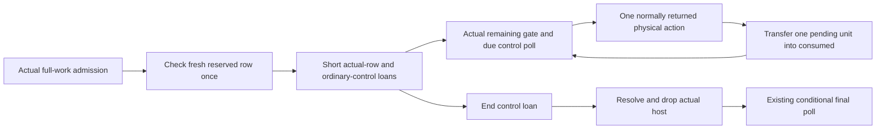

# Reserve Typed Materialization Once, Then Transfer Actual Units

Status: source `9744b35` and fresh final qualification complete, based on `7974435`
(runtime `247ff99`). Independent design, source and final QA reviews found no actionable
findings. The [six-case instruction checkpoint](../reviews/2026-11-06-typed-storage-reserved-row.md)
passes its predetermined predicate and independent evidence review; native time and
heap qualification remain pending. All preceding closed-text ordinary and heap
attempts are terminal; later disk cleanup and surviving GNU-original recovery are
recorded in the linked checkpoint. Their incomplete campaign brackets and remaining
threshold failures grant no measured keep or main merge. This plan supersedes the
earlier arbitrary-existing-frame/shared-projection proposal.

## Problem and alternatives

The typed-storage host reserves its complete materialization work before invoking its
factory. Each unit currently re-enters generic grouped completion, including lifecycle,
projection and effective-consumption checks. The only production interval here has
stronger invariants than that generic interface: pending consumption is already reserved,
and an exclusive loan prevents policy or competing work changes.

| Alternative | Consequence | Decision |
| --- | --- | --- |
| Check a reserved-row invariant once in the actual fresh typed host | Immediate actual counter transfers with entry-only budget/lifecycle checks; keeps the existing factory and cleanup owner. | Implemented; fresh QA and six-case instruction predicate passed; native/heap qualification pending. |
| Accept arbitrary existing Producer frames and project every unit | Preserves general post-tightening failure states, but creates an obligation absent from the sole typed caller. | Retain the existing general API for those callers; do not introduce another broad row API. |
| Add singleton specialization to the current grouped call | Smaller host edit, repeated lifecycle/position work and numeric projection remain. | Fallback if a real required interleaving invalidates the short-loan premise. |

The completed opportunity report locates 21,618 typed-storage completion edges and
1,880,766 Ir in the unchanged STL control. This is the addressed partition, not removable
cost or a predicted native gain. No new workload or benchmark boundary is needed.

## Entry invariant and interface

Keep `RetainedStorageWorkHost { parts, layout, frame }` as the outer physical owner.
At its sole fresh factory entry, bind/check ordinary Producer role, active nonfaulted
frame, catalog shape/position, open envelope and actual reserved numeric state. Let
`C = consumed`, `P = pending_consumed`, `R = this frame's remaining`, `A = attempted`
and `L = consumed_limit`. Require representable `E = C + P <= min(A, L)` and `P >= R`.
Use the existing numeric checks for this entry, preserving their error classification.

The short row contains references to the actual `WorkEntry` and `frame.remaining[0]`;
it stores no copied headroom, policy, counter, proof or completion receipt. Its enclosing
borrow excludes work/policy/channel changes and resolution until the loan ends. It has
no settlement Drop. This is a reserved-state interface for the actual typed host, not
a claim that every existing `WorkFrame` is in that state.

For `R > 0`, `P >= R` implies `P >= 1` and `C + 1 <= C + P <= u64::MAX`. Transferring
`(C, P, R)` to `(C + 1, P - 1, R - 1)` preserves E and `P >= R`. No per-unit limit,
pending-underflow or consumed-overflow projection is needed inside that closed interval.
The existing actual-remaining check before the callback remains the dynamic quantity
gate. Keep completion private to that checked call sequence; if the narrow module seam
needs a remaining check of its own, it may check the actual remainder without restoring
generic budget projection. Add no fast/slow mode, cached allowance or unsafe operation.

This proof does not apply to attempted-only text reads. General grouped completion and
its representable `CompletedWithLedgerFailure` prefix behavior remain unchanged.
Legal tightening before typed admission still rejects admission before the builder.
There is no legal work-view release/callback between successful typed admission and
loan construction in the current factory. A newly introduced interleaving must end the
loan and requalify its entry; it cannot silently reuse this contract.

## Control, failure and cleanup

Use the one-public-lifetime control shape from the completed design. Once per factory,
short-reborrow the actual `ExecutionOrdinaryStorage` fields by value beside the row.
This keeps `O` through real storage identity, with the original poll/failure/debt/state
references and existing PP/U; no dummy ownership marker or Core interface change.

Keep `run_unit` ordering: sticky failure, work present, actual remaining, due typed poll,
one callback, immediate actual transfer, then the original modulo-256 cadence update.
The typed poll remains its current `ordinary.poll.poll()` path; do not replace it with
generic action debt or another checkpoint. `run_string_unit` changes its independent
string remainder only after successful `run_unit`.

A normally returned domain/NonFinite result completes its unit before Core inspects it.
An escaping action panic completes no interrupted unit. Catching a panic inside caller
code retains today's state and subsequent-call behavior; no read-offset-derived flush.
Zero work retains no envelope/row and its existing entry/final checkpoints.

Retain the actual factory `catch_unwind`, sticky/returned Runtime/panic first-fault order,
incomplete counts/string checks and abandonment recording. Consuming control finish
ends only the short loan. The outer host then records the preserved fault, resolves,
takes/drops its owner, and explicitly drops the outer Option before the final lane poll.
The host remains armed through zero remainder, errors and unwinds; loans never settle it.
Keep prepared/output destruction containment and output-before-physical-before-logical
release, including nonclean fail-closed attribution. A loan-entry error must use the
existing prepared-value cleanup after settling the admitted host; a bare `?` is invalid.

## Scope, verification and decision

Production scope is the private numeric reserved-row primitive/reexports and
`concrete_store/activation/typed_storage.rs`. Delete the typed factory's `[1]` grouped
completion and its redundant hot checks. Retain the general grouped API and its tests.
Do not migrate other semantic/action/parse callers, reshape Core builders, alter finite
qualification, remove Scene validation or introduce a generic allocation/work framework.

Reuse actual typed-factory tests for extra/incomplete/string/zero work, normally returned
rejection, ignored error, forgotten borrow, cancellation at exact/next 256-unit frontiers,
factory/result destructor panic and physical/logical cleanup. Assert actual C/P/R after
partial/full completion and explicit suffix resolution. Add entry-invariant denial tests
at the new seam; do not require it to accept a tightened arbitrary frame. Keep the
existing general `CompletedWithLedgerFailure`/multirow tests as general-kernel oracles.

Independent design review must confirm the restricted entry and all legal typed outcomes
before code. Compile and qualify affected tests/lint/fmt serially with Rust 1.95.0 and
the existing target, then final workspace/consumer gates for a selected candidate.
Use the same six diagnostic cases with exact source/build identities: at least 1% lower
STL Ir, no case above +1%, identical observations/work and unchanged callback/poll counts.
Both ordinary platforms retain the original 14/110, three warmup pairs and twenty retained
AB/BA pairs, all signs/failures/load records and the parent's release targets. No timing,
heap, keep, main merge or release acceptance follows from this draft or entry proof.

## Implementation checkpoint

The initial five-file delta compiles all Operation targets/features with Rust 1.95.0.
The private kernel row borrows actual counters/remainder; its checked constructor
uses the existing effective-consumption helper and rejects invalid reserved entry.
A normally returned typed action directly transfers the reserved unit. The general
grouped completion kernel, parser checks and Core builder annotations are unchanged.
The outer host remains responsible for settlement after the consuming control ends.

Three kernel oracles cover actual partial/full prefixes alongside another pending
envelope, the u64::MAX admitted boundary, and rejection of a tightened existing frame
without counter completion. Existing typed tests retain real remainder-corruption
containment, cancellation, destruction and first-error behavior. Independent source
review found no actionable findings in the frozen five-file delta. Fresh integrated
qualification then completed; the exact results and limits are below. Performance
qualification remains separate.

The first Operation nextest attempt failed while compiling its test executable because
F: ran out of disk space; no tests executed. A guarded attempt to remove only the
incremental compiler cache was rejected by automatic approval policy; the agent deleted
no files. A temporary C: qualification attempt was interrupted. The user then cleaned
disk and requested repository-local builds; all subsequent builds use the existing
`F:/SourceCodes/Rust/baozi/target`, with one build job and one test thread.

Cleanup removed the former `target/review/convergence` receipts and performance trees.
Those prior raw files are not claimed available. Fresh final seven-gate qualification
is recorded outside compiler output at
`.git/baozi-review/performance-convergence/typed-reserved-row-qa-3/report.json`.
Its 972 tracked Rust/Cargo inputs include the same five reviewed source hashes and
the asset consumer. This source map differs in scope from the former 909-input map;
its count is not a claim of additional tests. No release benchmark flags or measurement
boundaries change as part of the disk recovery.

| Fresh serial qualification in the current repository target | Actual result |
| --- | --- |
| Workspace nextest, all features, one job/thread | 3,625 passed (one slow), six existing manual skips |
| Workspace doctests, all features, one job/thread | 190 passed |
| Workspace Clippy, all targets/features, `-D warnings` | Passed |
| Asset-consumer nextest, all features, one job/thread | 138 passed, one existing manual scale skip |
| Asset-consumer Clippy, all targets/features, `-D warnings` | Passed |
| Workspace and asset-consumer formatting | Both passed |

The receipt SHA-256 is
`0ccd70d42dcd1909103372e590001d9ac8ad1c5ba84862bee85a569b95e42f30`.
Independent review recomputes all seven log hashes, all 972 before/after/current input
hashes and all five frozen source hashes. It verifies the actual test totals, skips and
serial command intervals, and does not count the passing postprocess unwind test's
duplicated success tail twice. The intentional panic stderr is retained. The Rust
1.95.0, one-job/thread and target environment are recorded by the executor; logs are
not a complete process-environment attestation. Existing skipped fixtures, wasm and
other host execution are not newly qualified by this Windows run.

Source review is
`.git/baozi-review/performance-convergence/typed-storage-reserved-row-source-review-1.md`;
final QA review is `typed-reserved-row-final-qa-review-1.md` in the same directory.
Their GO supports this qualified source commit and diagnostic build. It grants neither
measured improvement, local-main integration nor release acceptance. The first GNU
diagnostic launcher fails before Cargo because its non-login PATH omits `rustc`; the
separate startup-failure receipt and first source archive remain. The second launcher
sets only its process PATH and keeps build output in the current repository target.

The completed diagnostic checkpoint retains every result: STL whole-worker Ir falls
13.009%; the other five fall 0.488-3.151%, with identical full nonclock observations
and reported work. All twelve raw profiles and their annotations, stdout/stderr,
immutable source/build identities and warnings are independently reviewed. Candidate
binary growth of 86,488 bytes is retained. This permits the next native qualification
step only; it is not ordinary time/memory acceptance or local-main disposition.
