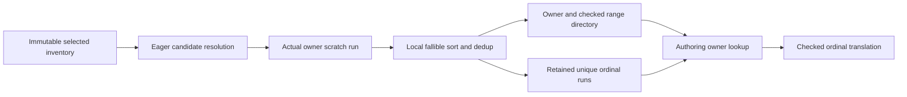

# Build glTF Source Relations Within Their Actual Owner

Status: independently reviewed GO for bounded implementation, with no required plan
corrections. The current measured runtime candidate is the separate OBJ token source
`7c1a7d9`. Its instruction and heap attempts are complete; ordinary qualification is
still open. Source implementation may proceed in a managed isolated worktree without
building or altering those fixed workers. Every build remains in the current main
repository target and is serialized with measurement. Release remains HOLD.

## Located cost and decision

The selected source profile owns an immutable inventory of selected declarations and
a many-to-many canonical-owner/source relation. Construction currently appends full
`(ProfileOwner, SourceEntityId)` rows, globally sorts/deduplicates them, searches that
relation for each owner, and searches the identity inventory again for each retained
link during authoring. Owner membership and later translation repeat the same identity
resolution across a closed immutable boundary.

The retained `9744b35` shared-32 diagnostic records 810 candidate rows, 714 unique
relations, 13,419 global-sort comparisons and 809 dedup comparisons. Whole-worker Ir
is 28,964,491. The 5,960,017 inclusive Ir attributed to `finish` overlaps its children;
it is a location, not removable cost or a predicted speedup. Shared-1/8/32 have
source-derived candidate/unique counts 35/32, 210/186 and 810/714.

| Alternative | Consequence | Decision |
| --- | --- | --- |
| Keep the global relation and existing searches | Known representation; retains the located sorting and translation work. | Keep until a replacement qualifies. |
| Buffer ordinal to last successful owner table | Deletes 96 duplicate Buffer insertions/lookups in shared-32; costs storage/initialization for every declared Buffer; global ordering and later searches remain. | Do not layer this table into the chosen replacement. |
| Complete each owner run and retain selected-entry ordinals | Local source ordering, one sorted owner directory, direct later translation; no declaration-sized marker table. | Proposed replacement, subject to review and measurement. |

Local evidence is in `.git/baozi-review/performance-convergence/`:
`gltf-repeated-normalization-owner-1.md` locates actual visits;
`gltf-source-profile-construction-design-1.md` evaluates representation and ownership.
Both are source/research reports, not compiled or measured acceptance.
The independent `gltf-owner-source-runs-plan-review-1.md` checks all nineteen owner
variants, the two suspended-owner phases, exact numbering/provenance and existing
fallible storage/work interfaces. It finds no actionable gap or blocker. Its GO
authorizes this source slice only, not runtime correctness, performance or main merge.

## Representation and interfaces

Keep `SelectedSourceProfile.entries`, its exact locators/extras, and selected inventory
admission unchanged. A private selected-entry ordinal identifies a position in this
one immutable inventory. It is distinct from a resource source, Buffer declaration,
accessor ID and canonical owner ID. Retain the ordinal returned by eager inventory
resolution; do not infer validity from input-array lengths or resource provenance.

Use one reusable metered scratch vector for ordinary owners. Explicitly close each
owner at its actual semantic boundary, locally order/deduplicate its candidate
ordinals, append its unique sequence to one retained ordinal vector, and append one
`(owner, start, length)` directory entry. Scratch capacity remains fully charged.
Sort only directory entries by owner at association end. Reject duplicate completed
owners and invalid ranges/ordinals; never repair them by silently merging owners.

Owner visitation is neither globally ordered nor universally contiguous. Node IDs
can follow DFS order. Primitive, Attribute and MorphDelta owners interleave. Default
Sampler contributions recur between Texture owners; AnimationClip contributions recur
between its channel owners. Use one additional reusable metered pending run for the
default Sampler during the texture phase, then the current clip during animation.
Those two suspended-owner phases do not overlap. Do not infer closure from an owner
change, add an arbitrary owner-to-vector map, or traverse clips/channels twice.

`for_owner` searches the directory and returns a sorted unique ordinal slice. The
authoring consumer translates it directly: Document remains source zero; another
selected ordinal i remains `resource_count + i - 1`, with checked arithmetic/u32
conversion. SyntheticRoot resolves its ordinal back to its original identity. Keep
the ID-based translation entry for extras and share its checked ordinal translation.
`link_count` means the actual unique retained relation count.

The production write set is `parser/source_profile.rs` and the relation consumers in
`parser/normalized.rs` within `baozi-format-gltf`. Replace their private link/finish
interfaces and representation-specific fixtures. No public API, Core interface,
decoder/payload ownership, dependency or generic graph/cache framework is required.
Retire the global full-row relation sort/dedup and repeated authoring identity search;
do not retain a second production implementation or compatibility mode.

## Semantics, work and failure ownership

Raw source preflight, selected-inventory admission and candidate membership resolution
serve different phases. Preserve membership resolution on every candidate at its
current visit, before later accessor/view dereferences. The new ordinal is the actual
resolution result. Missing selected identity/view failures must still be observable;
sorting raw IDs first and resolving only unique candidates is outside this cut.

Preserve every cross-owner association, selected declaration identity/range/GLB base,
resource-source ordering, extras bytes and generated evidence. Different embedded
Buffer declarations may share resource source zero and still require distinct source
identities. A clip's declaration associations currently include sampler input chains;
its resource provenance also includes retained output resources. Preserve both exact
contracts, scope-omitted duration contributors and source channel indexing.

All logical geometry/attribute/topology/influence/skin/morph/animation quotas stay.
Remove physical work only for searches, comparisons and visits that disappear. Keep
the documented bound charging for surviving binary searches. Meter new ordinal
transfers, descriptor creation/validation, local/directory comparisons and retrieval.
Use existing `ProfileComparisonWork`: reject before the next comparison, complete
only its normal return, poll within 64 comparisons and at short/empty scope edges.
Transfer and singleton/duplicate-heavy paths also need bounded control and a final
association check. No deferred completed counters or speculative completion credit.

Earlier local sorting and different storage can move cancellation/allocation/work
failure frontiers. Preserve the actual completed prefix, sticky first cause and
cleanup, rather than an old global-sort count or allocation-dependent poll ordinal.
An incomplete run/directory never authorizes successful normalization/publication.

## Scope, scaling and qualification

For candidate count L, unique relations U and owners N, ordering changes from a global
`O(L log(L+1))` to `O(sum l_o log(l_o+1))` plus `O(N log(N+1))`. Eager inventory
resolution stays; retained relation translation becomes O(U). Memory adds one owner
range per owner and two fully charged scratch capacities while narrowing retained
relation rows. No fixed byte/peak reduction is assumed. One huge owner or many
singleton owners can regress and must be evaluated.

1. Freeze independent expected relation/source-order fixtures from current behavior.
   Preserve shared-1/8/32 unique counts 32/186/714 and complete ordered provenance,
   with unchanged draws, attributes, placements, raw ranges and evidence.
2. Cover the actual suspended owners and identity counterexamples: implicit samplers
   across textures, multiple clips/channels and scope omissions, non-source-order
   node IDs, skin skeleton also a joint, sparse views in one/three Buffers, repeated
   accessors and distinct equal-byte Buffer declarations. Reuse existing fixtures
   and add only missing semantic boundaries.
3. Keep missing-inventory/owner rejection, comparison denial/unwind/poll and extras
   lifetime oracles. Add actual duplicate-owner/range rejection and cancellation
   during local ordering/transfer; verify completed work and released reservations.
4. Independently review the replacement, simplify it, and run affected tests/lint/fmt
   serially in the current repository target. A selected source needs all seven
   workspace/consumer gates; use Rust 1.95.0, jobs1 and nextest threads1.
5. Run the same six original instruction tasks against exact `7c1a7d9` source-bound
   control: shared-32 Ir at least 1% lower, no case above +1%. Require identical full
   nonclock observations except documented physical `import_work` changes. Inspect
   many-singleton and large-owner admitted capacities through bounded fixtures and
   separate heap observations; no synthetic result replaces an original lane.
6. Preserve the parent's Windows/GNU 14-case/110-lane ordinary protocol, three warmup
   and twenty retained AB/BA pairs, all load/failure/missing results and original
   release targets. Diagnostic/source success grants no main merge or release.

Shared accessor payload reuse remains a separate, wider ownership proposal. Do not
add it, a JSON-parser rewrite, a comparison execution redesign or the Buffer marker
table to this candidate. Refresh actual attribution after this representation has
been qualified and measured before selecting the next owner.

## Source implementation checkpoint

The managed source-only worktree implements the four-file replacement on `7c1a7d9`.
All nineteen owner boundaries are explicit; the two metered reusable scratch vectors,
retained ordinal runs and sorted owner directory replace the full-row relation.
The authoring consumers translate retained ordinals and recover SyntheticRoot identity
directly. Core and the general ledger are unchanged. No worker build or target exists.

Frozen source 1 is recorded in
`.git/baozi-review/performance-convergence/gltf-owner-source-runs-source-1.json`.
Independent production review verifies all four worktree/frozen hashes and finds no
actionable defect; its GO permits serial compiler/runtime qualification only. The
test review accepts the independent shared relation/provenance, suspended-owner and
failure-prefix oracles, and identifies two bounded gaps: sparse Buffer declaration
identity and rejection between ordinal/output and directory reservations. A test-only
follow-up adds source assertions for both cases using existing probes, including the
actual published sparse-source translation and a real charged-capacity calibration
for directory denial. Independent oracle review closes both at the source level.
One test in the existing public Skin integration file then checks the complete ordered
source/resource sequence for joints `[1, 3]` and `[3, 1]`, with skeleton 1 also a joint.
It reuses the fixture directly; no helper module wiring or new framework is added.
The selected source cut consequently includes that fifth test file. Independent Skin
review confirms the literal expected relation but finds one stable-compilation defect:
the public locator value is already `&str` and must use `starts_with` directly.

Both fixed ordinary platform attempts end before integration into the current F:
checkout on `optimize/gltf-owner-source-runs`. Formatting changes only the five selected
files; all 967 other recorded Rust/Cargo inputs remain unchanged. Subsequent source
freezes retain the exact corrections and every original failure:

| Attempt | Actual result and correction |
| --- | --- |
| Focused 1, selected source 2 | Test compilation fails on Skin's unstable `str::as_str`; zero tests run. Correct the assertion to `value.starts_with(identity)`. |
| Focused 2, selected source 3 | 536 tests run: 533 pass, three test-lifecycle failures. Negative fixtures catch a terminal child error and wrongly resume ordinary work in the same invocation. |
| Targeted failed cases, selected source 4 | All three pass after giving each terminal rejection a fresh import and returning the original error. Overflow rejection moves out of the successful inventory/publication fixture into independent negative cases. |
| Focused 3, selected source 4 | All 536 affected runtime tests pass (two slow, zero skips); strict Clippy then rejects three test-only `.err().expect()` expressions. |
| Selected source 5 | Replace those three expressions with `expect_err`; all seven final gates pass. Production source is unchanged by every runtime/lint correction. |

The independent lifecycle-test review verifies that every original invalid range,
unfinished/duplicate owner, ordinal and index-overflow obligation is preserved by a
real first-error witness. Each corrected failure returns its original content error
after pure state assertions, without reopening a stopped parser. The existing runner
checks zero live bytes/reservations and no publication. The shared successful inventory
fixture now completes publication rather than continuing after deliberate rejection.
This review is bounded to source 3-to-4 tests, not a new production or performance audit.

Current source authority is
`.git/baozi-review/performance-convergence/gltf-owner-source-runs-source-5.json`;
final qualification is `gltf-owner-source-runs-final-qa-1/report.json` in the same
directory. Earlier compile, runtime and lint receipts remain. All builds use the
existing `F:/SourceCodes/Rust/baozi/target`, Rust 1.95.0, jobs1 and nextest threads1.
The final receipt binds 972 stable before/after/current Rust/Cargo inputs, including
the same five frozen source hashes. Its SHA-256 is
`2ba3c6e4c6252fa3531283c4d571643350b1533953c72ec8e3d960d4c0e53589`.

| Final selected-source serial gate | Actual result |
| --- | --- |
| Workspace nextest, all features | 3,637 passed (two slow); six existing manual skips |
| Workspace doctests | 190 passed |
| Workspace Clippy, all targets/features, `-D warnings` | Passed |
| Asset-consumer nextest | 138 passed; one existing manual scale skip |
| Asset-consumer strict Clippy | Passed |
| Workspace and consumer formatting | Both passed |

The full workspace run includes the sparse identity, partial reservation, fresh
terminal-error, and public Skin-order/source-provenance oracles. The existing passing
postprocess unwind test retains intentional panic stderr. This is Windows-host source
qualification, not every feature combination, skipped manual fixture or wasm/new-host
execution. Independent final receipt/source-association review verifies every gate,
hash and named test closure with no actionable finding. It reuses the source1
production proof and bounds all later changes to formatting or reviewed tests.
No performance, main integration or release approval follows from these passes.
The original convergence goal remains active and release HOLD.

The [separate diagnostic checkpoint](../reviews/2026-11-06-gltf-owner-source-runs.md)
records source `6e7c1c0`: shared-32 whole-worker Ir falls 11.589768%, shared-1 rises
0.675913%, and the other four original cases are flat/lower. Physical import work
changes from 12,195/84,932 to 11,911/70,332 only for glTF. Complete remaining nonclock
output agrees. The prospective diagnostic predicate and independent instruction
audit pass. Eighteen independently audited separate heap observations retain glTF allocation-call
increases of five/ten and lower displayed rounded peaks; all four other tasks are
unchanged. Temporary-count disagreements, exit-live labels, unfavorable Assimp heap
ratios and reused-sanity provenance limits remain explicit. The diagnostic binary grows
477,080 bytes. Both new ordinary candidate workers are built and bound to final QA;
the Windows sampling envelope has started with the corrected first-clear guard.
Native time/process memory, ordinary acceptance and local-main disposition remain open.
