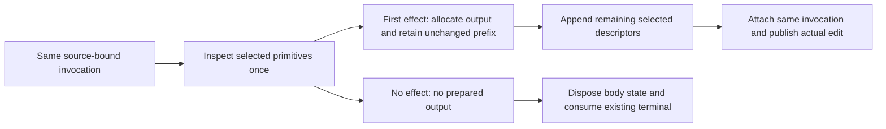

# Let Preparation Consume Its Producer Result

Status: independently reviewed GO for a bounded first slice of the existing small-task
lifecycle work. Fixed `6e7c1c0` native attempts are now terminal. The independent
`prepare-consuming-result-plan-review-1.md` accepts this cut with the concrete control,
failure and test obligations below. Source/compiler review and measurement remain
required. This does not complete finite invocation backing, allocation-free unchanged
preparation, native convergence or release qualification.

## Located ownership and selected cut

The current preparation producer owns selected primitive readers and already decides
whether each target requires an effect. It nevertheless allocates a prepared-output
scratch vector, writes unchanged descriptors for every no-effect target, and returns
them to a second action region that asks whether any descriptor changed. Empty input
also constructs an empty scratch owner. All-unchanged output is then discarded.

The existing `prepare-small-task-owner-opportunity-1.md` research under
`.git/baozi-review/performance-convergence/` locates these owners in actual source and
two already collected instruction profiles. Output construction/destruction plus the
second region account for 4,789/4,715 inclusive Ir in glTF-1/STL-1024. Those contexts
overlap necessary accounting and are neither removable totals nor predicted savings.
The larger planning/binding context is approximately 42% of preparation Ir in those
two profiles. Finite invocation/backing/terminal ownership remains the next substantial
design question, with its own concrete interface review.

Choose a producer-owned result as the first deletion within that trajectory. It
removes a genuine escaping scratch owner before the later finite-state work; it is
not an option-based early return or a substitute for that larger change.

| Alternative | Consequence | Disposition |
| --- | --- | --- |
| Keep unconditional output and rescan it | Retains a redundant owner and consumer decision. | Retire when the replacement qualifies. |
| Return a boolean beside the existing output | Deletes the rescan but keeps unchanged scratch and dummy writes. | Reject as an incomplete ownership cut. |
| Return unchanged or an owned prepared selection | Produces the authoritative result once and materializes output only when needed. | Selected bounded implementation. |
| Replace startup backing simultaneously | Addresses a larger cost but couples constructor, promotion and terminal types to this simple producer change. | Design separately; no new backend in this slice. |

## Private interface and ownership

`prepare/input.rs::prepare` returns a private result with two variants:
`Unchanged` and `Prepared(ScratchVec<PreparedPrimitive>)`. A separate validity token,
public API, cache, generic storage abstraction or alternate operation owner is not
needed. The current source-bound invocation, sorted target scratch and selected
borrowed-reader scratch remain authoritative.

Preserve current handle resolution, source-order traversal, duplicate rejection,
topology, field-effect and requested-policy inspection. Empty targets can return
`Unchanged` inside the existing action region. Nonempty no-effect targets retain all
their existing semantic inspection. They write an unchanged descriptor only if a
prepared selection already exists.

On the first actual prepared effect, allocate the one real output vector using the
existing metered scratch owner. Populate earlier unchanged targets from the already
selected reader prefix, then append the prepared target. Do not rerun selection,
topology/policy validation or generation. Charge the actual prefix identifier reads
and descriptor writes before executing them. Each later target appends exactly once.
The output retains source-selection order and every unchanged selected target needed
for changed-result evidence. Partial output and generated payload retain their normal
RAII owners if a later admission, allocation, generation or control check fails.

The caller consumes the result directly. `Unchanged` requests the existing unattached
terminal; `Prepared` uses the same consuming attachment, edit and publication path.
Delete the second descriptor scan, its action region and `PreparedPrimitive::changed`
if no remaining consumer needs it. Keep `PreparedPrimitive::unchanged` for mixed
selections. Do not move `SceneEditBootstrap::try_new` or reconstruct runtime state.

## Work, control and failure contract

The first action region already admits every surviving action, settles its actual
returned prefix, checks quiescence and polls control on successful exit
(`StoreActionExecution::finish`). Verify this real exit is the successful-preparation
checkpoint before consuming the producer result. The existing clean-success final
gate remains after body captures/scratch cleanup, with its current account readiness,
sticky-failure and containment precedence. Known-error cleanup must not acquire a new
control callback. Removing an obsolete decision region must preserve these semantic
boundaries; it does not require dummy work or recreating that region merely to preserve
historical poll ordinals. Add no new operation interface unless source review identifies
an actual missing boundary.

Resource/work denials continue to stop before the denied action. Surviving scratch
capacity, pending generated data, completed prefix, sticky first cause, containment
and final-control precedence belong to the same original owner. Removed allocation,
descriptor writes and comparisons lose their physical charges. Allocation and budget
failure frontiers can therefore change; exact old work totals are not a compatibility
requirement. Semantic rejection order among surviving checks remains: requested
handles resolve before duplicate rejection, then selected topology/effect policies.

Preserve empty unsupported topology rejection before zero-face no-effect handling,
conditional tangent/UV/morph/orientation validation, foreign/stale/range handles,
and original entire-Scene ownership on failure. A mixed changed selection keeps
unchanged targets with the final generation and absent generated-field/origin facts.
No successful partial subset or fabricated empty resource report is allowed.

## Write scope and verification

Production scope is `baozi-postprocess/src/prepare/input.rs` and its consuming block
in `prepare.rs`. Tests use existing `tests/selected_geometry.rs` and the preparation
cleanup/cancellation modules where an actual new boundary needs an oracle. No Core,
operation numeric kernel, normal/tangent kernel, comparator or dependency change is
selected. All builds use the current `F:/SourceCodes/Rust/baozi/target`, Rust 1.95.0,
one Cargo job and one nextest thread.

Review and execute existing oracles first; add only missing cases:

1. Empty and all-unchanged selection retain generation, payload and import evidence,
   with no canonical publication and zero terminal live scratch/reservations. Real
   nonempty inspection still records work.
2. Duplicate/foreign/stale targets and Preserve topology failures remain errors even
   for otherwise no-effect requests. Preserve unused policy dependencies rather
   than tightening validation for effects that never run.
3. An unchanged prefix before the first changed target, and an unchanged suffix,
   remain in the complete final selection evidence with the new generation and
   correct absence of generated metadata. Assert complete source-selection order
   with a differently ordered request. Include zero-face mixed input if the existing
   fixture permits it without a new fixture framework; separately require supported
   zero-face unchanged and unsupported/Preserve-before-zero-face rejection.
4. Real output admission denial or later failure disposes generated payload and
   partial prefix, returns the original whole Scene and retains truthful completed
   work/cause. Identify the pending first effect and actual output/backfill frontier
   so denial cannot accidentally occur in startup or publication. Cover a nonempty
   initialized prefix and assert the denied physical action did not execute. Reuse
   existing owner/fault seams and narrow test-only observations; no mirrored ledger
   test harness, generic fault framework or claimed allocator-fault injection.
5. Pre-cancelled empty/unchanged calls, successful-preparation cancellation and the
   final gate after cleanup remain observable. Arm at the real producer-return
   boundary for both result variants and at actual final cleanup/progress for an
   unattached call. Assert exact Control versus FinalControl projection, ownership
   after source/host disposal and cleanup order, not an obsolete callback count.

Keep the existing report projection's `changed()` method: only the private prepared
descriptor predicate and its sole consumer are retired. The review's four focused
oracle groups refine these existing obligations; they do not expand the production
scope into another runtime or numerical kernel.

After source simplification and independent review, run affected postprocess tests,
strict Clippy/fmt, then the seven integrated workspace/asset-consumer gates for the
selected source. Freeze source identities and retain every failed attempt. Diagnose
the same six original whole-worker instruction tasks against exact `6e7c1c0` control,
keeping complete nonclock observations equal except the documented physical work
changes. Preparation contexts must lose the retired owner/scan without an unexplained
whole-worker regression above 1%; report small absolute changes honestly rather than
require a whole-worker gain that these contexts cannot support.

The original Windows/GNU 14-case/110-lane protocol, three warmup/twenty retained AB/BA
pairs, all failures/load/missing campaigns and memory boundaries remain unchanged.
Source/diagnostic success does not authorize a native performance keep, local-main
runtime merge or release. The parent goal remains active and release HOLD.

## Source and correctness checkpoint

The four-file source 1 implements the selected two production-owner changes plus
oracles in the existing public selection and private cleanup tests. Independent
production and source-oracle reviews close with no required correction. The original
region-exit/final-control boundaries, mixed prefix/suffix, actual storage denial,
partial backfill denial and original whole-Scene ownership are checked without a new
operation API. The facade does not expose frozen terminal class/code or failure-time
pending; no test claim extends to those unavailable observations.

The first focused attempt passes 303 tests, strict Clippy and fmt. All seven fresh
integrated gates pass: 3,643 workspace tests, 190 doctests, 138 consumer tests, both
strict lint gates and both formatting gates, with 972 stable inputs. Existing skipped
manual cases and passing unwind panic stderr remain. Final receipt association is
independently closed. Source `e8c4802` builds its GNU diagnostic worker directly from
the current F repository, preserving all 972 qualified inputs and matching the exact
`6e7c1c0` control's recorded compiler/arguments/selected overrides.
The [checkpoint](../reviews/2026-11-06-preparation-producer-result.md) records six
independently audited instruction tasks: four whole-worker decreases, two small OBJ
increases, identical full nonclock output including work, and actual glTF-1/STL-1024
preparation-entry Ir decreases of 12.241491%/12.188790%. All eighteen separately audited
heap workers retain five one-call reductions, unchanged repeated OBJ, unchanged rounded
peaks, temporary-count/exit-live limitations and reused-sanity provenance gaps. Both
ordinary debug0 candidates are built and source-associated; original native qualification
remains open. No main runtime merge or release acceptance follows. The separately reviewed
[owned finite invocation plan](2026-11-06-1240-owned-finite-invocation-plan.md) covers
the larger fixed startup/terminal owner; its implementation is not part of this slice.
