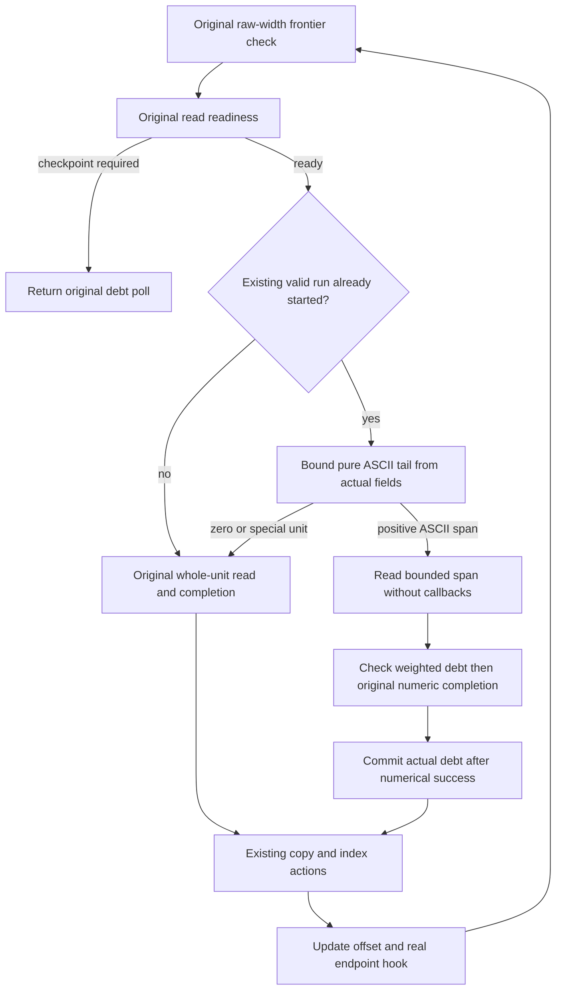

# Coalesce bounded ASCII emission spans under the original read row

Status: independent full-plan review closes GO for readiness to implement.
The two bounded premise audits resolve numerical, weighted-debt and existing
fixture counterexamples at source/design level. Source, compiled-test and
performance qualification remain ungranted.
Start at `2dc1f9e`, whose 1,059 build inputs exactly equal qualified `0452a73`.
The [single-piece host experiment](../reviews/2026-11-09-single-piece-parser.md)
is retired; it is not a dependency or a route to preserve for this design.
The [original convergence goal](2026-11-03-0900-perf-assimp-convergence-plan.md)
and every release/main gate remain active.

## Located work and bounded hypothesis

`build_text_input` already navigates immutable input accepted by the private
planning pass. It still classifies each ordinary ASCII byte, completes its
actual numerical row, and charges one control unit before eventually copying
valid runs. Investigate coalescing only those pure one-byte emission reads.
Keep the first planning/policy/quota/count pass and the second physical pass.

The fresh qualified `0452a73` GNU symbol image has SHA-256
`959f95f5f5fbe6b8fe5c43ee061cdc5d9e8a5b59f8040f91a3aa9aa46c6d35bf`.
Its original repeated/grid OBJ profiles have 711,709,601 / 2,107,466,996
whole-worker Ir. Disjoint Self rows whose displayed function contains
`::with_read_row` total 27,827,885 / 379,281,127 Ir (3.9100% / 17.9970%).
All 10,302 / 8,747 annotation rows sum exactly to their raw totals.
This group includes planning and emission and is not an isolated emission
cost, a removable saving or native CPU share. Local locating evidence is
`ascii-emission-span-locating-1.json`; no new worker is run for that grouping.
The candidate must earn its own measured result.

## Alternatives and selected seam

| Alternative | Benefit / cost | Decision |
| --- | --- | --- |
| Keep bytewise emission | Simplest unchanged code; repeats classification and accounting for every ASCII byte. | Qualified fallback and comparison control. |
| Cache success capacity but keep bytewise reads | Hoists some arithmetic but adds per-unit state; the earlier measured allowance failed selection. | Do not revive it. |
| Borrow conforming text or replace both passes | Could remove copying or more scanning; expands representation, admission and policy lifetime changes beyond this located seam. | Separate later investigation. |
| Extend started valid runs with bounded ASCII spans | Amortizes actual read/completion work while retaining original rows, second pass and all output boundaries. | Selected design for review. |

Use one uncached scalar query beside kernel `ParserReadRow::complete`.
For actual consumed C, pending P, attempted A, consumed limit L and frame
remainder R, a failed checked `C+P` or subtraction yields zero; otherwise:

```text
h = min(maximum, R, A - (C+P), L - (C+P))
```

It neither reports an error nor changes state. For positive `k <= h`, the
original numerical checker must succeed; its actual row/remainder remain the
only authority. Recompute per span, retain no allowance, snapshot or proof
object, and still invoke the original checker after the physical read.
Zero headroom uses the original whole-unit reader and completion, preserving
its first failed unit, exact error values and precedence.

Forward the query through existing Store/Import read-row adapters. Cap it by
applicable actual direct-debt headroom and an algorithmic maximum of 256
one-byte units. Registry mode has no direct debt: it must not gain debt polls.
Keep control constants/calculation at their existing owner rather than copy
another scheduling policy into Import.

## Physical flow and completion ownership



Anchor each existing valid output run with the original whole unit whenever
`offset == valid_run_start`. Only extend an already-started run. Use this
existing cursor, not a new flag, probe-specific offset or test-only algorithm.
Do not reset it at raw/debt handback. An old multibyte overfull-copy preflush
already starts its new run with that scalar unit.

An ASCII span stops before CR, LF or a non-ASCII byte. Bound its length by
input remainder, numerical success headroom, applicable debt headroom,
original raw frontier and current valid-run copy threshold. Use safe bounded
standard-library slice scanning initially, with no dependency, unsafe SIMD,
allocation or claim about vectorization. Do not inspect an unbounded suffix.

The existing scalar `complete_read(amount)` charges one physical unit even
when its raw width is two or four, or its amount is zero. Keep that contract.
Add one internal completion for positive unit-width reads, for example
`complete_read_units(NonZeroU64)`: amount and literal completed-unit cost are
both k. Keep ASCII naming in Import. Share the existing stopped guard,
checked-debt, numerical-completion and cold-failure sequence rather than
copying another accounting algorithm. Check weighted debt before row mutation,
invoke `row.complete(k)`, and write actual debt only after numeric success.

Original raw-before-debt ordering remains. A ready row with zero numerical
headroom takes scalar fallback; a debt-blocked row must first return its
original checkpoint. No callback or fallible output action intervenes between
the positive bound, pure span read and immediate numerical/debt commit.
Do not poll eagerly when a span reaches debt256. Keep original copy/index
actions, offset update and one hook at the actual completed endpoint before
the existing raw-exit/next-read logic. EOF below a raw frontier still appends
the final run before child return, without a synthetic final debt poll.

Keep `TextEmission::read` for all special units and unchanged BOM revalidation.
CRLF or a four-byte unit beginning at 4095 still polls at 4095 before that
whole unit; a debt poll does not advance the raw frontier. Preserve every
copy at its original 4096/newline/replacement/end boundary, newline copy
before line-start push, and replacement copy/index ordering. Do not copy at
shorter span or debt boundaries. Planning and emission still charge literal
raw lengths, preserving successful `DecodeWork = 2N + Q` and failure prefixes.

## Required checks and risks

| Risk | Required evidence / mitigation |
| --- | --- |
| A mid-span numerical denial loses an earlier prefix | Actual-row bound tests cover pending competition, independent attempted/consumed/frame ceilings, invalid state and overflow; zero falls back to original scalar error. Keep original direct multi-unit atomic semantics unchanged. |
| Span charges only one action | Exercise a real two-byte span at debt254, then checkpoint before a third byte. A production trace starts a fresh run at253, scalar anchor to254, span2 to256. Keep original255 tests as well. |
| Registry receives extra control work | Existing no-direct-debt registry oracle and a bulk-path witness retain its unchanged debt and raw polls. |
| Coalescing skips existing cancellation/panic endpoints | Keep original assertions. Real initial anchor reaches1; ASCII extension stops at the actual four-byte UTF-8 fixture at4095. The `a\nb\n` panic still follows real completion/copy/index at2 with `(attempted,consumed)=(8,6)`. No fictitious interior hooks. |
| Output copy fails at a different raw prefix | Keep original shortened-capacity assertions and add a bulk-path failure crossing a real copy boundary; compare actual ledger/text/index prefix, not just final equality. |
| Special units or raw/debt frontiers are split | Cover CRLF/UTF-8/replacement/BOM and mixed ASCII with exact positions, real checkpoints and existing first-cause/unwind/later-reuse assertions. |

Keep all original tests/assertions. Existing short fixtures exercise scalar
actions under this design; they do not establish the new bulk path. Add only
focused real bulk oracles and reuse existing fixtures. The general callable
read-row body and its interrupted-second-read unwind contract stay unchanged.

Initial write scope: kernel `ledger/work/kernel.rs`, Operation's existing
exclusive read-row adapter and focused tests, Import's existing read-row
projection and `text_input.rs` plus focused tests. A central debt-headroom
helper may be added beside existing debt arithmetic if needed; no new owner,
provider, public text representation or broad parser interface is introduced.
Separate implementation writers must have disjoint file sets. Independent
source/test review follows the reviewed plan before source retention.

Qualify affected Operation/Import/OBJ tests, strict all-target/all-feature
Clippy and existing borrowing doctests, then all original seven workspace /
public-consumer gates. Rust1.95, jobs1, nextest threads1 and the current
repository/existing target remain. Delete a superseded path only when the
replacement qualifies; do not accumulate another general fallback algorithm.

## Prospective measured decision

Use exact committed/QA/archive-bound GNU opt3/debug1/System workers. The
qualified immutable control image may be reused after identity/configuration
revalidation; run fresh control and candidate processes for every profile.
Inspect actual generated emission work to show positive spans use one real
numerical completion with correct weighted debt, not a relocated bytewise
accounting loop. Source shape alone is insufficient.

Use the original seven pipeline/memory diagnostic tasks, including STL1.
Require all seven complete literal non-clock pairs equal, at least one
original OBJ with `100*N <= 99*B`, and all seven with `100*N <= 101*B`.
Keep every sign, warning, failed/missing row and original scalar failure.
Do not change this predicate after observing results. Rejection retires the
unhelpful candidate while retaining its actual evidence.

A selected diagnostic candidate still needs original Windows/GNU fourteen
cases/110 lanes, 3 warmup pairs and 20 retained fresh serial AB/BA pairs in
C0/N0/N1/C1, comparable whole-child memory and separate representative heap.
No own build/profiler overlaps ordinary clocks. Preserve quiet/load records,
missing campaigns and regressions. Original pipeline/endpoint/memory targets
and independent source/evidence reviews remain; a partial improvement is not
release convergence. No push, PR, publication/yank, native promotion, cargo
clean or premature local-main runtime integration is authorized here.
