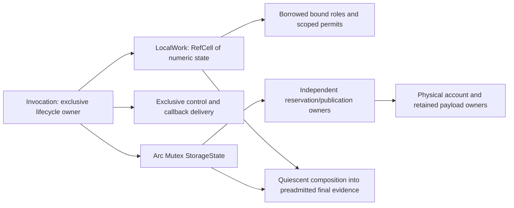

# Operation Work and Storage Ownership Design

Status: independently reviewed P1 ownership design, ready for implementation; no production replacement is claimed.
Date: 2026-11-02. Production control: `4455d03db190c6bef05ff5a1de024d2aac461465`.

This is the concrete ownership half of the
[operation architecture continuation](../plans/2026-11-02-1700-perf-import-operation-architecture-plan.md),
paired with the [reviewed bounded control contract](2026-11-02-bounded-operation-control-design.md).
The [cost diagnosis](2026-11-02-parser-operation-cost-diagnosis.md) supplies measured motivation.
Rust type sketches below describe responsibilities and lifetimes; they have not been compiled
as the replacement engine. Actual code, behavioral tests and native measurements remain required.
ADRs 0033 and 0047 retain current authority until an implementation amendment lands.

## Chosen representation

Choose **one invocation-owned `LocalWork` with short `RefCell` borrows, plus independently
shared storage**. This is accounting audit Alternative B. Do not give each helper an
exclusive `&mut WorkState` for its entire call. A permit borrows `LocalWork`, not a `RefMut`;
it can coexist with other internal permits and a controlled builder. The operation remains
movable when idle; work capabilities cannot be sent to another thread.

All attempted/consumed/pending arithmetic uses one numeric kernel and one local state.
Storage contains no work counters or copies of mutable work policy. This removes shared
work locks, permit Arc clones, catalog searches, and group sorting from bound pure actions.
It does not remove real storage/account locks or the need to meter binding/evidence memory.
There is no Local/Shared/Noop backend enum, policy framework, or dual recording route.



The `RefCell` is a borrowing mechanism inside the sole owner, not shared ownership. No `Rc`
or Arc points to work state. Its guards never escape numeric methods. No allocator, user
comparison, callback, observer, cancellation signal, panic-payload drop, or payload destructor
runs with a work guard or storage/account mutex guard held. Holding an unrelated exclusive
`&mut ControlOwner` during its callback is allowed; it grants no borrow of work or storage.

## Minimum type and method contracts

Names below are proposals, not an interface expansion requirement. Omitted vocabulary and
error parameters reuse the operation's existing typed equivalents. All fields are private.
The catalog and numeric row arrays have the same dense dimension positions, including mixed
dimensions. The catalog stores immutable identity/shape metadata, not mutable limits.

```rust
struct Invocation<P, D> {
    catalog: FrozenCatalog<P, D>,
    work: LocalWork,
    storage: SharedStorage<P, D>,
    control: ControlOwner,
    terminal: TerminalAssets, // preadmitted fallback, evidence backing, protected grant
}

struct LocalWork {
    state: RefCell<WorkState>,
    failure: Cell<Option<FailureCode>>, // one final-cause selector; Requested is provisional
    borrow_fault: Cell<bool>,          // persistent fail-closed latch, including Drop failure
}

struct WorkState {
    rows: Vec<WorkRow>, // allocated/metered at preparation, never grown by an action
    mode: WorkMode,     // Ordinary, OrdinarySealed, Protected, Closed
    open_envelopes: u64,
    parser_parent_open: bool,
    parser_child_open: bool,
    producer_open: bool,
    protected_open: bool,
    integrity_fault: bool,
}

struct WorkRow {
    attempted: u64,
    consumed: u64,
    pending_consumed: u64,
    policy: WorkPolicy, // attempted_limit, consumed_limit
}

struct SharedStorage<P, D> {
    state: Arc<Mutex<StorageState<P, D>>>,
}

struct BoundGroup<'op, const N: usize> {
    owner: &'op LocalWork,
    layout: GroupLayout<N>, // positions, duplicate representatives, fixed permutations
}

struct ObservedPermit<'op, const N: usize> {
    group: BoundGroup<'op, N>,
    remaining: [u64; N],
    resolved: bool,
    // Private lane identity: ordinary producer, internal share, or protected terminal.
}

enum Completion {
    Applied,
    AppliedWithFailure(WorkCause),
    NotApplied(WorkCause),
}

impl<'op, const N: usize> BoundGroup<'op, N> {
    fn admit_observed(&self, amounts: [u64; N])
        -> Result<ObservedPermit<'op, N>, WorkCause>;
    fn charge_attempted_in_order(&self, amounts: [u64; N]) -> Result<(), WorkCause>;
    fn consume_direct_atomic(&self, amounts: [u64; N]) -> Result<(), WorkCause>;
}

impl<const N: usize> ObservedPermit<'_, N> {
    fn complete(&mut self, amounts: [u64; N]) -> Completion;
    fn finish(self) -> Result<(), WorkCause>;
    fn finish_partial(self);
}
```

`StorageState` owns the storage columns and policies listed in the ownership table, storage
lifecycle, reservation counts, and evidence-budget scalars. `ControlOwner` owns mutable
observer/cancellation delivery and its sticky control detail. It forwards accepted failures
to `LocalWork.failure` outside callback execution; it does not independently choose the
operation's final cause. Independent physical poison/fault anchors remain in the physical
account; finalization reconciles those anchors with the selected operation cause.

Additional seams, without defining every public interface:

- `Invocation::bind_group(&self, checked_keys) -> BoundGroup<'_, N>` validates exact
  catalog/domain membership, planned inclusion, and role eligibility, including zero-valued
  entries. It computes duplicate/permutation layout once. Ordinary binding cannot select
  the protected terminal role. Binding errors latch the appropriate failure before work.
- `BoundGroup` is the operation-bound capability: it carries the actual owner's reference,
  not just `PhantomData<O>`, a domain ID, or an index. Its methods have **no other owner
  argument**. There is no `other_work.apply(group)` API. A persistent format plan stores
  immutable semantic roles, and each invocation binds them to its own rows.
- A group does not cache policy, availability, or `open = true`. Each numeric call reads its
  owner's current mode, policy, and pending totals. Per-action arrays are fixed size;
  duplicate amounts use precomputed representatives, not another key search/sort.
- `Invocation::with_active(&mut self, callback)` lends disjoint work/storage/control views
  for one synchronous invocation, with a higher-ranked callback borrow. No parser work
  capability or controlled builder result may retain that borrow. Typed stored payloads
  remain `Send + Sync + 'static` as required today. This seam replaces whole-session
  `try_outcome_owner()` acquisition for ordinary accounting/control/storage calls.
  Bind groups through these split active views, not by keeping a whole-invocation shared
  borrow and then requesting a conflicting mutable borrow. The real callers must compile
  this lending boundary before migrating their algorithm loops.
- `ControlledBuilder<'a>` contains an ordinary `BoundGroup<'a, 1>`, scratch storage view,
  and a short exclusive reborrow of the enclosing control cursor. Change the retained
  helper to receive the cursor and a closure accepting this builder capability as an
  argument; do not capture the cursor in the closure before entering the helper. The
  helper can poll before allocation and then lend control at actual callback entry.
  Its internal-share group references the **same** `LocalWork`. Neither holds a `RefMut`.
- Combined `tighten_dimension_policy` and scalar/full observations are owner methods over
  disjoint work/storage views. No independently owned reservation can tighten work policy.
- `seal_ordinary(self)` returns an ownership transition result that retains all state on
  failure; `activate_protected(&mut sealed)` lends the private finite terminal grant;
  `close_work(self)` consumes the sealed owner only after protected work resolves. These
  are lifecycle seams, not extra runtime accounting backends.

`with_active` releases its borrow before consuming publication transitions. A stored payload
cannot capture work references; a forgotten permit can still end the compiler-visible borrow.
Consequently finalization must inspect persistent state even with these lifetimes.

The control lending shape is one `ControlCursor<'a>` borrowing `&'a mut ControlOwner` and
the local failure selector, with bounded cadence debt only. Nested internal helpers receive
`&mut ControlCursor` reborrows; the enclosing helper cannot use it during a child borrow,
and regains it afterwards. Work roles independently borrow LocalWork. An external parser
context may therefore use `&mut self` for control-bearing methods; preserving the old
`&self` parser trait shape is not a requirement.

Keep the reviewed **256 bounded library actions / 4,096 raw-byte frontier** contract. Poll
before the region, before actual external callback/IO/allocation, at explicit checkpoints,
before parent completion, and final progress then poll before success. Internal fixed-size
closures reuse the enclosing cursor/debt; they do not create a region or full poll per call.
Record exact work completion before updating cadence debt or polling again. Callback-return
reconciliation retains the control document's route-specific rules, including control before
synthesizing an incomplete-success fault and authoritative semantic rejection precedence.
No recursive pre-callback checkpoint is added inside full poll itself.

Explicitly **remove** `text_input.rs` WorkCursor's deferred `processed_to`/`completed_to`
completion/flush mechanism. A known whole-scan attempted envelope may remain, with its
existing attempted meaning; record each completed classification unit's actual 1-4 raw
UTF-8 bytes immediately, before the next physical action or observable seam. Preserve the
byte polling frontier and malformed/recovery prefixes, not end-of-chunk consumed replay.
Decoded/storage/copy units keep their distinct meanings. The cursor stores no work deltas.

## State ownership and mixed-dimension policy

For example, `PrimaryBytes` has input attempted/consumed limits and an independent live-byte
limit; canonical payload bytes also carry commitments. Production constructors are at
`crates/baozi-import/src/ledger.rs:281`, `:300`, `:307`, `:362`, and `:371`.
`DimensionPolicy::reservable_bytes` itself combines these fields
(`crates/baozi-operation/src/ledger.rs:292`). Splitting whole dimensions is invalid.

| State/authority | Sole mutable owner | Other holders and permitted access |
| --- | --- | --- |
| Dimension/phase identities, ordering, reservable shape | Frozen catalog | Read-only metadata; positions bound once; no mutable policy cache |
| attempted, consumed, pending consumed | LocalWork rows | Borrowed permits carry positions/remaining only; reservations never touch these |
| attempted_limit, consumed_limit | LocalWork row policy | Current value read on every numeric mutation; temporary snapshot copies are evidence only |
| open envelope count, producer/parent/child/protected channel bits, integrity/borrow fault | LocalWork | Set before capability return; only explicit resolution/verified Drop can close it |
| first trusted operation failure, Requested override selection | LocalWork failure latch | Control/helper failures merge through the same selector; never call user code while merging |
| current/peak live bytes, retained bytes/reservations, active reservations | Shared StorageState | Owned reservations/drop owners retain its Arc; all mutations linearize under its mutex |
| pending publication, committed, committed canonical output, published outcome evidence | Shared StorageState | PendingPublication owns rollback authority; no implicit work debit/credit |
| live_byte_limit, committed_limit, published_outcome_evidence_limit | Shared StorageState row policy | Storage admission reads the live authoritative values under its mutex |
| operation live limit, phase live/peak, last completed phase, evidence current/peak/limit | Shared StorageState | Lifecycle owner changes phase; storage owners update relevant live fields |
| ordinary/protected work permission | LocalWork mode | Invocation alone transitions it; async storage drops cannot reopen work |
| storage admission/publication permission | Shared StorageState lifecycle | Open/Closing/Pending/TerminalQualified/Published; release remains possible as owned by each state |
| physical admission, payload lifetime, poison, verified release | Existing shared physical account/owners | Physical locks retained; no reference from an independent physical owner to LocalWork |
| fallback/evidence backing and final output manifest | Invocation, then consuming terminal owner | Preadmitted at startup; transferred once; retained output has no work lifetime |

`DimensionPolicy` can remain a value accepted at the owner boundary. Install its halves once;
do not retain a third full mutable policy. A frozen initial limits object may survive only as
initial configuration, never as an admission authority. Current policies in observations are
joined from their authoritative halves.

**Tightening transaction:** resolve the key outside guards; short-borrow work mutably, then
lock storage. This is the sole nested order for these two states; storage code never calls
back into work. Check lifecycle and immutable shape before any change. Calculate field-wise
minima, including `consumed_limit <= attempted_limit`, then install both policy halves
within this critical section. Validate against that same joint state. An evidence violation
returns failure but keeps **both** tightened halves, matching `ledger.rs:1507`. Unknown key,
closed lifecycle, or shape mismatch changes neither half. No allocation/comparator/Drop runs
inside this transaction; release guards before error projection or user cleanup.

Validation keeps `ledger.rs:5825`'s precedence: checked consumed + pending and its attempted
relationship, attempted limit, effective consumed limit, live limit, checked committed +
pending publication, then published-evidence limit. Neither half validates against a stale
copy of the other's limit. Storage-only reserve/drop needs only storage fields; pure work
needs only work fields. There is no invariant that committed equals consumed.

Transfer to protected terminal work is a local two-row policy transaction. Before ordinary
sealing, with no open scopes/envelopes, validate the counter-only shapes and subtract/add
the exact prequalified capacity using checked arithmetic; commit both work policies or
neither. Do not touch storage policy or refund counters. Preserve the finite single-use grant
from `retained/operation.rs:2051`; ordinary binding never exposes its dimension.

## Numeric and outstanding-state rules

The existing numerical routes have different contracts; they share projection code, not an
invented universal admission policy.

| Route | Admission and completion | Persistent owner state |
| --- | --- | --- |
| Ordinary/internal/protected observed envelope | Atomically aggregate/project full envelope; arithmetic overflow leaves the previous valid state. Once representable, rejected attempted work remains recorded. Successful admission adds pending headroom before action. Completion transfers only physical prefixes from pending to consumed. | open_envelopes and the applicable channel bit remain set until explicit finish, even after remaining reaches zero |
| Parser child/direct group | Attempt entries in caller order, stopping at attempted/item-limit failure; direct consumed groups are atomic and account for all observed pending headroom | parser_child_open is set for the callback; this direct route does not invent a consumed reservation at group entry |
| Parser semantic parent | Same ordered attempted entry, no consumed completion until children and mandatory pre-completion check succeed | parser_parent_open; permits sequential ordinary children but no second parent or nested child |
| Internal share | Observed pair with the same pending arithmetic; no exclusive ordinary-producer channel claim | Its own envelope count; may coexist with producer/parent/child work and protected sharing in the appropriate mode |

The parser direct route intentionally retains its existing attempted-only envelope, rather
than silently changing failure timing by reserving all consumed capacity up front
(`baozi-import/src/scope.rs:1007`). The shared numeric kernel includes direct atomic consumed,
observed admission/completion, and ordered observed-pair projections as separate entry
contracts. The last must preserve earlier pairs on later failure; it is not replaced with
atomic direct completion.

On observed completion, update the permit's remaining values iff `Completion` says the
prefix was applied. A tightened limit or other legal intervening work may cause
`AppliedWithFailure`: keep every completed dimension's physical prefix, latch the failure,
then release only the unfinished suffix on partial finish. Envelope/overflow errors that
cannot apply are `NotApplied`. A failure is never converted into fictional successful work;
unrepresentable/corrupt completion makes clean finalization unavailable. This retains the
distinction at `ledger.rs:1031`, `:1120`, and `:1271`.

`finish_partial` explicitly closes an envelope, subtracts only its remaining pending suffix,
and retains attempted/consumed/failures. Normal unresolved **producer/protected** Drop does
the same release but latches the existing abandoned-permit product-graph fault. An internal
helper explicitly resolves its unfinished envelope on expected allocation/admission failure;
it must not turn an ordinary failure into an abandoned-producer failure. Parser callback
guards close parent/child channels on error and unwind without manufacturing that producer
fault; caught parser unwind has its existing separate contract (`scope.rs:387`).

All of these operations take a short local borrow. Unexpected borrow conflict returns a
typed reentrancy/invariant error; Drop sets `borrow_fault` if it cannot obtain its borrow,
does not panic, and does not guess pending release. This is containment for an implementation
defect, not a valid callback mechanism. No fallible user operation occurs inside the borrow.

`mem::forget` executes none of these releases. Owner count/channel bits and pending totals
therefore survive. Forgetting a fully completed but unfinished producer also leaves its
channel/count set even with pending = 0. Sealing inspects all of them and latches containment;
it never normalizes them. No destructor-only argument is used. In particular, forgotten work
must reject **minimal fallback too**, as the real regression requires at
`crates/baozi-operation/tests/concrete_store/producer_host.rs:556`.

## Coherent observation and lifecycle transitions

**Scalar observation** briefly borrows stable work, takes the storage mutex, and copies one
joined row. Its linearization point is within that overlapping interval. Pending consumed
remains internal, never reported as consumed (`ledger/snapshot.rs:536`). Storage can have
changed since any earlier sample; this sample is nevertheless one state that actually existed.

**Full interim snapshot** cannot reuse the current allocate-under-lock route at
`ledger/snapshot.rs:259`. Use this sequence:

1. Obtain immutable dimension/phase counts/layout. Admit the evidence buffers and any
   replacement overlap against SharedStorage, then release its mutex.
2. Allocate exact-layout or otherwise fully capacity-accounted buffers using the existing
   metered allocation discipline, with no work borrow or storage/account guard. On failure,
   free backing before releasing the admission. No unmetered temporary work clone is made.
   Rollback releases only this snapshot's owned admission against the **current** counters;
   it never restores a pre-allocation global baseline that could erase intervening evidence
   changes. The old allocate-under-lock grow helper cannot be reused unchanged.
3. Only after allocation, borrow work immutably, then lock storage. Fill already-sized
   buffers by dense index with POD copies; no capacity growth, key comparison, callback,
   or generic destructor occurs. Work cannot advance, and independent storage drop is
   serialized by this mutex. Do not separately sample physical-account counters and claim
   they share this instant; physical/ledger joint terminal proof is a different contract.
4. Within the same section, transfer the outgoing buffers out of ledger-owned evidence
   accounting. Copy current/peak scalars with current excluding the outgoing snapshot's
   own buffers, preserving today's snapshot meaning. Then unlock, release the work borrow,
   and return the immutable snapshot without an Arc back to the operation.

Work/storage changes during buffer allocation are allowed: copy the latest joint state only
in step 3, rather than copying work before allocation. This needs no long-lived freeze guard,
retry protocol, or per-row versioning. Frozen catalog size makes the buffers sufficient.
Final evidence uses the already preadmitted staging/backing, not another allocation.

| Transition | Work owner | Storage/physical owner and ordering |
| --- | --- | --- |
| Startup -> Ordinary | Create/bind local rows and roles; account startup share prefixes locally | Preserve startup preflight, all-or-nothing admission, fallback/evidence backing and independent account poison protocol |
| Ordinary execution | Short numeric borrows; parent/child and internal envelopes can coexist as specified | Reservations may allocate/resize/drop independently; no whole-session borrow crosses user code |
| Ordinary -> OrdinarySealed | End active invocation borrow; inspect persistent channels/counts/pending/integrity; revoke all ordinary roles | Set Closing under storage mutex in the same owner transition; no new external growth/publication transaction; drops still release verified storage |
| OrdinarySealed -> Protected (failure only) | Activate private prequalified finite grant once, retaining all ordinary failure/counter evidence | Only terminal owner admits required evidence/share storage; use the same share kernel/physical protocol |
| Protected -> Closed | Resolve protected envelopes, inspect all pending/counts/faults again; no further work mutation | Candidate failure graph finished or physically discarded before attribution release |
| OrdinarySealed -> success control gate | Ordinary work remains sealed; protected grant stays dormant and available | Success candidate/validation already built; stage publication, deliver final progress then mandatory full poll outside guards; no commit yet |
| Accepted success control -> Closed | Dispose callback/control owners outside guards, reconcile failures, then irrevocably close work | Recheck storage/account/ownership eligibility after callbacks and their destruction; no further user callback in prepared handoff |
| Rejected success control -> Protected or minimal fallback | Latch failure before cleanup; ordinary work stays sealed; only finite failure grant may activate | Destroy rejected candidate before publication/attribution rollback; no retry of final observer delivery |
| Qualified -> detached -> output | Move closed work rows exactly once into final composition, then destroy local owner | Verified discard, detach attributable batches, require unique storage-state extraction, freeze final evidence, then existing joint account/ledger commit |

The success path seals only after ordinary construction, internal shares, and validation
finish. It must not seal immediately on entering a publication assembly: current assembly
builders still do ordinary work. Ordinary sealing is irreversible in this proposal. Pending
publication rollback releases storage after destruction; it cannot resurrect ordinary roles.
Assembly-open retries remain possible **before** sealing. This deliberately replaces any
generic rollback-and-resume-work API; no production need for that later resume was found.

Final-control failure is a branch, not a successful freeze followed by a changed label. Keep
PendingPublication and physical candidate owners active; first destroy rejected output, then
roll back attribution/commitments. If rich failure evidence is needed, activate the finite
protected grant from the still-owned sealed operation, finish it, and close work before
failure freeze. **Closed is never reopened**: the success branch remains OrdinarySealed
until final control and callback-owner cleanup accept success. Failure evidence after a
preexisting control cause uses the existing terminal checkpoint allowance, not a fresh ordinary
poll that suppresses required finite evidence construction (`retained/operation.rs:2149`).

Minimal preadmitted fallback performs no new allocation, builder, validator, or user control
callback (`retained/operation.rs:2325`). It still verifies closed/outstanding state. A trusted
ordinary failure may select it; corrupt/forgotten work or unverified physical cleanup returns
containment instead. Sticky cause selection keeps the existing first trusted cause and
Requested override rules (`retained/operation.rs:204`, `:2179`).

Before terminal unique extraction, dispose control/progress/cancellation owners outside all
guards, retain any resulting containment/failure, and release their evidence only after
verified destruction. Any callback-owned destructor that can affect evidence must precede
the final joint snapshot. Never run it after freezing while pretending evidence is unchanged.
The disposal helper must return any contained destructor failure to the owner. Today's
`control.rs::discard_extension` swallowing a destructor panic is not that implementation;
closing work after such a call would skip the required failure coordination.

Detach preserves `ledger.rs:4545`'s ownership argument: after verified physical discards,
convert **every known** attributable reservation/batch into a terminal manifest that no longer
holds SharedStorage Arcs, then `Arc::try_unwrap` its storage state. Independent owners still
holding Arcs cause containment, including a drop still in progress. Do not wait under a lock,
force Arc uniqueness, or clear live counts. Detach failure retains all covers/physical owners
in the existing fail-closed rail. Successful output keeps physical accounts/frozen evidence,
not local work references. It may outlive the invocation and move/share across threads.

## Three difficult call sequences, grounded in current source

### 1. Internal share + controlled builder + protected failure builder

Anchors: `crates/baozi-operation/src/retained.rs:1852` lends the control while calling
`retained/block_table.rs:2713`; that helper admits share work before attribution/physical
admission and enters the builder at `:2757`. `retained/physical.rs:1215` releases its physical
lock before completing clone/handle work at `:1242`. The two physical prefixes are explicit
in `retained/operation_start/share.rs:61`. Postprocess assigns both share entries and kernel
units to `keys.work` at `crates/baozi-postprocess/src/operation/runtime.rs:172`.

1. Split the retained assembly's fields once: immutable `&LocalWork`, storage/account views,
   exclusive cursor, mutable batch/table. Bind a two-entry internal share group and
   builder unit role to that same local work owner. The helper owns the cursor borrow
   until invoking `build(emplacer, controlled_builder)`, which lends a short reborrow.
   Do not capture `&mut Invocation`, the cursor, or `RefMut<WorkState>` in advance.
2. Preserve physical action/poison preflight ordering. Admit the share pair locally, then
   reserve operation attribution before allocator entry. If either later admission fails,
   explicitly release the unfinished share suffix; attempted is retained.
3. Commit physical admission under its own short lock, release that lock, clone the account
   reference, complete the first work prefix, construct its typed handle, complete the
   second, and finish the internal envelope. These are physical actions, not speculative
   consumption. On completion failure carry the actual owner out for ordered rollback,
   as today's `RetainedShareWorkCompletionFailure<T, D>` does.
4. Full-poll before actual allocation and external builder entry, with no guards. Internal
   library builder closures reuse the current cadence cursor. In an initially empty `work` dimension, the pair
   has attempted = 2, consumed = 2, pending = 0. A builder unit admits attempted = 3,
   consumed = 2, pending = 1; after its normal return it becomes consumed = 3, pending = 0.
   If builder activity needs another internal storage/account share while this unit is
   open, that pair sees the unit's pending headroom in the **same rows**. Its internal lane
   does not falsely claim a second ordinary producer or permit a recursive parser child.
5. Builder rejection/unwind retains completed prefixes and follows existing physical
   rollback/poison containment. Drop callback captures and results outside numeric guards.
   In particular preserve the canonical semantic ordering at
   `concrete_store/activation/preflight.rs:1535`: contain callback destruction, retain its
   first fault, record a normally returned physical action, then reject/drop its result if
   required. Do not undo the action because a callback capture's destructor failed.
6. Rich failure evidence uses exactly this retained helper sequence with the private
   protected share/validation roles, after ordinary sealing. The helper accepts its
   designated role, not an unrestricted raw ledger; a second work engine is unnecessary.

### 2. Semantic parent, sequential children, then a forgotten permit

Anchors: `crates/baozi-format-obj/src/mesh_builder.rs:418` wraps geometry materialization in
AttributeStreams/AttributeCells parent work; its callback allocates scratch at `:459`.
`crates/baozi-import/src/scope.rs:947` requires the final check before atomic parent
completion, while `:1013` distinguishes parent and ordinary channels.

1. Bind the parent's two roles once. Charge attempted entries in their original order;
   only after admission succeeds set `parser_parent_open`. No consumed or pending work is
   fabricated for the parent. Invoke materialization with all numeric borrows released.
2. Each child opens `parser_child_open`, records its attempted entries, executes actual
   decode/push/materialization, and commits its direct completion atomically. A child may
   reserve scratch or perform internal shares. It closes before the next child; a nested
   child or second parent is rejected. Having a parent does not block this child channel.
3. On successful callback return, perform the mandatory parent pre-completion control
   check with no guards. If cancelled, release the parent channel and destroy the returned
   materialization using storage-first cleanup; parent consumed remains unchanged and
   earlier completed children remain consumed. If accepted, atomically complete the
   parent and close its channel. Other cadence choices follow the paired control contract; this semantic order is preserved.
4. On child error/caught or escaping unwind, release callback channels according to the
   existing parser contract; do not turn parser guard release into an unresolved observed
   producer fault. Existing first-failure selection still controls the outcome.
5. Separate adversarial branch: admit an ordinary observed unit, complete a prefix, then
   `mem::forget(permit)` and let the producer view end. Its count/producer bit and remaining
   pending survive in LocalWork. A subsequent terminal request cannot borrow the forgotten
   object, but sees that owner-side state and returns containment even for minimal fallback.
   Forget after full completion also fails because its unresolved channel/count survives.
   This is why local lifetimes are necessary but not a replacement for persistent state.

### 3. Storage drop during snapshot/tightening, final cancellation, detach

Anchors: interim snapshot/scalar APIs at `crates/baozi-operation/src/coordinator.rs:406`;
policy tightening at `ledger.rs:1507`; final progress/poll before commit at
`coordinator.rs:487`; unique detach at `ledger.rs:4590`. Real destruction/headroom races
are specified at `retained/tests/accounting.rs:1485`, `:1668`, and `:1797`.

1. Work has attempted = 10, consumed = 6, pending = 2; an independent storage owner covers
   100 live bytes of that same mixed dimension. A full snapshot admits/allocates buffers
   outside guards. The other thread may start payload destruction during allocation.
2. Snapshot takes the work borrow and storage lock together. If verified release already
   linearized, it copies live = 0; otherwise it copies live = 100. While a destructor is
   blocked, live remains 100. The joined attempted/consumed/live sample is coherent in
   either case. Pending = 2 is used for validation, never exposed as consumed = 8.
3. Tightening the consumed limit to 7 and live limit to 50 subsequently installs both
   halves under the joint transaction. Effective consumed = 8 fails first and both limits
   remain tightened. If a valid outstanding action then physically completes one unit,
   consumed = 7 and pending = 1 are retained with `AppliedWithFailure`; partial finish
   releases the remaining pending unit. A later reserve reads live limit = 50, never 100.
   Even if pending release restores numeric headroom, the latched failure is not cleared.
4. In the distinct otherwise-successful branch, finish construction and all work, seal
   ordinary work, and stage publication. A final observer can drop independent storage
   and cancel. No guard is held; after return latch cancellation, reject success, destroy
   the candidate payload before rolling back its publication/attribution. Use protected
   evidence or the preadmitted minimal fallback as eligible; never commit success first.
5. On accepted success/failure, finish control-owner cleanup and physical discards before
   final composition/detach. Converting known batch owners does not account for an
   unexpected surviving reservation Arc. If one remains, unique extraction fails closed;
   successful detach carries only immutable work evidence and physical output owners.

## Actual Send/Sync and lifetime contract

| Type/caller | Proposed contract | Concrete evidence and implication |
| --- | --- | --- |
| Idle Invocation/OperationCoordinator | Send when vocabulary/control fields are Send; !Sync | `tests/thread_safety.rs:57` asserts coordinator Send, not Sync. RefCell/Cell preserve movability without permitting shared work mutation |
| LocalWork | Send, !Sync | Plain numeric contents and owned vectors; no Rc, thread pin, or unsafe auto-trait implementation |
| BoundGroup, observed permit, active work view | !Send and !Sync; borrow exact LocalWork | A shared reference to !Sync LocalWork is not Send; moving its Invocation while borrowed is rejected |
| Parser invocation/scope | !Send/!Sync, synchronous | `baozi-import/src/scope.rs:417` already has Cell/RefCell and an explicit marker at `:443`; no single-parse worker spawning is promised |
| Format registration/importer | Send + Sync; independent invocations concurrent | `format.rs:175`, `registry.rs:474`; concurrent poison/invocation tests at `registry.rs:1180` and `:1247`. Per-invocation work never enters shared registration |
| LiveReservation, PendingPublication, storage-only handles | Send + Sync under existing vocabulary bounds; can outlive invocation borrow | `tests/thread_safety.rs:71`; they retain SharedStorage/physical owners, never &LocalWork or a work permit |
| Physical account/retained allocation/detached output | Existing Send + Sync for qualifying payloads | `retained/tests/architecture.rs:17`; real shared admission and last-drop races remain synchronized |
| Immutable snapshot/terminal evidence | Send + Sync under vocabulary bounds | Evidence holds values/backing, not the local owner; concurrent freeze qualification remains its independent single-winner protocol |

Thread-call inventory inspected: the selected production import/postprocess/operation routes
contain no worker spawn requiring a work permit to travel while its owner continues. Explicit
spawns are tests: registry invocations/poison, physical admission/destruction, startup physical
pair admission (`retained/startup/tests.rs:606`), independent startup ledgers
(`ledger/startup/tests.rs:1216`), and shared immutable terminal freeze
(`retained/evidence/tests.rs:505`). `ledger/tests.rs:3500` constructs an extra internal ledger
alias to test rejection of policy mutation after qualification; it does not establish a
public concurrent-work requirement. Replace that obsolete alias test with the new storage
lifecycle rejection and owner-only policy mutation contract. This is an inventory of the
inspected caller surface, not a claim about unknown external consumers.

The intentional breaking restriction is that a generic borrowed work capability/permit cannot
be moved to another thread, even if the old raw Arc-backed permit happened to allow it.
Unrestricted shared ledger work and raw concurrent policy tightening are removed/internalized.
Independent operations can still run on different threads, an idle coordinator can move, and
storage-only handles retain their real concurrency contract. A borrowed active invocation
cannot move mid-callback; there is no unsafe Send/Sync escape hatch.

## Alternatives, review gate, and unresolved items

1. **Chosen: LocalWork with short local borrows.** Meets the inspected helper overlap,
   parent/child, forgotten-permit, mixed-policy, coherent-snapshot, and thread contracts.
   Costs a local borrow check per numeric mutation and a coordinated terminal migration.
2. **Exclusive `&mut WorkState` throughout each helper.** Rejected for this boundary:
   today's enclosing share helper and captured controlled builder need overlapping access
   to the same owner. A full continuation/lending rewrite could sequence it safely, but
   simply adding `&mut` is invalid; it buys no demonstrated requirement over short borrows.
3. **Candidate A: prebound shared authoritative ledger.** A fallback only if independent
   review finds a specific unsatisfied local constraint, such as a required simultaneous
   same-invocation work producer that cannot be transferred/joined or safely removed.
   Then revise the plan's zero-shared-work-lock acceptance explicitly and choose A instead
   of B. Do not implement A now or keep it alongside B as a permanent backend.

Reviewable acceptance properties, not measurements or tests run in this task:

- One mutable owner for every table field; no shared work route or duplicated policy.
- Zero catalog searches, key sorts, work mutex acquisitions, permit Arc clones, or dynamic
  allocations in bound pure admission/completion. Policy/lifecycle checks remain local.
- All physical actions have prior admission and exact physical-prefix completion; pending,
  forgotten channels, and independent storage destruction cannot be normalized away.
- Every joined observation has an overlapping stable-work/storage-lock interval; allocator
  and callback execution has neither accounting guard. Final detach proves ownership.

**No demonstrated ownership blocker remains in the inspected production routes.** This proposal requires independent review before implementation. Remaining decisions/integration
items are bounded:

- Implementation must integrate the reviewed 256-action/4,096-byte contract, including
  removal of deferred text completion. This sidecar supplies the lending/ordering seam.
- Review the deliberate irreversible ordinary seal / no post-publication rollback-to-work
  change. If a real consumer needs resume, return to Ordinary only through an owner-only
  checked transition before final observer delivery/protected activation, issue fresh roles,
  and keep stale roles invalid. That is a specific revision, not permission to cache open state.
- Keep the success control gate in OrdinarySealed until control-owner destruction and
  failure reconciliation finish. Closing earlier would strand protected failure work;
  reopening Closed is explicitly rejected by this design.
- During implementation, map existing exact-layout evidence allocation/terminal covers to
  the two-phase snapshot sequence. Calling the current `try_snapshot` unchanged is invalid
  because it allocates under a guard. This is required work, not an assumption of conformance.
- If an uninspected genuine same-invocation concurrent work caller is discovered, stop and
  name it with its required contract; reconsider B versus A rather than silently making
  LocalWork shared or weakening Send/Sync safety. No such caller was established here.

No new measurement claim, speedup target, format API, cadence constant, or engineering script
is part of this ownership decision.

## Independent P1 Review and Implementation Gate

The final independent review finds no demonstrated blocker in the inspected production routes
and approves this local-work/shared-storage design for implementation. It explicitly requires
real-call-site lending/auto-trait compilation, snapshot rollback against current counters,
reported control-disposal outcomes, persistent forgotten-work checks, protected-role gating
and the existing numerical/terminal regressions. Those are P2 acceptance obligations, not
passing tests supplied by this document. The paired control review is also closed.

Ordinary sealing is deliberately irreversible: no inspected production caller requires
ordinary work to resume after final observer delivery. Retries before sealing remain possible.
If implementation reveals a concrete contrary requirement, revise that owner transition
explicitly; do not reopen Closed, cache an old open permission or add a second work backend.
