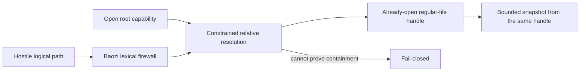

# Native Filesystem Bound-Handle Admission

**Historical decision date:** 2026-07-10

**Historical decision:** Admit `cap-std` 4.0.2 as the capability backend for the
`baozi-io/fs-candidate` implementation in
U3 and exact direct `rustix` 1.1.4 solely as the source of Unix `OFlags::NONBLOCK`, subject to the
acceptance suite below. Baozi passes that flag through `cap_std::fs::OpenOptionsExt`; it does not use
a numeric flag, a documentation-hidden transitive API, or `cap-fs-ext`. This admits dependencies and
an implementation direction; it does not claim the current Baozi adapter already has bound-handle
behavior. Runtime candidate code is limited to `x86_64-unknown-linux-gnu`,
`x86_64-pc-windows-msvc`, and `aarch64-apple-darwin`. `x86_64-unknown-freebsd` remains in the exact
dependency audit and future implementation research only; its candidate adapter must fail closed.
Do not retain or fall back to `canonicalize + starts_with + File::open`.

## Current Pin Status (2026-10-30)

The root `Cargo.lock` now resolves `cap-std`, `cap-primitives`, and `cap-fs-ext` to 4.0.3.
`crates/baozi-xtask/src/native_fs/contract.rs` and its behavioral fixtures pin these exact versions
and checksums from that lockfile:

| Crate | Current version | Crates.io checksum |
| --- | --- | --- |
| `cap-std` | 4.0.3 | `c1ec78e242cfa2cfe276807ac2ecc00315a6c97786977414bcd1c3963b6c91b8` |
| `cap-primitives` | 4.0.3 | `8b5f74729fd2f44701d1a8eb47e906cdb3ccd9ec0f02baad85a744b791940b18` |
| `cap-fs-ext` | 4.0.3 | `56ff379b70af8e08307a8f65e7040c7301cb4a572538ade16b4984f0da77847f` |

A local comparison of the checksum-qualified 4.0.2 and 4.0.3 registry sources found
`cap-primitives/src/windows/fs/dir_utils.rs` and `src/windows/fs/open_impl.rs` byte-identical.
Their 4.0.3 SHA-256 values are respectively
`1b23c6388cdef4d2a25eef5651ac4f86f266e400c52f78edb3b5d584bc484603` and
`08766478419324ae2e3dd0d31f995f6344860673ea71c66f1d8256a1163c19b5`.
The current closure therefore binds the retained Windows directory share-mode observation to
`cap-primitives@4.0.3`. This source comparison does not qualify other changed code by implication.

The source remains `registry+https://github.com/rust-lang/crates.io-index`. Direct `rustix` remains
pinned to 1.1.4 with the checksum recorded in the historical review below.

This update records local pin alignment and does not claim a new external security re-review of
4.0.3. The original decision and the remaining sections preserve the 2026-07-10 research: the
4.0.2 versions, checksums, upstream commits, platform findings, license/MSRV evidence, and Windows
smoke-test results remain historical evidence for 4.0.2.

Both resolved-closure JSON baselines were regenerated with the existing snapshot functions from
locked metadata for four native profiles and two portable byte-only profiles. The 65 xtask tests,
including the actual repository admission check, passed on 2026-10-30. These checks establish the
reviewed dependency closure; they do not establish additional runtime conformance or promote a
release target.

## Question

How can Baozi authorize an attacker-controlled relative asset reference and ensure the bytes parsed
come from that exact authorized filesystem object across Linux, Windows, macOS, and BSD targets?

The blocking property is object binding:



A resolved pathname is not sufficient because a directory entry can be replaced before a later open.

## Gap at the Historical Review

The existing prototype canonicalizes the root and candidate, compares path prefixes, and then opens
the returned path. That has a check/open time-of-check-to-time-of-use (TOCTOU) window. The U3 native
filesystem adapter must replace this behavior; adding more string normalization does not close the
race.

## Admission Criteria

| Gate | Requirement |
| --- | --- |
| Object binding | authorization and reads use the same opened object handle |
| Scope | resolution starts from an open directory capability, not current working directory |
| Root construction | public APIs accept only a Baozi-constructed opaque capability validated as a directory; Windows roots exclude `FILE_SHARE_DELETE` |
| Links | symlinks/reparse points cannot escape; replacement races fail or remain bound in-scope |
| File type | only regular files reach parsers |
| Nonblocking rejection | a FIFO, socket, device, or directory cannot block before its typed rejection |
| Baozi unsafe | Baozi-owned crates retain `forbid(unsafe_code)` |
| License | compatible with `MIT OR Apache-2.0` project distribution |
| MSRV | no higher than Rust 1.95 |
| Targets | exact runtime candidates `x86_64-unknown-linux-gnu`, `x86_64-pc-windows-msvc`, and `aarch64-apple-darwin`; exact dependency audit additionally includes `x86_64-unknown-freebsd`; portable byte builds remain isolated, and target support claims remain governed by ADR 0034 |
| Failure | unavailable security primitive fails closed with no path-based fallback |
| Maintenance | active upstream, advisories auditable, backend replaceable behind `AssetIo` |
| Resolved closure | exact reviewed versions, sources, checksums, target features, and security-sensitive transitive packages are machine-checked |

## Candidates

| Candidate | License / MSRV | Platforms | TOCTOU properties | Decision |
| --- | --- | --- | --- | --- |
| Standard library canonicalization | Rust distribution / project MSRV | broad | path check and later open are separate; replacement remains possible | reject |
| `rustix` 1.1.4 plus Baozi platform code | Apache-2.0 WITH LLVM-exception OR Apache-2.0 OR MIT / Rust 1.63 | Unix-like syscall surface; no complete Windows filesystem capability layer | can implement strong Unix opens, but requires custom resolver and Baozi-owned Windows unsafe/native calls | reject for canonical implementation |
| `cap-std` 4.0.2 | Apache-2.0 WITH LLVM-exception OR Apache-2.0 OR MIT / Rust 1.70 | Linux, macOS, Windows, FreeBSD and more | directory capability, constrained relative opens, manual component/link handling fallback | admit |
| Linux-only `openat2` wrapper | dependency-specific | Linux only | strongest direct Linux flag control | reject as cross-platform canonical backend; useful as implementation evidence |

`cap-std` adds a security-sensitive dependency, but it removes substantially more project-owned
platform and unsafe code than it adds. This research did not modify Baozi's main lockfile. U3 must
lock and machine-check `cap-std` 4.0.2, `cap-primitives` 4.0.2, direct `rustix` 1.1.4, their reviewed
crates.io checksums, enabled target features, sources, and the complete resolved dependency closure.
Any update changing path resolution, open flags, special-file behavior, unsafe scope, MSRV, license,
target behavior, or Windows native calls requires re-admission.

Rejecting `rustix` as the backend does not reject its safe flag vocabulary. `cap-std` exposes Unix
custom open flags but not a stable first-class nonblocking setter. U3 therefore promotes exact
`rustix` 1.1.4 to a direct target-specific dependency only for `OFlags::NONBLOCK`. This avoids a
platform numeric constant and avoids depending on `cap-primitives`' documentation-hidden
`_cap_fs_ext_nonblock` hook. Its exact source, checksum, enabled `std`/`fs` features, and transitive
effects are part of the same machine-checked admission closure.

The packaged crate records upstream commit `c4caf5caaa7e93828a2e4a4cdba1dd0171e45717`.

The manifest-level admission is exact:

| Package edge | Target condition | Version requirement | Enabled features |
| --- | --- | --- | --- |
| direct `cap-std` | exact Linux, Windows MSVC, Apple ARM64, and FreeBSD audit triples | `=4.0.2` | `default-features = false`; no optional crate features |
| transitive `cap-primitives` | target-filtered through `cap-std` | resolved exactly to `4.0.2` by the lockfile and admission checker | only features reachable from the admitted `cap-std` edge |
| direct `rustix` | exact Linux, Apple ARM64, and FreeBSD audit triples only | `=1.1.4` | `default-features = false`, `features = ["std", "fs"]` |

No target outside the four exact dependency-audit triples resolves these edges from `baozi-io`.
The FreeBSD edge is resolved for supply-chain review but does not enable runtime code. Windows does
not gain a direct `rustix` dependency, and byte-only WebAssembly graphs contain none of the three
packages through the native-filesystem feature path. The checker compares target-filtered normal and
build dependency reachability rather than only searching the lockfile package union.
Every admitted predicate binds `target_abi = ""`; in particular, GNU x32 does not share the Linux
runtime candidate or dependency-audit edge.

The reviewed tag resolves to commit `715e4ed607ae9a93c7446b0fa63296f7898831c2`. Source inspection
and a Windows smoke spike are evidence for admission. U3 must still run the complete race/reparse
matrix before promotion and may not add or describe release `native-fs` as conforming before that gate.

The reviewed Windows path includes `unsafe` inside `cap-primitives`, notably the relative
`NtCreateFile` wrapper and Windows open implementation. This code is outside Baozi-owned crates but
remains in Baozi's trusted computing base. U3 must record the relevant unsafe/native files, run the
repository advisory/license/source checks over the final resolved graph, and fail if the graph differs
from the reviewed closure. A top-level `cap-std = "4.0.2"` requirement alone is not an admission
control because `cap-std` declares `cap-primitives` with a compatible-version requirement.

| Layer | Responsibility after admission |
| --- | --- |
| `cap-std` 4.0.2 | capability-rooted open, platform link resolution, already-open object handle |
| direct `rustix` 1.1.4 | typed Unix `OFlags::NONBLOCK` value only; no Baozi-owned path resolver or syscall layer |
| Baozi `baozi-io` adapter | logical-path firewall, regular-file policy, typed errors, feature/target gate |
| Baozi import session | authorization ordering, immutable snapshot, identity cache, limits/evidence |
| Host | chooses trusted root/custom IO, aggregate concurrency, process isolation, mount policy |

## Platform Findings

### Linux

Linux `openat2` accepts a directory fd and resolution policy in the same syscall. `RESOLVE_BENEATH`
rejects resolution outside that directory. `RESOLVE_NO_MAGICLINKS` blocks `/proc`-style magic links;
the kernel can return `EAGAIN` when it cannot prove containment under a race, which must be retried a
bounded number of times or returned as failure. `openat2` is available since Linux 5.6.

`cap-std` 4.0.2 uses `openat2` on Linux 5.6+ and a component-at-a-time handle algorithm otherwise.
The reviewed implementation requests `RESOLVE_BENEATH | RESOLVE_NO_MAGICLINKS`, retries `EAGAIN` at
most four times, then uses its secure manual resolver. The admitted Baozi behavior is capability
containment, not a promise that one particular fast syscall is always used. There is no fallback to
ambient `File::open`.

Linux acceptance:

- root is an open directory capability
- absolute and escaping references fail
- in-root relative symlinks may work; absolute, magic, and escaping links fail
- Baozi charges a conservative worst-case resolution-work amount before the backend call because the
  exact count of the backend's bounded internal retries is not observable
- the final capability-relative open uses `O_RDONLY | O_NONBLOCK`; the returned handle is checked
  as a regular file and read directly
- a FIFO, socket, device, or directory returns a typed failure by deadline even when no FIFO writer
  exists
- `metadata(path)`/`stat(path)` followed by `open(path)` is forbidden because it both restores a
  replacement race and can block on the replacement before validation
- bind mounts beneath a host-authorized root are host authority unless a later policy adds
  `RESOLVE_NO_XDEV`

### Windows

`CreateFileW(FILE_FLAG_OPEN_REPARSE_POINT)` can open the final reparse point, and
`GetFinalPathNameByHandleW` can report a resolved handle path. However, "open by path, compare final
strings, reopen by path" is not admitted: the reopen restores the race, and normalized final-path
queries have SMB/permission caveats.

The reviewed `cap-std` 4.0.2 source itself implements Windows relative handle opens with
`NtCreateFile` and `OBJECT_ATTRIBUTES.RootDirectory`; it is not a Baozi `windows-sys` adapter design
that remains to be written. Its manual resolver retains directory handles and its relative open maps
`FILE_FLAG_OPEN_REPARSE_POINT` to `FILE_OPEN_REPARSE_POINT`. Microsoft documents that `NtCreateFile`
in user mode can open a path relative to the directory represented by `RootDirectory`.

Baozi will call the safe `cap-std` API privately. Baozi does not duplicate these native calls. Baozi
still owns the logical-path firewall, regular-file requirement, feature/target gating, typed errors,
session snapshot, and platform adversarial tests. If the upstream behavior cannot pass those tests,
the dependency admission is revoked rather than patched with a path-string reopen.

`cap-std::fs::Dir::from_std_file` documents an additional Windows precondition: the supplied
directory must have been opened without `FILE_SHARE_DELETE`. `cap-std` enforces that share mode when
it opens ambient roots and descendant directories, but a Baozi API accepting an arbitrary
`std::fs::File` could not prove the precondition. The canonical public API therefore uses a
Baozi-constructed opaque `NativeDirectoryCapability`. Baozi validates that it is a directory and, on
Windows, opens it without `FILE_SHARE_DELETE`; unverifiable raw handles and `std::fs::File` values are
not admitted.

Baozi still applies a lexical firewall before the capability backend. It rejects:

- drive-qualified and drive-relative paths, UNC paths, and absolute paths
- `\\?\`, `\\.\`, `\??\`, `\Device\`, and `GLOBALROOT` namespace forms
- colon/alternate-data-stream syntax
- NUL and control characters
- `CON`, `PRN`, `AUX`, `NUL`, `COM0`-`COM9`, superscript digit aliases, and `LPT0`-`LPT9`, including
  extensions and case/space aliases
- components ending in dot or space

Windows acceptance includes symlink, junction, mount-point/reparse, case alias, 8.3 alias where the
test volume supports it, and concurrent replacement tests. A case or 8.3 alias may either return a
typed rejection or open the already-authorized regular file beneath the retained root. It must never
select out-of-scope bytes, turn a device or reparse object into parser input, authorize through a
final-path string, or trigger a pathname reopen. If relative native opens or reparse inspection return
`ERROR_NOT_SUPPORTED` for a filesystem/driver, Baozi fails closed.

Regular-file validation on Windows reads metadata from the exact handle returned by the relative
native open. A path metadata query cannot authorize or classify a later open. Directories, devices,
pipes, and unresolved reparse objects return typed failures without a pathname reopen.

### macOS and Future POSIX/BSD Candidates

POSIX `openat` binds one relative lookup to a directory fd, and `O_NOFOLLOW` protects the final
component only. macOS has no `openat2` equivalent that applies a beneath policy to an entire path.
A safe portable strategy opens one component at a time relative to retained directory handles,
inspects links without following them, and handles link destinations inside the root capability.

`realpath` is useful for display or diagnostics but is not authorization: a subsequent path open can
name a replacement. `fstatat` is also not enough if code later reopens by name; the admitted result is
the already-open handle.

The FreeBSD details below record future runtime-candidate requirements, not current runtime support.
FreeBSD 13 introduced `O_RESOLVE_BENEATH`, but its `..` behavior does not satisfy `cap-std`'s
containment expectation. `cap-std` performs a runtime semantic check and uses
`O_RESOLVE_BENEATH` only when that check succeeds, normally on FreeBSD 14 and later; otherwise it
uses its capability handle walk. The older `O_BENEATH` design is never admitted as proof. On macOS,
`cap-std` uses the portable handle-walk path.

macOS/BSD acceptance:

- each lookup is a single component relative to a retained directory handle
- a symlink destination is resolved inside the capability root with a bounded link count
- execute/search permission failures are errors rather than ambient-path fallbacks
- concurrent renames cannot substitute the object represented by a retained handle
- the final open uses `O_RDONLY | O_NONBLOCK`, and its descriptor is checked and read without a
  pathname metadata preflight or reopen
- FIFO, socket, device, and directory rejection completes within a test deadline

## API Consequences for U3

The canonical native adapter follows these ownership rules without exposing `cap-std` types through
Baozi's public facade:

- Baozi defines opaque `NativeDirectoryCapability`; its public path constructor opens and validates
  a directory, and `FileSystemAssetIo::from_capability` accepts only that type.
- Public native APIs do not implement conversions from raw descriptors, raw Windows handles,
  `std::fs::File`, or `cap_std::fs::Dir`. A future preopened-handle API needs separate admission.
- `NativeDirectoryCapability::open_ambient` is explicit ambient host setup and completes capability
  construction before hostile references are processed; facade path helpers may delegate to it.
- `AssetScope` does not expose a "resolved secure `PathBuf`" API.
- `AssetIo::open` returns the authorized open object; the session reads and snapshots it once.
- On Unix-like targets, the adapter builds `cap_std::fs::OpenOptions` for
  `O_RDONLY | O_NONBLOCK`, sourcing `OFlags::NONBLOCK` from direct `rustix` 1.1.4, opens relative to
  the capability, and validates regular-file metadata on that returned handle. Windows performs the
  same-handle validation after its native relative open.
- The adapter never performs path metadata followed by open, never reopens a validated path, and
  never uses numeric native flags, documentation-hidden dependency APIs, or `cap-fs-ext`.
- `exists` cannot be used for authorization and should be removed from the canonical session path.
- Allowlisted roots are allowlisted directory capabilities, not canonical path prefixes.
- A custom resolver returns immutable bytes or an authorized opener plus stable identity, not a path
  for Baozi to reopen.
- `cap-std` remains private to `baozi-io` and is enabled only by `fs-candidate`/facade
  `native-fs-candidate`; release `fs`/`native-fs` features remain absent before promotion.
- Unsupported targets expose memory/custom IO and fail closed for the native adapter.

## Executable Acceptance Matrix

| Area | Required cases |
| --- | --- |
| Lexical | empty, `.`, `..`, escape, absolute, repeated separators, NUL/control, overlong path |
| Linux | in-root and escaping symlinks, absolute symlink, `/proc/self/fd` magic link, directory swap, final-file swap, exact retry/work limit |
| Windows | drive/UNC/device/NT namespaces, ADS, reserved names with extensions/case/trailing aliases, case and 8.3 alias two-state oracle, symlink, junction, mount-point/unknown reparse, reparse swap, final-file swap |
| macOS | in-root/escaping symlink, multi-link chain, directory rename/swap, final-file swap, search-permission failure |
| Future FreeBSD candidate | FreeBSD 13 incompatible `..` behavior, FreeBSD 14+ runtime `O_RESOLVE_BENEATH` acceptance, forced capability-walk fallback, symlink escape, directory/final-file swap before any runtime-candidate proposal |
| Unix special files | Current Linux/macOS candidates reject FIFO-without-writer by deadline and reject socket/device/directory handles after the capability-relative `O_NONBLOCK` open; a future FreeBSD candidate must pass the same gate |
| Object type and availability | regular file accepted; directory, FIFO/socket/device/reparse object returns a typed failure from same-handle validation; FIFO without a writer completes before the platform test deadline |
| Root lifetime | replacing the textual root after scope construction does not change the held root capability |
| Root construction | non-directory roots fail; raw/std handles cannot enter the public API; Windows roots and descendants exclude `FILE_SHARE_DELETE` |
| Read binding | successful race iterations read the identity of the returned handle, never a path reopened later |
| Failure | unsupported backend error is typed and performs no weaker open |
| Features | `cap-std`, `cap-primitives`, and direct `rustix` absent from `wasm32-unknown-unknown` and `wasm32-wasip1` byte-only dependency trees |
| Dependency closure | target-filtered normal/build closures for Linux, Windows MSVC, macOS, and FreeBSD match the committed package versions, sources, checksums, and features |

Race tests should run many bounded iterations with a cooperating replacer and assert a two-state
oracle: either a permitted object handle is returned or the open fails. Observing out-of-scope bytes
is always a test failure. Platform tests that require symlink privileges may skip only with explicit
evidence; CI must have at least one authoritative runner where they execute.

### Current Bounded Replacement Fixtures (2026-10-31)

[`fs.rs`](../../crates/baozi-io/src/fs.rs) now exercises concurrent final-file, intermediate-directory, and file-symlink
replacement in 64 fixed rounds each. Objects are fully written before racing; the reader retains
an opened handle until replacement completes, then accepts only complete authorized bytes or an
open error. Stable positive and escaping-path controls run between rounds. Windows directory
replacement uses a real junction. Errors 32 for a held directory and 5 for a held descendant may
defer the exchange only until handle release; the same exchange must then succeed. A deterministic
held-child control requires one of those exact codes before release and immediate rename success
afterward. This distinction was confirmed in a controlled local Win32 fixture after the race
exposed error 5.
The existing deterministic same-handle test remains the separate identity assertion.
Coordination timeouts detect a stalled protocol but cannot interrupt a hung OS open/read.

Unix fixtures additionally check a multi-link relative chain containing an in-root parent step,
then reject an escaping final-link replacement. Linux checks a real `/proc/self/fd` magic link,
whose outside contents are first verified through a host read. These fixtures improve the
executable matrix without proving every thread schedule or backend retry/fallback path.

A Unix search-permission fixture now removes execute/search permission from an intermediate
directory, verifies actual host `PermissionDenied`, and requires the capability open to return
the same typed class. It restores the permissions before asserting and rechecks successful reads.
The fixture requires an unprivileged runner; a privileged bypass fails setup instead of skipping.
It executed on Linux under UID 1000. A Windows fixture verifies real lower/upper-case host aliases
before requiring capability reads to return the authorized in-root contents or a typed open error;
the original spelling must open successfully. Windows runtime and repository candidate suites
executed this fixture. The local F: fixture additionally produced the real 8.3 alias
`LONGAU~1.BIN`. A small native consumer read identical authorized bytes through both host spellings,
opened the original name through `FileSystemAssetIo`, and required the alias to return
`PathErrorCode::ShortNameAlias` before backend IO. This is one executed volume case; it does not
qualify every Windows volume or hosted runner. Actual Apple ARM64 execution, including the
permission case, Windows volume-mount reparse points, and the remaining backend retry/fallback
evidence still precede complete promotion. Candidate membership and release registration remain
distinct.

An actual unknown-tag probe then exposed a missing runtime check: the capability backend could
return an unresolved file handle for tag `0x42`, and its metadata still reported a regular file.
Host `std::fs::read` rejected that same object with Windows error 1920. Runtime IO now inspects
`FILE_ATTRIBUTE_REPARSE_POINT` on the returned handle before accepting regular-file metadata,
sharing the predicate already needed by repository capture. It returns `InspectObject` with
`NonRegularFile(SymlinkOrReparsePoint)` without reading or reopening the payload. No dependency,
resolver, raw-handle API, or native unsafe boundary is added.

The maintained Windows fixture uses `FSCTL_SET_REPARSE_POINT` and `FSCTL_GET_REPARSE_POINT` to
verify the actual tag/GUID for root and nested file objects (`0x42`) and an in-root directory
(`0x10000042`). Both unresolved file objects must receive the exact typed rejection. Ordinary
file reads remain positive controls; the ordinary child of the tagged directory follows the
authorized-bytes-or-open-error oracle. A directory itself never becomes parser input. These
nonredirecting tags do not establish behavior for every filter driver or volume-mount reparse.
The fixture follows Microsoft's [GUID data-buffer contract](https://learn.microsoft.com/en-us/windows/win32/api/winnt/ns-winnt-reparse_guid_data_buffer)
and [reparse file attribute](https://learn.microsoft.com/en-us/windows/win32/fileio/file-attribute-constants).
A separate local `SetVolumeMountPointW` attempt against a new, verified-empty directory under
`target/review/` returned Windows `ERROR_ACCESS_DENIED` (5). No mount was created or existing
volume mapping changed. This is an actual fixture-setup limitation, not adapter rejection or
volume-mount acceptance; the retained result is `target/review/h-windows-volume-fixture.json`.

The current-source Linux Rust 1.95.0 IO test executable subsequently passed all **62/62** cases in
its ordinary environment and in each child-local `openat2` error state: `ENOSYS`, `EPERM`, and
persistent `EAGAIN`. A temporary seccomp fixture first verifies the actual syscall result, then
executes the same complete binary with one test thread; it affects only that child and allows
other syscalls. All four modes ran without skips, including actual link/permission/race and Unix
repository cases. This demonstrates fallback behavior without establishing an exact retry count,
deadline, or every platform's work bound. Build selection and all four logs are retained as
`target/review/a2-native-fallback-*.log` and `a2-native-fallback-build.jsonl`. It is local
qualification evidence, not a newly maintained resolver or hosted CI result.

## Residual Risks

| Risk | Impact | Treatment |
| --- | --- | --- |
| `cap-std` implementation defect | scope escape | security-sensitive upgrade review, platform race suite, advisory monitoring |
| Kernel/filesystem/driver defect | scope escape or inconsistent error | outside library guarantee; supported target tests and fail closed on unsupported operations |
| Special file blocks before validation | import hangs before parser limits apply | capability-relative `O_NONBLOCK` open, same-handle type validation, and deadline tests |
| Malicious in-process `AssetIo` | arbitrary host access or bytes | trusted-code boundary; use process isolation for adversarial code |
| Writable authorized root | attacker changes permitted content | immutable per-session snapshot; host should use read-only/private scope |
| Hard link shares an inode with another directory | confidentiality expectation mismatch | directory entry is authorized; use immutable bundle for ownership semantics |
| Mount beneath authorized root | grants content selected by host namespace | host authority; optional no-cross-device policy can be proposed later |
| OOM/abort while snapshotting | process availability | preflight/read limits reduce risk but hard guarantee requires subprocess |

## Historical Verification Commands Used

```powershell
cargo search cap-std --limit 3
cargo info cap-std
cargo info rustix
Get-FileHash -Algorithm SHA256 $env:USERPROFILE\.cargo\registry\cache\index.crates.io-1949cf8c6b5b557f\rustix-1.1.4.crate
curl.exe -L https://man7.org/linux/man-pages/man2/openat2.2.html
curl.exe -L https://learn.microsoft.com/en-us/windows-hardware/drivers/ddi/wdm/nf-wdm-zwcreatefile
curl.exe -L https://learn.microsoft.com/en-us/windows/win32/api/fileapi/nf-fileapi-createfilew
curl.exe -L https://learn.microsoft.com/en-us/windows/win32/api/fileapi/nf-fileapi-getfinalpathnamebyhandlew
curl.exe -L 'https://man.freebsd.org/cgi/man.cgi?query=open&sektion=2&format=html'
curl.exe -L https://developer.apple.com/library/archive/documentation/System/Conceptual/ManPages_iPhoneOS/man2/open.2.html
git ls-remote --tags https://github.com/bytecodealliance/cap-std.git refs/tags/cap-std-v4.0.2 refs/tags/cap-std-v4.0.2^{}
cargo test --manifest-path $env:TEMP\baozi-cap-std-admission-20260710\Cargo.toml -- --nocapture
cargo +1.95.0 test --locked --manifest-path $env:TEMP\baozi-cap-std-admission-20260710\Cargo.toml -- --nocapture
```

Observed dependency metadata and reviewed crates.io package checksums from 2026-07-10:

| Crate | Reviewed version | Crates.io checksum | License | Upstream MSRV evidence |
| --- | --- | --- | --- | --- |
| `cap-std` | 4.0.2 | `7281235d6e96d3544ca18bba9049be92f4190f8d923e3caef1b5f66cfa752608` | Apache-2.0 WITH LLVM-exception OR Apache-2.0 OR MIT | workspace CI floor 1.70 |
| `cap-primitives` | 4.0.2 | `cdadbd7c002d3a484b35243669abdae85a0ebaded5a61117169dc3400f9a7ff0` | Apache-2.0 WITH LLVM-exception OR Apache-2.0 OR MIT | workspace CI floor 1.70 |
| `rustix` | 1.1.4 | `b6fe4565b9518b83ef4f91bb47ce29620ca828bd32cb7e408f0062e9930ba190` | Apache-2.0 WITH LLVM-exception OR Apache-2.0 OR MIT | 1.63 |

The isolated Windows MSVC spike pinned `cap-std = "=4.0.2"`. Both stable Rust and Rust 1.95.0
compiled it successfully. Four behavior assertions executed successfully: an in-root regular file
opened, parent traversal failed, `NUL.txt` failed, and a file symlink to an outside sibling failed.
The open-root rename case was skipped because the current filesystem refused to rename an open root;
it is not counted as evidence. Junction, mount-point reparse, 8.3 alias, and concurrent replacement
tests remain mandatory U3 gates.

No dependency was added during this research. U3 owns the manifest and lockfile change after tests are
in place. The U3 change must also commit a machine-readable resolved-closure baseline and a check that
rejects a version, source, checksum, or relevant feature mismatch before `native-fs` can conform.
Schema 2 of the baseline must keep `runtime_candidate_targets` (three exact triples),
`dependency_audit_profiles` (those three plus exact FreeBSD), and the empty
`release_registered_targets` set separate. It models target-filtered normal/build reachability rather
than treating the union in `Cargo.lock` as proof that each target enables the reviewed features.
Byte-only WebAssembly graphs are negative fixtures.

## Living Official Document Capture

The following canonical URLs were retrieved on 2026-07-10. Each identity records the exact final
response body after redirects; every final URL was identical to the displayed URL.

- [Linux `openat2(2)`](https://man7.org/linux/man-pages/man2/openat2.2.html) - 27,390 bytes;
  SHA-256 `4f90fcb01c70724c7435c5721037b0b499e7790c0c8a46fee137541220177a46`.
- [Microsoft `NtCreateFile` / `RootDirectory`](https://learn.microsoft.com/en-us/windows-hardware/drivers/ddi/wdm/nf-wdm-zwcreatefile) -
  79,043 bytes; SHA-256 `15d41b88cdc88163e645ef6ec8d20dcd7021d7669b0d27faed632429873f775a`.
- [Microsoft `CreateFileW` reparse behavior](https://learn.microsoft.com/en-us/windows/win32/api/fileapi/nf-fileapi-createfilew) -
  115,033 bytes; SHA-256 `d871c89b4d6a36ffda87a549812d11234687b6eee906f7cc61da4df99227c735`.
- [Microsoft `GetFinalPathNameByHandleW` caveats](https://learn.microsoft.com/en-us/windows/win32/api/fileapi/nf-fileapi-getfinalpathnamebyhandlew) -
  59,707 bytes; SHA-256 `90fcb3e96c37eb866504481d072a63f07b53db8f91081a5c42444173084fcf7c`.
- [Microsoft file names and namespaces](https://learn.microsoft.com/en-us/windows/win32/fileio/naming-a-file) -
  69,346 bytes; SHA-256 `45570ea2bef3ee3d7971156431c4c87312fd9e7e286c90bbce931db863dfa1d5`.
- [FreeBSD `openat(2)`](https://man.freebsd.org/cgi/man.cgi?query=open&sektion=2&format=html) -
  72,697 bytes; SHA-256 `e52a02d588a8e79cdc6a8d03bfe80ee8f16d5811b4c4f867e146f8f6acfb9100`.
- [Apple `open(2)`](https://developer.apple.com/library/archive/documentation/System/Conceptual/ManPages_iPhoneOS/man2/open.2.html) -
  22,495 bytes; SHA-256 `c2ec41ee07fc90bcb1deb3ec8a3487629538cf1e12e2b9a9e96daa6fe015e61a`.
- [POSIX `openat`](https://pubs.opengroup.org/onlinepubs/9799919799/functions/openat.html) -
  40,401 bytes; SHA-256 `57b770918aa3e0c25186972675df8c96da119cf4b973335ed4487405e260dc3a`.

## Primary Sources

- [Linux `openat2(2)`](https://man7.org/linux/man-pages/man2/openat2.2.html)
- [Microsoft `NtCreateFile` / `RootDirectory`](https://learn.microsoft.com/en-us/windows-hardware/drivers/ddi/wdm/nf-wdm-zwcreatefile)
- [Microsoft `CreateFileW` reparse behavior](https://learn.microsoft.com/en-us/windows/win32/api/fileapi/nf-fileapi-createfilew)
- [Microsoft `GetFinalPathNameByHandleW` caveats](https://learn.microsoft.com/en-us/windows/win32/api/fileapi/nf-fileapi-getfinalpathnamebyhandlew)
- [Microsoft file names and namespaces](https://learn.microsoft.com/en-us/windows/win32/fileio/naming-a-file)
- [FreeBSD `openat(2)`](https://man.freebsd.org/cgi/man.cgi?query=open&sektion=2&format=html)
- [Apple `open(2)`](https://developer.apple.com/library/archive/documentation/System/Conceptual/ManPages_iPhoneOS/man2/open.2.html)
- [POSIX `openat`](https://pubs.opengroup.org/onlinepubs/9799919799/functions/openat.html)
- [`cap-std` 4.0.2 source and design at the reviewed commit](https://github.com/bytecodealliance/cap-std/tree/715e4ed607ae9a93c7446b0fa63296f7898831c2)
- [`cap-std` 4.0.2 workspace license and MSRV](https://github.com/bytecodealliance/cap-std/blob/715e4ed607ae9a93c7446b0fa63296f7898831c2/Cargo.toml)
- [`cap-std` Linux `openat2` flags, retry bound, and manual fallback](https://github.com/bytecodealliance/cap-std/blob/715e4ed607ae9a93c7446b0fa63296f7898831c2/cap-primitives/src/rustix/linux/fs/open_impl.rs)
- [`cap-std` FreeBSD runtime semantics check](https://github.com/bytecodealliance/cap-std/blob/715e4ed607ae9a93c7446b0fa63296f7898831c2/cap-primitives/src/rustix/freebsd/fs/check.rs)
- [`cap-std::fs::Dir::from_std_file` Windows root-handle precondition](https://github.com/bytecodealliance/cap-std/blob/715e4ed607ae9a93c7446b0fa63296f7898831c2/cap-std/src/fs/dir.rs#L55-L64)
- [`cap-std` Windows relative `NtCreateFile` implementation at the reviewed commit](https://github.com/bytecodealliance/cap-std/blob/715e4ed607ae9a93c7446b0fa63296f7898831c2/cap-primitives/src/windows/fs/create_file_at_w.rs)
- [`rustix` 1.1.4 source at the packaged commit](https://github.com/bytecodealliance/rustix/tree/c4caf5caaa7e93828a2e4a4cdba1dd0171e45717)
