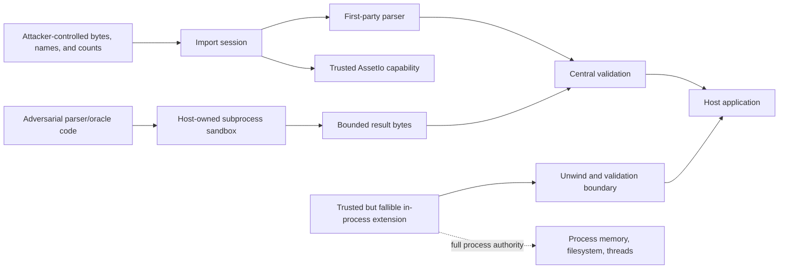

# Parser Threat Model

Baozi imports complex assets inside a caller's process. This document defines what the library
defends, which components are trusted, and when a host must use process isolation. ADR 0010 owns
object-bound asset IO; ADR 0014 owns parser, panic, unsafe, and FFI policy.

## Conformance Status

The objectives below are normative acceptance targets, not a blanket assertion that every current
tracer already conforms. Parser and byte-import claims require their executable parser, facade, and
resource gates. Object-bound native filesystem claims take effect only after U3 replaces the
path-based prototype and passes the platform-local admission matrix. Target-profile claims require
the U9 release matrix. ADR 0037 and ADR 0038 remain non-authoritative proposals regardless of this
document.

For first-party parsers, baseline safety admission precedes maturity. A known panic, abort, unbounded
attacker-controlled allocation/recursion, ambient-IO bypass, or invalid-success path is disabled and
unregistered, rejected/replaced, or process-isolated; it cannot stay in the first-party inventory or
`all-formats` as Experimental. Experimental may represent missing non-safety maturity evidence only.

## Security Objectives

A conforming implementation satisfies all of the following:

- Hostile asset bytes and references cannot bypass configured IO, work, graph, allocation, string,
  diagnostic, or path limits.
- A successful import or postprocess result satisfies the central Scene validation contract.
- Failures preserve bounded stage, detection, diagnostic, source, and resource evidence.
- First-party parsers do not panic, hang, silently accept invalid structure, or open ambient paths.
- Native filesystem helpers never parse bytes from an object different from the authorized handle.
- Native filesystem helpers reject directories and special files without blocking before parser
  limits or cancellation can run.
- Portable byte imports do not gain filesystem, network, subprocess, or plugin authority.

## Non-Goals

- Baozi is not a sandbox for Rust code, dynamic libraries, FFI, callbacks, custom `AssetIo`, or
  registered importers in the same process.
- Per-import limits do not cap the sum of concurrent imports.
- Cooperative cancellation is not a hard wall-clock, CPU, or RSS limit.
- A checksum proves accidental corruption detection, not publisher authenticity.
- Baozi does not defend against a malicious kernel, filesystem driver, allocator, or compromised host.
- Archive and export guarantees are not current behavior: ADR 0037 and ADR 0038 remain Proposed and
  non-authoritative until implementation tracers exist.

## Trust Boundaries



| Component | Trust classification | Baozi treatment |
| --- | --- | --- |
| Primary/sidecar bytes and embedded text | hostile data | bounded parse, checked arithmetic, fuzzing |
| Paths, URIs, archive-like names, metadata | hostile data | lexical validation, escaping, object-bound IO |
| Built-in parser code | trusted first-party code with bugs | safe Rust, review, tests, fuzz, central validation |
| Third-party Rust parser dependency | trusted computing base | dependency admission, wrapper, replacement trigger |
| Registered importer or custom `AssetIo` | trusted in-process extension | catch unwind where possible, validate result; no sandbox claim |
| Progress/tracing/cancellation callbacks | trusted host code | bounded invocation and panic containment where possible |
| FFI/native backend | high-risk trusted code | opt-in and isolated; subprocess for hostile workloads |
| Host application | policy authority | chooses roots, budgets, concurrency, credentials, and sandbox |

## Attacker Capabilities

An attacker may control every byte and declared value in an asset, including:

- signatures, headers, lengths, offsets, strides, counts, indices, and graph edges
- text encoding, long strings, Unicode aliases, control characters, and diagnostic content
- material, buffer, image, and include references
- repeated references to the same or aliasing identity
- sidecar presence, truncation, read errors, or mutation between backend opens
- symlink, junction, reparse, rename, and path replacement races when the attacker can write the
  filesystem scope
- directory entries that name or are replaced by FIFOs, sockets, devices, or other non-regular
  objects intended to block or bypass type validation
- compression/container-shaped bytes even before archive support exists
- timing intended to trigger cancellation, callback, or concurrent-session edge cases

The attacker may not inject new code into the trusted process under the library threat model. If they
can select a plugin, dynamic library, executable, or custom resolver implementation, that component
must run in a host sandbox.

## Assets at Risk

- process availability and bounded CPU/memory use
- filesystem and resolver authority
- confidentiality of host paths, panic messages, credentials, and unrelated assets
- integrity of the canonical Scene and downstream renderer/tool behavior
- deterministic build, CI, and asset-pipeline results
- auditability of format selection, recovery, and semantic loss

## Threat and Defense Matrix

| Threat | Example | Required defense | Residual boundary |
| --- | --- | --- | --- |
| Detection poisoning | one detector exhausts a shared probe | immutable bounded probe; per-detector inconclusive result; order tests | malicious registered code is trusted |
| Detect/parse drift | backend returns different primary bytes on reopen | primary opens once; detection and parse share snapshot | mutable memory after unsafe host violation |
| Path traversal | `../../secret`, drive/UNC/device path | logical rejection plus directory-capability open | malicious custom resolver |
| Check/open race | symlink/junction swapped after canonicalize | authorize and read the same open handle | kernel/driver defects |
| Special-file blocking | a checked regular path is replaced by a FIFO with no writer | capability-relative `O_RDONLY | O_NONBLOCK` open followed by regular-file validation on that same handle; typed rejection by deadline | kernel/driver defects |
| Repeated sidecar budget refund | optional MTL fails repeatedly | cached first snapshot/failure; monotonic attempted IO/work | host-wide concurrency |
| Decompression/decoded amplification | tiny encoded data expands hugely | preflight, streaming hard stop, decoded/work/peak-live limits | an unbounded opaque path is disabled/replaced or process-isolated before first-party admission |
| Count/stride overflow | count times element width wraps | checked arithmetic and fallible reservation | allocator abort outside predictable budget |
| Non-consuming loop | zero-width PLY records | progress or work-token invariant | none for first-party parser after tests/fuzz |
| Graph explosion | deep cycle or shared diamond | iterative O(nodes + edges) traversal; node/edge/depth/work limits | caller can launch many imports |
| Diagnostic amplification/leak | long hostile path echoed in every warning | count/byte cap, escaping, deduplication, root redaction | host telemetry sink policy |
| Third-party panic | parser dependency unwinds | facade unwind boundary, structured failure, regression | abort, UB, stack overflow not catchable |
| Invalid extension Scene | custom importer forges references | independent central validation and non-forgeable success stage | extension side effects already happened |
| FFI memory corruption | native decoder writes out of bounds | opt-in isolation; subprocess for hostile inputs | OS sandbox quality |
| Semantic corruption | plausible triangles from invalid topology | strict format checks, canonical invariants, golden/differential evidence | unsupported semantics fail or report recovery |
| Concurrent exhaustion | many imports each stay under limits | host queue, semaphore, CPU/RSS and deadline admission | deliberately host-owned |

## Filesystem Boundary

A conforming native path scope is Baozi-constructed opaque `NativeDirectoryCapability`, not a
canonical path prefix. Its path constructor validates the root as a directory, and the native
adapter's root-taking constructor accepts only this type; public APIs do not accept unverifiable raw
handles or `std::fs::File` values. The open operation returns the object handle used for bounded
reads. Unsupported secure-resolution behavior fails closed.

On Windows, Baozi creates root and descendant directory handles without `FILE_SHARE_DELETE`, as
required by the admitted capability backend's race contract. A handle whose share mode cannot be
verified does not enter the public native adapter.

Windows inputs receive additional rejection for drive-relative, UNC, Win32/NT namespace, alternate
stream, reserved device, and trailing dot/space aliases. On Unix-like systems, resolution is relative
to retained directory descriptors; `realpath` does not authorize a later open.

On Unix-like systems, the capability-relative open uses `O_RDONLY | O_NONBLOCK` before Baozi
validates regular-file metadata on the returned descriptor. On Windows, Baozi performs the equivalent
regular-file validation on the handle returned by the relative native open. No platform performs
path metadata followed by open or reopens a path after validation. Directories, FIFOs, sockets,
devices, pipes, and unresolved reparse objects produce typed failures; a FIFO with no writer must be
rejected within the platform test deadline.

An authorized writable root remains mutable. Session snapshots prevent later byte drift, but the host
must choose a root whose contents it is willing to disclose. A hard link or mount placed under that
root is host-authorized namespace content under the default model.

## Resource and Availability Boundary

Every import has independent limits for attempted/consumed work, live reservations, committed output,
assets, graph structure, attributes/topology, animation, strings/metadata, diagnostics, and relevant
backend decode allowances. Failed optional work is not refunded.

An opaque allowance is accounting evidence, not proof of containment. If Baozi cannot enforce a finite
input/work/memory envelope before a backend can amplify hostile data, that backend path fails
first-party admission regardless of maturity label. Once baseline bounds pass, sustained sanitizer,
RSS, oracle, target, or packaging history remains maturity evidence rather than an admission waiver.

The host owns aggregate admission:

```text
host maximum memory/CPU
  -> queue and concurrent import limit
  -> per-import ResourceLimits
  -> cooperative OperationControl
```

A network service handling untrusted users should isolate imports in worker processes with hard RSS,
CPU, wall-clock, file-descriptor, output, and process-count limits. Killing a worker is the only
reliable response to abort, deadlock, non-cooperative native code, or an allocator failure.

## In-Process Extension Boundary

Registered importers, custom IO, and callbacks are trusted at the code level. Baozi still treats their
outputs and errors defensively:

- catch unwindable panics at the facade boundary
- discard panic payloads and return bounded typed evidence
- validate every returned Scene and enforce resource limits independently
- do not expose constructors that forge validated stages
- snapshot dependency bytes and first terminal failures

These controls limit accidental faults. They do not revoke ambient filesystem/network access, prevent
threads, contain unsafe memory corruption, or roll back side effects.

## Process-Isolation Profile

When parser or oracle code is not trusted, the host should launch a separate executable with:

- no network and no inherited ambient handles except explicit read-only input/output channels
- read-only preopened input scope, private temporary storage if required, and no host root paths
- bounded length-prefixed protocol frames and validated schema versions
- CPU, memory, wall-clock, descriptor, process, and output quotas
- termination on timeout, protocol violation, or excess output
- no dynamic plugin discovery from the asset scope
- central Baozi validation of returned Scene data before use

An Assimp differential oracle follows this profile and only receives explicitly trusted fixtures. It
is not linked into Baozi and does not receive fuzz-generated arbitrary corpora.

## Archive and Export Boundary

Archive-shaped input is currently only hostile bytes to a format parser. Baozi does not currently
claim safe ZIP directory parsing, decompression, nested-container access, or extraction. ADR 0037
proposes those future controls and cannot be cited as current protection.

Baozi also has no current exporter transaction or semantic-loss guarantee. ADR 0038 is a proposal;
snapshot, serde, and cache output are not interchange export.

## Security Verification

- Exact-boundary unit tests for every resource limit and checked conversion.
- Facade tests for invalid extension output, unwind, failure evidence, and non-forgeable stages.
- Mutable/injected-failure IO tests for open-once and cached dependency identity.
- Platform-local symlink, junction, reparse, namespace, and concurrent replacement suites.
- Platform-local same-handle regular-file suites, including deadline-bounded FIFO-without-writer,
  socket, device, directory, pipe, and reparse rejection where applicable.
- Root-construction tests proving non-directory and unverifiable external handles cannot enter the
  public adapter, plus the Windows no-`FILE_SHARE_DELETE` lifetime contract.
- Malformed fixtures and parser-reachable fuzz targets for each public format.
- Linux sanitizer execution authority; Windows/macOS platform behavior jobs.
- Scale counters proving linear graph/validation behavior and bounded peak-live storage.
- Dependency license/advisory/feature audits for root and fuzz workspaces.
- A machine check of every security-sensitive resolved package version, source, checksum, and target
  feature against its admission record.
- Negative inventory/feature fixtures proving a baseline-unsafe parser cannot be registered as
  first-party, labeled Experimental, or reached through `all-formats`.

## Alternatives Considered

### Option A: Treat Rust memory safety as the complete threat model

Pros:

- Simple policy and low implementation cost.

Cons:

- Ignores panic, OOM, CPU, filesystem, semantic, FFI, and concurrency threats.
- Produces no answer for hostile in-process plugins.

Decision: rejected.

### Option B: Claim the facade sandboxes registered parsers

Pros:

- Attractive single-process integration story.

Cons:

- Technically false: native code shares process authority and memory.
- `catch_unwind` and output validation cannot contain abort, UB, or side effects.

Decision: rejected.

### Option C: Strong hostile-data boundary plus explicit trusted-code/process boundary

Pros:

- Makes enforceable library guarantees precise.
- Directs adversarial code to the only meaningful containment boundary.
- Assigns aggregate availability to the component that can enforce it.

Cons:

- Requires host engineering for worker isolation and admission.
- Does not offer a one-call sandbox promise.

Decision: chosen.

## Success Metrics

| Metric | Target | Measurement |
| --- | --- | --- |
| Hostile data | no panic, hang, invalid success, scope escape, or unbounded growth | tests, fuzz, scale gates |
| Admission before maturity | baseline-unsafe paths are absent from first-party inventory/all-formats; only evidence-incomplete safe paths may be Experimental | registry, feature-graph, and maturity negative fixtures |
| Object binding | replacement races return permitted handle or failure, never outside bytes | platform adversarial tests |
| Evidence | every failure retains bounded stage/detection/diagnostic/resource context | facade snapshots |
| Trust honesty | in-process APIs and docs make no sandbox claim | API/doc review |
| Aggregate availability | service deployment guidance requires host admission or workers | security review |
| Proposal honesty | archive/export proposals are not presented as implemented defenses | ADR review and docs review |

## Review Checklist

- Does every input-controlled loop consume input or spend a bounded work token?
- Are counts, byte sizes, offsets, and conversions checked before allocation or slicing?
- Is authorization bound to the exact opened object, with no path reopen?
- Can a directory entry become a FIFO or other special file and block before same-handle type
  validation, or does the admitted nonblocking open return a typed failure by deadline?
- Was the root capability constructed and directory-validated by Baozi, with the Windows share-mode
  precondition enforced rather than assumed?
- Can a repeated optional resource consume fresh IO while appearing free in statistics?
- Are graph node, edge, depth, and work limits independent?
- Are diagnostics bounded, escaped, deduplicated where needed, and host-root redacted?
- Can any extension construct a validated success or bypass central validation?
- Is an unsafe/FFI dependency opt-in, admitted, fuzzed, and replaceable?
- Would any known panic, abort, unbounded allocation/recursion, IO bypass, or invalid success remain
  reachable merely by assigning Experimental maturity? If so, the path has not passed admission.
- Does the complete resolved dependency closure still match the admitted versions, sources,
  checksums, features, unsafe scope, and advisory evidence?
- Who limits concurrent imports and enforces a hard timeout/RSS ceiling?
- Does documentation distinguish current behavior from Proposed archive/export work?

## Sources

- [ADR 0010: object-bound asset IO](../adr/0010-asset-io-virtual-filesystem-uri-archive-and-path-security.md)
- [ADR 0014: parser, unsafe, FFI, and panic boundaries](../adr/0014-parser-security-unsafe-ffi-and-panic-boundary-policy.md)
- [Rust `catch_unwind`](https://doc.rust-lang.org/std/panic/fn.catch_unwind.html)
- [Rust Reference: panic](https://doc.rust-lang.org/reference/panic.html)
